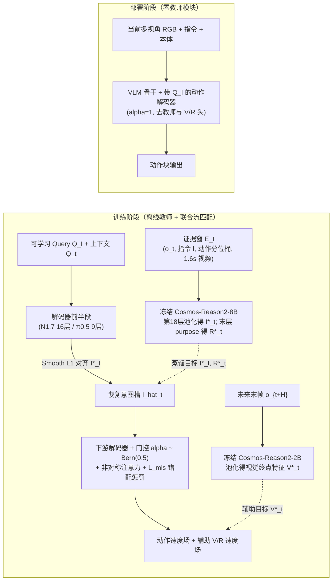

# Indi（Intention Distillation，arXiv:2608.23478）

**Indi**（*Act with Intent: Distilling Behavior Intent for Vision-Language-Action Models*，[arXiv:2608.23478v1](https://arxiv.org/abs/2608.23478)，[项目页](https://leesangoh.github.io/indi-project-page/)，[代码占位仓](https://github.com/Leesangoh/INDI)）由 POSTECH 提出，把教师 VLM 对示范执行片段的局部行为意图蒸馏进动作解码器中间态，而不把整套未来像素预测搬进在线推理。

## 一句话定义

**动作解码器缺的不是更多未来像素，而是可恢复的局部目标表征——Indi 用冻结教师 VLM 对示范执行窗口的语义理解作为蒸馏目标，在 VLA 动作解码器中段恢复行为意图并指导下游动作预测，推理期零教师模块。**

## 英文缩写速查

| 缩写 | 英文全称 | 简要说明 |
|------|----------|----------|
| Indi | Intention Distillation | 本文方法：将局部行为意图蒸馏进 VLA 动作解码器 |
| VLA | Vision-Language-Action | 视觉–语言–动作策略，本文在 GR00T-N1.7 与 π0.5 上验证 |
| VLM | Vision-Language Model | 视觉语言模型；训练期用冻结 Cosmos-Reason2-8B 担任教师 |
| BC | Behaviour Cloning | 仅用动作克隆损失监督动作输出的基线 |
| GR00T | Generalist Robot 00 Technology | NVIDIA 人形与通用机器人基础策略（本文用 N1.7） |

## 为什么重要

- **直指 BC 与未来帧监督的差异：** 仅靠 BC 只学会从当前观测映射到具体电机动作；而未来帧、潜观测或光流只监督“某一种未来视觉/运动实现”（同一局部目标可用多条轨迹达成，同一视觉前景也可能服务不同子目标）。
- **语义对齐 + 因果强制使用：** 论文实验证明，单纯扩大解码器自由隐变量（57.0%）或只加未来视觉/文本 grounding（60.0%）均低于纯动作基线（61.5%）；只有把中段意图槽对齐教师语义目标，并用门控 + 错配损失逼迫动作层读取它，性能才跃升至 85.5%。
- **推理部署几乎零负担：** 教师 VLM 与对齐损失头在推理时完全移除；在 1x B200 上 GR00T-N1.7 仅增 `+46.4M (+1.3%)` 参数与 `+5.4 ms` 延迟（56.1→61.5 ms），π0.5 仅增 `+23.1M (+0.64%)` 与 `+5.3 ms`（24.4→29.7 ms）。

## 核心原理

| 模块 | 实现要点（原文 §3 & Appendix C） | 关键参数 / 维度 |
|------|----------------------------------|-----------------|
| **机构** | 浦项工科大学（POSTECH） | — |
| **冻结教师构建目标** | `Cosmos-Reason2-8B` 读取 `E_t=(o_t, l, c_A(W_t), vid_{t:t+H})`（1.6s 执行窗：Bridge `H=8@5Hz`、RoboCasa/真机 `H=32@20Hz`，均采 16 帧；动作按 1%/99% 分位离散成 10 桶文本）生成 `<think>`+目的句 `S_t` | 第 18 层输入 span 隐状态池化 `K_I=8` 槽 `I*_t`（`d_T=4096`）；末层 `S_t` 池化 `K_R=8` 得 `R*_t`；`Cosmos-Reason2-2B` 编码末帧 `o_{t+H}` 得 `K_V=16/48` 视觉终点 `V*_t` |
| **解码器中段恢复与瓶颈** | 在动作解码器中插入可学习 intent query `Q_I`（GR00T-N1.7 接第 16/32 块，π0.5 接第 9/18 层），输出 `\hat{I}_t` 用 Smooth L1 对齐 `I*_t` | 引入视觉终点与目的句两条联合流匹配辅助分支 `Z^{V,\lambda}_t, Z^{R,\lambda}_t`（`\lambda_I=\lambda_V=\lambda_R=0.5`） |
| **强制下游读取机制** | 训练阶段采用非对称注意力掩码，并用二值上下文门控 `\alpha ~ Bernoulli(0.5)` 随机遮蔽下半段对原观测上下文的直连；外加意图错配铰链损失 `L_mis` | `m=0.05`，`\lambda_mis=0.1`；部署推理时去掉教师与对齐头，固定 `\alpha=1` |
| **开源状态** | 项目页链接 `<https://github.com/Leesangoh/INDI>` | 当前仓库仅含 `README.md`（`Code Coming Soon`），未公开源码与权重 |

### 流程总览

## 源码运行时序图

**不适用。** 项目页链接的官方仓库 [Leesangoh/INDI](https://github.com/Leesangoh/INDI) 截至核查日（2026-11-14）仅包含单一 `README.md`（标注 `"Code Coming Soon"`），无任何可运行的训练、教师目标提取或推理脚本；`Leesangoh/indi-project-page` 为静态项目展示网页，故不编造源码时序图，待官方代码发布后补充。

## 实验与评测

### 1. 仿真主基准（SimplerEnv-Bridge & RoboCasa Kitchen）

| 基准 / 设置 | 骨干 | 基线 | + 未来监督 | **+ Indi** | 关键子项 |
|-------------|------|------|------------|------------|----------|
| **SimplerEnv-Bridge**（3 轮 × 50 ep/任务） | GR00T-N1.7 | 64.3% | 68.0% | **84.7%** | Put Eggplant in Basket：36.0% → **96.0%** |
| **SimplerEnv-Bridge**（同上） | π0.5 | 52.3% | — | **58.8%** | Put Eggplant in Basket：24.7% → **40.7%** |
| **RoboCasa Kitchen**（24 任务 × 100 demo/task） | GR00T-N1.7 | 64.1% | 65.8% | **70.3%** | 接近论文引用 3000 demo/task GR00T 参考线（70.8%） |
| **RoboCasa Kitchen**（同上） | π0.5 | 34.9% | — | **41.4%** | — |

### 2. 真机双臂 SO-101（GR00T-N1.7，4 任务 × 100 demo，每条件 50 trials）

| 评估条件 | GR00T-N1.7 | **+ Indi** | 增益 |
|----------|------------|------------|------|
| ID clean | 71.0% | **76.0%** | +5.0 pp |
| Held-out objects | 62.0% | **68.0%** | +6.0 pp |
| Distractors | 53.0% | **62.0%** | +9.0 pp |
| **三条件总均值** | 62.0% | **68.7%** | **+6.7 pp** |

增益最显著的长程任务为 **Drawer Storage**（三条件均值 +10.7 pp，ID clean 24.0%→36.0%）与 **Cross-Bin Stacking**（三条件均值 +7.3 pp，ID clean 74.0%→80.0%）。

### 3. 机制消融与因果干预（SimplerEnv-Bridge 固定评测 run，Table 6 / Tables 9–19）

- **监督对象对照：** Base 61.5%、仅 Groundings（V+R）60.0%、自由 Latent 57.0%、Future sup 68.0%、仅 Intent 76.0%、Intent+V 81.0%、Intent+R 79.5%、**Full INDI 85.5%**。
- **核心设计消融：** 去掉信息瓶颈降至 70.0%，去掉 `L_mis` 降至 74.0%，两者皆去仅 65.5%；推理期人为置零 `\hat{I}_t`（即使 `\alpha=1`）会跌至 45.5%。
- **因果干预实验（Table 6b）：** 替换为同物体正确子任务的另一段意图仅微降至 84.5%；替换为跨目标子任务意图跌至 45.2%；注入高斯噪声跌至 1.0%；提前注入晚期/过早阶段意图跌至 5.5% / 7.3%。
- **教师能力与读出（Tables 14–19）：** 把教师换成较弱模型会拖累整条曲线（Qwen3.5-9B 仅 54.5%、Qwen3-VL-8B 为 73.5%、Cosmos-Reason2-8B 为 85.5%）；视觉终点读出在 Top-1/Top-10 检索达 72.6%/95.3%，`\hat{I}_t` 的物体 F1 为 0.693，高于纯文本 `\hat{R}_t` 的 0.314。

## 与其他工作对比

| 对比维度 | Indi（本文） | 未来帧 / WAM 监督 | 自由 Latent Plan（如 Play-LMP） |
|----------|--------------|------------------|-------------------------------|
| 监督目标 | 教师 VLM 对示范执行窗口抽出的局部行为意图 `I*_t` | 单一未来视觉实现（像素/潜表征/轨迹/光流） | 与策略联合学习的无外部语义锚定重构码 |
| 推理期开销 | 零教师模块；仅增加约 0.6%–1.3% 参数与 ~5 ms 前向 | 通常部署无未来解码头，与本方案相似 | 需保留 planner latent 采样或先验头 |
| 可解释性与干预 | 可解码出文本目的与未来终点图，跨目标替换直接改写行为 | 受限于具体像素/轨迹采样多样性 | 隐空间语义不易显式对齐或人类可读检查 |

## 结论

**给 VLA 动作解码器中段蒸馏“这段行为为了达成什么局部目标”，比堆叠未来像素/轨迹监督更直接有效，且推理期保留完整通用策略接口与微弱时延开销。**

1. **开源核查结论：** `Leesangoh/INDI` 当前仅有 `Code Coming Soon` 占位 README，暂无法直接用官方脚本复现训练和评估。
2. **蒸馏设计抓手：** 效果依赖“教师证据 span（含动作分位桶 + 执行视频）+ 中段瓶颈 + 门控与错配惩罚”三者配合；只加无约束隐变量（57.0%）或仅做终点 grounding（60.0%）会倒退。
3. **数据效率启示：** 在 RoboCasa 24 任务上，100 demo/task 配 Indi 即可达到论文引用 3000 demo/task 参考线附近（70.3% vs 70.8%），适合作为有限示范微调时的动作头增强方案参考。
4. **因果性校验方式：** 团队若复现实现，建议像论文一样验证“跨目标置换 `\hat{I}_t` 应显著掉成功率、同目标置换应基本无损”，防止解码器旁路掉意图通道。

## 工程实践

| 工程环节 | 论文实施细节（Appendix A / C） | 落地注意点 |
|----------|-------------------------------|------------|
| 教师离线缓存 | 先把每段 1.6s 执行窗口喂给冻结 `Cosmos-Reason2-8B` 生成 `I*_t, R*_t`，并由 `Cosmos-Reason2-2B` 提取 `V*_t` | 教师层特征需离线落盘缓存以控制 VLA 微调显存；论文在 3× B200 上训练约 19–29 小时 |
| 窗口与动作分位 | Bridge 用 `H=8`（5 Hz），RoboCasa 与 SO-101 用 `H=32`（20 Hz），均抽 16 帧；动作轨迹按第 1/99 分位归一化并分 10 桶输入教师 | 需要预先统计数据集动作分布分位数，并确认教师模型对短执行片段的物体指代稳定 |
| 解码器插入位置 | GR00T-N1.7 在第 16/32 块接入 `Q_I`；π0.5 在第 9/18 层接入 | 新骨干需挑选中深层而非最后一层输出，并确保下半段非对称掩码与 `\alpha ~ Bernoulli(0.5)` 正确配置 |
| 部署验证 | 部署前剥离教师与 `Z^V / Z^R` 对齐头，固定 `\alpha=1` | 因官方仓库尚未释放训练/部署脚本，工程复现需自行基于 GR00T-N1.7 或 π0.5 源码补全损失头与注意力掩码 |

## 局限与风险

- **代码与权重未开源：** `https://github.com/Leesangoh/INDI` 仅含 `Code Coming Soon` README，无法逐行核实超参细节或直接复用蒸馏缓存与模型权重。
- **教师能力形成性能天花板（Appendix D）：** 若教师 VLM 在当前片段发生物体/目标指代误判（如将较弱的 Qwen3.5-9B 替代 Cosmos-Reason2-8B，Bridge 会跌至 54.5%），动作解码器会直接拟合错误意图且无法凭物理执行结果自纠。
- **单窗确定性预测、缺乏跨步保持与人工可控性：** 当前对单步窗口确定性预测意图，既不跨多个 chunk 持续保持同一子目标，也不支持高层规划器或人类直接改写 `I_t` 转向。
- **仅使用成功示范单窗：** 尚未覆盖包含多阶段层次结构或失败恢复动作（recovery）的混合示范切分；真机评测范围限于双臂 SO-101 桌面任务，尚未涉及移动全身操作（loco-manipulation）。

## 关联页面

- [VLA](../methods/vla.md) — 解码器监督与基础策略主线
- [Isaac GR00T](./isaac-gr00t.md) — N1.7 骨干工程栈
- [π0.5](./paper-pi05-open-world-vla.md) — 第二测试骨干
- [Imitation Learning](../methods/imitation-learning.md) — 行为克隆与示范监督背景
- [Manipulation](../tasks/manipulation.md) — 桌面与厨房操作任务入口
- [ROS2SmolVLA](./paper-ros2smolvla.md) — 同专辑轻量工业 VLA 对照
- [开源 7 篇系统结构地图](../overview/open-source-7-papers-system-structure-technology-map.md) — 同专辑结构索引
- [M3](./paper-m3-modality-masking.md) — 训练期模态遮蔽方案
- [Imitator Game](./paper-imitator-game.md) — 面向功能意图替代的模仿视角
- [48ms WAM / 编排 10 篇地图](../overview/glancewam-vla-crew-10-papers-technology-map.md) — 同批次技术地图

## 参考来源

- [Indi 论文摘录](../../sources/papers/indi_arxiv_2608_23478.md) — 论文全文 `2608.23478v1` 精读与数据核对
- [项目页归档](../../sources/sites/indi-leesangoh.md) — 项目页展示资源与代码状态复核
- [Leesangoh/INDI 仓库归档](../../sources/repos/indi-leesangoh.md) — GitHub 仓库占位 README 核查
- [具身智能小站 7 篇盘点](../../sources/blogs/wechat_embodied_station_7_papers_vla_intent_space_2026-08-26.md)
- [具身智能小站 10 篇盘点](../../sources/blogs/wechat_embodied_station_10_papers_glancewam_vla_crew_2026-08-30.md)

## 推荐继续阅读

- [arXiv:2608.23478](https://arxiv.org/abs/2608.23478)
- [Indi 项目页](https://leesangoh.github.io/indi-project-page/)
- [Leesangoh/INDI（GitHub 占位仓）](https://github.com/Leesangoh/INDI)
