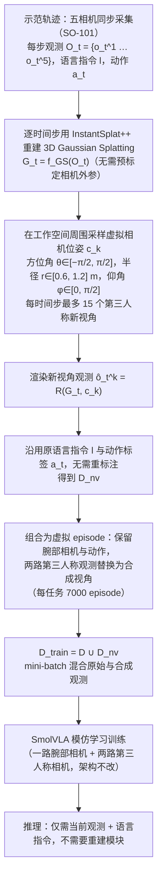

# InfiNoVA（arXiv:2609.27734）

**InfiNoVA: Infinite Novel View Augmentation for Viewpoint Invariant Robot Policies**（[项目页](https://infi-nova.github.io/)，[arXiv:2609.27734](https://arxiv.org/abs/2609.27734)）来自 [具身智能小站 · 13 篇盘点](../../sources/blogs/wechat_embodied_13_papers_forgetmimic_2026-09-24.md)（2026-09-24）。

## 一句话定义

**用时变 3D Gaussian 重建轨迹并渲染无限新视角，提升 VLA 对 **未见相机位姿** 的鲁棒性。**

## 英文缩写速查

| 缩写 | 英文全称 | 简要说明 |
|------|----------|----------|
| VLA | Vision-Language-Action | 视觉–语言–动作策略 |
| RL | Reinforcement Learning | 强化学习 |
| TO | Trajectory Optimization | 轨迹优化 |
| HITL | Human-in-the-Loop | 人在回路 |

## 为什么重要

- 多相机仍只能覆盖稀疏视角；策略对训练视角敏感是部署常见失败模式。
- 纳入 [13 篇技术地图](../overview/embodied-13-papers-technology-map.md) 阅读坐标。
- 开源结论（步骤 2.5，2026-09-24）：**待发布**。

## 流程总览

图依据：论文 §III-A–D 与 Fig. 1/2（多视角重建、新视角采样渲染、数据混合与 VLA 训练）。

## 核心机制

| 项 | 内容 |
|----|------|
| **arXiv** | [2609.27734](https://arxiv.org/abs/2609.27734) |
| **开源** | **待发布** |
| **要点** | 从演示轨迹建时变 3DGS，渲染 novel view 作为增强；不改策略架构的数据侧路径。 |
| **文内指标** | 四个真实操作任务上提高未见视角成功率（文内定性 + 任务级改进；逐项以 PDF 为准）。 |

## 源码运行时序图

**不适用**（截至 2026-09-24 项目页/论文未提供可运行官方代码；开源状态：**待发布**）。

## 实验与评测

- 四个真实操作任务上提高未见视角成功率（文内定性 + 任务级改进；逐项以 PDF 为准）。
- **读法：** 公众号归纳；逐项 baseline 与协议以 arXiv PDF 为准。

## 与其他工作对比

- 横向索引见 [13 篇技术地图](../overview/embodied-13-papers-technology-map.md)。

## 结论

**视角增强可独立于模型结构** — 复现时对齐 3DGS 重建质量与相机标定。

1. 开源边界：**待发布** — 以项目页/仓库实际链接为准（入库日 2026-09-24）。
2. 核心机制：从演示轨迹建时变 3DGS，渲染 novel view 作为增强；不改策略架构的数据侧路径。…
3. 部署前核对任务协议与硬件条件，勿直接横比公众号摘录数字。

## 关联页面

- [Vla](../methods/vla.md)
- [Manipulation](../tasks/manipulation.md)
- [Sim2Real](../concepts/sim2real.md)
- [Embodied 13 Papers Technology Map](../overview/embodied-13-papers-technology-map.md)

## 参考来源

- [13 篇盘点（公众号）](../../sources/blogs/wechat_embodied_13_papers_forgetmimic_2026-09-24.md)
- [InfiNoVA: Infinite Novel View Augmentation for Viewpoint Invariant Robot Policies](../../sources/papers/infinova_arxiv_2609_27734.md)
- [arXiv PDF](https://arxiv.org/pdf/2609.27734)：已通读方法部分（实验与附录以略读为准）：摘要、§I 引言、§III 方法（A–D）、§IV-A–D 实验与渲染对比（略读 §IV 其余部分）

## 推荐继续阅读

- [arXiv:2609.27734](https://arxiv.org/abs/2609.27734) — 原文
