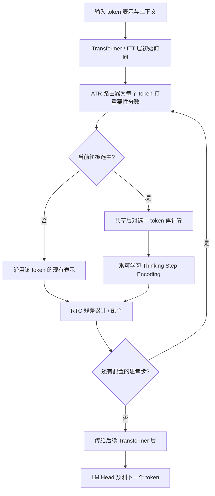

# Inner Thinking Transformer：用动态深度在隐藏状态中多想几步

*Inner Thinking Transformer: Leveraging Dynamic Depth Scaling to Foster Adaptive Internal Thinking*（**内部思考 Transformer：通过动态深度缩放实现自适应隐式推理**），Chen 等，中国科学院信息工程研究所 / 中国科学院大学 / 百度 / 北京师范大学，[arXiv:2502.13842v2](https://arxiv.org/pdf/2502.13842)，[ACL 2025 正式论文](https://aclanthology.org/2025.acl-long.1369/)。

## 一句话定义

**ITT 让 Transformer 在不增加主体模型参数量的情况下，对高重要性 token 重复执行共享层、积累各步隐藏状态修正，并允许推理时动态改变所需计算深度。** 这是语言模型内部的隐式推理，不是显式输出思维链，也不是已经验证的机器人闭环策略。

## 英文缩写速查

| 缩写 | 英文全称 | 简要说明 |
|------|----------|----------|
| ITT | Inner Thinking Transformer | 本文按 token 动态分配内部思考深度的架构 |
| ATR | Adaptive Token Routing | 基于隐藏状态重要性打分，选择需要额外计算的 token |
| RTC | Residual Thinking Connection | 累计共享层多轮变换结果以修正 token 表示 |
| TSE | Thinking Step Encoding | 可学习的不同思考步权重/编码 |
| PPL | Perplexity | 语言建模困惑度，越低越好 |
| FLOPs | Floating-Point Operations | 比较额外计算预算的计算量指标 |
| CoT | Chain-of-Thought | 显式输出推理文本，与 ITT 的层内计算不同 |

## 为什么重要

- **参数数目与推理计算量分开：** 参数不变也可提升有效计算深度，代价是部分 token 多轮前向与训练反传开销。
- **计算位置与计算次数都可调：** ATR 每一轮挑选 token，RTC 合并多轮结果，而非让所有 token 统一多跑几层。
- **迁移价值是架构启发：** 对 [VLA](../methods/vla.md) 等含 Transformer 的高层推理模块可能有研究价值，但论文没有 VLA、机器人操作或机载实时实验，不能推断可以提高机器人成功率。

## 核心信息

| 项 | 论文事实 |
|----|----------|
| 机构 | 中国科学院信息工程研究所、中国科学院大学、百度、北京师范大学 |
| 发表 | ACL 2025 Long Papers；DOI 10.18653/v1/2025.acl-long.1369 |
| 原文版本 | arXiv 2502.13842v2（2025-02-23） |
| 预训练 | RedPajama、50B tokens、8×A100 80GB；序列长度 4096（§4.1） |
| 规模 / 基线 | 162M、230M、466M；Vanilla Transformer、Loop、ITT |
| 更深计算 | 每隔一层可换为 ITT 层；循环/思考步配置为 2×、3×、4× |
| 代码状态 | 论文及 ACL 条目未提供 ITT 官方代码入口；所引用 Sheared-LLaMA 是第三方实验基础设施 |

## 核心机制

### 1. 共享参数下的内部思考（§3.1–3.2）

将一次或多次 Transformer 层变换视作一次隐表示的「思考步」；在某层内重复使用相同变换函数 f，逐步改善 token 的内部表示。

**RTC（式 4）** 对步骤 i 的变换输出乘以可学习的步编码 ϕ^(i)，再累计融合为当前状态；不是简单重复最后一步输出。**TSE** 帮助区分早期/晚期步骤贡献。

### 2. Adaptive Token Routing（§3.3）

- 先进行普通层计算，再由线性路由器针对每个 token 的隐藏状态计算重要性分数。
- 依据分数阈值/Top-K 选出一个子集，额外运行共享层；未选 token 保持此前状态。
- 每一思考步重新选择，并将选中 token 的加权贡献经 RTC 融合；推理可调整每一步的选择比例，在准确率与 FLOPs 间折中（表 2）。

### 流程总览

§3 图 3、式 4–7 与附录 A.1 算法 1 的简化模块数据流：

图为**论文方法图**；真实实现涉及 token 索引、KV cache 与路由容量，不能据图认定已有公开源码可运行。

## 实验与评测

| 对照（表 1） | 参数量 | FLOPs（表中口径） | 平均准确率 |
|--------------|-------:|-----------------:|-----------:|
| LLaMA2 风格 Transformer | 162M | 1.88 | 40.4 |
| ITT×4 | 162M | 3.29 | 42.1 |
| LLaMA2 风格 Transformer | 466M | 4.92 | 43.6 |

- **跨规模对比：** 162M ITT×4 的平均分是 466M dense 的约 **96.6%**（论文摘要写 96.5%），但比同规模 dense 使用更多 FLOPs，故不是「同计算量零成本提升」。
- **数据效率：** 图 4 显示达到 162M dense 对应效果只需约 56.8% 训练 tokens，论文称节省 43.2% 数据；这不等于训练 GPU 时数或费用下降 43.2%。
- **消融（表 3）：** ITT×4-162M 的评测 PPL 为 10.25；去 RTC 11.02；去 ATR 10.44；去 TSE 10.56。表格最后一个变化量标注为 +0.22，但与 10.56−10.25=+0.31 不一致；本页保留原始数值，并指出口径冲突。
- **推理弹性（表 2）：** 训练时 70%/70%/70% 的 token 选择比例对应 PPL 10.52、FLOPs 3.85；推理时使用 50%/50%/50% 时 PPL 10.47、FLOPs 3.29。该配置显示可调性，不保证所有输入/硬件都获得相同收益。

## 结论

**ITT 的价值在于把模型的固定深度改成 token 级可分配计算，但准确率收益必须和额外计算、训练显存与部署约束一起看。**

1. 比普通共享层循环更关键的是 **RTC 的逐步残差融合**（去除后的 PPL 增幅最大，表 3）。
2. **ATR 的主要工程价值还包括省 FLOPs**：不必为所有 token 做同样深的额外计算（§4.3）。
3. **162M ITT×4 ≈ 466M dense 的 96.5% 平均准确率**只在论文给定的语言评测与预算设置中成立，不能外推到具身策略。
4. **训练数据节省不等于算力节省**，部署必须对比实际吞吐、显存和最坏响应时间。
5. **当前只验证至 466M，缺乏开源 ITT 入口与机器人实验**；不应直接写成已部署的 VLA 方案。

## 工程实践与复现

- **适用研究位置：** 如果要研究 [Transformer](../concepts/transformer.md) 中的 token 路由/动态深度，可围绕同参数、同训练 token、同推理 FLOPs 做三组基线（dense / loop / ITT）；保留各自 PPL、准确率和单请求 P95 延迟。
- **机器人扩展需重新验证：** 可以用在 [VLA](../methods/vla.md) 的语义层作为研究假设，先测实际 token 形状、动作延迟/抖动及闭环成功率；与 [Action Chunking](../methods/action-chunking.md) 的时间维度解耦不是同一机制。
- **源码运行时序图：不适用。** 未找到可核对的 ITT 官方实现仓库或运行入口；附录算法 1 是论文伪代码，不能冒充实际训练/推理源码时序图。

## 局限与风险

- **范围：** 实验均为文本预训练和语言理解，最大 466M 参数；没有 VLA 或机器人真机结果（论文 Limitations）。
- **训练/反传开销：** 多轮 RTC 使训练阶段保存更多中间状态，可能增加内存与实现成本。
- **路由策略：** 训练使用固定的路由比例/调度设置，尽管逐 token 分数是自适应的；部署时变更路由预算是否在复杂输入上稳定仍需验证。
- **证据措辞：** 论文将模型的内隐变换比作思考步骤，这是方法命名和经验假设，并不等价于可观察、可证明的逐步逻辑证明。

## 关联页面

- [Transformer](../concepts/transformer.md) — ITT 共享的架构底座
- [位置编码](../concepts/positional-encoding.md) — 对照 token 位置编码与 ITT 的思考步编码
- [AIC：何时停止内部计算](./paper-aic-adaptive-internal-computation.md) — RL 中联合学习停止深度和动作，和 ITT 的语言 token 路由目标/训练方式不同
- [具身基础模型时延与泛化取舍](../concepts/embodied-fm-latency-generalization-tradeoff.md) — 迁移到具身前的成本判据
- [模型架构路线 Stage 5](../../roadmap/depth-model-architecture.md) — 在时延预算内研究动态深度
- [VLA](../methods/vla.md) / [Action Chunking](../methods/action-chunking.md) — 潜在应用场景与不同的时间尺度机制

## 参考来源

- [论文一手资料归档](../../sources/papers/inner-thinking-transformer_arxiv_2502_13842.md)
- [arXiv v2 PDF](https://arxiv.org/pdf/2502.13842)
- [ACL Anthology 正式发表页](https://aclanthology.org/2025.acl-long.1369/)（ACL 2025，DOI 10.18653/v1/2025.acl-long.1369）

## 推荐继续阅读

- [论文全文及附录](https://arxiv.org/pdf/2502.13842)
- [ACL Anthology](https://aclanthology.org/2025.acl-long.1369/)
