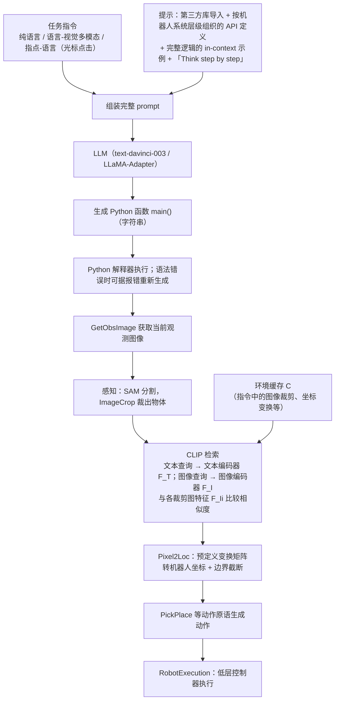

# Instruction2Act

**Instruction2Act**（[arXiv:2305.11176](https://arxiv.org/abs/2305.11176)）收录于 Lumina [Embodied-AI-Guide 微信专辑](../../wiki/overview/embodied-ai-guide-wechat-album-curator.md)。本页为独立详情节点；实验数字以原文为准。

## 流程总览

图依据：论文 §3.1–§3.3 / Fig.2、Fig.3

## 一句话定义

**把自然语言编译成带视觉 grounding 的短程序。**

## 英文缩写速查

| 缩写 | 英文全称 | 简要说明 |
|------|----------|----------|
| VLA | Vision-Language-Action | 视觉–语言–动作策略 |
| LLM | Large Language Model | 大语言模型 |
| IL | Imitation Learning | 模仿学习 |
| BC | Behavior Cloning | 行为克隆 |

## 核心信息

| 项 | 内容 |
|----|------|
| **机构** | — |
| **arXiv** | [2305.11176](https://arxiv.org/abs/2305.11176) |
| **开源** | 待核实 |

## 实验与评测

- **本页为索引级节点**（Lumina Embodied-AI-Guide 微信专辑）：正文固化定位与开源边界，**未转存原文实验表**。
- **回原文须核对的证据**：本页结论已点明「视觉 grounding 决定 API 调用是否正确」——回原文须核对**感知错误与代码错误的归因拆分**，否则单一成功率无法定位瓶颈在看错还是写错。
- **读法：** 先对齐本体、任务集与成功判定，再读任何数字；勿把专辑摘要当实验结论。

## 与其他工作对比

| 维度 | 读法 |
|------|------|
| **对照工作** | 与 Code-as-Policies 同属 code-as-policy 谱；本页结论另点明与 ASPIRE 对照「在线写代码 vs 预置技能库」两种取舍 |
| **横比口径** | code-as-policy 的成功率高度依赖可调 API 的粒度与覆盖面；API 集不同的两篇工作不可横比。 |
| **开源状态** | **待核实** — 复现前以项目页 / 官方仓实际链接为准 |

## 结论

Instruction2Act 与 CaP 同属 code-as-policy 谱。

- 视觉 grounding 决定 API 调用是否正确
- 与 ASPIRE 对照在线写代码 vs 技能库

## 源码运行时序图

**不适用**

## 关联页面

- [paper-pai-2209-07753-codeaspolicies](./paper-pai-2209-07753-codeaspolicies.md)
- [paper-voxposer](./paper-voxposer.md)
- [aspire](../methods/aspire.md)

## 参考来源

- [wechat_lumina_embodied_practice_part2_code_as_policy_2026-09-20.md](../../sources/blogs/wechat_lumina_embodied_practice_part2_code_as_policy_2026-09-20.md)
- [arXiv PDF](https://arxiv.org/pdf/2305.11176)：已通读方法部分（实验与附录以略读为准）：摘要、§1、§3 方法（3.1 LLM 驱动机器人、3.2 提示设计、3.3 指令模态管理）、§4 开头的实验设置

## 推荐继续阅读

- [arXiv:2305.11176](https://arxiv.org/abs/2305.11176)
