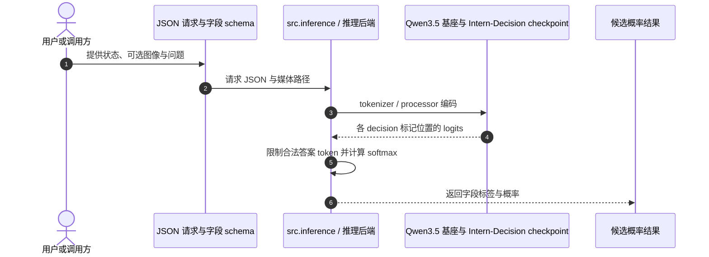

# Intern-Decision：用一次前向计算输出结构化决策

**Intern-Decision**（*Intern-Decision: Efficient Multimodal Decision Making with Autoregressive Masked Language Modeling*，[arXiv:2610.22131](https://arxiv.org/abs/2610.22131)，[官方代码与项目页](https://github.com/InternLM/Intern-Decision)）是上海人工智能实验室发布的一组多模态结构化决策模型。它将状态、可选图片和多个问题转成带候选概率的选择、评分或是非结果，而不是生成自由格式答案。

## 一句话定义

将多个有限候选决策嵌入完整 JSON 骨架，用一个因果前向计算预测每个字段的合法答案及概率。

## 英文缩写速查

| 缩写 | 英文全称 | 简要说明 |
| --- | --- | --- |
| LLM | Large Language Model | 语言主干负责读取上下文并预测结构化决策标记 |
| VLM | Vision-Language Model | 支持图片输入的视觉语言模型；本项目冻结视觉塔和投影层 |
| ECE | Expected Calibration Error | 置信度校准误差指标，依赖分箱与数据分布 |
| BF16 | Brain Floating Point 16 | 论文延迟测量使用的低精度浮点格式 |

## 为什么重要

- **把决策接口收窄到候选空间：** 输出是候选项或分数及其概率，便于环境或 agent 使用固定 schema 解析。
- **一次请求可问多个问题：** 多个字段在同一次因果前向中计算，减少逐字段调用带来的延迟。
- **能测概率质量而非只看选对没：** 仓库提供温度校准、Brier、ECE 和已知分布 pilot 工具，方便检查置信度是否可靠。
- **对机器人是上层决策组件的候选：** 可研究用于有限动作/选项筛选、任务状态判断或不确定性门控；它本身不是输出连续关节目标的机器人 VLA 或底层控制器。

## 核心原理

模型把一组问题、状态和可选图像组织进 assistant JSON 骨架，每个待预测字段放置一个 `<decision>` 标记。训练时标准 causal next-token 位置学习答案符号，答案只作为监督标签而不暴露在输入中；因此所有字段可以共用一次前向计算。

推理时不需要让模型续写任意长文本：实现读取标记位置 logits，只保留 schema 允许的答案 token，应用 softmax 并映射回原候选标签。问题和选项顺序须与输入数据保持一致。论文所述架构微调 Qwen3.5 语言主干，同时冻结视觉编码器和投影层。

| 项 | 内容 |
| --- | --- |
| 机构 | 上海人工智能实验室（Shanghai AI Lab） |
| 公开 checkpoint | 0.8B、2B、4B；训练配置另支持 9B dense 结构 |
| 代码许可 | 官方仓库为 Apache-2.0；权重许可按各模型卡确认 |

| 输入/输出 | 说明 |
| --- | --- |
| 输入 | 状态文本、可选图片，以及一个或多个带候选项的结构化问题 |
| 问题类型 | `choice`（选项选择）、`score`（有序评分）、`noul`（是/否） |
| 输出 | 每个字段的合法候选标签与对应概率 |
| 运行方式 | 所有字段在一次因果前向中评分，不依赖逐字段自由文本生成 |

## 流程总览

## 实验与评测

论文报告的结果应连同任务、硬件和基准协议一起读取：

| 设置 | Intern-Decision | 对比项 | 口径 |
| --- | ---: | ---: | --- |
| 七项准确率套件 | 4B 平均 90.02% | Jev v1.13.0：88.74% | 七项显示准确率的未加权平均 |
| 固定请求本地延迟 | 4B：44.16 ms；2B：33.28 ms；0.8B：33.98 ms | Jev：109.70 ms | RTX 4090、BF16、SDPA；289 输入 token、三个字段、单次前向 |
| 已知分布校准 pilot | 4B：Brier 0.550 / ECE 0.089 | Jev：0.595 / 0.130 | 96 条诊断样本；单独校准协议 |
| 置信度交接 | 82/111 → 97/111（73.87% → 87.39%） | 42 条不确定样本转交 Atria-Dawn-Preview | Jevbench-Hard；是外部模型路由系统结果 |

这些数字不是同一个 benchmark 的综合结论：准确率、请求延迟、分布校准和外部模型交接各有独立样本与定义。速度对比也只对应论文固定的请求形态和 RTX 4090 测量条件。

## 与其他工作对比

| 维度 | Intern-Decision（本文） | [Jev](../entities/typesafe-jev.md) | [Valen](../entities/valen.md) | [SayCan](../methods/saycan.md) |
|------|------|------|------|------|
| 决策形式 | JSON 骨架中的 `<decision>` 标记，一次因果前向输出 choice / score / noul 及概率 | schema 约束的类型安全多字段决策 + 校准概率，并行采样 | Choice / Noul / Score 概率输出 | LLM 生成子任务候选，价值函数估计可行性 |
| 模型与输入 | 微调 Qwen3.5 语言主干（0.8B / 2B / 4B），冻结视觉塔；文本 + 可选图片 | 早期访问 API，非结构化 state 输入 | Qwen3.5-2B + 共享决策头；文本 / 图 / 视频 | 语言模型 + 机器人技能价值函数 |
| 开放程度 | 代码 Apache-2.0，权重单独发布，训练数据未公开 | SDK / Skills MIT 开源，权重未公开 | 代码、权重、100k 数据已开源 | 本库页为方法页 |
| 机器人定位 | 上层有限候选选择 / 状态判断，不输出连续动作 | 毫秒级条件分支、路由与 guardrail | 本库页以 Sokoban 单步等决策任务评测 | 直接用于机器人技能选择 |

- **相对 Jev：** 二者输出形态相同（typed 决策 + 概率），本文以 Jev v1.13.0 为主要对照：七项准确率 90.02% 对 88.74%，固定请求延迟 44.16 ms 对 109.70 ms，但 Intern-Decision 提供可自托管权重。
- **相对 Valen：** 同样基于 Qwen3.5 的开源多模态 System One 路线；Intern-Decision 的区别在于把多个字段嵌进 JSON 骨架、用掩码式自回归目标在一次前向中联合评分。
- **相对 SayCan：** SayCan 用可行性价值函数把候选落地到机器人技能，Intern-Decision 只给出候选概率，落地与安全需外部模块承担。
- 与 Jev 的数字来自本文各自独立的协议（准确率套件、RTX 4090 单次请求、96 条校准 pilot）；Valen 的 Sokoban 结果为其自报口径，不可横比。

## 工程实践

- **接口与后端：** 仓库提供 Hugging Face 原生推理和 XTuner 后端、训练脚本、benchmark scoring、温度校准与浏览器 demo。
- **权重单独获取：** GitHub 仓库不含模型权重；从 [Intern-Decision 模型集合](https://huggingface.co/collections/internlm/intern-decision)获取对应 checkpoint，并按该 checkpoint 模型卡确认许可与运行要求。
- **复现边界：** 训练数据、数据准备流水线、图片、内部校准/验证记录不在公开仓库内。仓库有七项准确率测试套件、96 条校准 pilot 和离线评分器；用户训练需自行提供符合 `docs/DATA.md` 的 JSONL 与基础 checkpoint。
- **依赖环境：** 官方 README 的训练与 CUDA 推理路径依赖 Linux、Python、PyTorch/CUDA；XTuner 路径还固定了兼容运行时和算子依赖。可先用公开评测记录检查接口与评分脚本，再准备自有训练数据。
- **机器人系统定位：** 把它接入机器人时，需将其视作上层有限候选选择或状态判断模块，并由独立安全层校验输出；连续动作生成、实时轨迹跟踪和电机控制仍需其他策略及控制栈承担。

## 局限与风险

- **离散候选边界：** 适合 schema 已列出的选项、序数评分和是非问题；自由文本规划或连续动作须由其他模型/模块完成。
- **概率不自动等于可信度：** 论文使用温度校准改善指定划分上的指标；分布变化后应重新验证，不能把校准 pilot 数值当作真实机器人安全保证。
- **数据无法完整复现：** 训练数据、准备流水线与内部温度拟合数据未发布，外部研究者不能据公开仓库完整重建全部训练过程。
- **速度与准确率受协议影响：** 单次前向和 289-token 请求结果不等于多分辨率图像、长上下文或并发场景下的端到端响应时间。
- **交接收益有额外成本：** Jevbench-Hard 置信度路由提升使用外部 Atria-Dawn-Preview；须计入路由延迟、调用成本与隐私边界。

## 结论

**总判：** Intern-Decision 将小型多模态模型改造成受 schema 约束的候选概率评分器，在有限决策接口上减少自由生成并报告了有竞争力的准确率与延迟。

1. 把它用于候选项清晰、可自动评分的上层决策，并让调用方保留可追溯的候选顺序和 schema。
2. 需要概率门控时，在目标分布上单独校准并监测 Brier/ECE；不要直接复用异分布温度。
3. 复现先拆分代码、权重、训练数据和私有校准记录的可用性；GitHub 公开代码不代表完整训练材料开放。
4. 机器人部署时保留独立安全检查与执行控制，不能将模型概率直接解释为关节动作或安全证明。

## 关联页面

- [AI Agent 评测](../concepts/ai-agent-evaluation.md) — 将决策模块放入完整任务、环境终态与 grader 的评测闭环。
- [具身大模型评测基准选型闭环](../queries/embodied-eval-benchmark-selection-loop.md) — 决策模块的 choice/score 准确率属「具身大脑认知」层，须再接任务成功率层验证闭环效果。
- [多模态基础](../concepts/multimodality-basics.md) — 视觉与语言输入的建模背景。
- [视觉-语言-动作模型（VLA）](../methods/vla.md) — 对照直接生成机器人动作的策略路线。

## 参考来源

- [论文归档](../../sources/papers/intern_decision_arxiv_2610_22131.md)
- [官方项目入口与开源范围核查](../../sources/sites/intern-decision.md)
- [代码仓库归档](../../sources/repos/intern-decision.md)
- [arXiv:2610.22131](https://arxiv.org/abs/2610.22131)

## 推荐继续阅读

- [Intern-Decision 论文](https://arxiv.org/abs/2610.22131) — 方法、基准与限制。
- [官方代码仓库](https://github.com/InternLM/Intern-Decision) — 数据接口、评测和推理实现。
- [在线演示](https://huggingface.co/spaces/internlm/intern-decision) · [模型权重集合](https://huggingface.co/collections/internlm/intern-decision)
