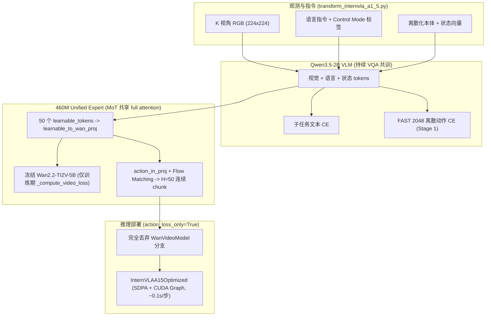
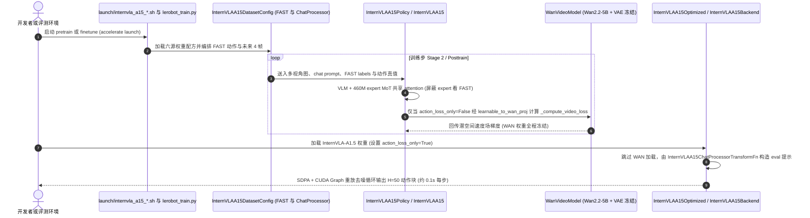

# InternVLA-A1.5：理解、潜式前瞻与动作的统一 VLA

**InternVLA-A1.5**（*Unifying Understanding, Latent Foresight, and Action for Compositional Generalization*，[arXiv:2607.04988](https://arxiv.org/abs/2607.04988)，[项目页](https://internrobotics.github.io/internvla-a15.github.io/)，[代码](https://github.com/InternRobotics/InternVLA-A1)，上海人工智能实验室 **Physical Intelligence Team**）是在 [InternVLA-A1](https://arxiv.org/abs/2601.02456) 统一范式上的升级：把 **视觉–语言理解**、**潜式未来推理** 与 **连续动作生成** 收进 **单一 MoT 框架**——在 **Qwen3.5-2B** 原生 chat 模板上 **持续 VQA 与子任务共训** 以守住语义，用 **50 个 learnable foresight token** 向 **冻结 WAN2.2-5B** 查询 **任务相关紧凑未来潜码**（训练期视频监督、**推理完全丢弃生成器**），再以 **flow matching** 输出 **50 步 action chunk**；在 **1.2M 机器人 episode + 3M InternVLA-M1 多模态** 上预训练后，**六套仿真基准均为最佳或极强竞争力**，真机 **held-out 指令绑定** 与 **13 步 MOF 长程流程** 显著超过 **π₀.₅** 与 **Motus**。截至 2026-11 复核，官方已在 `InternRobotics/InternVLA-A1` 的 `main` 分支按 **CC BY-NC-SA 4.0** 完整公开训练/评测代码与 HuggingFace 权重。

## 一句话定义

**在原生 VLM 上继续语言共训，用少量 foresight token 向冻结视频世界模型「提问」未来潜码来监督动作专家，部署时只留理解 + flow 动作头，兼顾组合泛化、长程执行与实时闭环。**

## 英文缩写速查

| 缩写 | 英文全称 | 简要说明 |
|------|----------|----------|
| InternVLA-A1.5 | Intern Vision-Language-Action A1.5 | 本文统一理解–前瞻–动作 VLA 简称 |
| VLA | Vision-Language-Action | 视觉、语言与动作统一的多模态策略 |
| VLM | Vision-Language Model | 预训练视觉–语言骨干；本文用 Qwen3.5-2B |
| MoT | Mixture of Transformers | 共享 full attention、分模态 linear attention 的混合 Transformer |
| FM | Flow Matching | 流匹配生成范式，学习连续动作速度场 |
| FAST | Fine-grained Action Sequence Tokenizer | 将动作块离散化为短 token 序列的编码器（2048 词表并入 VLM） |
| WAN | Wan video generation model | 本文冻结的视频生成世界模型教师（Wan2.2-TI2V-5B） |

## 为什么重要

- **统一模型的新配方：** 相对 InternVLA-A1、Being-H0、MMADA 等「未来像素 + 动作联合回归」路线，A1.5 把未来预测改成 **latent querying**——**不从零学像素生成**，却通过冻结 WAN 吸收 **时空动力学先验**；部署侧与 **Fast-WAM / DSWAM** 同族：**训练用世界模型、推理不想象**。
- **语义不被动作目标侵蚀：** Stage 1–2 持续 **VQA + 子任务 + FAST 离散动作** 的 **单一 next-token CE**（机器人:多模态 **0.15:0.85**），论文强调这是 **组合指令 OOD 绑定** 领先 π₀.₅ 的关键——与 [Vesta](./paper-vesta-generalist-embodied-reasoning.md) 讨论的「专精 VLA 遗忘语义」形成对照语境。
- **仿真六榜 + 真机长程：** LIBERO **98.9%**、RoboTwin **93.2%**、SimplerEnv **80.8%**、LIBERO-Plus **84.8%**、DOMINO 零样本 **27.7%**、EBench Test **35.2%**；真机 MOF **76.4%** vs π₀.₅ **29.3%**，held-out tube–target 绑定 **全胜**。
- **工程可部署与真开源落地：** 视频分支训练后通过 `action_loss_only=True` 整段跳过；`InternVLAA15Optimized` 在 **CUDA Graph + SDPA** 下单步 **~0.1s**（RTX 5090），且官方已在 `InternRobotics/InternVLA-A1`（`main` 分支）开源训练、LeRobot v3.0 适配与五大仿真评测服务。

## 核心原理

### 核心信息

| 字段 | 原文与源码核定内容 |
|------|--------------------|
| **机构与发布** | 上海人工智能实验室（Shanghai AI Laboratory）Physical Intelligence Team；arXiv:2607.04988v1 |
| **骨干架构** | `Qwen/Qwen3.5-2B` VLM（3×Gated DeltaNet + 1×full attention 交错）+ 460M unified expert（MoT，共享 full attention） |
| **世界模型教师** | 冻结 `Wan2.2-TI2V-5B` + `Wan2.2_VAE`（仅训练期以 50 个 foresight token 计算 4 帧潜空间视频损失） |
| **预训练数据** | 1.2M 机器人 episode（861M 帧，六源混合）+ ~3M InternVLA-M1 多模态 QA |
| **开源状态** | **已开源（CC BY-NC-SA 4.0）**：代码见 `InternRobotics/InternVLA-A1` `main` 分支；权重见 HF `InternRobotics/internvla-a15` |
| **推理延迟** | ~0.1s/步（RTX 5090，`action_loss_only=True` + `InternVLAA15Optimized` CUDA Graph + SDPA） |

### 方法栈与模块角色

| 模块 | 角色（对应源码 `modeling_internvla_a1_5.py` & `wan_model.py`） |
|------|--------------------------------------------------------------|
| **Qwen3.5-2B VLM** | 接收多视角图 + 原生 chat 指令 + 256-bin 离散本体 + `Control Mode`；Stage 1 自回归预测子任务文本与扩展 2048 个 FAST token |
| **460M Unified Expert** | `InternVLAA15WithExpertModel` 中通过 MoT 共享 full attention 与 VLM 交互，承载 50 个 `learnable_tokens` 与连续 flow matching 动作头 |
| **50 Foresight Tokens** | 读出未来潜码后经 `learnable_to_wan_proj` 替换 WAN 原 T5 文本条件，对 4 帧未来视频（第一帧 clean teacher forcing）计算 `_compute_video_loss` |
| **Flow Matching 动作头** | 对 `chunk_size=50` 连续动作学速度场（推理默认欧拉去噪 `num_inference_steps`）；`_block_suffix_attend_prefix_tokens` 训练时屏蔽 expert 对 FAST token 的注意力防泄漏 |

### 流程总览

### 三阶段训练与数据配比

| 阶段 | 步数 / 设定 | 目标与源码配比 |
|------|-------------|----------------|
| **Stage 1** | 300K steps, batch 1024 | 机器人 + InternVLA-M1 VQA（0.15:0.85）；单一 CE 联合监督 VQA / 子任务 / FAST 动作 |
| **Stage 2** | 600K steps, `lr=5e-5` | `CE + video_loss_weight(1.0)*L_video + 10*L_action`；引入 460M expert 与 50 个 foresight tokens；`weight_rules_pretrain.yaml` 混合六源（AgiBotWorld 0.25、InternData-A1 0.20、Galaxea 0.20、DROID 0.15、RoboMind 0.10、FastUMI 0.10） |
| **Posttrain** | 60K steps, cosine LR | `launch/internvla_a15_finetune*.sh` 基于 `InternRobotics/InternVLA-A1.5-base` 按任务微调（可选保留或关闭视频损失） |

## 源码运行时序图

以下时序基于 `InternRobotics/InternVLA-A1` 仓库 `main` 分支源码（`launch/internvla_a15_{pretrain,finetune}.sh`、`src/lerobot/policies/internvla_a1_5/{modeling_internvla_a1_5.py,modeling_internvla_a1_5_optimized.py,wan_model.py}` 与 `evaluation/LIBERO/policy_server/backends/policy_backend_internvla_a1_5.py`）核对绘制：

## 工程实践

- **仓库分支与目录对应关系：** 官方仓库 `InternRobotics/InternVLA-A1` 的 **`main` 分支已承载 InternVLA-A1.5 完整代码**（`pyproject.toml` 标注 `internvla-a1-5` v1.0.0 与主页 `InternRobotics/InternVLA-A1.5`），前作 InternVLA-A1 已保留至 `InternVLA-A1` 分支；注意协议为 **CC BY-NC-SA 4.0（非商业研究使用）**。
- **预训练与 LeRobot v3.0 统计准备：** 按 `tutorials/pretrain_internvla_a1_5_with_interndata_a1.md`，先解压 `InternData-A1`（LeRobot v3.0 格式）至 `data/a1`，再运行 `util_scripts/compute_norm_stats_multi.py --action_mode delta --chunk_size 50` 为各本体生成外置 `stats.json`；预训练入口 `launch/internvla_a15_pretrain.sh` 需同时准备 `Qwen/Qwen3.5-2B` 与本地 `Wan2.2-TI2V-5B`（含 `Wan2.2_VAE.pth`）。
- **推理部署关键配置（`evaluation/LIBERO/policy_server/backends/policy_backend_internvla_a1_5.py`）：**
  - 推理期强制启用 `action_loss_only=True`，完全跳过 WAN 权重反序列化与加载；
  - 提示词构造需由 `InternVLAA15ChatProcessorTransformFn(mode="eval")` 对齐训练时的 `Control Mode: <action_mode>;`（`abs` 或 `delta`）和 `<Subtask, Action>` 后缀，`max_prompt_length=650`；
  - 开启 `inference_backend="optimized"`（`InternVLAA15Optimized`）可将动作专家转为 fp32、启用 SDPA 与 `torch.cuda.CUDAGraph` 静态图重放去噪，亦可运行 `tests/openloop_internvla_a1_5.py` 做开环误差与可选未来帧检查。

## 评测

> 数字以 [arXiv:2607.04988](https://arxiv.org/abs/2607.04988) 原文 Tables 2–8 为准。

| 设定 | InternVLA-A1.5 | 对照要点 |
|------|----------------|----------|
| **LIBERO avg** | **98.9%** | 超 Motus 97.7%、LingBot-VA 98.5% |
| **LIBERO-Plus total** | **84.8%**（零样本） | 背景/噪声/相机扰动领先 |
| **RoboTwin 2.0 avg** | **93.2%** | clean 93.3 / rand 93.0，域随机几乎不掉点 |
| **SimplerEnv avg** | **80.8%** | 超 Xiaomi-Robotics-0 79.2% |
| **DOMINO SR** | **27.7%** ZS / **29.3%** FT | 动态操作零样本最高 |
| **EBench Test SR** | **35.2%** | 移动操作长程领先 π₀.₅ 29.5% |
| **真机 MOF** | **76.4%** | π₀.₅ 29.3%；Motus 0% |
| **held-out 指令绑定** | 三任务 OOD **最佳** | Sort / Insert / Move Tubes 组合泛化核心证据 |

**消融（Table 8）：** 去掉 video loss 或 foresight tokens → LIBERO-Plus / DOMINO 跌幅最大，说明 **潜式前瞻** 主要服务 **分布偏移与动态交互**。

## 结论

**A1.5 的核心取舍是把世界模型放在训练侧当「潜式教师」、推理侧通过 `action_loss_only=True` 整段丢弃：用一次性的动力学蒸馏换实时闭环，同时靠持续语言共训避免动作目标侵蚀语义。**

1. **两个核心可消融开关：** **50 个 foresight token 查询冻结 Wan2.2 的视频损失**负责抗分布偏移与动态交互（Table 8），Stage 1–2 的 **持续 VQA/子任务共训**（机器人:多模态 0.15:0.85）则负责组合指令 OOD 绑定。
2. **部署形态决定长程实战：** 推理不滚像素且通过 `InternVLAA15Optimized`（SDPA + CUDA Graph）压至 **~0.1s/步**，真机 13 步 MOF 达到 **76.4%**（对比 π₀.₅ 29.3%、Motus 0%）。
3. **开源复现路径清晰：** 训练/评测代码（`InternRobotics/InternVLA-A1` `main` 分支）与 `InternVLA-A1.5-{base,RoboTwin,Libero,DOMINO}` 权重已完整公开，微调只需按 `launch/internvla_a15_finetune.sh` 对齐 `Control Mode` 与本体归一化统计，无需在推理节点部署 5B WAN 权重。
4. **适用边界明确：** foresight 视界 **≤ 一个 action chunk（H=50）**，没有长程显式规划或在线 world-model roll；长程能力主要依赖 VLM 子任务分解与语义保持。
5. **教师分布与合规约束：** 上界受冻结通用 Wan2.2 的具身场景先验覆盖限制，且公开发行协议为 **CC BY-NC-SA 4.0（限制商用）**。

## 局限与风险

- **概念误区：** 把 A1.5 当成测试期仍滚 WAN 的 WAM——**视频生成器仅在训练期通过 `_compute_video_loss` 监督 50 个 foresight token，推理后端默认 `action_loss_only=True` 完全不加载 WAN**。
- **短视界边界：** foresight 视界 **≤ 一个 action chunk**，尚无跨多个子任务的显式长程世界推演。
- **教师覆盖上界：** WAN 全程冻结且偏向通用视频分布，细粒度接触动力学与遮挡场景先验仍受教师能力限制。
- **许可协议限制：** 仓库与权重采用 **CC BY-NC-SA 4.0** 协议，面向学术与非商业研究开放，商业化部署需另行评估或重新基于商用允许骨干训练。

## 与其他工作对比

| 对照对象 | InternVLA-A1.5 的差异 |
|----------|------------------------|
| **InternVLA-A1** | 同团队前作；A1.5 用 **latent foresight + 持续 VQA** 替代 **像素级未来回归**，语义与零样本更稳，代码仓已升级至 `main` 分支 |
| **π₀.₅** | 同族 FAST 离散 + flow 连续双阶段；A1.5 加强 **VQA 共训比例** 与 **冻结 WAN 动力学蒸馏**，长程 MOF 大幅领先 |
| **Motus** | 典型 **部署期仍想象未来** 的 video-action 路线；A1.5 **丢弃生成器** 保实时，MOF 上 76.4% vs 0% |
| **Being-H0.7** | 同为 **潜空间未来监督**；A1.5 用 **冻结大规模视频生成器** 作教师而非自建轻量未来头 |
| [LingBot-VLA 2.0](./lingbot-vla-v2.md) | 同 RoboTwin/LIBERO 赛道；LingBot 走 **MoE + 6 万小时数据工程**；A1.5 强调 **语义保持 + latent WAN 查询** |
| [Xiaomi-Robotics-0](./xiaomi-robotics-0.md) | 同 **Qwen3 + DiT flow** 族；A1.5 额外统一 **理解/前瞻/动作** 三目标与 **组合泛化** 真机协议 |
| [G0.5](./paper-galaxea-g05.md) | 同 **Qwen3.5-2B**；G0.5 把动作留在 **AR 词表**（VLM-as-Actor），A1.5 部署仍是 **flow chunk** + 丢弃 WAN |
| [JoyAI-RA 0.5](./paper-joyai-ra-05.md) | 同为「训练用世界模型、部署不滚像素」；JoyAI-RA 自训 **LAC-WM + latent-action**，A1.5 用 **冻结 WAN foresight token** |

## 关联页面

- [VLA（Vision-Language-Action）](../methods/vla.md) — 统一 VLA 范式与 π₀.₅/FAST 语境。
- [π₀.₇（Pi-zero 0.7）](../methods/pi07-policy.md) — 多模态提示与子任务分解对照。
- [World Action Models（WAM）](../concepts/world-action-models.md) — 「训练耦合、部署不想象」族谱定位。
- [Being-H0.7](../methods/being-h07.md) — 潜空间世界–动作先验的另一路径。
- [Action Chunking](../methods/action-chunking.md) — H=50 chunk 与 KV cache 推理。
- [Manipulation](../tasks/manipulation.md) — LIBERO / RoboTwin / 真机操作背景。
- [RoboTwin](./robotwin.md) — 双臂仿真基准与 DOMINO 动态扩展。
- [Vesta](./paper-vesta-generalist-embodied-reasoning.md) — 具身推理与专精 VLA 语义遗忘对照。
- [LingBot-VLA 2.0](./lingbot-vla-v2.md) — 同赛道大规模预训练 VLA 对照。
- [G0.5](./paper-galaxea-g05.md) — 同骨干的 VLM-as-Actor 开源对照（arXiv:2608.11739）。
- [JoyAI-RA 0.5](./paper-joyai-ra-05.md) — 双动作对齐 VLWA；自训 LAC-WM 对照路径（arXiv:2608.05674）。
- [RoboInter1.5](./paper-robointer-1-5.md) — 同组织生态的稠密中间表示 + plan-then-execute VLA 套件（Executor 参考 InternVLA-M1）。

## 参考来源

- [InternVLA-A1.5 论文归档](../../sources/papers/internvla_a15_arxiv_2607_04988.md) — **主要一手来源**：arXiv:2607.04988v1 全文（含 Tables 1–8、Appendices A.1–A.2）核对归档
- [InternVLA-A1.5 仓库归档](../../sources/repos/internvla-a1.md) — **主要一手来源**：官方仓 `InternRobotics/InternVLA-A1` `main` 分支源码、训练脚本与推理后端核对归档

## 推荐继续阅读

- 论文 PDF：[arXiv:2607.04988](https://arxiv.org/pdf/2607.04988)
- 官方项目页与开源代码：[InternVLA-A1.5 Project](https://internrobotics.github.io/internvla-a15.github.io/) / [InternRobotics/InternVLA-A1 (`main`)](https://github.com/InternRobotics/InternVLA-A1)
- 前作 InternVLA-A1：[arXiv:2601.02456](https://arxiv.org/abs/2601.02456) / [项目页](https://internrobotics.github.io/internvla-a1.github.io/)
- π₀.₅ 技术报告：[Physical Intelligence π₀.₅](https://www.physicalintelligence.company/blog/pi05) — FAST 离散动作与 flow 连续头对照
- WAN 视频生成：[Wan2.2](https://arxiv.org/abs/2503.20314) — foresight 冻结教师来源
