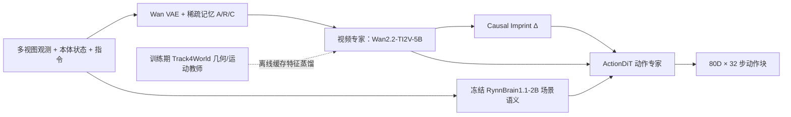
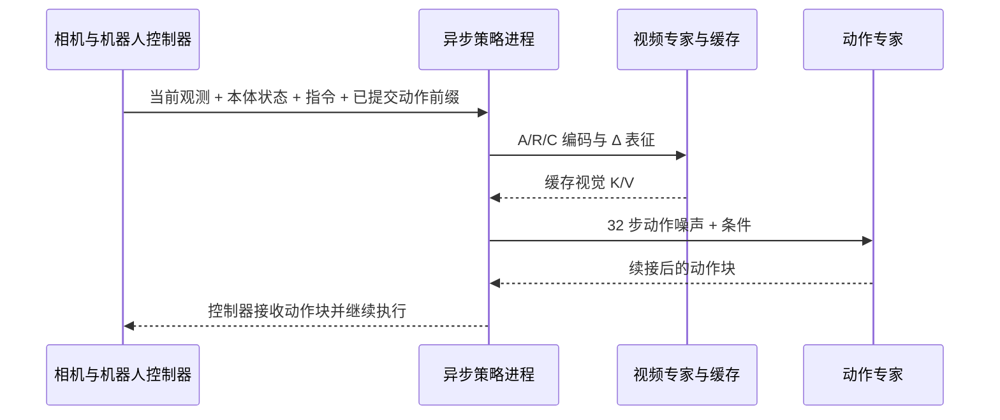

# InternW0-Δ: A World Action Model Bridging Predictive Dynamics and Actions with 20K+ Hours of Open Data

**InternW0-Δ**（arXiv: [2609.31394](https://arxiv.org/abs/2609.31394)，Shanghai AI Laboratory / InternRobotics）把视频生成预训练中的时间动力学迁移到机器人动作生成。它不要求推理时先生成一段未来视频再交给规划器：视频专家从观测中提取上下文，动作专家借助 **Causal Imprint（因果印记）**读取“接下来场景可能如何变化”的训练所得表征，并直接生成机器人动作块。

## 一句话概括

> 以 Wan2.2-TI2V-5B 视频专家 + ActionDiT 动作专家构成定向 Mixture-of-Transformers；通过稀疏记忆保持长短时上下文、冻结 VLM 将任务语言落到当前场景、未来特征监督教会 Causal Imprint 表达可预测变化，再用 Track4World 的离线几何/运动特征蒸馏视频表征。训练统一 80D 机器人状态/动作槽位，执行端缓存视觉 K/V、只对 32 步动作 chunk 做 flow matching 推理。

## 缩写与名词

| 名称 | 含义 | 在本工作中的作用 |
|---|---|---|
| WAM | World Action Model | 联合使用世界演化表征与动作生成 |
| MoT | Mixture-of-Transformers | 视频、动作专家参数分开，以定向注意力耦合 |
| CI | Causal Imprint | 由可观测历史预测动作相关变化的 learnable tokens |
| SMC | Sparse Memory Context | episode 锚点、上一动作块前的近期帧、当前帧 |
| RTC | Real-Time Chunking | 新动作块生成时延迟续接当前已提交动作 |
| UMI | Universal Manipulation Interface | 以手持工具采集的末端位姿/夹爪轨迹等操作数据 |
| Ego2Robot | — | 将第一人称人类视频合成为机器人动作/视频训练样本的流程 |
| 4D distillation | 时空表征蒸馏 | 将 Track4World 几何、运动教师特征蒸馏进视频专家 |

## 模型结构与信息流

### 1. 异构观测与任务语义

输入包含一个或多个相机视图、当前机器人本体状态和文本指令。相机视图依各机器人适配器合成为统一画布，并由冻结 Wan VAE 编码；本体状态分别投影到视频专家和动作专家的表征空间。

语言走两条不同路径：

- **视频专家：** 保留 Wan2.2-TI2V-5B 的 T5 文本条件，以继承视频预训练中的语言–视频接口。
- **动作专家：** 冻结的 **RynnBrain1.1-2B** VLM 同时看当前有效视图与指令，提供场景级语义和指代消歧，再与本体状态一起条件化动作生成。单独 T5 并不看当前场景，无法确定“把它放进去”里的“它”是哪一个物体。

### 2. 稀疏记忆上下文（SMC）

每轮只保留三类视觉上下文：

1. episode 开始时的多视图锚点 **A**，提供任务全局背景；
2. 上一动作块开始前的近期观测 **R**，保留最近交互历史；
3. 当前观测 **C**。

它以少量历史帧代替密集视频历史，试图同时支持任务进度识别和短期动作连续性。消融中加入 SMC 后 LIBERO-Plus 成功率由 **49.59% 升至 53.47%**。

### 3. Causal Imprint：把未来监督压进当前表征

训练时，从干净视频潜变量计算未来相邻时间片之间的潜变量差分，并将未来视频专家的末端切片特征作为对齐目标。视频专家中加入与当前潜变量空间位置对应的 learnable **Δ tokens**，它们只接收 R/C 等可观测上下文，不直接读取已实现的未来帧；这些 tokens 通过两个目标学习：

- 直接回归相邻干净潜变量差分，表达场景接下来发生的视觉变化；
- 将较浅层 Δ 特征与视频专家较深层的未来特征做 stop-gradient 余弦对齐，传递更丰富的语义和时间信息。

训练时确实用未来帧构造监督目标；但在动作推理的信息路径中，CI 与动作专家都不能注意未来 token。部署时无需采样未来视频，Δ 表征直接交给动作专家。LIBERO-Plus 消融从 VLM/SMC 变体的 **69.08%** 提升到加入 CI 后 **70.80%**；再加入未来特征对齐后为 **76.45%**。

### 4. 4D-aware 表征蒸馏

冻结 **Track4World** 教师离线处理与动作时域对齐的视频片段，将几何、二维/三维运动、相机运动和可见性统计聚合为 **1430 维**描述子，训练一个 query decoder 从视频专家 A/R/C 特征预测该描述子，并以 MSE 对齐。教师特征预先缓存；推理时教师及蒸馏分支均移除，故该分支增加训练成本但不形成额外部署模型路径。消融中进一步把 **76.45%** 提升到 **78.37%**。

### 5. 定向视频–动作 MoT

视频专家与动作专家分别保留自己的参数、cross-attention 和 FFN；每层通过分开的 Q/K/V 投影进行联合 masked self-attention。核心信息约束是：

- 视频未来 token **F** 可用于视频生成目标；
- Causal Imprint Δ 从观测上下文学习，但不能读取 F；
- 动作 token 可读取 A/R/C/Δ 和动作流，但不能读取 F；
- 视频侧观测与 Δ 不能反向读取动作 token。

因此未来视频训练任务与动作预测共享有用的内部表示，但模型动作预测没有未来帧泄漏。视频和动作两个目标均使用 flow matching，联合优化视频生成、动作生成、CI 两项监督及 4D 蒸馏。

### 结构与训练信息流

## 数据与统一动作接口

论文称处理后的混合语料超过 **20K 小时**，包含机器人操作示范、UMI、人类第一视角示范，以及从 EgoDex/EgoVerse 转换出的 Ego2Robot 机器人化样本。异构源的原生关节顺序、控制语义、相机和时间定义各异，不能直接逐维拼接；论文将机器人状态/动作映射到统一 **80D** 语义槽位，并以 mask 标出各 embodiment 未使用的维度。

| 数据类别 | 过滤/转换后规模（论文口径） | 说明 |
|---|---:|---|
| 机器人数据 | 11,302.20 h；1,247,656 episodes | 多个公开操作数据集，质量筛选后保留 |
| 人类第一视角 EgoDex + EgoVerse | 4,061.35 h；1,622,756 episodes | 过滤后的人类视频，供 Ego2Robot 等处理 |
| Ego2Robot 输出 | 5,633.77 robot-hours；3,730,513 episodes | 由成功转换区间合成；不要与输入视频时长混为一谈 |
| Hy-UMI-10K | 2,075.42 h；416,053 个切分训练 episode | 双手 UMI 轨迹，经静止/异常片段过滤 |

论文报告总量超过 20K 小时；不同数据列分别是原始机器人演示、输入人类视频、UMI 以及由人类视频转换得到的 robot-hours，**不是同一种“原始采集时长”**。机器人数据经过信号异常、动作幅度、静止片段、画面质量及视频–指令一致性筛选。Ego2Robot 对人类视频进行动作/运动学对齐、移除人体并渲染机器人到原视角，再作深度感知合成；轨迹速度减半以贴近机器人数据。论文承诺仅在许可允许时公开处理后数据，因此“20K+ 开放数据”不等于每个上游数据集或处理样本都能无条件再分发。

### 80D 动作空间不是固定某一台机器人的电机指令

80D 是跨 embodiment 的**带 mask 语义槽位**：

- 双臂关节目标、末端执行器位姿/位移增量、夹爪、灵巧手通道；
- 躯干关节、预留维度、升降高度、头部关节；
- 可选移动底盘状态与局部位移动作。

关节/夹爪/手动作常是绝对目标；末端动作是相对当前末端位姿的平移和旋转增量。原生单位、坐标系和缺失通道由各 source adapter 指定。所以“统一 80D”并不意味着免除机器人适配器、控制器标定或目标平台后训练。

## 预训练与目标任务适配

预训练使用 **Wan2.2-TI2V-5B** 视频专家、随机初始化的 ActionDiT，以及冻结 **RynnBrain1.1-2B**。视频为 384×256、33 帧，动作预测 horizon 为 32；80D 状态/动作以 validity mask 处理。训练在 **256 张 NVIDIA A800** 上进行，bfloat16、全局 batch 4096、AdamW，学习率 5e-5；共 245K steps，论文称约 14 天。前 235K steps 不启用 4D 蒸馏，最后 10K 加入 Track4World 教师目标。

预训练 checkpoint 再按目标任务和机器人单独 post-train，包括 LIBERO、RoboTwin、RoboDojo、EBench 和四类真机接口。不能把实验解读成一个未适配 checkpoint 零样本控制所有机器人。

## 推理与部署

动作推理分两段：

1. 用当前 A/R/C 观测和 Δ tokens 执行一次视频专家 prefill，缓存各 MoT 层 K/V；
2. 初始化噪声动作块，动作专家重复做 N 步 flow denoising，每次复用已缓存视觉 K/V，只更新动作流；不生成未来视频，也不运行 Track4World 教师。

每个动作块含 **32 步**。真机控制频率为 **30 Hz**，每执行 16 步就在后台发起一次新推理；执行中的计划作为 clean prefix 提供给新动作块，训练时随机模拟 0–16 步的 committed prefix。以 30 Hz 计，等待下一块的理论窗口为 533 ms；文章另外报告 RTX 5090 上 controller-observed round-trip latency **152.8 ms**（相对 780.5 ms 标准运行时 5.11× 加速）。这是动作块请求的往返延迟，不是每步 152.8 ms，也不意味着该模型能以 30 Hz 完成一次全量重新规划再阻塞式执行。

### 推理/控制执行顺序

## 实验结果

### 仿真基准

| 基准 | InternW0-Δ | 对照 / 论文报告的优势 | 读数提示 |
|---|---:|---|---|
| LIBERO-Plus | **92.8%** | 高于 Qwen-RobotManip-Context 91.4%；OpenWAM-α 69.2% | 任务扰动下的操作成功率 |
| RoboTwin 2.0 Clean2Random | **71.9%** | 较 Qwen-RobotManip-Context 高 2.5 个百分点；OpenWAM-α 为 48.7% | 仅用 clean demos 训练再测试随机化环境 |
| RoboTwin Clean2Clean | **90.0%** | OpenWAM-α 为 89.4% | clean 分布未因随机泛化提升而明显退化 |
| EBench | **49.2% 成功率；66.0 总分** | 49.4% 成功率的 OpenWAM-α 总分为 64.7 | 两列不是同一指标；移动双臂、精细与长时序任务 |
| RoboDojo | **23.9% 平均成功率** | OpenWAM-α 11.92% | 高精度、记忆和长时程任务仍难 |

### 真机任务

在 **AC-One、Arx5、双臂 Franka+XHand、TianJi Marvin+Wuji Hand** 四种设置共测试 11 项任务，涉及倒饮料、烤面包、化学实验流程、磁力搅拌器、放置试管、倒水、放水果、叠杯、滴管操作和做三明治。每种平台都有单独 post-training，控制由单张 RTX 5090 本地推理，控制频率 30 Hz。

预训练收益的对照在 AC-One 两项任务、每个条件各 20 次试验：烤面包从 **4/20（20%）到 19/20（95%）**；Luminol 反应从 **0/20 到 19/20（95%）**。饮水任务部署时还能适应与示范不同的杯中目标水位，不过论文对这部分是定性展示，不应外推为任意物体/场景鲁棒性。

## 局限与证据边界

- **异构动作并未消除适配成本：** 80D 带 mask 的统一布局让预训练共享成为可能，但每类原生控制信号仍需 adapter；四种真机分别做 post-training。
- **大量数据不等于全量开源可下载：** 项目 README 当前提供数据准备/训练/评测/部署代码和 MIT 代码许可；README 将模型 checkpoint 标为 forthcoming，处理后数据受上游许可约束。
- **真机证据有任务和试验范围：** 11 项任务中，论文只对两项 AC-One 任务给出明确、每条件 20 次的预训练对照；其他任务覆盖的统计细节不应由示例视频代替。
- **CI 的 future supervision 是训练目标而非测试时信息：** 动作路径不看未来帧，但表示收益仍需经消融和下游任务验证；CI 的直接 latent difference 目标单独增益不大，和未来特征对齐联合时增益更明显。
- **数据来源的贡献未被穷尽分析：** 论文局限指出未系统分析不同第一视角数据、转换策略、混合比例和监督形式；agent-assisted control 的实验也仅是初步纠错场景，没有系统研究长期规划/调用策略。
- **吞吐、控制频率和推理延迟需分开：** 30 Hz 是控制器执行频率；152.8 ms 是一次异步动作块调用的往返延迟，依靠 chunk 前缀和并行执行保持连续性。
- **“最大开源语料”是作者对处理后数据集合的表述**；授权限制意味着公开可得性要按来源逐项确认。

## 开源与复现状态（核验于 2026-10-13）

- **代码：已公开。** [InternRobotics/InternW0-Delta](https://github.com/InternRobotics/InternW0-Delta) 包含数据处理、预训练、4D 蒸馏、post-training、评测、真机部署、可视化和测试代码；README 提供 Linux/Python 3.11/CUDA 安装与训练入口。许可证为 **MIT**，第三方组件按 NOTICE 分别适用其许可证。
- **权重：尚未随当前 README 提供。** 项目页和 README 将模型 checkpoint 标为 **Forthcoming / coming soon**；论文表示计划发布。
- **数据：部分受许可限制。** 发布范围受原始数据集许可制约，不能将论文中所有训练时长等同为一个可直接下载的数据包。
- **论文：** arXiv v1 于 **2026-09-25** 提交，论文标注 **CC BY-NC-SA 4.0**；论文许可和代码 MIT 是不同对象。

## 关联页面

- [World Action Models 概念页](../concepts/world-action-models.md) — WAM 的范围、结构路线和相关实体索引。
- [生成式世界模型](../methods/generative-world-models.md) — 视频生成/潜变量动力学及控制接口。
- [Day 5：世界模型与决策导读](../overview/humanoid-motion-intelligence-day5-world-models-decision.md) — 作为该综述索引中的既有条目。
- [OpenWAM](./paper-openwam.md) — WAM 训练/评测路线对照。
- [Long-WAM](./paper-long-wam-scaling-context.md) — WAM 长上下文扩展对照。
- [4D-WAM](./paper-4d-wam.md) — 时空几何表征与动作模型相关路线。

## 一手来源

- [论文归档](../../sources/papers/internw0_delta_arxiv_2609_31394.md)
- [官方项目页归档](../../sources/sites/internw0-delta.md)
- [官方代码仓库归档](../../sources/repos/internw0-delta.md)
- [arXiv HTML](https://arxiv.org/html/2609.31394v1)
- [官方项目页](https://internrobotics.github.io/InternW0-Delta/)
- [官方仓库](https://github.com/InternRobotics/InternW0-Delta)
