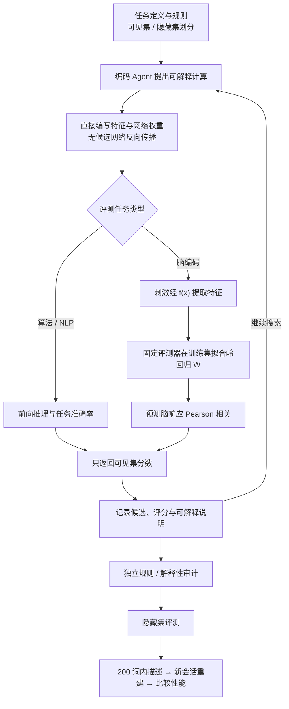
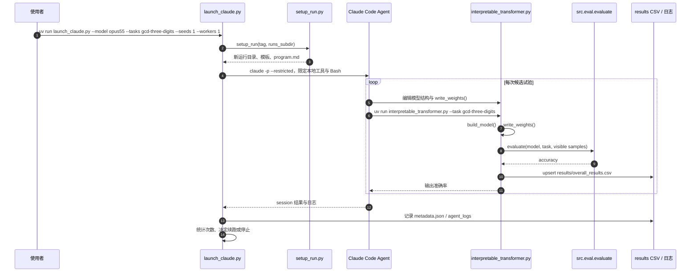

# Interpretable weight-space programming builds transparent transformers and brain encoding models / 可解释权重空间编程：构造透明 Transformer 与脑响应编码模型

## 一句话定义

**iWSP（Interpretable Weight-Space Programming）** 让编码 Agent 在不使用候选网络梯度训练的约束下，直接把可解释特征与权重写进程序，经可见集评估、迭代修改、独立审计和隐藏集检验，构造可复述、可重建的神经计算模型。

## 英文缩写速查

| 缩写 | 英文全称 | 简要说明 |
|---|---|---|
| iWSP | Interpretable Weight-Space Programming | 直接编写可解释特征与权重的搜索方法 |
| LLM | Large Language Model | 编写模型与做独立可解释性审计的 Agent 底座 |
| fMRI | Functional Magnetic Resonance Imaging | 视觉与故事聆听的血氧响应测量 |
| ECoG | Electrocorticography | 皮层电活动记录；本文预测高伽马响应 |
| NSD | Natural Scenes Dataset | 视觉编码特征的跨数据集测试 |
| TR | Repetition Time | fMRI 扫描的时间单位；用于边缘裁除 |

## 为什么重要

- **从事后解释转向事前可读：** 模型不是先训练成黑盒再找归因；Agent 将领域假设显式表达为滤波器、注意力电路、规则与权重。
- **可验证的可解释性：** 除人工/LLM 审计，还要求另一个新会话只根据不超过 200 词的描述重建模型；比较预测与准确率，而非仅看“模型参数少”。
- **可暴露评测捷径：** 在语言 fMRI 中，能读懂模型发现位置特征主要追踪扫描边缘的异常信号，而非语义。
- **对机器人研究的定位：** 可作为“Agent 自动设计可审计的状态特征/控制计算”研究思路；论文**没有**机器人训练、闭环控制或 Sim2Real 试验，不能直接归因其工程有效性。

## 核心信息

| 项目 | 内容 |
|---|---|
| 作者 | Yash Mehta、Chandan Singh 等（共 9 人） |
| 机构 | 微软研究院（Microsoft Research）、约翰斯·霍普金斯大学（Johns Hopkins University）、哥伦比亚大学（Columbia University）、纽约大学（New York University） |
| 原文 | [arXiv:2611.18114v1](https://arxiv.org/html/2611.18114v1)，2026-11-13 |
| 官方代码 | [csinva/weight-space-programming-autoresearch](https://github.com/csinva/weight-space-programming-autoresearch)，仓库标注 MIT |
| 范围 | 13 个算法任务、4 个 NLP 任务；视觉/语言 fMRI、听觉 ECoG 编码 |
| 软件与运行 | uv + Claude Code，源码及提示词、实验运行快照已公开；本页未独立重跑 |

## 核心原理

1. **候选表示：** Agent 修改一个可运行 Python 模型文件，写出网络结构、特征及固定权重。算法/NLP 基础模板是 3 层、宽度 64 的小 Transformer，重点编辑 write_weights(model, task)。
2. **禁止候选模型训练：** 规则不允许优化器、梯度下降、反向传播或由数据拟合出的权重，也不允许在网络外偷算任务答案；可用闭式构造、规则和已有计算模块。
3. **反馈与选优：** 固定评测器只向 Agent 暴露 visible set 的性能；Agent 通过有限多次试验提案、评估、修正，并将不同候选与得分留档。
4. **审计与隐藏集：** 独立 Agent 检查可解释性与违约，算法/NLP 用更换任务数据后权重是否变化检查是否依赖标签；最终在未参与搜索的隐藏集评估。
5. **文本瓶颈：** 用最多 200 词描述最终模型，另起 Agent 会话重建并检测性能保留情况。

**重要边界：** 在脑响应研究中，Agent 写出**特征提取器** f(x)，固定评测器会用训练刺激拟合**岭回归读出** W，再预测响应 y。所谓“不训练”是对 Agent 直接编写的候选特征/网络权重的限制，不是“任何统计拟合都不存在”。

### 流程总览

## 源码运行时序图

对齐官方 README 的算法 Transformer 复现实验入口（不是视觉/fMRI/ECoG 的公共入口）：

入口逐行核查：`experiments/evolve/launch_claude.py` 的 `run_one()` 调用 `setup_run()`，通过 `subprocess.run` 执行受限 `claude -p`；由 Agent 编辑 `interpretable_transformer.py`；模板底部 `build_model()` / `src.eval.evaluate()` 算 visible accuracy 并写入 CSV。隐藏集及独立审计**不在该图内**，不是每次可见集运行自动完成。

## 评测结果与证据边界

| 场景 | 作者报告结果 | 正确读法 |
|---|---|---|
| 算法任务 | Opus 5.5：13 任务 × 2 runs = **26/26** 运行在 hidden set 达 100% | 指指定任务分布（算法 hidden set 各 2,000 例）；不代表对所有任意规模输入形式证明正确 |
| NLP | 4 任务中 3 项高于多数类基线；TREC hidden **87.3%**；MRPC 没有超越基线 | 手工规则式网络能做有限分类，不能据此宣称通用语言能力 |
| 视觉 fMRI | NSD unseen dataset：early **0.443 vs 0.400**、ventral **0.317 vs 0.256**（最优可解释基线） | 指 Pearson 相关；ventral 仍低于预训练 AlexNet **0.391** |
| 视觉特征 | 600 次搜索最终得到 14 类显式计算、9,996 维特征 | 如 Gabor 能量、表面几何、轮廓曲率与通道相关；脑响应映射仍用岭回归 |
| 语言 fMRI | 增加故事位置特征后可见分数 **0.067 → 0.104**；裁掉扫描边缘后语义模型与 GPT-2 XL 接近 | 位置提升暴露非语言扫描边缘混杂，不能当成真实语义表征进步 |
| 听觉 ECoG | surface-grid hidden：iWSP **0.074 vs Whisper 0.082**；全 166 电极 **0.065 vs 0.070**，融合 **0.075** | 两种电极统计口径分开；iWSP 单独较弱，但可贡献互补特征 |

文本瓶颈复建显示模型描述具有一定忠实性：13 个算法任务的复建在该 hidden protocol 下继续全部 100%；视觉模型 200 词复建平均保留搜索中八个检查点原模型约 96% 的相关表现。所有数字是**论文报告**，本站未独立复现。

## 结论

iWSP 在有限、可审计的建模空间展示了“让 Agent 编写可解释权重与特征”的可行性，科学解释和数据混杂诊断的价值大于泛化到任意深网或机器人策略的现有证据。

- 构建类似方法时，固定评价器、分离 visible/hidden set，保存完整候选与规则审计记录。
- 检查权重函数是否依赖训练标签；文本复建可作为可解释性的一项行为检测，而非形式化证明。
- 特征写入不等于全系统零拟合：应分别说明人工/Agent 规则构造与下游线性读出拟合。
- 比较脑编码性能时记录数据集、受试者、皮层区域/电极集合及相关指标，禁止混合不同统计口径。
- 将方法迁移到机器人前须补充动作稳定性、实时性、安全约束、真机闭环和失败模式的独立验证。

## 工程实践

1. 参考 [官方运行说明](https://github.com/csinva/weight-space-programming-autoresearch) 用 uv sync 安装环境；自动搜索还依赖 Claude Code。运行源码示例：`uv run experiments/evolve/launch_claude.py --model opus55 --tasks gcd-three-digits --seeds 1 --workers 1`。
2. 不使用 Agent 时先用 `setup_run.py demo` 建独立运行目录，再运行 `uv run interpretable_transformer.py --task addition-five-digits`，核对权重书写、前向计算、visible CSV 的调用链。
3. 若研究机器人 RL 低层策略，优先把研究问题定义为“可解释状态特征/有限结构的构造”；真实机器人上的性能、闭环安全和训练预算仍须重新实验，不能直接迁移本文实验数字。

## 局限与风险

- 作者明确指出主要复用了欧几里得算法、Gabor 滤波等**已知**计算模块，没有展示真正未知计算原理的发现；在深层视觉、复杂 NLP、音频任务上仍落后黑盒基线。
- iWSP 候选权重可读，但文字解释与实际计算仍可能不一致；LLM 审计和复建是实证检查，不是形式保证。
- 神经实验为观察性数据，受试者范围和因果干预不足；发现扫描混杂不能推出完整脑机制。
- 搜索费时昂贵，论文 API 标价成本估计约 **17,500 美元**，不包括实际特征计算或岭回归开销。
- 官方仓库**已公开实现及实验日志**，但三类神经实验各有独立 harness；此处记录的 Transformer CLI 不代表可一条命令复现全部论文，本站也未声称复现结果。

## 关联页面

- [MIT Sparks of Weight-Space Programming](weight-space-programming.md)：另一团队同期工作的直接权重编辑实验；不是本论文的另一个版本。
- [Robotics Weight Editing](robotics-weight-editing.md)：机器人策略的权重改写尝试；与本文的神经科学编码实验不同。
- [CapVector 能力向量](paper-capvector-capability-vectors-vla.md)：基于训练 checkpoint 差分的能力向量编辑，与无需候选网络梯度训练的 iWSP 对照。

## 参考来源

- [arXiv 论文 v1 原文归档](../../sources/papers/iwsp_arxiv_2611_18114.md)
- [官方代码、入口及实验归档](../../sources/repos/weight-space-programming-autoresearch.md)

## 推荐继续阅读

- [论文 HTML 全文（含附录）](https://arxiv.org/html/2611.18114v1)
- [官方 README：Results / Quickstart / Reproducing](https://github.com/csinva/weight-space-programming-autoresearch)
- [官方实验入口 launch_claude.py](https://github.com/csinva/weight-space-programming-autoresearch/blob/main/experiments/evolve/launch_claude.py)
