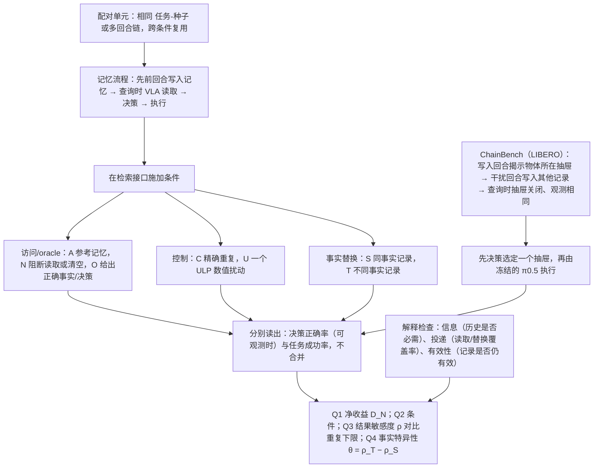

# Interventional Memory Evaluation VLA（arXiv:2610.23372）

**Interventional Memory Evaluation VLA**（*Beyond Success Rate: Interventional Evaluation of Memory in Vision–Language–Action Systems*，[arXiv:2610.23372](https://arxiv.org/abs/2610.23372)，[项目页](https://anonymous.4open.science/r/IMEP-ChainBench-DC83/)）来自 [具身智能小站 2026-11-01 盘点](../../sources/blogs/wechat_embodied_station_56_papers_libero_dynamic_latency_eval_2026-11-01.md)，属「评测与基准」组。

## 一句话定义

**IMEP在检索接口替换事实、保留事实或施加微小数值扰动，分开判断决策与执行；ChainBench补充历史依赖任务，强调用事实特异性证据验证记忆作用。**

## 英文缩写速查

| 缩写 | 英文全称 | 简要说明 |
|------|----------|----------|
| Interventional Memory Evaluation VLA | Beyond Success Rate: Interventional Evaluation of Memory in Vision–Language–Action Systems | 本文方法 / 基准的简称 |

## 为什么重要

- 成功率变高，不能证明记忆真的被使用。
- 开源结论：**项目页未列 GitHub**（步骤 2.5，2026-11-01）。项目页为 anonymous.4open.science 匿名链接，curl 返回 HTTP 401，无法核查代码。
- 同期同组工作见 [动态评测、技能编译与环境潜变量适配：具身智能小站 11-01 期 56 篇阅读坐标](../overview/embodied-station-2026-11-01-56-papers-technology-map.md)。

## 流程总览

图依据：论文 §3.1–3.5 / Fig.2。

## 核心机制

| 项 | 内容 |
|----|------|
| **arXiv** | [2610.23372](https://arxiv.org/abs/2610.23372) |
| **开源** | **项目页未列 GitHub** |
| **要点** | IMEP在检索接口替换事实、保留事实或施加微小数值扰动，分开判断决策与执行；ChainBench补充历史依赖任务，强调用事实特异性证据验证记忆作用。 |
| **文内指标** | 公众号未给具体数字，本页不引用。 |

## 源码运行时序图

**不适用（项目页未列 GitHub）** — 项目页为 anonymous.4open.science 匿名链接，curl 返回 HTTP 401，无法核查代码。 不编造运行脚本；代码公开后再补。

## 实验与评测

- 公众号未给具体数字，本页不引用。
- **读法：** 本页为索引级摘要，依据公众号转述的官方摘要与仓库信息整理；逐项数字与 baseline 以原文 PDF 为准。

## 与其他工作对比

- 横向索引见 [动态评测、技能编译与环境潜变量适配：具身智能小站 11-01 期 56 篇阅读坐标](../overview/embodied-station-2026-11-01-56-papers-technology-map.md)；同 arXiv 不重复造页。

## 结论

**成功率变高，不能证明记忆真的被使用：IMEP在检索接口替换事实、保留事实或施加微小数值扰动，分开判断决策与执行；ChainBench补充历史依赖任务，强调用事实特异性证据验证记忆作用。**

1. 开源边界：**项目页未列 GitHub** — 项目页为 anonymous.4open.science 匿名链接，curl 返回 HTTP 401，无法核查代码。
2. 核心机制：IMEP在检索接口替换事实、保留事实或施加微小数值扰动，分开判断决策与执行；ChainBench补充历史依赖任务，强调用事实特异性证据验证记忆作用。
3. 复现与选型前核对任务协议、硬件与基准口径，勿直接横比公众号摘录数字。

## 关联页面

- [simulation-evaluation-infrastructure](../concepts/simulation-evaluation-infrastructure.md)
- [vla](../methods/vla.md)
- [manipulation](../tasks/manipulation.md)
- [embodied-station-2026-11-01-56-papers-technology-map](../overview/embodied-station-2026-11-01-56-papers-technology-map.md)
- [具身大模型评测基准选型闭环](../queries/embodied-eval-benchmark-selection-loop.md) — 评测基准在选型闭环中的定位与取舍

## 参考来源

- [interventional_memory_evaluation_vla_arxiv_2610_23372.md](../../sources/papers/interventional_memory_evaluation_vla_arxiv_2610_23372.md)
- [wechat_embodied_station_56_papers_libero_dynamic_latency_eval_2026-11-01.md](../../sources/blogs/wechat_embodied_station_56_papers_libero_dynamic_latency_eval_2026-11-01.md)
- [arXiv:2610.23372](https://arxiv.org/abs/2610.23372)
- [arXiv PDF](https://arxiv.org/pdf/2610.23372)：已通读全文主文：IMEP 协议、干预与读出、ChainBench（§3、§4；附录仅查阅相关设定）

## 推荐继续阅读

- [arXiv PDF](https://arxiv.org/pdf/2610.23372)
- [项目页](https://anonymous.4open.science/r/IMEP-ChainBench-DC83/)
