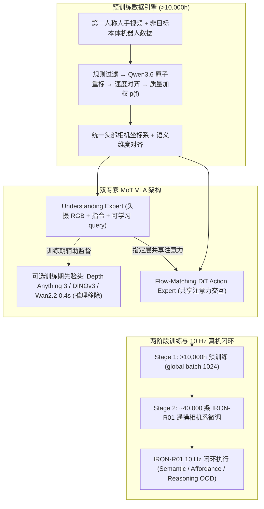

# IronMind：通过相机空间第一视角预训练扩展人形灵巧操作

**IronMind**（*IronMind: Scaling Humanoid Dexterous Manipulation via Camera-Space Ego-Centric Pretraining*，[arXiv:2609.39403](https://arxiv.org/abs/2609.39403)，[项目页](https://xpeng-robotics.github.io/ironmind/)）由 **小鹏机器人（XPENG Robotics）World Model Team** 提出：绕开无躯干真值的显式人–机全身运动学重定向，直接在**头部相机坐标系**中语义对齐第一人称人类手部轨迹与异构机器人数据，经 **>10,000 小时**数据清洗与双专家 **Mixture-of-Transformers（MoT）** VLA 预训练，并在 **IRON-R01** 人形真机上验证数据规模缩放规律与 OOD 灵巧操作迁移。

## 一句话定义

**把第一人称人手运动和外参标定后的机器人轨迹统一放进头部相机坐标系，用 >10,000 小时高质量清洗数据预训练双专家 MoT + flow-matching VLA，从而绕过躯干重定向假设并实现从 250h 到 10,000h 的对数线性缩放。**

## 英文缩写速查

| 缩写 | 英文全称 | 简要说明 |
|------|----------|----------|
| VLA | Vision-Language-Action | 视觉–语言–动作策略；本文采用双专家 MoT + flow-matching 架构 |
| MoT | Mixture-of-Transformers | 理解专家与动作专家参数隔离、指定层共享注意力的双流主干 |
| DiT | Diffusion Transformer | 本文流匹配动作专家骨干，用于去噪生成连续相机系轨迹块 |
| OOD | Out-of-Distribution | 未见过物体实例、affordance 或空间推理指令的真机评测集 |
| SLAM | Simultaneous Localization and Mapping | 从头戴第一人称视频估计相机自身运动轨迹 |

## 为什么重要

- **破除第一人称数据「必须做躯干重定向」的假设：** 低成本头戴相机没有躯干/脊柱动捕，硬假定刚体垂直脊柱会引入明显标注噪声，且机器人头摄安装微小偏差会导致观测与躯干系动作失配；统一到**头部相机系**同时消除了这两类误差。
- **验证大规模人类第一人称数据的缩放拐点：** 在 250h–10,000h 预训练预算区间，验证损失以 **−0.058 / decade** 对数线性下降且未饱和；真机六项 OOD 成功率在 ≤5,000h 时仍 ≤11.7%，到 **10,000h 跃升至 55.0%**，呈现明显的规模阈值效应。
- **训练期世界先验与真机闭环的实证权衡：** 论文同时测出「深度（Depth Anything 3）+ 语义（DINOv3）+ 视频未来帧（Wan2.2 0.4s）」能稳定拉高**开环**逼近指标，但**真机闭环**表现反而低于无辅助世界先验版本（31.7% vs 55.0%），为 VLA 训练目标取舍提供了反直觉一手的实证警钟。

## 核心信息

| 项 | 内容 |
|----|------|
| **机构** | 小鹏机器人（XPENG Robotics）World Model Team |
| **作者** | Huimin Pan\*、Yufan Ren\*†、Kunpeng Song\*、Siyang Wang\*、Xiwen Zhang\* 等 19 位作者 |
| **预训练语料** | **>10,000 小时** 第一人称人类视频 + 非目标本体异构机器人数据（不含 IRON-R01） |
| **后训练数据** | 约 **40,000** 条过滤后的 IRON-R01 遥操作轨迹（经外参转至头部相机系） |
| **评测平台** | 开环（970 approaching + 120 grasping）、3-chunk 策略闭环、IRON-R01 真机（10 Hz 闭环） |
| **开源状态** | **确认未开源**（截至 2026-11-22，项目页与 `xpeng-robotics` 组织未列代码、权重或数据集） |

## 核心原理

### 1）相机坐标系动作接口与数据清洗引擎

- **统一坐标与语义对齐：** 人类视频保留相机 SLAM 轨迹与相机系 3D 手部参数化姿态；异构机器人与 IRON-R01 轨迹通过外参标定变换至头部相机系。腕位姿与手指屈曲等维度按**语义**映射到统一输出槽位。
- **四步数据策展（§3.1.2）：**
  1. **规则过滤：** 剔除相机内参缺失/无效或遮挡导致的病态 3D 手姿帧；
  2. **原子任务重标：** 将长视频切分为单意图片段，用 `Qwen3.6-35B-A3B` 生成原子指令，并在段边界掩码动作损失；
  3. **速度分布对齐：** 按数据分片均值速度做时间重缩放，使敏捷人手轨迹接近遥操控制速度；
  4. **逐帧质量加权：** 计算 $p(f)=e(f)g(f)\cdot s_{\mathrm{cam}}(f)s_{\mathrm{move}}(f)b_{\mathrm{vel}}(f)$（手可见性与跟踪门控 × 相机旋转稳定度、手移动量与段边界停顿加权），按累积分布逆变换采样。

### 2）双专家 MoT 与可选多模态世界先验

- **Understanding Expert：** 预训练 VLM 处理头摄 RGB 与语言指令，保留原生因果与跨注意力语言解码能力。
- **Action Expert：** flow-matching DiT 读取状态 token 与噪声动作块，在指定层通过流特定投影的共享注意力交互，生成平滑连续相机系动作块。
- **可选世界先验（仅训练期）：** 在理解专家前缀加入可学习 query token，分别以冻结 `Depth-Anything-3-Base`（深度）、`DINOv3`（语义）和冻结 `Wan2.2`（0.4s 未来 VAE latent，另对比 3D motion flow）监督；**推理时彻底移除教师网络与辅助预测头**。

### 流程总览

图依据：arXiv:2609.39403v1 §3.1–3.3、Fig. 1 / Fig. 3 / Fig. 4。

## 源码运行时序图

**不适用**（截至 2026-11-22，[项目页](https://xpeng-robotics.github.io/ironmind/) 与 `xpeng-robotics` 组织未发布源码、checkpoint 或数据集，仅有论文、技术图表与真机演示视频）。

## 工程实践

| 环节 | 论文设定与工程要点（arXiv:2609.39403v1） |
|------|----------------------------------------|
| **坐标系标定** | 真机部署需精确标定头部相机到机器人运动学树的外参；虽对挂载微小偏差比躯干系更鲁棒，但外参误差仍会直接污染动作监督与逆向控制映射 |
| **动作块与控制频率** | 训练采用 AdamW（global batch 1024，余弦退火至峰值 10%）；IRON-R01 真机以 **10 Hz** 闭环运行连续流匹配动作块 |
| **三层评测阶梯** | 先用单 chunk 开环（$d_{p10}$、progress、$\theta_{\mathrm{align}}$、$e_{\mathrm{FA}}$）与 3-chunk 重渲染闭环（policy-in-the-loop）低成本迭代预训练，再上 IRON-R01 测 OOD 闭环 |
| **世界先验开关** | **真机闭环默认不启用世界先验监督**（Table 5 显示无世界先验 55.0% 显著高于带世界先验 31.7%），建议仅在开环表征诊断或新对齐机制下再启用 |
| **开源与复现** | **未开源**；复现需自建 >10,000h 第一人称清洗流水线（MHR 3D 手姿 + Qwen3.6 重标）及 IRON-R01 级 40k 遥操微调集 |

## 实验与评测

### 1）预训练数据缩放（开环 970 approaching + 120 grasping & 3-chunk 闭环，Table 1–2）

- **验证损失：** 250 h → 10,000 h 呈对数线性下降，斜率 **−0.058 / decade**，未见饱和。
- **开环与闭环逼近：**

| 预训练预算 | 开环 \(d_{p10}\) (cm) ↓ | 开环 Prog. (%) ↑ | 开环 \(e_{\mathrm{FA}}\) (mm) ↓ | 3-chunk 闭环 \(d_{p10}\) (cm) ↓ | 3-chunk 闭环 Prog. (%) ↑ |
|-----------|-------------------------|-----------------|-------------------------------|--------------------------------|--------------------------|
| 250 h | 37.8 | 14.7 | 19.97 | 32.0 | 21.4 |
| 500 h | 33.4 | 28.1 | 19.54 | 25.6 | 32.2 |
| 2,000 h | 32.0 | 30.7 | 23.83 | 23.0 | 39.0 |
| 5,000 h | 30.8 | 34.0 | 20.33 | 22.7 | 39.1 |
| **10,000 h** | **25.8** | **44.9** | **15.66** | **14.6** | **49.3** |

- **盲测人工偏好（Table 3）：** 10,000 h 对 250 h 在 70 票有效裁决中获 **47 票（67.1% 胜率）**，另有 30 票平局。

### 2）真机六项 OOD 消融（IRON-R01，每任务 10 trials，Table 5 & Fig. 10）

| 模型变体（10,000h 预训练 + ~40k IRON-R01 后训练） | 成功率 ↑ | 里程碑进度 ↑ | 备注 |
|-------------------------------------------------|----------|--------------|------|
| **IronMind（相机系、无世界先验）** | **55.0%** | **71.3%** | ≤5,000h 各预算均 ≤11.7%，无预训练仅 5.0% |
| IronMind（带三项世界先验） | 31.7% | 53.3% | 开环逼近优（Table 4: 22.6 cm / 53.4%），但闭环掉点 23.3 pp |
| InternVLA-A1.5（同数据微调） | 30.0% | 47.8% | 公开权重微调，动作空间需重初始化 |
| IronMind（躯干坐标系基线） | 26.7% | 46.2% | 同 10,000h 数据转躯干系，低 28.3 pp |

## 结论

**IronMind 证明「头部相机坐标系 + 大规模高质量清洗」能有效解锁第一人称人类视频的缩放红利，但仅在突破数千小时阈值并配合真机后训练后才显现跃迁，且训练期辅助世界先验并未顺利转化为真机闭环收益。**

1. **动作参考系选择：** 在缺乏躯干真值的第一人称语料上，头部相机系相比躯干系在 10,000h 同预算下带来 **+28.3 pp**（55.0% vs 26.7%）真机 OOD 差距。
2. **数据清洗与规模缺一不可：** 规则过滤 + VLM 原子重标 + 速度对齐 + $p(f)$ 质量加权配合 >10,000h 规模才拉出 5,000h→10,000h 的真机跃迁（≤11.7% → 55.0%）。
3. **开环 ≠ 闭环（世界先验警示）：** Depth Anything 3 + DINOv3 + Wan2.2 先验在开环将 $d_{p10}$ 从 27.6 cm 降至 22.6 cm，但在真机接触闭环中反而掉至 31.7%，辅助监督与接触控制之间仍存在失配。
4. **落地前提：** 预训练不含目标本体数据，真机仍依赖约 40k 条 IRON-R01 遥操作微调与精确相机外参标定；**官方尚未开源**，当前主要作为数据工程与表示选型参照。

## 局限与风险

- **未开源：** 代码、清洗流水线实现与 10,000h 预训练权重均未公开，第三方无法直接复现或校验超参细节。
- **场景与评测覆盖：** 语料集中于家庭/厨房/车间；真机仅在单个 IRON-R01 平台测 6 项 OOD 任务（每项 10 次），尚缺长程复杂操作与多本体对照。
- **仍依赖外参标定与真机后训练：** 相机坐标系减少了躯干假设误差，但未消除对头摄外参和目标机 ~40k 遥操数据的依赖。
- **世界先验的闭环退化未解决：** 为何开环更好的多模态世界先验在真机闭环退化 23.3 pp 尚待进一步机制分析。

## 与其他工作对比

| 维度 | IronMind（本文） | [EgoScale](../methods/egoscale.md) | [XPACE](./paper-xpace.md) | [AnyWorld](./paper-anyworld.md) |
|------|------------------|------------------------------------|---------------------------|----------------------------------|
| **人→机接口** | **头部相机系语义对齐**（免躯干重定向） | 相对腕运动重定向到关节空间 | 共享运动学 schema + bridge 数据 | 动作–相机–具身因子化视频重组 |
| **骨干范式** | 双专家 MoT（VLM + flow-matching DiT） | 规模化第一人称预训练 VLA | 因果视频–动作 MoT + SGF simulator | WAN Fun-Control 14B 数据引擎 |
| **世界模型作用** | 可选训练期先验（真机闭环反而不启更优） | 动作策略主干 | 核心联合预测与合成 recovery 自改进 | 离线合成机器人域 rollout 喂给 UniT |
| **开源状态** | 未开源 | 未开源（以官方页为准） | 未开源 | 已开源推理与编辑脚本（`xpeng-robotics/AnyWorld`） |

## 关联页面

- [VLA（Vision-Language-Action）](../methods/vla.md)
- [EgoScale](../methods/egoscale.md) — 另一条大规模第一人称人类视频预训练对照
- [XPACE](./paper-xpace.md) — 同机构小鹏机器人联合世界–动作建模路线
- [AnyWorld](./paper-anyworld.md) — 同机构跨具身因子化世界模型数据引擎
- [Locomotion](../tasks/locomotion.md) / [Loco-manipulation](../tasks/loco-manipulation.md)
- [【9.28–10.2 前沿论文动态】人形/四足49篇](../overview/frontier-humanoid-quadruped-2026-09-28-10-02.md)

## 参考来源

- [IronMind 论文归档（arXiv:2609.39403v1）](../../sources/papers/ironmind_arxiv_2609_39403.md)
- [IronMind 官方项目页归档](../../sources/sites/xpeng-robotics-ironmind.md)
- [【9.28–10.2 前沿论文动态】人形/四足49篇 综述条目](../../sources/blogs/frontier_humanoid_quadruped_2026_09_28_10_02.md)

## 推荐继续阅读

- [IronMind 论文全文（arXiv:2609.39403）](https://arxiv.org/abs/2609.39403)
- [IronMind 官方项目页](https://xpeng-robotics.github.io/ironmind/)
- [InternVLA-A1.5（arXiv:2607.04988）](https://arxiv.org/abs/2607.04988) — 本文共享注意力 MoT 与潜在先验主要结构参照及真机基线
