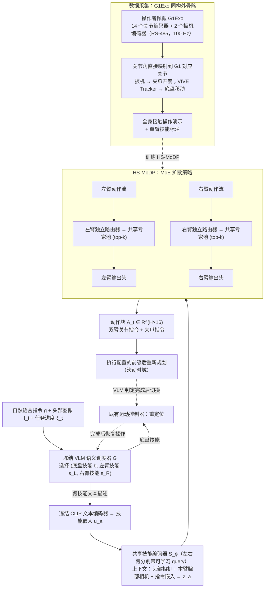

# G1Exo 组合操作：基于同构遥操作与独立技能路由的组合式人形操作

**G1Exo 组合操作**（*Compositional Humanoid Manipulation through Isomorphic Teleoperation and Independent Skill Routing*，[arXiv:2610.26169](https://arxiv.org/abs/2610.26169)）收录于 senlanke「具身运控lab」10-19–10-23 前沿论文动态（人形/四足）。本页依据**周报条目 + arXiv 摘要页**整理，流程图依据论文方法部分（见参考来源），未逐页核对实验数字；指标与结论以论文为准。

## 一句话定义

**G1Exo 组合操作：基于同构遥操作与独立技能路由的组合式人形操作——提出共享专家池、左右臂独立语义路由的扩散策略；设计 G1Exo 同构外骨骼直接采集关节级接触操作数据，并通过语义调度器交替执行操作与身体重定位。**

## 英文缩写速查

| 缩写 | 英文全称 | 简要说明 |
|------|----------|----------|
| RL | Reinforcement Learning | 强化学习 |
| WBC | Whole-Body Control | 全身控制 |

## 为什么重要

- 周报所述待解决的问题：分别采集的左右臂技能难以自由组合，而为每种双臂技能组合重新示范成本过高。

## 流程总览

图依据：论文 §III（G1Exo）、§IV-A–E / Fig. 3、式 1–6。

## 核心机制

| 项 | 内容 |
|----|------|
| **arXiv** | [2610.26169](https://arxiv.org/abs/2610.26169) · [PDF](https://arxiv.org/pdf/2610.26169) |
| **作者（arXiv）** | Yiming Wang, Peixian Yang, Lifeng Zhuo, Lai Wei, Xinling Du, Kun Song, Weiming Wang, Daolin Ma |
| **机构（周报所述，未逐条核实）** | 上海交通大学、香港大学、Xense Robotics、复旦大学 |
| **arXiv 评论栏** | （无） |
| **开源** | arXiv 摘要页与评论未见代码或项目页链接（仅核对 arXiv 摘要页，不代表未发布）（2026-10-26） |
| **周报所述创新点** | 提出共享专家池、左右臂独立语义路由的扩散策略；设计 G1Exo 同构外骨骼直接采集关节级接触操作数据，并通过语义调度器交替执行操作与身体重定位。 |

### arXiv 摘要节选（英文原文）

> Humanoid manipulation requires reusable arm skills, yet demonstrating every possible skill combination is impractical. We present Humanoid Semantic Mixture-of-Experts Diffusion Policy (HS-MoDP), which composes separately demonstrated arm skills through independent semantic routing over a shared expert pool.

## 源码运行时序图

**不适用**：arXiv 摘要页与评论未见代码或项目页链接（仅核对 arXiv 摘要页，不代表未发布），无可对齐的官方代码流程。

## 实验与评测

- 周报与摘要给出的数字/场景已写入上表「创新点」与摘要节选；其余实验细节、基线与成功率定义请回到论文正文。
- 读法：先对齐任务设定、传感器与成功定义（仿真/真机），再解读 headline 数字，勿跨论文直接比较。

## 与其他工作对比

| 维度 | 读法 |
|------|------|
| **同周对照** | 见 [人形/四足周报技术地图](../overview/senlanke-weekly-2026-10-19-23-humanoid-quadruped-technology-map.md)，按方向浏览同期论文 |
| **开源状态** | arXiv 摘要页与评论未见代码或项目页链接（仅核对 arXiv 摘要页，不代表未发布） |

## 结论

**G1Exo 组合操作：基于同构遥操作与独立技能路由的组合式人形操作。**

1. 本页是入库级摘要，复现前请核对论文正文、附录与代码仓库。
2. 指标须连同实验条件解读。
3. 关注 arXiv 版本更新与代码发布。

## 关联页面

- [senlanke-weekly-2026-10-19-23-humanoid-quadruped-technology-map](../overview/senlanke-weekly-2026-10-19-23-humanoid-quadruped-technology-map.md)
- [humanoid-locomotion](../tasks/humanoid-locomotion.md)
- [reinforcement-learning](../methods/reinforcement-learning.md)

## 参考来源

- [isomorphic-teleop-skill-routing-humanoid_arxiv_2610_26169.md](../../sources/papers/isomorphic-teleop-skill-routing-humanoid_arxiv_2610_26169.md)
- [wechat_senlanke_weekly_humanoid_quadruped_2026-10-19_23.md](../../sources/blogs/wechat_senlanke_weekly_humanoid_quadruped_2026-10-19_23.md)
- [arXiv:2610.26169](https://arxiv.org/abs/2610.26169)
- [arXiv PDF](https://arxiv.org/pdf/2610.26169)：已通读方法部分（实验与附录以略读为准）：§I–IV（引言、相关工作、G1Exo 硬件、HS-MoDP 的问题表述/技能条件化/独立路由/训练目标/技能调度）

## 推荐继续阅读

- [arXiv PDF](https://arxiv.org/pdf/2610.26169)
