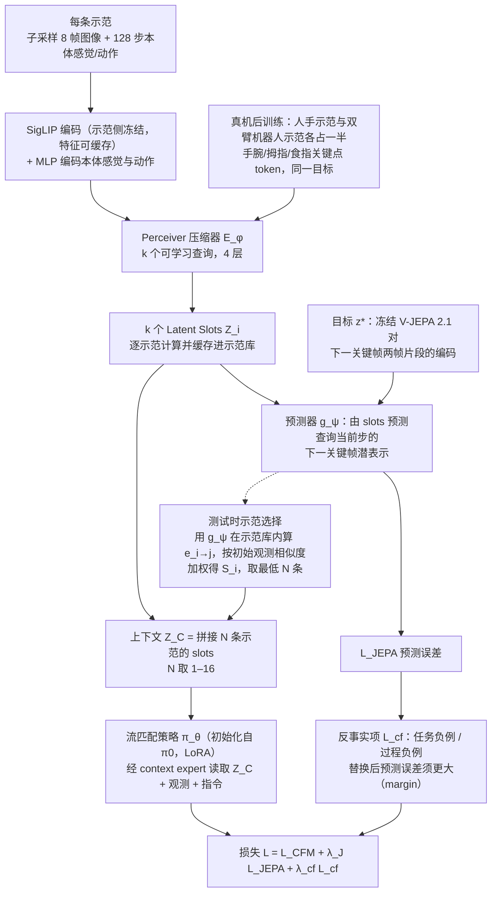

# JEDI：面向上下文模仿学习的联合嵌入示范压缩

**JEDI**（*JEDI: Joint-Embedding Demonstration Compression for In-Context Imitation Learning*，[arXiv:2610.40356](https://arxiv.org/abs/2610.40356)）收录于 senlanke「具身运控lab」10-26–10-30 前沿论文动态（Manipulation）。本页依据**周报条目 + arXiv 摘要页**整理，未逐页核对正文 PDF；指标与结论以论文为准。

## 一句话定义

**JEDI：面向上下文模仿学习的联合嵌入示范压缩——将每条示范压缩为少量 Latent Slots，并使用冻结的 V-JEPA 预测查询轨迹下一阶段的关键帧表示。同时引入任务和执行过程的反事实示范，使压缩表示保留抓取位置、操作顺序等信息，而不只是任务语义。还通过预测误差选择更有用的示范，并支持人手视频作为机器人操作条件。**

## 英文缩写速查

| 缩写 | 英文全称 | 简要说明 |
|------|----------|----------|
| VLA | Vision-Language-Action | 视觉–语言–动作模型 |
| IL | Imitation Learning | 模仿学习 |

## 为什么重要

- 周报所述待解决的问题：上下文模仿学习需要将示范轨迹作为条件输入，但完整示范包含大量图像和动作 Token，限制了可同时使用的示范数量。

## 流程总览

图依据：论文 §3.1–3.7 / Fig. 2。

## 核心机制

| 项 | 内容 |
|----|------|
| **arXiv** | [2610.40356](https://arxiv.org/abs/2610.40356) · [PDF](https://arxiv.org/pdf/2610.40356) |
| **作者（arXiv）** | Liang, Jiazhao, He, Zhewen, Yuan, Shuaihang, Huang, Hao, Fang, Yi |
| **机构（周报所述，未逐条核实）** | 纽约大学、纽约大学阿布扎比分校。 |
| **arXiv 评论栏** | （无） |
| **开源** | arXiv 摘要页与评论未见代码或项目页链接（仅核对 arXiv 摘要页，不代表未发布）（2026-11-02） |
| **周报所述创新点** | 将每条示范压缩为少量 Latent Slots，并使用冻结的 V-JEPA 预测查询轨迹下一阶段的关键帧表示。同时引入任务和执行过程的反事实示范，使压缩表示保留抓取位置、操作顺序等信息，而不只是任务语义。还通过预测误差选择更有用的示范，并支持人手视频作为机器人操作条件。 |

### arXiv 摘要节选（英文原文）

> In-context imitation learning (ICIL) adapts robot policies through test-time demonstrations, but long multimodal trajectories constrain how many examples fit in context. We ask what a compressed demonstration should preserve.

## 源码运行时序图

**不适用**：arXiv 摘要页与评论未见代码或项目页链接（仅核对 arXiv 摘要页，不代表未发布），无可对齐的官方代码流程。

## 实验与评测

- 周报与摘要给出的数字/场景已写入上表「创新点」与摘要节选；其余实验细节、基线与成功率定义请回到论文正文。
- 读法：先对齐任务设定、传感器与成功定义（仿真/真机），再解读 headline 数字，勿跨论文直接比较。

## 与其他工作对比

| 维度 | 读法 |
|------|------|
| **同周对照** | 见 [Manipulation周报技术地图](../overview/senlanke-weekly-2026-10-26-30-manipulation-technology-map.md)，按方向浏览同期论文 |
| **开源状态** | arXiv 摘要页与评论未见代码或项目页链接（仅核对 arXiv 摘要页，不代表未发布） |

## 结论

**JEDI：面向上下文模仿学习的联合嵌入示范压缩。**

1. 本页是入库级摘要，复现前请核对论文正文、附录与代码仓库。
2. 指标须连同实验条件解读。
3. 关注 arXiv 版本更新与代码发布。

## 关联页面

- [senlanke-weekly-2026-10-26-30-manipulation-technology-map](../overview/senlanke-weekly-2026-10-26-30-manipulation-technology-map.md)
- [manipulation](../tasks/manipulation.md)
- [vla](../methods/vla.md)

## 参考来源

- [jedi-demonstration-compression-in-context-il_arxiv_2610_40356.md](../../sources/papers/jedi-demonstration-compression-in-context-il_arxiv_2610_40356.md)
- [wechat_senlanke_weekly_manipulation_2026-10-26_30.md](../../sources/blogs/wechat_senlanke_weekly_manipulation_2026-10-26_30.md)
- [arXiv:2610.40356](https://arxiv.org/abs/2610.40356)
- [arXiv PDF](https://arxiv.org/pdf/2610.40356)：已通读全文：方法 §3.1–3.7（压缩器、预测目标、反事实项、策略训练、示范选择、人手后训练）与 Fig. 2

## 推荐继续阅读

- [arXiv PDF](https://arxiv.org/pdf/2610.40356)
