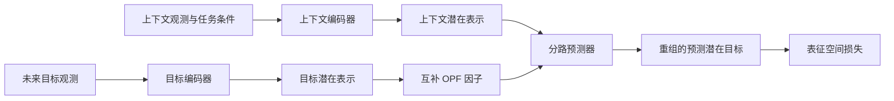
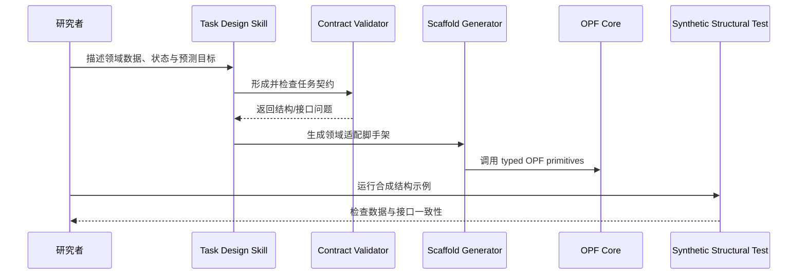

# JEPA-Anything（跨世界预测模型）

## 一句话定义

JEPA-Anything 以 **Orthogonal Predictive Factorization（OPF）** 组织跨领域 JEPA：把未来潜在目标拆成互补因素、分别预测后重组为共享预测表示；它学习潜在预测，不是逐帧渲染视频的生成器。

## 英文缩写速查

| 缩写 | 英文全称 | 简要说明 |
|------|----------|----------|
| JEPA | Joint Embedding Predictive Architecture | 在表征空间预测目标，而非必须生成像素 |
| OPF | Orthogonal Predictive Factorization | 将潜在目标分解为互补、正交化因素并分路预测 |
| EMA | Exponential Moving Average | 常见 JEPA target encoder 更新方式，仓库含对应基线实现 |
| OOD | Out-of-Distribution | 分布外泛化；跨世界任务要关注的评估问题 |
| DFM | Digital Foundation Model | PhAI Labs 使用的科学基础模型研究范式称呼，不是本项目运行时依赖 |

## 核心原理

论文的 OPF 试图解除单个潜在向量承担多种动力学因素时的纠缠：对潜在目标作互补因子分解，各预测路径学习不同因素，再组合成共享的预测设计。其关键主张是结构可以从视觉扩展到不同科学和动力学域，而不是宣称一个已经统一训练的通用模型可以无条件解决所有领域。

## 评测与结果

论文摘要报告七类领域（视觉、生物、临床轨迹、控制、分子动力学、物理场、天气）和十项动力学任务，并称相较匹配 JEPA 基线各项指标改善。代表性结果包括：

- Interventional Pong 单次干预误差降低 34.8%。
- 四类分子系统报告一步与 100 步预测误差最佳。
- 临床任务覆盖超过 1000 个事件预测。
- 生物干预发现由细胞共培养、类器官、肿瘤片段与小鼠实验支持。
- Kepler 缩放斜率报告为 -1.4991。

不同证据来自不同任务和验证流程，不能把所有结果视为同一类端到端模型能力。尤其生物实验的外部验证与抽象预测基准应分别解读。

## 源码运行时序图

GitHub 仓库公开 OPF typed PyTorch 核心、任务契约/验证器、生成脚手架的 skill，以及用于验证结构的 synthetic example。下图描述仓库可见的开发时序；它不包含论文训练/评测的全域流水线。

## 开源与复现边界

官方仓库为 Apache-2.0，提供核心原语、任务设计辅助和结构示例；synthetic example 不训练模型，也不复现论文指标。仓库没有领域数据集或训练权重。PhAI Labs 项目页另列 Hugging Face 模型集合，但那是独立资源，不能推断为 GitHub 仓库自带的可复现实验套件。当前没有公开演示。

## 局限与风险

- 七领域的统一框架主张依赖各领域各自的任务契约、数据和评测，不能只凭公共核心库判断迁移性能。
- OPF 因子索引本身不代表可解释的语义；因子语义需要干预证据支持。
- 论文汇总的一步/长程误差、临床预测及生物验证属于不同指标和证据类型，横向比较需回到各任务协议。
- 代码仓当前的 structural example 仅做接口/结构验证，不是训练脚本；按仓库 quickstart 运行并不会重现论文结果。
- 预测式 JEPA 表征与像素级视频生成器目标不同，不能仅凭“世界模型”称呼推定其可直接生成机器人视觉 rollout。

## 结论

JEPA-Anything 的核心价值是提出可复用的潜在预测因子化结构并在多个科学/动力学任务报告结果，公开代码则主要支撑核心原语与任务适配开发，论文全套实验复现能力仍需单独核验。

- 将 OPF 视为架构假设，评估时要与任务匹配的 JEPA baseline 对照。
- 阅读跨域结果时保留每个任务的预测跨度、数据量和外部验证方式。
- 预测 latent 不等于像素渲染，接入具身规划仍需明确观测/动作接口与闭环评测。
- 仓库结构示例适合启动适配，不应作为论文性能复现证据。
- 与后续 RSI-Anything 的关系是方法基础与系统应用，不是同一个项目或代码仓。

## 关联页面

- [RSI-Anything](./paper-rsi-anything.md) — 在其基础上把预测用于候选筛选和迭代改进。
- [PhAI Labs](./phai-labs.md) — 项目发布机构及 DFM 关系说明。
- [生成式世界模型](../methods/generative-world-models.md) — JEPA 属于潜在预测路线，与像素视频生成路线区分。

## 参考来源

- [JEPA-Anything 论文归档](../../sources/papers/jepa_anything_arxiv_2609_20800.md)
- [JEPA-Anything 官方仓库归档](../../sources/repos/jepa-anything.md)
- [PhAI Labs 项目页归档](../../sources/sites/jepa-anything.md)

## 推荐继续阅读

- [JEPA-Anything arXiv 页面](https://arxiv.org/abs/2609.20800)
- [JEPA-Anything GitHub](https://github.com/Gen-Verse/JEPA-Anything)
- [RSI-Anything](./paper-rsi-anything.md)
