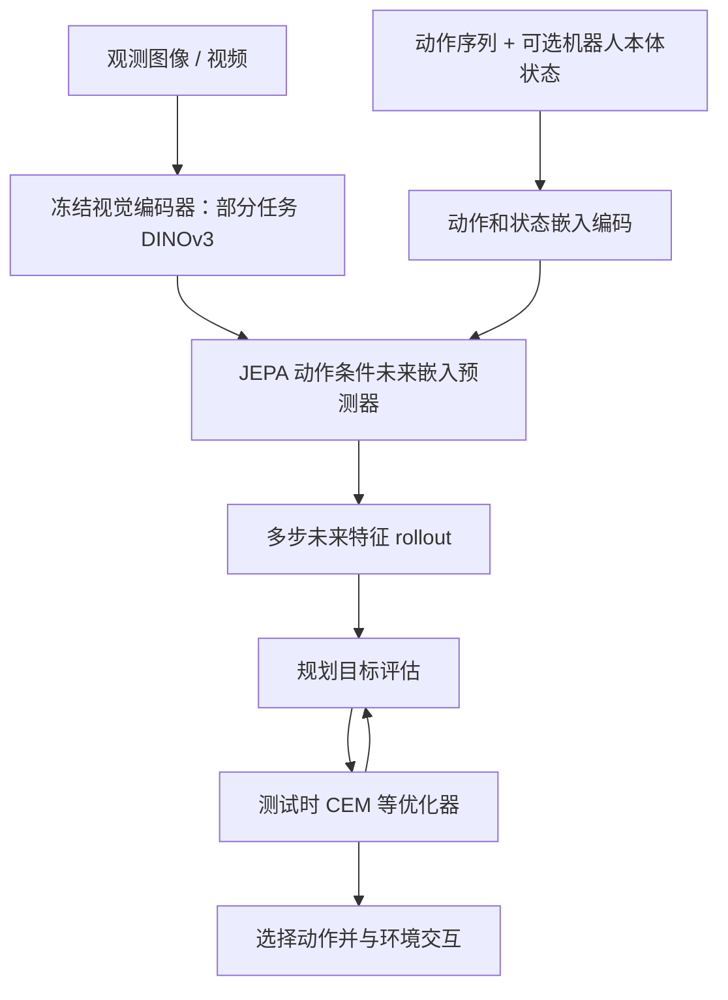
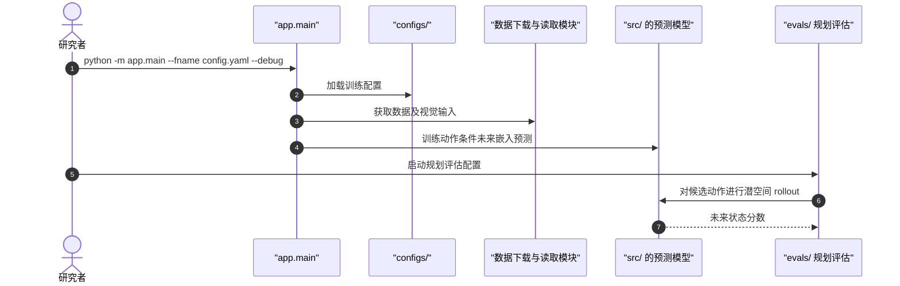

# JEPA-WMs — Joint-Embedding Predictive World Models / 联合嵌入预测物理规划世界模型

## 一句话定义

**JEPA-WMs** 以冻结视觉表征、动作及可选本体状态输入训练未来嵌入预测器，再在测试时通过模型预测搜索动作；部分机器人任务使用 DINOv3 ViT-L/16。

## 英文缩写速查

| 缩写 | 英文全称 | 简要说明 |
|---|---|---|
| JEPA | Joint-Embedding Predictive Architecture | 联合嵌入预测学习架构 |
| WM | World Model | 动作条件潜空间动力学模型 |
| DINOv3 | Self-Distillation with No Labels v3 | DROID/RoboCasa 使用的视觉骨干 |
| CEM | Cross-Entropy Method | 测试时优化候选动作序列 |
| DoF | Degrees of Freedom | 机器人动作自由度 |

## 为什么重要

研究将世界模型表示学习和测试时规划分开，帮助判断成功到底来自视觉表征、动力学模型、上下文长度还是规划优化器，而非将所有改进归于大参数量。

## 流程总览

## 核心机制

- 将未来状态预测写在联合嵌入空间中，使用未来视觉特征作为学习目标，不要求先重建像素。
- 训练预测器时可使用动作条件、机器人本体感知，推理时规划器比较候选轨迹。
- 代码明确区分 **DROID / RoboCasa 为 DINOv3 ViT-L/16** 和 **Push-T / PointMaze / Wall 等的 DINOv2 版本**，不能统称 DINOv3 世界模型。

## 源码运行时序图

依据官方 README 的 `app.main`、`evals`、`configs` 入口；不声称已逐函数审计。

## 工程实践

- 先依官方 README 安装 conda/uv 依赖、数据与对应 DINOv3 或 DINOv2 checkpoint。
- 单进程调试入口：`python -m app.main --fname <config.yaml> --debug`。
- 逐任务选择正确配置，不可把 DROID checkpoint 移到 Push-T 直接视为复现。

## 实验与评测

论文以不同物理规划任务和世界模型设计进行系统比较，涉及多步预测、规划器和本体状态等因素；当前未逐项复核全部实验数值，因此不在本页写跨任务绝对优劣。

## 与其他工作对比

- [DUET-DINO](paper-duet-dino.md) 强调双相机跨视角未来表示与 CEM；本工作重点是通用 JEPA 世界模型设计因素。
- [DINO-WM](paper-sa-2411-04983-dino-wm-world-models-on-pre-trained-visual-featu.md) 以 DINOv2 特征做目标图像规划，是时间上更早的对照。

## 结论

**JEPA-WMs 的主要启示是潜空间动力学质量和测试时规划方式必须联合评估，DINOv3 只用于其中一部分实验。**

1. 选模型前先核对视觉编码器及任务数据集。
2. 测量多步 rollout 误差与规划器搜索预算。
3. 真机适配时应核对本体状态输入和动作空间差异。

## 局限与风险

- 本次未完整逐段阅读全文附录与源码；节点保持 **draft**。
- 规划成本与数据分布会影响跨本体迁移；不得直接外推论文整体真机表现。
- 官方仓库模型与数据依赖体量较大，复现需额外准备。

## 关联页面

- [DINOv3](paper-rcl-2508-10104-dinov3.md)
- [DUET-DINO](paper-duet-dino.md)
- [生成式世界模型](../methods/generative-world-models.md)

## 参考来源

- [论文归档](../../sources/papers/jepa-wms-physical-planning_arxiv_2512_24497.md)
- [官方源码核验](../../sources/repos/dinov3-wm-jepa-wms.md)

## 推荐继续阅读

- [论文原文](https://arxiv.org/html/2512.24497)
- [官方 GitHub](https://github.com/facebookresearch/jepa-wms)
