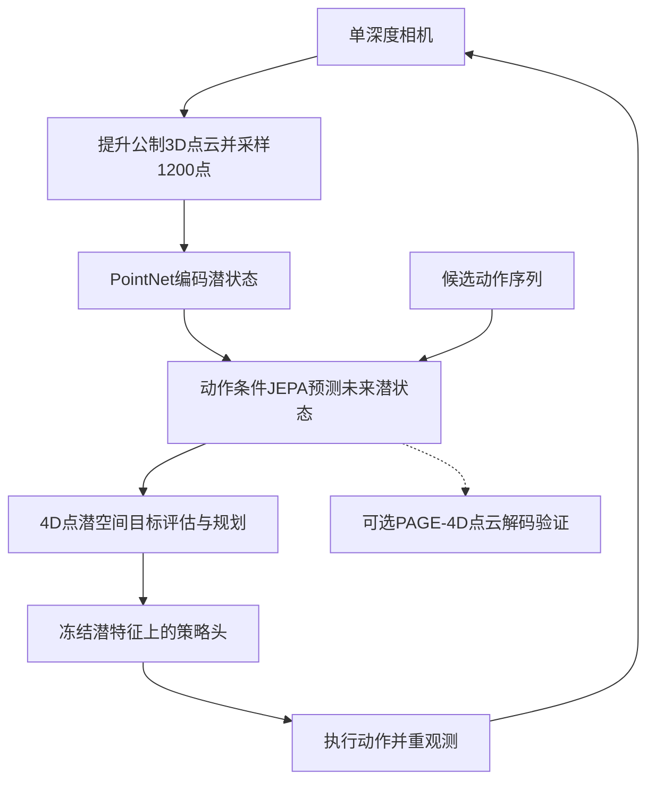
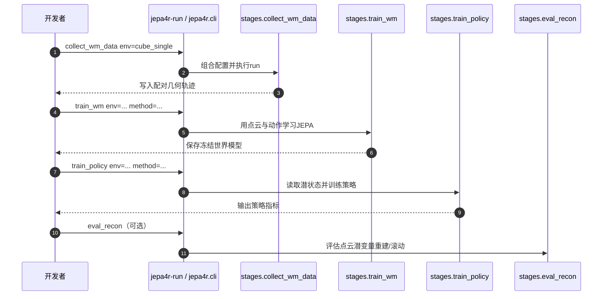

# JEPA4R: Embodied JEPA World Models with 4D Point Planning / 在 4D 点云潜空间预测未来与规划操作

## 一句话定义

**JEPA4R**：JEPA4R 使用单深度相机生成公制点云，在动作条件的 JEPA 潜空间做未来预测和动作规划；报告 200 步点云误差约 1.1 厘米内、MetaWorld 98.4%、Adroit Relocate 88.0%，并验证数字孪生到真机零样本迁移。

## 英文缩写速查

| 缩写 | 英文全称 | 简要说明 |
|---|---|---|
| JEPA | Joint-Embedding Predictive Architecture | 无像素重建的预测表示学习 |
| 3D | Three-Dimensional | 深度成像所恢复的公制空间位置 |
| 4D | Four-Dimensional | 三维点位随时间演变的表示 |
| SIGReg | Sketched Isotropic Gaussian Regularization | 防止表示坍缩的正则项 |
| DQC | Distributional Q-Conditioned | 相关下游策略训练路径 |

## 为什么重要

RGB 潜表示不显式提供距离、接触位置及物体几何，控制所需的空间误差很难量化。JEPA4R 从单相机深度恢复带尺度的点云，使未来预测、动作规划和控制在同一几何潜空间联结。

## 核心原理

1. 将单深度相机的图像提升到世界坐标点云，移除静态背景和任务不可见标记、5 mm 体素去重，采样 1200 个含 xyz/rgb 的点。
2. 使用与图像基线匹配容量的 PointNet 编码器（约 5.51M）和带动作条件的 JEPA 预测器，约 18M 参数的世界模型通过预测损失与 SIGReg 训练。
3. 冻结世界模型潜表示后训练策略头；可选点云解码支路以 PAGE-4D 重建未来点云进行定性与定量评估，解码器不是每次策略动作的必要环节。

## 流程总览

## 源码运行时序图

代码静态核对的真实入口如下（仅确认调用链，未执行训练）：

## 工程实践

- 官方 CLI 入口为 jepa4r-run；按 README 运行 collect_wm_data、prepare_policy_data、train_wm、train_policy，并用 eval_recon 或 report 比较几何与任务结果。
- jepa4r/cli.py 将训练/评测阶段分派至 jepa4r.stages.<stage>.run；pyproject.toml 中 jepa4r-run 映射到该入口。
- 真机上线前需要深度相机外参、可见性和点云采样统计一致；遮挡与透明反光物体要单独测试。

## 实验与评测

- 报告长时滚动 200 步平均点误差在约 1.1 cm 范围内；此为指定几何协议，不意味着开放世界无误差规划。
- MetaWorld 成功率 98.4%、Adroit Relocate 88.0%（论文固定协议）；跨任务比较应核对各自训练与数据条件。
- 通过 RM75-B 数字孪生训练，展示零样本真机迁移；真机实验规模、传感器标定和任务范围须单独说明。

## 结论

**JEPA4R 的价值应以相同任务协议、训练数据与推理测时边界判断，不能仅依据宣传规模或单一成功率。**

1. 将单深度相机的图像提升到世界坐标点云，移除静态背景和任务不可见标记、5 mm 体素去重，采样 1200 个含 xyz/rgb 的点。
2. 使用与图像基线匹配容量的 PointNet 编码器（约 5.51M）和带动作条件的 JEPA 预测器，约 18M 参数的世界模型通过预测损失与 SIGReg 训练。
3. 官方 CLI 入口为 jepa4r-run；按 README 运行 collect_wm_data、prepare_policy_data、train_wm、train_policy，并用 eval_recon 或 report 比较几何与任务结果。
4. jepa4r/cli.py 将训练/评测阶段分派至 jepa4r.stages.<stage>.run；pyproject.toml 中 jepa4r-run 映射到该入口。

## 与其他工作对比

| 对照 | 关键差异 |
|---|---|
| ResWAM | 冻结 DINOv3 的视觉特征残差作为监督；JEPA4R 的核心是公制点云与动作条件潜空间预测/规划。 |
| H-JEPA | 分层多时间尺度视觉规划与本工作基于单深度相机几何表示的点规划互补。 |

## 局限与风险

- 单视角深度数据依赖相机可见性及标定，遮挡时未来点云表示存在失真风险。
- 高成功率为特定模拟与数字孪生任务协议，不能等价于任意真机操作泛化。

## 关联页面

- [基于模型的强化学习](../methods/model-based-rl.md)
- [机器人操作](../tasks/manipulation.md)
- [世界–动作模型](../concepts/world-action-models.md)
- [H-JEPA](./paper-h-jepa-visual-planning.md)
- [ResWAM](./paper-reswam-2611-19559.md)
- [WAM 纵深路线](../../roadmap/depth-wam.md)

## 参考来源

- [论文全文归档](../../sources/papers/jepa4r-2611-19771.md)
- [arXiv 原文 v1](https://arxiv.org/html/2611.19771v1)
- [官方项目页归档](../../sources/sites/jepa4r-2611-19771.md)
- [官方代码归档](../../sources/repos/jepa4r-2611-19771.md)

## 推荐继续阅读

- [JEPA4R: Embodied JEPA World Models with 4D Point Planning](https://arxiv.org/abs/2611.19771)
- [官方项目页](https://aigeeksgroup.github.io/JEPA4R/)
- [官方代码](https://github.com/AIGeeksGroup/JEPA4R)

