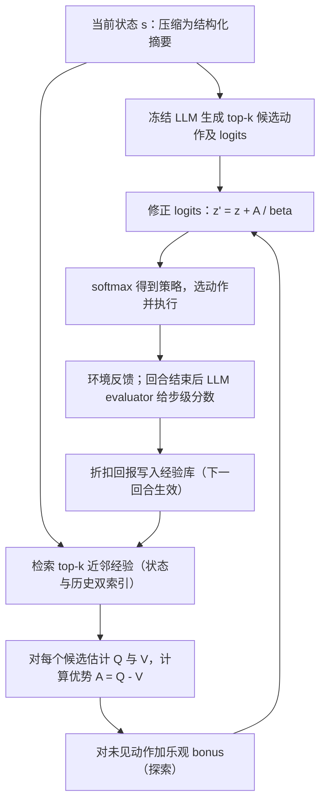
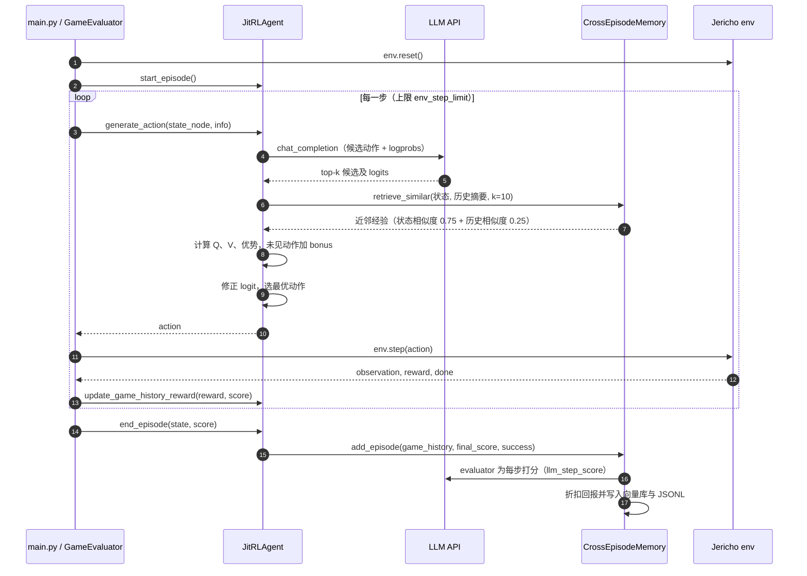

# JitRL：即时强化学习（Just-In-Time Reinforcement Learning）

## 一句话定义

**JitRL** 是一种**免梯度更新**的测试时策略优化方法：LLM 智能体部署后权重不变，它把每次交互存为 `<state, action, reward>` 经验，在决策时检索相似经验估计各候选动作的优势，再把优势**直接加到 LLM 的候选动作 logits 上**，从而在不训练参数的情况下持续改进（论文：[arXiv:2601.18510](https://arxiv.org/abs/2601.18510)，作者来自新加坡国立大学；代码：[liushiliushi/JitRL](https://github.com/liushiliushi/JitRL)）。

## 英文缩写速查

| 缩写 | 英文全称 | 简要说明 |
|------|----------|----------|
| JitRL | Just-In-Time Reinforcement Learning | 本文方法：测试时检索经验并修正 logits，无梯度更新 |
| KL | Kullback-Leibler divergence | 相对冻结参考策略的约束项，保证输出仍接近原 LLM 分布 |
| ICL | In-Context Learning | 把历史经验写进提示词的上下文学习，对照方法的主流路线 |
| WebArena | WebArena benchmark | 真实网站（购物、论坛、地图、GitLab 等）的网页智能体评测环境 |
| WebRL | 自进化在线课程 RL 框架（Qi et al., 2025） | 面向网页智能体的权重更新式 RL，本文的最强权重更新基线 |
| GRPO | Group Relative Policy Optimization | 组内相对优势的策略梯度方法，本文 Jericho 的训练式对照 |

## 为什么重要

- 智能体上线后常犯同样的错误；微调式 RL 成本高（论文估计 WebRL 训练约 $9,900，JitRL 约 $290），且有灾难性遗忘风险。
- 纯提示词记忆（Reflexion、AWM 等）随上下文变长而效果变差；JitRL 想保留 RL 的「按回报学习」，但把学习放在推理时的 logit 层。
- 对做具身或机器人规划的人，它给出一个可借鉴的范式：**把经验库当作非参数策略分布，用检索得到的优势做软修正**。注意它目前只在文本/网页动作空间验证，与连续控制的关系见下文「局限」。

## 核心信息

| 项目 | 内容 |
|------|------|
| 机构 | 新加坡国立大学（NUS） |
| 作者 | Yibo Li、Zijie Lin（共同一作）、Ailin Deng、Xuan Zhang、Yufei He、Shuo Ji（通讯）、Tri Cao、Bryan Hooi |
| 会议 | ICML 2026 Spotlight（依据代码 README 自述） |
| 评测 | WebArena（含 WebArena-Lite held-out）、Jericho（Zork1 / Zork3 / Library） |
| 骨干 | 免训练方法主要用 Gemini-2.5-flash；另报 GPT-5-mini、DeepSeek-V3.2；同骨架对比见下文 |
| 代码 | 已开源（推理与评测代码，无训练代码） |

## 核心原理

### 1. 经验记忆（§4.1）

- 每回合结束，LLM evaluator 读完整轨迹，为每步给出标量**步级奖励**；按折扣因子 γ 汇总成回报 G（论文 Jericho 取 γ=0.5，WebArena 取 γ=0.1，附录 H）。
- 原始状态（完整 DOM、长文本游戏描述）过于嘈杂，先压缩成结构化摘要：WebArena 用「正则化 URL + 近期输入」，文字游戏用 `Step t: [State: 名词] [Action: 动词]` 格式（附录 F）。

### 2. 测试时价值估计（§4.2）

- 对当前状态取 top-k 近邻（论文默认 k=10，相似度阈值 Jericho 0.95 / WebArena 0.8）。
- 状态价值 V̂(s)：近邻回报的均值；动作价值 Q̂(s,a)：近邻中执行过 a 的回报均值。
- **未见过的动作**不直接赋 0，而按「乐观不确定性」给一个奖励加成（UCB 类，探索率 Jericho 0.65、WebArena 0.05，附录 H）。
- 优势 Â(s,a) ≈ Q̂(s,a) − V̂(s)，式 (7)，即「相对局部平均好多少」。

### 3. 策略更新（§4.3，核心）

- 目标：在最大化期望优势的同时，约束与冻结参考策略 π_ref 的 KL 距离（式 8）。
- 论文声称闭式解（定理 4.1）经 logit 形式化为**加性更新**（式 10）：`z' = z + Â/β`，之后对 z' 做 softmax 得到修正后的策略。
- 我的推断（论文 HTML 未能提取公式，需对照 PDF 核对）：β 即式中温度，更新强度随 β 减小而增大；代码 `update_scores` 中 `corrected_logprob` 为原 logprob 加上归一化优势，与此形式一致。

### 4. 回合循环（文字游戏版，见下方时序图）

1. 基座 LLM 对当前状态输出 top-k 候选动作及 logprob（若 API 不给 logprob，用「verbalized」模式让模型输出 0–100 置信度再转换）。
2. 检索近邻，估计各候选的 Â，修正 logit，取最优动作执行。
3. 回合结束：evaluator 打分、写入经验库；下一回合检索到新经验。

## 工程实践

### 流程总览

图依据：论文 Fig.2、§4.1–§4.3；代码 `Jericho/src/jitrl_agent.py`、`cross_episode_memory.py`。

### 源码运行时序图

以 `Jericho/` 文字游戏版为准（WebArena 版结构相同，修正在 `WebArena/memory_agents/jitrl_agent.py` 的 `update_scores` 中完成）。

**关键复现路径：** 先确认 `--llm_model`（OpenRouter）与 `--enable_cross_mem` 设置，`python main.py --game_name zork1 --agent_type jitrl --eval_runs 10` 即可跑通一个回合循环；对照实验用 `--no-enable_cross_mem` 关闭跨回合记忆。

### 工程要点

| 项 | 论文设定（附录 H） | 备注 |
|----|-------------------|------|
| 候选动作数 | 3 | 来自基座 LLM |
| 检索近邻 k | 10（§5.6 图 4：8–14 较稳） | 太小方差大，太大噪声多 |
| 折扣 γ | Jericho 0.5 / WebArena 0.1 | WebArena 仓库默认与论文不一致，见 [源码核对](../../sources/repos/jitrl.md) |
| 温度 | 0.8 | 基座 LLM 采样温度 |
| 步数上限 | Jericho 60 / WebArena 10 | README 中 WebArena 默认 `--max_steps 30`，以论文为准 |

- **成本结构（论文 Table 9）**：JitRL 按 API token 计费，约 $290；WebRL 按 H200 训练估计 $9,900。二者计量口径不同，「降低 30 倍以上」应读作**量级**而非严格对比。
- **检索实现**：论文 WebArena 版用正则化 URL 先过滤，再算 Jaccard；Jericho 版用状态与历史两个向量索引加权（代码默认 `use_vector=True`）。两者都依赖文本表征，论文附录 L 显示文本摘要比稠密 embedding 稳定。

## 实验与评测

**WebArena 全量（Table 1，免训练方法之间比较，Avg / Final 成功率 %）**

| 方法 | Average Avg | Average Final |
|------|------------|--------------|
| Static | 35.63 | 36.30 |
| Memory（全部历史入上下文） | 41.36 | 43.00 |
| Reflexion | 41.08 | 42.12 |
| AWM | 39.37 | 40.32 |
| EvoTest | 39.24 | 42.49 |
| **JitRL** | **46.98** | **51.35** |

**Jericho（Table 3，Final 分数）**

| 方法 | Library | Zork1 | Zork3 |
|------|---------|-------|-------|
| Reflexion | 18 | 35 | 1 |
| AWM | 10 | 44 | 2 |
| EvoTest | 26 | 54 | 4 |
| GRPO（训练式） | 11 | 10 | 2 |
| **JitRL** | **30** | **69** | **5** |

**与权重更新方法的对比（需谨慎读）**

- Table 2（WebArena-Lite held-out）：JitRL Final **60.00**（Gemini-2.5-flash，免训练）vs WebRL **46.06**（Llama-3.1-70B 训练）。
- 同骨架（Llama-3.1-70B，离线训练 + 离线评测，Table 13）：JitRL **40.88** vs WebRL **46.06**，论文自己承认「该设定对权重更新方法有利」，JitRL 主要针对没有大规模离线数据的持续学习场景。
- Jericho 同骨架（Qwen3-32B，Table 14）：JitRL 在三个游戏上均高于 GRPO（具体数值见附录 J.2）。

**消融与分析**

- 「logit 更新」优于「把同样检索内容写进提示词」（Table 8，Admin / Reddit）。
- 跨任务记忆占检索上下文近 50%（Table 6），对未见任务的冷启动有收益（Table 5）。

## 局限与风险

- **依赖基座模型的候选集**：JitRL 只能在基座 LLM 给出的候选里重新加权，无法发现基座永远不会生成的动作（论文自述）。
- **依赖 evaluator 的步级打分**：信用分配错误会直接污染优势估计（论文自述）。
- **文本表征限制**：对棋盘、时序等难以用文字描述的状态，检索相似性可能失效（论文自述）。
- **骨干不一致**：论文的「优于 WebRL」结论主要来自 Table 2，骨干为 Gemini-2.5-flash 对 Llama-3.1-70B；同骨架结果反而是 WebRL 略高。阅读时应把两者分开。
- **评测协议**：WebArena 为同一任务**顺序重复多回合**，指标 Avg 与「同任务持续学习」绑定；主表（Table 1、3）未见误差条或多随机种子统计（据我所读，未核对附录逐表）。
- **可复现性**：代码自述 Gemini 快照已下线，默认模型已变更，数值可能偏移（仓库 README）。
- **隐私**：经验库存放真实交互轨迹，可能留存敏感用户信息（论文 Impact Statement）。
- **与机器人的距离**：实验全部在文本/网页动作空间；把它迁到连续控制或视觉动作，需要解决状态表征与候选动作集合的问题——这是我的推断，论文未涉及。

## 与相关工作对比

- 与 Reflexion、AWM、Memory 等「把经验写进提示词」的路线相比，JitRL 把经验转为**logit 层的软修正**，不占用上下文，论文以 Table 8 支持这一点。
- 与 WebRL 等权重更新式自进化相比，JitRL 把「学习」放到推理时；代价是每步检索与额外的 evaluator 调用。自进化 / 递归改进的更广背景见 [递归自我改进](../concepts/recursive-self-improvement.md)。
- 与 [在线 vs 离线 RL](../comparisons/online-vs-offline-rl.md) 的关系：JitRL 更接近「在线经验积累 + 离线式价值估计」的混合，但不更新参数。

## 结论

**JitRL 证明了：在冻结 LLM 上，用检索得到的经验优势直接修正动作 logits，可以在文本与网页任务上稳定超过提示词式记忆基线；但它与权重更新方法的比较高度依赖骨干与设定，「超过 WebRL」应读作「在其论文所设的持续学习条件下」。**

- 最可靠的证据是 WebArena 全量与 Jericho 的免训练对比（Table 1、3）。
- 最需要警惕的是跨骨架的 WebRL 对比（Table 2 vs Table 13）。
- 对机器人的启示是方法论：经验库 + 优势修正 + KL 约束，适合做低成本的测试时适应；直接迁到连续动作需要新的状态表征与候选生成。
- 复现时优先对齐附录 H 的超参数，并注意 README 默认值与论文不一致之处。

## 关联页面

- [Agent 记忆与 Dreaming](../concepts/agent-memory-and-dreaming.md)：经验记忆与测试时复用的同类设计
- [递归自我改进](../concepts/recursive-self-improvement.md)：权重更新式自进化的背景
- [AI Agent 评测](../concepts/ai-agent-evaluation.md)：WebArena 类评测口径
- [在线 vs 离线 RL](../comparisons/online-vs-offline-rl.md)：JitRL 所处的学习范式位置
- [自进化智能体：具身终身学习对比](../comparisons/self-improving-agents-embodied-lifelong-learning.md)：同主题的具身视角

## 参考来源

- [jitrl_arxiv_2601_18510.md](../../sources/papers/jitrl_arxiv_2601_18510.md)：论文归档，已通读（正文、附录 A–P；附录 G 提示词仅抽样）。
- [jitrl.md](../../sources/repos/jitrl.md)：官方仓库归档，已开源，已读 Jericho 与 WebArena 入口代码。
- [arXiv:2601.18510](https://arxiv.org/abs/2601.18510)：论文原文。
- 用户提供的解读专栏（<https://www.bilibili.com/read/cv53311456>）未能获取，**未用于本页**。

## 推荐继续阅读

- [JitRL 论文（arXiv:2601.18510）](https://arxiv.org/abs/2601.18510)：方法与全部实验，尤其附录 B（闭式解推导）与附录 H（超参数）。
- [JitRL 官方代码](https://github.com/liushiliushi/JitRL)：Jericho 与 WebArena 的完整运行入口。
- [WebArena（arXiv:2307.13854）](https://arxiv.org/abs/2307.13854)：评测环境原文。
- [WebRL（arXiv:2411.02337）](https://arxiv.org/abs/2411.02337)：本文的最强权重更新基线，应一并读其训练设定。
- [Reflexion（arXiv:2303.11366）](https://arxiv.org/abs/2303.11366)：免训练的语言反思基线。
