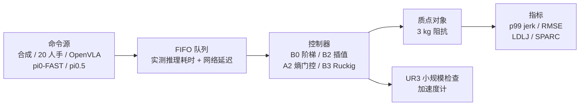

# JitterVLA：VLA 人机操作的运动质量回放基准

**JitterVLA**（[arXiv:2610.13628](https://arxiv.org/abs/2610.13628)，[项目页](https://faithogunwoye.github.io/JitterVLA/)）由 Skolkovo Institute of Science and Technology（Skoltech）智能空间机器人实验室提出：VLA 输出稀疏动作目标，到达控制器时间晚且不规则，机器人在人附近会出现突兀运动。该基准**固定命令序列和到达时序，只换控制器**，量化冲击（jerk）与跟踪误差的取舍。

## 一句话定义

**一个不依赖机器人闭环的成对回放基准：同一条 VLA 命令流、同一份延迟实现，分别喂给阶梯保持、线性插值、熵门控刚度、限 jerk 轨迹生成等控制器，比较 p99 jerk 与跟踪 RMSE。**

## 英文缩写速查

| 缩写 | 英文全称 | 简要说明 |
|------|----------|----------|
| VLA | Vision-Language-Action | 被评估的动作来源（OpenVLA、pi0-FAST、pi0.5） |
| Jerk | 加加速度（加速度对时间的导数） | 运动突兀程度的主指标，单位 m/s³ |
| RMSE | Root Mean Square Error | 相对无延迟参考轨迹的跟踪误差 |
| LDLJ | Log Dimensionless Jerk | 无量纲平滑度辅助指标 |
| SPARC | Spectral Arc Length | 频谱弧长平滑度指标 |
| FIFO | First In First Out | 命令到达队列模型 |

## 为什么重要

- **隔离变量：** 真实闭环里模型、延迟与控制器耦合；回放协议让差异只来自控制器。
- **指出取舍：** 插值在所有测试源上降低 jerk，但总有跟踪误差代价；限 jerk 生成降得更多、代价更高。
- **明确边界：** 作者把它定位为人机研究前的筛选工具，而不是安全认证。

## 核心信息

| 项 | 内容 |
|----|------|
| **机构** | Skolkovo Institute of Science and Technology（Skoltech），莫斯科 |
| **规模** | 838 个 VLA episode（598 为新留出抽样）、20 人手部轨迹、UR3 30 + 30 次回放；共 69,988 次成对回放 |
| **对象** | 通用三轴质点（3 kg），非 UR3 模型 |
| **开源** | 代码待发布；UR3 遥操作数据集已在 HuggingFace 可见（截至 2026-10-12） |

## 方法栈 / 流程总览

## 方法

**输入 / 输出：** 输入命令流与延迟实现，输出各控制器的 jerk 与跟踪误差，统计按源单位配对（5,000 次自助法 95% 区间）。

- **延迟模型：** 一张 RTX 5090 的实测推理耗时进入单工作者 FIFO；网络延迟选零延迟、Gamma（均值 0–400 ms，形状 2）或 12 小时实测轨迹（LAN、互联网往返、冷启动 HTTPS）；最新到达目标生效。
- **控制器：** B0 阶梯保持；B2 一个命令周期内线性插值；A2 = B2 + 熵门控刚度；B3 Ruckig 限 jerk（25 m/s³）；另有 8 档固定刚度网格作可达最优基线。
- **质点对象：** 临界阻尼阻抗、20 ms 力滞后、3000 N/s 力速率上限、1 ms 步长。
- **命令源：** 合成到达 10 条；人手 20 人（5 Hz 目标）；OpenVLA（BridgeData V2，80 + 200，逐 token 熵）；pi0-FAST（DROID，80 + 199，10 步 chunk 熵）；pi0.5（DROID，80 + 199，15 步流匹配 chunk，无熵，v1.5 看过结果后加入）。

## 实验与评测

- **插值 B2 对 B0（零额外延迟，Δjerk m/s³ / ΔRMSE cm）：** 合成 −504 / +2.39；人手 −521 / +2.32；OpenVLA −202 / +0.78；pi0-FAST −371 / +0.28；pi0.5 −374 / +0.56；新抽样结果方向一致（如 OpenVLA −193 / +0.77）。
- **人手 + 200 ms 平均延迟：** B0 为 615 m/s³ / 9.91 cm；B2 为 106 m/s³ / 11.87 cm；B3 为 23.5 m/s³ / 14.79 cm；A2 为 150 m/s³ / 16.72 cm，两轴均不如 B2。
- **延迟扫描：** 阶梯控制 p99 jerk 在固定 0 / 200 / 400 ms 下均约 534；200 ms 延迟抖动抬到 623。
- **熵：** OpenVLA 的 token 熵与目标步长弱负相关（ρ=−0.065）；pi0-FAST 的 chunk 熵与边界跳变正相关（ρ=0.221）；A2 对 B2 在 pi0-FAST 上约低 208 m/s³、多 0.18 cm，在 OpenVLA 上无收益；两条管线效应符号相反。
- **复现：** pi0-FAST 的 28 个预注册对比全部复现，OpenVLA 为 22 / 28。
- **UR3：** 冻结协议下位置派生 p99 滤波 jerk 为 77.7–81.9 m/s³，计划对比未分辨；探索性加速度计会话中 B2 在 6 个配对上降低 3.0–14.0%；加速度计未标定，作者明确不构成 UR3 质点模型验证或 TCP 安全结果。

## 源码运行时序图

不适用：截至 2026-10-12 论文与项目页均未列出公开代码仓库（计划审稿期后 Apache-2.0 发布，目录为 `core/`、`benchmark/`、`jittervla/` CLI、`tests/`、`scripts/`）。

## 工程实践

- **开源核查（2026-10-12）：** 项目页无 GitHub 链接，标注代码与基准数据“审稿期后发布”；仅 [HuggingFace UR3 遥操作数据集](https://huggingface.co/datasets/armteam/JitterVLA-teleop-episodes)可见，无数据集卡片、未声明许可，预览为 12 行（项目页称 29 个 episode，不一致，未核实）。
- **使用方式（推测）：** 等代码发布后，可把自己的 VLA 命令流与控制器接入回放，先在质点上筛掉明显突兀的方案，再做真机或人因实验。
- **控制器选型读点：** 默认可先试线性插值；需要极低 jerk 时再考虑限 jerk 生成，并接受更大的跟踪误差。

## 结论

**对 VLA 低层控制器，线性插值是低成本的第一步，但这套证据只能用于筛选，不能证明人机交互安全。**

1. 所有测试源上插值都降低 jerk，同时多出 0.28–2.39 cm 的跟踪误差。
2. 人手 200 ms 延迟下插值把 p99 jerk 从 615 降到 106 m/s³，跟踪多约 2.0 cm。
3. 限 jerk 生成降到 23.5 m/s³，但跟踪误差升到 14.79 cm。
4. 熵门控刚度效果依赖管线（pi0-FAST 有收益，OpenVLA 无），不要默认启用。
5. 实验是开环预测加通用质点，未测任务成功率与人的舒适度或信任。
6. UR3 检查仅 30 + 30 次、加速度计未标定，只算方向性佐证。

## 局限与风险

- 作者自述：单一质点模型；三条 VLA 管线不是受控比较；时序来自单 GPU 与单个实验室网络；UR3 样本小，v1.2a 是零结果后设计的；指标是运动质量代理。
- 代码未发布，无法自行重跑；数据集卡片缺失。
- pi0.5 是看过结果后加入的探索性数据源。

## 与其他工作对比

- 被评估的 VLA 来源见 [OpenVLA](./paper-openvla.md)、[π0](./paper-pi0.md)、[π0.5](./paper-pi05-open-world-vla.md)；它们关注任务成功，JitterVLA 关注动作到达之后的运动质量。
- 方法背景见 [VLA 方法](../methods/vla.md)。

## 关联页面

- [34 篇空间落地技术地图（汇总页）](../overview/embodied-station-34-papers-spatial-grounding-technology-map.md)
- [操作任务](../tasks/manipulation.md)
- [VLA 方法](../methods/vla.md)
- [OpenVLA](./paper-openvla.md)

## 参考来源

- [具身智能小站 34 篇盘点（2026-10-12）](../../sources/blogs/wechat_embodied_station_34_papers_spatial_grounding_2026-10-12.md)
- [JitterVLA 论文来源归档](../../sources/papers/jittervla_arxiv_2610_13628.md)
- [JitterVLA 项目页核查](../../sources/sites/jittervla-github-io.md)

## 推荐继续阅读

- [JitterVLA arXiv 原文](https://arxiv.org/abs/2610.13628)
- [JitterVLA 项目页](https://faithogunwoye.github.io/JitterVLA/)
- [UR3 遥操作数据集（HuggingFace）](https://huggingface.co/datasets/armteam/JitterVLA-teleop-episodes)
