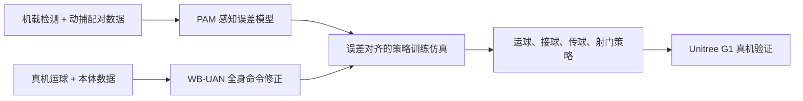

# Joga：带主动视觉的人形足球技能学习

**Joga（Joint Optimization of Gaze and Action，视线与动作联合优化）** 是 MIT Improbable AI Lab 的全栈人形足球系统：Unitree G1 使用机载相机和本体感知，在仿真强化学习策略中共同控制身体与主动视觉颈部，并通过少量真机数据对齐仿真误差。

## 英文缩写速查

| 缩写 | 英文全称 | 简要说明 |
|------|----------|----------|
| PAM | Perception Alignment Model | 学习球检测的状态相关偏差、噪声和漏检 |
| WB-UAN | Whole-Body Unsupervised Actuator Network | 学习全身关节位置命令的修正量 |
| DoF | Degrees of Freedom | 相机颈部具有 2 个转动自由度 |
| RL | Reinforcement Learning | 通过任务奖励在仿真中训练足球技能策略 |
| Sim2Real | Simulation to Real | 用真机数据校准仿真并迁移策略的过程 |

## 为什么重要

Joga 把“看球”作为全身技能的一部分来训练：颈部转动改变相机视角，身体运动影响球检测质量，执行器偏差又会改变触球时序。它展示了一条更精细的 Sim2Real 路线：用短时真机数据针对性拟合误差，再把拟合结果放回训练环境，而不是依赖宽泛域随机化来掩盖所有差异。

## 方法栈与流程总览

### 主动视觉与全身策略

策略使用机载 RGB 相机和本体感知。定制的 2-DoF 颈部安装在躯干上，策略共同控制全身关节与颈部，让视线随高速移动和触球过程调整。硬件结构、装配和仿真模型见 [Joga Neck 仓库归档](../../sources/repos/joga-neck.md)。

### 感知对齐模型（PAM）

PAM 以机器人状态和球的图像几何为条件，拟合机载球检测框的偏差、噪声与可见性变化。训练数据由约 10 分钟的机载检测和动捕配对数据构成。把状态相关的观测误差放入策略训练，可避免策略只在理想球位置或统一噪声假设下学习。

### 全身执行器对齐（WB-UAN）

WB-UAN 是全身共享的无监督执行器模型：根据全身关节位置与命令，预测位置命令修正。模型从约 10 分钟真机运球数据拟合，不需要力矩标签或动捕标签；随后在修正仿真中微调运球策略。项目页报告其仿真回放比不加残差时更贴近真机记录。

### 技能衔接

传球与射门策略从运球过程中访问到的机器人和球状态分布微调，使技能可以在跨步移动时接续，而无需先停在人为设定的初始状态。关键是训练状态分布与上游技能的访问分布匹配。

## 实验与评测

项目页报告 Unitree G1 真机结果：

| 技能 / 指标 | 结果 |
|------|------:|
| 持续运球速度 | 1.71 ± 0.16 m/s |
| 估计峰值运球速度 | 2.31 m/s |
| 急转展示 | 135° |
| 单触接球来球速度 | 最高 5.2 m/s |
| 技能转换 | 运球到传球、运球到射门 |

项目页还展示了草地、强风和长时间运球视频；这些数据是项目页公开值，不代表独立基准上的横向比较。

## 与其他工作对比

相较于常见的球检测加全身策略架构，Joga 将颈部运动纳入策略动作，并在训练中显式处理感知与执行器两类误差。与 [Vision-Driven Reactive Soccer](./paper-hrl-stack-26-learning_vision_driven_reactive_socc.md) 的虚拟感知和 AMP 先验、[Agile Striker](./paper-notebook-learning-agile-striker-skills-for-humanoid-socce.md) 的分阶段教师–学生训练相比，Joga 突出短时真机数据驱动的感知/全身动力学校准及行进中的技能衔接；各工作硬件、任务定义和评测场景不同，不宜只按速度指标排序。

## 结论

**短时真机数据的价值在于校准策略实际遇到的误差，再把技能训练分布接近真实部署分布。**

1. **主动视觉属于动作空间。** 若机器人头部/颈部能控制视线，训练时应联合优化视线和身体动作，而非把相机视角当成固定输入条件。
2. **误差要按来源建模。** PAM 针对球检测误差；WB-UAN 针对执行器命令偏差，两者数据和作用位置不同。
3. **校准数据量很小但场景特定。** 页面各报告约 10 分钟数据；复现者应检查采集动作、球距离、机器人姿态是否覆盖目标工作区。
4. **上游技能决定下游初始化分布。** 从运球状态微调传球/射门，是缩短技能交接分布差异的直接做法。
5. **速度数字需要谨慎解释。** 1.71 m/s 是持续运球结果，2.31 m/s 是估计峰值；比较前需统一球场、任务和计速方法。

## 工程实践

- 先验证颈部 yaw/pitch 行程、相机固定和线缆余量，再采集机载检测与动捕的同步数据。
- 感知模型要覆盖检测框偏差、尺度变化和漏检；仅按距离加固定高斯噪声不足以表达状态相关误差。
- 用真机命令回放对照仿真关节轨迹，检查残差是否提高整身跟踪一致性，再微调运球策略。
- 从运球 rollouts 采集传球、射门的初始化状态分布，检查技能切换时球和支撑脚状态是否连续。
- **源码运行时序图：不适用。** 官方公开仓库是相机颈部硬件资产，不含可执行策略训练、推理或部署入口；详见[源码开放核查](../../sources/sites/joga-humanoid-soccer.md)。

## 局限与风险

- 项目页未提供策略实现、权重、完整训练配置或机载部署频率，独立复现策略性能会受限。
- PAM 的配对标签依赖动捕采集；项目页没有列出具体检测器、网络结构、损失或数据划分细节。
- WB-UAN 用真机运球数据拟合，迁移到不同 G1 版本、舵机状态或地面条件时，需重新验证误差覆盖范围。
- 展示的足球技能由人类操作者通过摇杆实时提供球的目标方向/速度；策略负责执行相应全身动作，项目未声称整场自主比赛。

## 关联页面

- [Humanoid Soccer 任务](../tasks/humanoid-soccer.md)：足球技能与系统挑战总览。
- [Unitree G1](./unitree-g1.md)：Joga 的真机平台。
- [Vision-Driven Reactive Soccer](./paper-hrl-stack-26-learning_vision_driven_reactive_socc.md)：视觉误差与 AMP 运动先验。
- [Agile Striker](./paper-notebook-learning-agile-striker-skills-for-humanoid-socce.md)：分阶段足球技能训练对照。

## 参考来源

- [Joga 论文摘录](../../sources/papers/joga_learning_agile_humanoid_soccer.md)
- [Joga 项目页](../../sources/sites/joga-humanoid-soccer.md)
- [Joga Neck 开源硬件仓库](../../sources/repos/joga-neck.md)

## 推荐继续阅读

- [Joga 官方项目页与交互演示](https://joga.csail.mit.edu/)
- [Joga Neck 装配指南](https://joga.csail.mit.edu/neck/)
