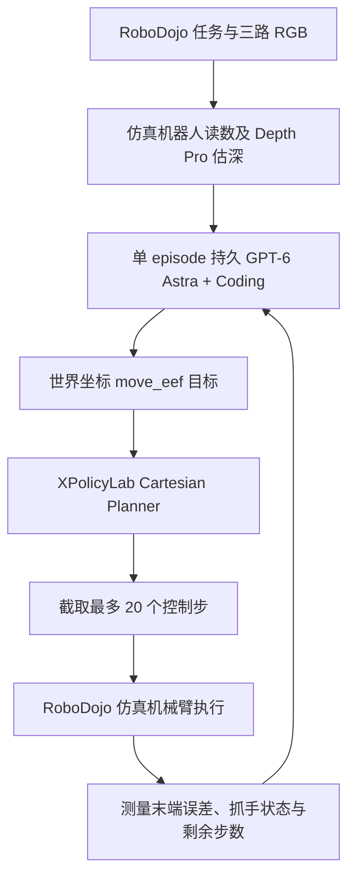
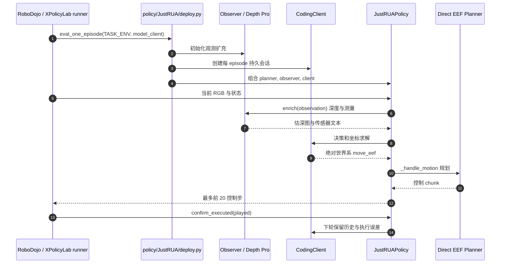

# JustRUA：GPT-6 机器人操作智能体的受控拆解研究
*JustRUA: A Controlled Study of GPT-6 Robot-Use Agents*

## 一句话定义

**JustRUA**：固定 RoboDojo 测试集与基础 harness，分别消融模型调用历史、运动动作接口、经验复用与场景几何，构建更高效的 GPT-6 Astra 机械臂使用智能体。

## 英文缩写速查

| 缩写 | 英文全称 | 简要说明 |
|---|---|---|
| RUA | Robot-Use Agent | 以模型工具调用控制机器人 |
| EEF | End Effector | 机器人末端执行器 |
| RGB | Red Green Blue | 三视角彩色观测 |
| OOD | Out-of-Distribution | 未见场景分布 |

## 为什么重要

不同机器人 Agent 的 harness、任务子集和观察接口同时变化时，排行榜改进难以归因；受控对照帮助定位真实有效的设计。

## 核心信息

| 维度 | 核对信息 |
|---|---|
| 原始论文 | [arXiv:2611.16009v1](https://arxiv.org/html/2611.16009v1) |
| 机构 | 清华大学、华中科技大学、北京大学、ModelBest、腾讯等 |
| 论文作者 | Zefan Wang、Yufan Dang、Xuanwei Shi、Mingqi Gao 等 |
| 官方项目 | [项目页](https://zefanw.github.io/JustRUA/) |
| 代码（2026-11-27） | [公开适配器，固定 1de90d5](https://github.com/ZefanW/JustRUA/tree/1de90d565b3e35e36bf602d5ff5ca8f989fa5c23)，Apache-2.0；不是独立仿真或开源模型。 |
| 回放 | [官方 Replay Explorer](https://huggingface.co/spaces/ZefanW/robodojo-replay-explorer)，按同一任务和场景对比配置。 |

## 核心原理

沿用 RoboDojo 官方 L3 环境及 ARX X5 双臂；使用单次 episode 内持久的 GPT-6 Astra coding conversation 读取三路 RGB、由 RGB 预测的彩色深度图、相机标定和仿真机器人读数（夹指、腕力等）；调用绝对世界系 move_eef 目标，经 XPolicyLab Cartesian planner 转控制量，每轮最多执行前 20 个控制步，丢弃剩余部分并回传实际到达误差和夹持状态供下一次决策。运行时不向模型提供原始米制深度数组、物体位姿或评分器状态；最终配置允许本地代码从像素与标定求坐标，不把代码路径当作读取深度数组。文章另对示范、经验库、不同动作接口等做对照，最终配置不含自改经验库。

### 流程总览

> 图示基于论文的方法和监督流向；训练与部署路径应区分，图中模块不代表源码调用关系。

## 实验与评测

在作者定义的 **111 个仿真 episode**（全部 42 个任务）上，按任务内布局、能力组内任务、五个能力组逐层等权汇总。23 个高波动任务跑四个固定布局，其余跑一个；Generalization 的随机布局权重为 75%，官方全量协议为 50%。官方 L3 在这个子集是 **29.7**，在 2,100 条全量协议为 **29.0**。不能把 50.3 写成排行榜全量结果或成功率；[RoboDojo](robodojo.md) 支持部分完成得分。

| 累加配置 | 得分（满分 100） | 首轮单 episode 模型调用成本下界 |
|---|---:|---:|
| 官方 L3（子集） | 29.7 | — |
| Codex 会话 + 全图像历史 | 34.7 | $3.76 |
| 每次运动最多 20 个控制步 | 38.0 | $4.94 |
| 精简机器人读数 | 39.8 | $5.51 |
| RGB 预测深度 | 42.4 | $7.74 |
| 坐标求解 + 取消策略决策数上限 | **50.3** | **$12.53** |

- 最后一行的组均成功率为 **43.3%**，不是按回放条数的比例。按公开目录重算得 50.3125 分、43.3333%；59/111 是未经分组权重的成功条数。首轮成本假设所有可缓存输入都命中，不是实付账单或端到端成本。
- 保留历史与改用 Codex 会话是同一对照项；最终的 42.4→50.3 同时开启坐标计算与移除决策次数上限，不能单独归因。仿真 episode 的控制步预算仍生效；该上限也不同于单次动作的 20 步限制。
- 首轮 42 条的行为审查里，精简读数配置空抓 41 次，加入预测深度后 16 次；不代表所有误差都消失。仿真真值深度是参考对照，不是合规榜单输入。经验复用对照接触了受评任务，最终未选用。按[评测方法](../methods/ai-benchmark-evaluation.md)把同场景比较、动作行为、宏平均与成本分开看。

## 回放核验

[Replay Explorer](https://huggingface.co/spaces/ZefanW/robodojo-replay-explorer) 固定同一案例切换配置，可选头部与双腕相机，并检查请求目标、动作拒绝、零控制、实执行步数与反馈。目录实测 14 × 111 = 1,554 个回放，其中 228 个有事件时间定位；没有定位时分开看视频和动作序列。公开动作备注不是模型内部推理。

例：`insert_tubes__standard__s0__scene0` 的估深配置为 40 分、65 个事件、500 控制步；最终配置为 100 分、57 个事件、496 控制步。两个动作文件均按清单核对了哈希；这是同布局的作者记录，不能据单例分离两个同时修改的因素。

## 与其他工作对比

| 工作 | 关键接口与训练阶段 | 边界与取舍 |
|---|---|---|
| 本文 | 固定 RoboDojo 测试集与基础 harness，分别消融模型调用历史、运动动作接口、经验复用与场景几何，构建更高效的 GPT-6 Astra 机械臂使用智能体。 | 只在仿真、单基准、单模型设置上评估，各配置对照未重复多次且不是全因子设计。 |
| [Reins](./paper-reins-robot-harness.md) | 同领域相关研究，侧重不同的学习或动作接口 | 不能把不同基准、度量或硬件结果直接横比 |
| [ACE-CaP-0](./paper-ace-cap-0.md) | 从另一维度处理学习、记忆或控制问题 | 验收须按论文各自协议建立独立基线 |

## 结论

**固定 RoboDojo 测试集与基础 harness，分别消融模型调用历史、运动动作接口、经验复用与场景几何，构建更高效的 GPT-6 Astra 机械臂使用智能体。 但必须按论文的实验协议和开源边界解读其效果。**

1. 把评分口径锁定在论文 111 episode 子集，而不是直接与其他排行榜横比。
2. 区分预测深度的行为收益与「坐标求解 + 放开决策上限」的联合结果；按缓存口径标注成本下界。
3. 仿真夹指测量值与命令目标必须区分；动作超过 20 步被截断后的反馈不可丢。

## 源码运行时序图

> 联调按固定版本的 `deploy.py`、`policy.py`、`actor/client.py` 核对：当规划超过 20 步，`confirm_executed` 用实际执行的前缀恢复夹爪目标，不继承被丢弃后缀的目标。使用上游固定 XPolicyLab 版本，官方离线测试 **6 项通过**（观测、动作前缀和模拟子进程协议）；没有启动 RoboDojo/Isaac、加载 Depth Pro 权重、请求模型服务或运行真机。

## 工程实践

| 项目 | 实施与检查点 |
|---|---|
| 接入输入 | 核实论文定义的观察模态、坐标系、动作/控制接口，不能照搬其他本体 |
| 基线与指标 | 复用论文评测协议；另外记录成功率、任务进度、执行耗时和失败分布各自口径 |
| 训练/执行成本 | 区分模型预训练成本、开发期调用次数、在线决策延迟及实际通信开销 |
| 代码可得性 | 公开了完整的 XPolicyLab policy adapter；依赖 RoboDojo 仿真/资产、Depth Pro checkpoint 与 GPT-6 Astra 服务账户。 |
| 复现路径 | 以[官方论文](https://arxiv.org/html/2611.16009v1)与[项目页](https://zefanw.github.io/JustRUA/)为准，缺失的数据/权重/控制接口需要单列阻塞 |

## 局限与风险

只在仿真、单基准、单模型设置上评估，各配置对照未重复多次且不是全因子设计。完整适配器已开源，但复现还需外部 RoboDojo/XPolicyLab、Depth Pro 权重和可用模型账户。

- **跨实验不可直接排名：** 论文分别使用跨本体进度、VLA 成功率、真机 episode 成功率或 RoboDojo 子集得分，不具备共同分母。
- **工程安全边界：** 真机动作链需另行评估碰撞、限位、通信中断与异常恢复；论文实验成绩不构成部署安全保证。

## 关联页面

- [2026-11-16 具身前沿 29 篇论文阅读地图](../overview/embodied-frontier-29-papers-2026-11-16.md)

- [Reins](./paper-reins-robot-harness.md)
- [ACE-CaP-0](./paper-ace-cap-0.md)
- [VLA 学习纵深路线](../../roadmap/depth-vla.md)
- [跨本体迁移纵深路线](../../roadmap/depth-cross-embodiment.md)

- [机器人操作](../tasks/manipulation.md)：了解物体操作和抓取任务。
- [智能体机器人操作策略](../methods/agentic-manipulation-policies.md)：对照智能体、机器人接口与执行反馈。

## 参考来源

- [论文原文与核对归档](../../sources/papers/justrua-arxiv-2611-16009.md)
- [官方项目页核对](../../sources/sites/justrua-project-20261116.md)
- [官方源码与运行入口核对](../../sources/repos/justrua-official-20261116.md)
- [arXiv HTML v1（包含实验与局限）](https://arxiv.org/html/2611.16009v1)

## 推荐继续阅读

- [官方项目页](https://zefanw.github.io/JustRUA/)
- [论文 PDF v1](https://arxiv.org/pdf/2611.16009v1)
- [回放浏览器与固定目录核查](../../sources/sites/justrua-robodojo-replay-explorer.md)
- [官方代码](https://github.com/ZefanW/JustRUA)
