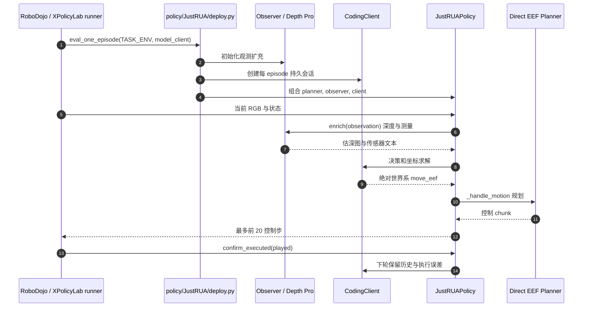

# JustRUA：GPT-6 机器人操作智能体的受控拆解研究
*JustRUA: A Controlled Study of GPT-6 Robot-Use Agents*

## 一句话定义

**JustRUA**：固定 RoboDojo 测试集与基础 harness，分别消融模型调用历史、运动动作接口、经验复用与场景几何，构建更高效的 GPT-6 Astra 机械臂使用智能体。

## 英文缩写速查

| 缩写 | 英文全称 | 简要说明 |
|---|---|---|
| RUA | Robot-Use Agent | 以模型工具调用控制机器人 |
| EEF | End Effector | 机器人末端执行器 |
| RGB | Red Green Blue | 三视角彩色观测 |
| OOD | Out-of-Distribution | 未见场景分布 |

## 为什么重要

不同机器人 Agent 的 harness、任务子集和观察接口同时变化时，排行榜改进难以归因；受控对照帮助定位真实有效的设计。

## 核心信息

| 维度 | 核对信息 |
|---|---|
| 原始论文 | [arXiv:2611.16009v1](https://arxiv.org/html/2611.16009v1) |
| 机构 | 清华大学、华中科技大学、北京大学、ModelBest、腾讯等 |
| 论文作者 | Zefan Wang、Yufan Dang、Xuanwei Shi、Mingqi Gao 等 |
| 官方项目 | [项目页](https://zefanw.github.io/JustRUA/) |
| 开源状态（2026-11-16） | [官方源码](https://github.com/ZefanW/JustRUA)；公开了完整的 XPolicyLab policy adapter；依赖 RoboDojo 仿真/资产、Depth Pro checkpoint 与 GPT-6 Astra 服务账户。 |

## 核心原理

沿用 RoboDojo 官方 L3 环境及 ARX X5 双臂；使用单次 episode 内持久的 GPT-6 Astra coding conversation 读取三路 RGB、RGB 估深、相机标定、夹指及腕力实际测量；调用绝对世界系 move_eef 目标，经 XPolicyLab Cartesian planner 转控制量，每轮最多执行前 20 个控制步，丢弃剩余部分并回传实际到达误差和夹持状态供下一次决策。文章另对示范、经验库、不同动作接口等做对照，最终配置不含自改经验库。

### 流程总览

> 图示基于论文的方法和监督流向；训练与部署路径应区分，图中模块不代表源码调用关系。

## 实验与评测

在作者定义的 **111-episode** RoboDojo 对照评测子集（涵盖全部 42 任务），官方 L3 harness 29.7 → 最终 JustRUA 50.3；最终配置对应成功率 43.3%，首轮平均调用成本约 12.53 美元/episode。该分数不是未经校正的官方排行榜总分。

## 与其他工作对比

| 工作 | 关键接口与训练阶段 | 边界与取舍 |
|---|---|---|
| 本文 | 固定 RoboDojo 测试集与基础 harness，分别消融模型调用历史、运动动作接口、经验复用与场景几何，构建更高效的 GPT-6 Astra 机械臂使用智能体。 | 只在仿真、单基准、单模型设置上评估，各配置对照未重复多次且不是全因子设计。 |
| [Reins](./paper-reins-robot-harness.md) | 同领域相关研究，侧重不同的学习或动作接口 | 不能把不同基准、度量或硬件结果直接横比 |
| [ACE-CaP-0](./paper-ace-cap-0.md) | 从另一维度处理学习、记忆或控制问题 | 验收须按论文各自协议建立独立基线 |

## 结论

**固定 RoboDojo 测试集与基础 harness，分别消融模型调用历史、运动动作接口、经验复用与场景几何，构建更高效的 GPT-6 Astra 机械臂使用智能体。 但必须按论文的实验协议和开源边界解读其效果。**

1. 把评分口径锁定在论文 111 episode 子集，而不是直接与其他排行榜横比。
2. 额外深度估计和代码坐标求解带来较大收益，但推理调用成本也上升。
3. 真实夹指位置与命令目标必须区分；动作超过 20 步被截断后的反馈不可丢。

## 源码运行时序图

> 时序依据官方仓库 README 与入口脚本；依赖外部环境/数据未在此声称实机复现。

## 工程实践

| 项目 | 实施与检查点 |
|---|---|
| 接入输入 | 核实论文定义的观察模态、坐标系、动作/控制接口，不能照搬其他本体 |
| 基线与指标 | 复用论文评测协议；另外记录成功率、任务进度、执行耗时和失败分布各自口径 |
| 训练/执行成本 | 区分模型预训练成本、开发期调用次数、在线决策延迟及实际通信开销 |
| 代码可得性 | 公开了完整的 XPolicyLab policy adapter；依赖 RoboDojo 仿真/资产、Depth Pro checkpoint 与 GPT-6 Astra 服务账户。 |
| 复现路径 | 以[官方论文](https://arxiv.org/html/2611.16009v1)与[项目页](https://zefanw.github.io/JustRUA/)为准，缺失的数据/权重/控制接口需要单列阻塞 |

## 局限与风险

只在仿真、单基准、单模型设置上评估，各配置对照未重复多次且不是全因子设计。完整适配器已开源，但复现还需外部 RoboDojo/XPolicyLab、Depth Pro 权重和可用模型账户。

- **跨实验不可直接排名：** 论文分别使用跨本体进度、VLA 成功率、真机 episode 成功率或 RoboDojo 子集得分，不具备共同分母。
- **工程安全边界：** 真机动作链需另行评估碰撞、限位、通信中断与异常恢复；论文实验成绩不构成部署安全保证。

## 关联页面

- [2026-11-16 具身前沿 29 篇论文阅读地图](../overview/embodied-frontier-29-papers-2026-11-16.md)

- [Reins](./paper-reins-robot-harness.md)
- [ACE-CaP-0](./paper-ace-cap-0.md)
- [VLA 学习纵深路线](../../roadmap/depth-vla.md)
- [跨本体迁移纵深路线](../../roadmap/depth-cross-embodiment.md)

- [机器人操作](../tasks/manipulation.md)：了解物体操作和抓取任务。
- [智能体机器人操作策略](../methods/agentic-manipulation-policies.md)：对照智能体、机器人接口与执行反馈。

## 参考来源

- [论文原文与核对归档](../../sources/papers/justrua-arxiv-2611-16009.md)
- [官方项目页核对](../../sources/sites/justrua-project-20261116.md)
- [官方源码与运行入口核对](../../sources/repos/justrua-official-20261116.md)
- [arXiv HTML v1（包含实验与局限）](https://arxiv.org/html/2611.16009v1)

## 推荐继续阅读

- [官方项目页](https://zefanw.github.io/JustRUA/)
- [论文 PDF](https://arxiv.org/pdf/2611.16009)
- [官方代码](https://github.com/ZefanW/JustRUA)
