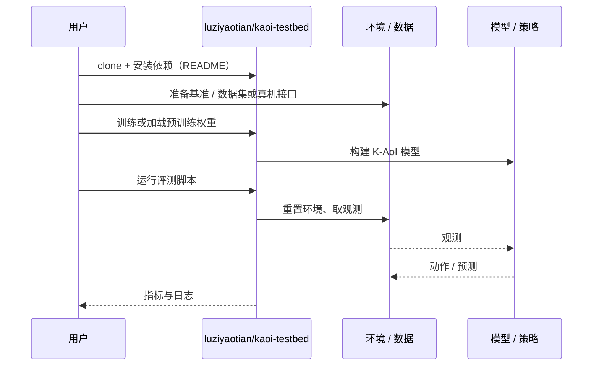

# K-AoI（arXiv:2610.26201）

**K-AoI**（*K-AoI: A Spatio-Temporal Synchronization Metric for Digital Twin-based Teleoperation in Dynamic Network Environments*，[arXiv:2610.26201](https://arxiv.org/abs/2610.26201)，[代码](https://github.com/luziyaotian/kaoi-testbed)）来自 [具身智能小站 2026-10-31 盘点](../../sources/blogs/wechat_embodied_station_50_papers_scenerig_photo_to_sim_2026-10-31.md)，属「评测、基准与可靠性」组。

## 一句话定义

**K-AoI用瞬时笛卡尔速度加权信息年龄，让数字孪生同步评测反映运动后果；机械臂与Unity测试床覆盖不同网络条件，是对时间指标的补充。**

## 英文缩写速查

| 缩写 | 英文全称 | 简要说明 |
|------|----------|----------|
| K-AoI | K-AoI: A Spatio-Temporal Synchronization Metric for Digital Twin-based Teleoperation in Dynamic Network Environments | 本文方法 / 基准的简称 |

## 为什么重要

- 遥操作延迟，也要换算成空间偏差。
- 开源结论：**已开源**（步骤 2.5，2026-10-31）。仓库可达（git ls-remote）。
- 同期同组工作见 [单图重建仿真、VLA 适配评测与跨形态世界模型：具身智能小站 10-31 期 50 篇阅读坐标](../overview/embodied-station-2026-10-31-50-papers-technology-map.md)。

## 核心机制

| 项 | 内容 |
|----|------|
| **arXiv** | [2610.26201](https://arxiv.org/abs/2610.26201) |
| **开源** | **已开源** |
| **要点** | K-AoI用瞬时笛卡尔速度加权信息年龄，让数字孪生同步评测反映运动后果；机械臂与Unity测试床覆盖不同网络条件，是对时间指标的补充。 |
| **文内指标** | 公众号未给具体数字，本页不引用。 |

## 源码运行时序图

以下为按仓库入口（`luziyaotian/kaoi-testbed`）推断的通用运行链路；入库日仅核实仓库可达，未逐文件阅读，具体脚本名以 README 为准。

## 实验与评测

- 公众号未给具体数字，本页不引用。
- **读法：** 本页为索引级摘要，依据公众号转述的官方摘要与仓库信息整理；逐项数字与 baseline 以原文 PDF 为准。

## 与其他工作对比

- 横向索引见 [单图重建仿真、VLA 适配评测与跨形态世界模型：具身智能小站 10-31 期 50 篇阅读坐标](../overview/embodied-station-2026-10-31-50-papers-technology-map.md)；同 arXiv 不重复造页。

## 结论

**遥操作延迟，也要换算成空间偏差：K-AoI用瞬时笛卡尔速度加权信息年龄，让数字孪生同步评测反映运动后果；机械臂与Unity测试床覆盖不同网络条件，是对时间指标的补充。**

1. 开源边界：**已开源** — 仓库可达（git ls-remote）。
2. 核心机制：K-AoI用瞬时笛卡尔速度加权信息年龄，让数字孪生同步评测反映运动后果；机械臂与Unity测试床覆盖不同网络条件，是对时间指标的补充。
3. 复现与选型前核对任务协议、硬件与基准口径，勿直接横比公众号摘录数字。

## 关联页面

- [simulation-evaluation-infrastructure](../concepts/simulation-evaluation-infrastructure.md)
- [vla](../methods/vla.md)
- [manipulation](../tasks/manipulation.md)
- [embodied-station-2026-10-31-50-papers-technology-map](../overview/embodied-station-2026-10-31-50-papers-technology-map.md)
- [具身大模型评测基准选型闭环](../queries/embodied-eval-benchmark-selection-loop.md) — 评测基准在选型闭环中的定位与取舍

## 参考来源

- [k_aoi_arxiv_2610_26201.md](../../sources/papers/k_aoi_arxiv_2610_26201.md)
- [wechat_embodied_station_50_papers_scenerig_photo_to_sim_2026-10-31.md](../../sources/blogs/wechat_embodied_station_50_papers_scenerig_photo_to_sim_2026-10-31.md)
- [arXiv:2610.26201](https://arxiv.org/abs/2610.26201)

## 推荐继续阅读

- [arXiv PDF](https://arxiv.org/pdf/2610.26201)
- [https://github.com/luziyaotian/kaoi-testbed](https://github.com/luziyaotian/kaoi-testbed)
