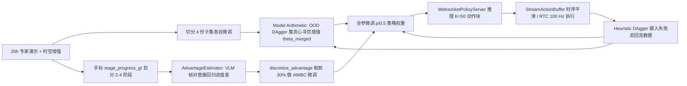
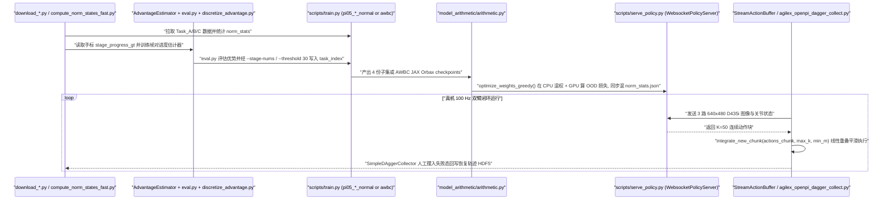

# χ₀ / kai0（Resource-Aware Robust Manipulation）

## 一句话定义

**$\chi_0$（公开工程名 kai0）** 是 Kinetix AI 与香港大学 MMLab / OpenDriveLab 提出的一套面向有限真机资源（每任务约 20 小时演示与 8×A100 微调）的[VLA](../methods/vla.md)后训练与部署对齐方法：将长程[双臂操作](../tasks/bimanual-manipulation.md)的失效根因统一刻画为训练数据分布 $P_{\mathrm{train}}$、模型归纳偏置 $Q_{\mathrm{model}}$ 与真机部署分布 $P_{\mathrm{test}}$ 三者不一致，并在 [π₀.₅](paper-pi05-open-world-vla.md) / [π₀](../methods/pi0-policy.md) 骨干上通过 **Model Arithmetic + Stage Advantage + Train-Deploy Alignment** 实现协同服装操作约 **250%** 的相对成功率跃升与任意初态 **24 小时**连续自主运行。

## 英文缩写速查

| 缩写 | 英文全称 | 简要说明 |
|---|---|---|
| MA | Model Arithmetic | 数据子集独立微调后在权重空间插值并在 OOD DAgger 集上贪心寻优的方法 |
| SA | Stage Advantage | 用 VLM 帧对直接回归阶段条件进度优势并做优势加权行为克隆的模块 |
| TDA | Train-Deploy Alignment | 覆盖启发式 DAgger、时空增强与时间分块平滑的训练-部署对齐管线 |
| AWBC | Advantage-Weighted Behavior Cloning | 按优势阈值筛选正样本的加权监督训练（对应 `pi05_*_awbc` 配置） |
| RTC | Real-Time Chunking | 跨异步推断周期对齐新旧动作块的实时分块衔接方法 |
| SFR / MSTD | Smooth Frame Ratio / Mean Speed Trajectory Deviation | 论文用于衡量阶段优势标签平稳度与策略运动抖动率的评测指标 |
| SR / TP | Success Rate / Throughput | 真机任务成功率与单位时间完成吞吐量（次/小时） |

## 为什么重要

现有通用 VLA（包括开源 `openpi` 底座及其他视觉-语言-动作大模型）在实验室有限示教下往往能偶发成功，但在长时程、高形变的日常柔性物体操作上却频频遭遇「一遇皱褶偏移便彻底卡死」或「重复动作循环」的瓶颈：

- **从「堆更大算力与数据」转向「对齐三分布错配」**：论文指出长程失稳不仅源于模型容量，更源于有限示教覆盖不足（$P_{\mathrm{train}}$ 窄）、跨阶段视觉似是而非引起的时序错配（$P_{\mathrm{train}}\leftrightarrow Q_{\mathrm{model}}$）以及缺失错误恢复样本导致的失败级联（$Q_{\mathrm{model}}\leftrightarrow P_{\mathrm{test}}$）。
- **低真机资源可复现配方**：不依赖数百小时遥操作集群，单任务约 20 小时演示即可把展平叠衣（Task A）、条件分拣（Task B）与桌面挂衣（Task C）推进至连续 **24 小时**不间断稳定运行，同时暴露 GO-1、X-VLA、DexVLA、UniVLA、OpenVLA 等基线在同条件 20 h 微调下的真机泛化落差（App. A Q2）。
- **全链条真机开源样板**：[OpenDriveLab/kai0](../../sources/repos/kai0.md) 完整公开了基于 [openpi](../../sources/repos/openpi.md) 的权重插值脚本、基于帧对进度回归的 `AdvantageEstimator` 与 `discretize_advantage.py`、以及支持 `StreamActionBuffer` 时序平滑与 `RTC` 的双臂真机推理代码。

## 核心原理

### 核心信息

- **论文：** $\chi_0$: *Resource-Aware Robust Manipulation via Taming Distributional Inconsistencies*（arXiv:2602.09021v3，2026-03-17）
- **作者与机构：** Checheng Yu, Chonghao Sima*, Hongyang Li, Ping Luo 等（Kinetix AI & HKU MMLab / OpenDriveLab）
- **项目主页 / 代码 / 权重：** [mmlab.hk/research/kai0](https://mmlab.hk/research/kai0) · [OpenDriveLab/kai0](https://github.com/OpenDriveLab/kai0)（Apache-2.0）· HF `OpenDriveLab-org/Kai0`（CC-BY-NC-SA-4.0）
- **硬件与骨架：** Task A/B 采用双臂 **Agilex Piper**（第 5 轴 pitch）、Task C 采用双臂 **ARX X5**（第 5 轴 yaw），搭配 3 路 `RealSense D435i`（头顶 + 双腕 `640×480` @ 30 Hz）；策略骨干以全参微调开源 $\pi_{0.5}$（辅以 $\pi_0$，动作块 $K=50$，底层控制 100–200 Hz）。

### 流程总览

### 1. Model Arithmetic（MA）：面向覆盖不足与参数冗余

面对单一 20 h 演示流形窄化、全参微调易过拟合的问题，MA 将原始数据集切分为 $M=4$ 份不重叠子集分别微调得到权重 $\{\theta_1,\dots,\theta_4\}$，在权重空间构造凸组合 $\theta_{\mathrm{merged}}=\sum_{i=1}^4 \alpha_i \theta_i$（$\alpha_i\ge 0, \sum \alpha_i=1$）。与常见权重汤仅在训练验证集均匀平均不同，χ₀ 特别采用 **DAgger 收集的错误恢复轨迹作为 OOD 验证集** 来优化融合系数 $\alpha$，并消融对比了 `average`、`inverse-loss`、`gradient descent` 与 `greedy` 四种策略，发现 **greedy + OOD 验证集**表现最稳且全变体均优于单子集最佳模型乃至全量数据直接联训——从侧面印证 VLA 全参微调存在显著参数冗余与样本互扰。

### 2. Stage Advantage（SA）：消除长程时序模糊

传统 [AWR](../methods/awr.md) / $\pi_{0.6}^*$-style RECAP 路线通常独立训练价值网络并做值差 $A=V(s')-V(s)$，在跨阶段视觉近似的衣物折叠中极易出现方差放大与跨阶段尺度混淆（同一抓姿在「初次展平」与「收尾对折」具有完全不同的时间语义）。χ₀ 改用直接面向阶段条件的VLM帧对回归（见[进度奖励建模](../concepts/progress-reward-modeling.md)）：

- 按任务把长程过程拆为离散阶段（Task A/B/C 分别为 2/4/3 阶段），给定阶段标量 $g\in\{0,\dots,(S-1)/S\}$ 与随机时间步距 $\Delta$，用轻量价值头从帧对直接估计相对优势 $A_{\mathrm{stage}}(s,a,g)=f_\theta(s,s'\mid g)$；
- 按各阶段分位数截取前 $\epsilon=0.3$ 为正样本标签送入 [优势加权回归（AWBC）](../methods/awr.md) 微调，使策略在平滑帧比例（SFR）与运动轨迹抖动（MSTD）指标上均稳于值差法。

### 3. Train-Deploy Alignment（TDA）：弥合仿真外真机间隙

为同时遏制失败级联与块切换断层，TDA 包含三项相互配合的工程与算法机制（Algorithm 1）：

- **Heuristic DAgger**：不等待策略在漫长 rollouts 中随机出错，而是由人类操作员主动把衣物或手臂摆入常见失败边界态（错抓角、袖口半滑落、褶皱卡住），直接录制短恢复轨迹，采集耗时远低于标准在线 [DAgger](../methods/dagger.md) 且达到接近的效果；
- **时空增强（Spatio-temporal Augmentation）**：对桌面双臂图像同步执行水平镜像 + 左右臂关节空间互换，以及跳帧变速增强，提升空间对称泛化与作业吞吐率（TP）；
- **时间分块平滑（Temporal Chunk-wise Smoothing）**：客户端 `StreamActionBuffer` 按已消费索引 $k$ 动态裁掉传输耗时对应旧步 $d=\min(k, d_{\max})$，旧缓存长度不足 $m_{\min}$ 时进行末值填充，并在新旧动作块重叠区间按线性权重 $w_i = 1 - i/\max(L-1,1)$ 过渡平滑，且可与 `RTC` 正交叠加，有效缓解[控制与推理频率解耦](../concepts/control-inference-frequency-decoupling.md)带来的动作跃变。

## 源码运行时序图

以下运行时序依据 `OpenDriveLab/kai0` 仓库实际入口与模块实读绘制，串联从资产拉取、Stage Advantage 离散化、Model Arithmetic 权重融合到双臂客户端平滑闭环的全链路：

## 工程实践

依据 [OpenDriveLab/kai0 仓库核对归档](../../sources/repos/kai0.md) 与官方 README，部署和复现需注意以下工程边界：

1. **算力分层**：全参微调 $\pi_{0.5}$ 需单卡 `>70 GB` 显存（如 A100 80GB / H100，原文使用 `8×A100`、AdamW `lr=2.5e-5`、`batch=128`、80k steps）；纯真机推理仅需 `>8 GB` 显存（RTX 4090 上部署 `WebsocketPolicyServer` 对接机器人端 IPC 客户端）。
2. **源码多后端细节差异**：
   - `AdvantageEstimator`（`src/openpi/models_pytorch/pi0_pytorch.py`）基于 PyTorch 实现，挂载于后缀状态 token 终层表示 `suffix_out_full[:, 0, :]` 后的 3 层 SiLU+Tanh `value_head`（`loss_value_weight=1.0`, `loss_action_weight=0.0`），监督截断至 `[-1, 1]` 的帧间进度差 `obs_full.progress`；
   - `model_arithmetic/arithmetic.py` 主打 JAX Orbax/OCDBT checkpoint 混合，并且特别注意同步融合各子集对应的 `norm_stats.json`；README 明确标注 PyTorch 版 checkpoint 合并仍属未充分测试路径。
3. **开环重放可行性数据质检（App. A Q5）**：作者提出使用轨迹在真机或等价条件下的开环重放可行性（replay-ability）作为采集数据质检门槛，先行剔除存在严重传感器滞后或轨迹畸变的脏数据，再送入 MA 子集微调与 SA 排序。
4. **开源许可分工**：代码主仓遵循 Apache-2.0 许可，但 Hugging Face / ModelScope 上公开的 `OpenDriveLab-org/Kai0` 数据集与模型权重遵循 **CC-BY-NC-SA-4.0** 非商用协议。

## 实验与评测

论文在三大渐进难度双臂衣物操作任务上（Task A T恤展平折叠：2668 eps；Task B 条件分拣：3519 eps；Task C 桌面挂衣：2988 eps；统一 30 Hz 采集、每种任务测试 3 类服装 × 10 trials，见 Table I–II 与 App. A–E）开展评测：

- **总体跃升与极限耐力**：完整 χ₀ 配方在协同展平叠衣与挂衣任务上相对开源 `openpi` 监督基线实现约 **250%** 的成功率相对提升（Average Score 从基线低区间大幅跨入高分里程碑），并在任意初始褶皱姿态下稳定完成 **24 小时**连续自主运行；同时在同约 20 小时数据与调参条件下，GO-1、X-VLA、DexVLA、UniVLA 与 OpenVLA 等基线虽训练损失收敛但真机成功率接近 0（App. A Q2）。
- **Model Arithmetic 消融**：全部权重融合变体（average / inverse-loss / gradient descent / greedy）均高于单一子集最佳权重与全量联合训练；引入 DAgger 恢复集作为 OOD 验证目标显著降低不同测试服装间的方差。
- **Stage Advantage 消融**：相较独立值函数做差的 $\pi_{0.6}^*$-style RECAP 复现与不拆阶段的 Direct 估计，Direct+Stage（SA）在平滑帧率（SFR）和运动抖动（MSTD）上最稳健；但论文也如实指出，在缺乏预训练挂衣先验且阶段边界不明显的 Task C 中，阶段先验的增量收益相对收窄。
- **TDA 消融**：Heuristic DAgger 恢复成功率与恢复成本逼近完整在线 DAgger 且省去漫长现场等待；`StreamActionBuffer` 时序分块平滑在多数设置下优于传统 temporal ensembling 与单一 RTC，将时序平滑与 RTC 叠加可获得最高流畅度与吞吐。

## 结论

**$\chi_0$（kai0）证明了在有限真机演示（约 20 小时/任务）和中等微调算力约束下，通过「权重空间融合、阶段条件优势筛选与训练-部署平滑对齐」系统治理分布错配，比单纯堆砌更大规模基础模型更直接决定长程柔性操作的真机可用性。**

- 切分训练数据做独立微调并以 **OOD 恢复轨迹**指导 `greedy` 权重混合（MA），能够在不增加真机数据总量的前提下吸收多模型多样性并抑制参数过拟合。
- 当长程任务存在高度相似的视觉中间态（如叠衣重复抚平）时，用**帧对直接回归阶段进度**替代常规值差 $V(s')-V(s)$ 并取高分位优势做 AWBC，可显著减少卡死循环与动作抖动。
- 用人工主动摆放失败边界的 **Heuristic DAgger** 替代被动等待 rollout 失败，能以更低时间成本把关键恢复流形注入 $P_{\mathrm{train}}$。
- 部署端务必通过 `StreamActionBuffer`（重叠线性混合）或与 `RTC` 组合消除推理-执行节拍差引入的动作块断层，并优先对原始采集轨迹执行开环重放可行性筛选。
- 面向跨本体与全新长程任务迁移前，仍应先核查骨干模型是否具备对应的基础物理操作先验（例如 Task C 中预训练先验缺失即会削弱阶段优势微调的上限）。

## 与其他工作对比

| 相关工作 | 核心问题焦距 | 优势估计 / 后训练机制 | 部署平滑与真机定位 |
|---|---|---|---|
| **χ₀ / kai0（本页）** | $P_{\mathrm{train}}$ / $Q_{\mathrm{model}}$ / $P_{\mathrm{test}}$ 三分布一致性 | 4 子集 OOD Model Arithmetic + VLM 帧对阶段优势（前 30% AWBC） | `StreamActionBuffer` 重叠平滑 + RTC；Agilex Piper / ARX X5 24h 服装作业 |
| **[π₀](../methods/pi0-policy.md) / [π₀.₅](paper-pi05-open-world-vla.md)（`openpi`）** | 跨本体通用流匹配 VLA 预训练与基础微调 | 离线纯监督条件流匹配（无内建优势过滤或权重汤） | 本文直接微调并强化的上游骨干底座 |
| **$\pi_{0.6}^*$ / RECAP** | 大规模真机离线/在环 RL 优势微调 | 独立价值网络评估并做差值 $A=V(s')-V(s)$ | 需大规模高覆盖演示；SA 论文对比中值差易在跨阶段放大噪声 |
| **[LeHome / Learning to Fold](paper-lehome-learning-to-fold.md)** | 低成本桌面叠衣开源基线与竞赛栈 | 侧重 SO-ARM101 平台与异步 AWR / RECAP 迭代 | 偏单套轻量桌面平台；χ₀ 聚焦双臂协同长时程生产级稳定运行 |
| **[STEAM](paper-steam-advantage-modeling.md)** | 离线视角下的优势建模与滤波 | 通过离线自监督集成估计优势 | 不依赖人工阶段划分；χ₀ 结合手标阶段 + 启发式在线恢复采样 |

## 局限与风险

- **仍存在抓偏与死循环尾部失败（App. A Q6）**：论文失效分析指出，即使经三支柱增强，在衣物初次抓取展平阶段仍偶发空间位姿抓偏或因局部状态外观滞留引发策略微幅往复循环。
- **阶段优势依赖人工阶段定义与基础先验**：Stage Advantage 目前需要手工按任务切分 2–4 个阶段并在 `discretize_advantage.py` 设置 `--threshold 30` 分位阈值；当底层骨干缺乏对应物理动作先验时（如 Task C 挂衣动作），仅靠阶段优势过滤收益会收窄。
- **全参微调显存与非商用许可边界**：标准 `pi05` 全参微调流程需 >70 GB 级 GPU（原文 8×A100）且 PyTorch checkpoint 合并未经完整验证；官方开放数据集与模型权重受 **CC-BY-NC-SA-4.0** 非商用限制。

## 与其他页面的关联

- 上游骨干与基础模仿范式：[π₀ 策略](../methods/pi0-policy.md)、[π₀ 论文实体页](paper-pi0.md)、[π₀.₅ 论文实体页](paper-pi05-open-world-vla.md)、[VLA 综述](../methods/vla.md)、[模仿学习](../methods/imitation-learning.md)、[Behavior Cloning](../methods/behavior-cloning.md)
- 三支柱关键方法与概念：[DAgger](../methods/dagger.md)、[AWR](../methods/awr.md)、[Action Chunking](../methods/action-chunking.md)、[进度奖励建模](../concepts/progress-reward-modeling.md)、[控制与推理频率解耦](../concepts/control-inference-frequency-decoupling.md)、[分布外泛化](../concepts/out-of-distribution-generalization.md)
- 任务、硬件与同领域对照：[机器人操作](../tasks/manipulation.md)、[双臂操作](../tasks/bimanual-manipulation.md)、[ALOHA](aloha.md)、[LeHome / Learning to Fold](paper-lehome-learning-to-fold.md)、[STEAM Advantage Modeling](paper-steam-advantage-modeling.md)
- 纵深学习路线：[模仿学习纵深路线（Stage 6）](../../roadmap/depth-imitation-learning.md)

## 参考来源

- [χ₀ / kai0 (arXiv:2602.09021v3) 原文通读归档](../../sources/papers/chi0_kai0_arxiv_2602_09021.md) — 完整通读 §I–§V 及附录 A–H（核对三分布数学定义、MA/SA/TDA Algorithm 1、Task A/B/C 数据规模、Table I–II 指标、24h 极限测试与 App. A Q2/Q5/Q6 分析）。
- [HKU MMLab kai0 项目页归档](../../sources/sites/mmlab-kai0.md) — 核对 `mmlab.hk/research/kai0` 博客快照中 Mode Consistency 叙事、图表指标与开源声明。
- [OpenDriveLab/kai0 官方仓库源码核对归档](../../sources/repos/kai0.md) — 实读 `arithmetic.py`、`AdvantageEstimator`、`eval.py`、`discretize_advantage.py`、`StreamActionBuffer` 与 DAgger 采集入口。
- [Physical-Intelligence/openpi 官方仓核对归档](../../sources/repos/openpi.md) — 对照底层 `openpi` 训练与推理基础设施。

## 推荐继续阅读

- **补全骨干模型背景**：[π₀ 策略](../methods/pi0-policy.md) → [π₀.₅ 开放世界 VLA](paper-pi05-open-world-vla.md) — 理解 χ₀ 所基于的流匹配与 Knowledge Insulation 底座特性。
- **深挖后训练与块平滑模块**：[AWR（Advantage-Weighted Regression）](../methods/awr.md) → [DAgger](../methods/dagger.md) → [控制与推理频率解耦](../concepts/control-inference-frequency-decoupling.md)。
- **横向对比同赛道叠衣研究**：[LeHome / Learning to Fold](paper-lehome-learning-to-fold.md) 与 [STEAM Advantage Modeling](paper-steam-advantage-modeling.md)。
