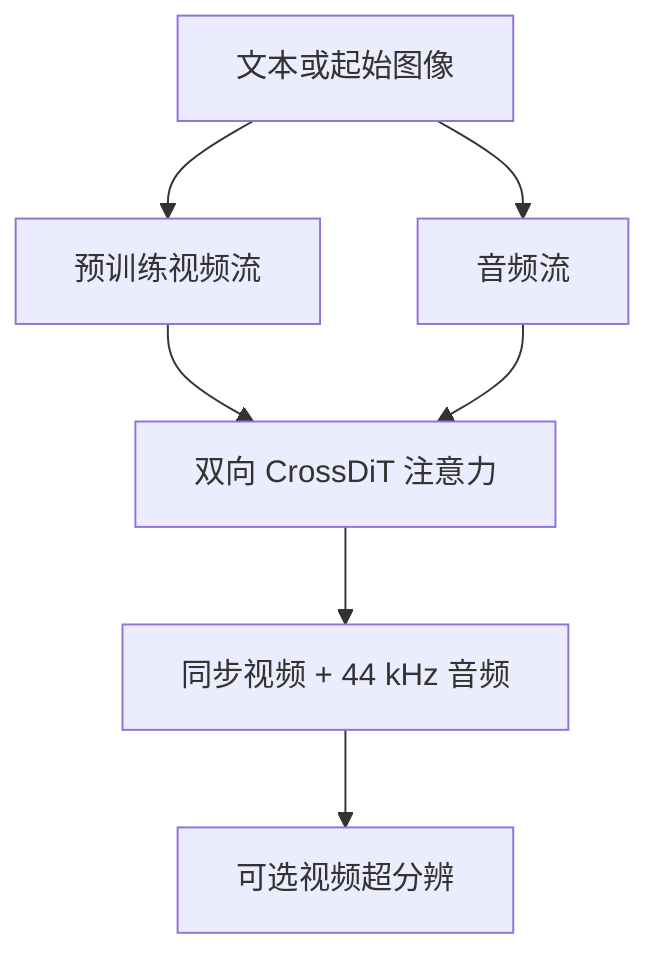
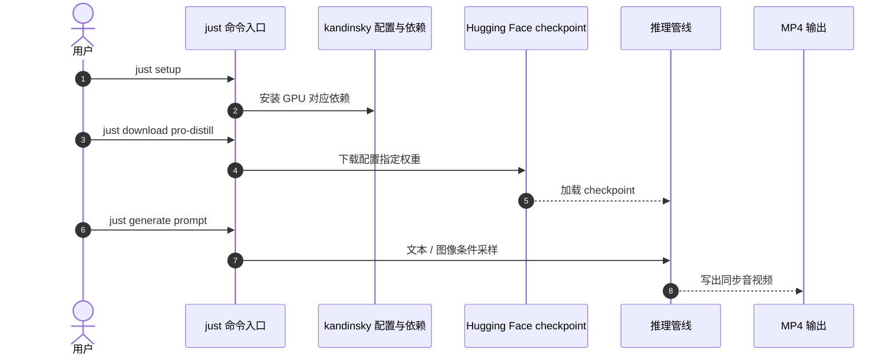

# Kandinsky 6.0 Video：同步生成视频与音频

Kandinsky 6.0 Video 是一组双流扩散基础模型，以跨模态注意力连接视频与音频生成，支持文本或图像条件的同步音视频片段。

## 英文缩写速查

| 缩写 | 英文全称 | 简要说明 |
|------|----------|----------|
| T2AV | Text-to-Audio-Video | 文本条件的联合音视频生成 |
| I2AV | Image-to-Audio-Video | 图像条件下生成同步音视频 |
| DiT | Diffusion Transformer | 承载扩散生成的 Transformer 骨干 |
| SFT | Supervised Fine-Tuning | 预训练后的监督微调阶段 |
| RL | Reinforcement Learning | 后训练阶段优化同步与声音表现 |

## 为什么重要

视频和音频分开生成后再拼接，时间与语义容易错位。双流生成器让声音事件和画面在模型内部交互；可用于研究多模态生成与仿真素材合成，但不是直接的机器人控制策略。

## 方法栈与流程

Lite 3B 与 Pro 29B 基于预训练视频流，并新训练音频流；CrossDiT 通过双向 cross-attention 交换信息。训练先音频预训练、再配对音视频联合训练，之后 SFT、RL 后训练和蒸馏。

## 源码运行时序图

README 提供可执行命令生成路径：`just setup` 安装依赖，`just download pro-distill` 获取权重，`just generate` 生成视频。

README 标注需要 NVIDIA GPU、Python 3.13/3.14；另有 ComfyUI、Diffusers、vLLM-Omni 等入口。

## 评测与结果

模型输出 5 秒片段、44 kHz 同步音频及 lip-sync；超分辨可到 Full HD。论文报告 Pro 优于前代，并在 speech quality 上与领先模型有竞争力，属于 side-by-side 人评结论，不代表所有任务维度绝对领先。

## 结论

**技术重点是把音视频同步纳入联合生成，而非单纯增加参数或分辨率。**

1. Lite 3B 和 Pro 29B 面向不同计算预算，需明确区分。
2. 评测分别看语义、音质、口型和同步，不以视觉观感替代音频指标。
3. Full-HD 依赖超分辨模块，应区分基础生成和最终输出分辨率。
4. 固定权重变体、采样参数、offload、硬件和代码版本以复现。
5. 项目有 MIT 代码和 checkpoint 入口，但使用前仍需核对权重卡具体条款。

## 与其他工作对比

[UltraText Bench](./paper-ultratext-bench.md) 是图像文本渲染基准，不是音视频生成模型；两者任务和指标不同。[扩散模型](../concepts/diffusion-model.md)介绍共同建模基础。

## 工程实践

先用单 prompt 确认 checkpoint 与 GPU 配置；记录 Lite/Pro、蒸馏变体、分辨率、帧数、steps、guidance、seed 和 offload。建立独立音质、语义及 lip-sync 测试集，测端到端时延和显存。

## 局限与风险

片长约 5 秒，不证明长视频一致性；Pro 计算开销较高，可能需要 CPU offload。人评存在样本与主观性边界，VSR 输出应与基础输出分别评测。

## 关联页面

- [UltraText Bench](./paper-ultratext-bench.md) — 图像视觉文本评价
- [扩散模型](../concepts/diffusion-model.md) — 生成模型基础

## 参考来源

- [论文摘录](../../sources/papers/kandinsky_6_video_arxiv_2610_05608.md)
- [项目页归档](../../sources/sites/kandinsky-6-video.md)
- [仓库归档](../../sources/repos/kandinsky-6.md)
- [arXiv:2610.05608v1](https://arxiv.org/abs/2610.05608v1)

## 推荐继续阅读

- [Kandinsky Lab 视频模型页](https://kandinskylab.ai/models/video/)
- [官方代码仓库](https://github.com/kandinskylab/kandinsky-6)
- [Diffusers Kandinsky 6 文档](https://huggingface.co/docs/diffusers/main/en/api/pipelines/kandinsky6)
