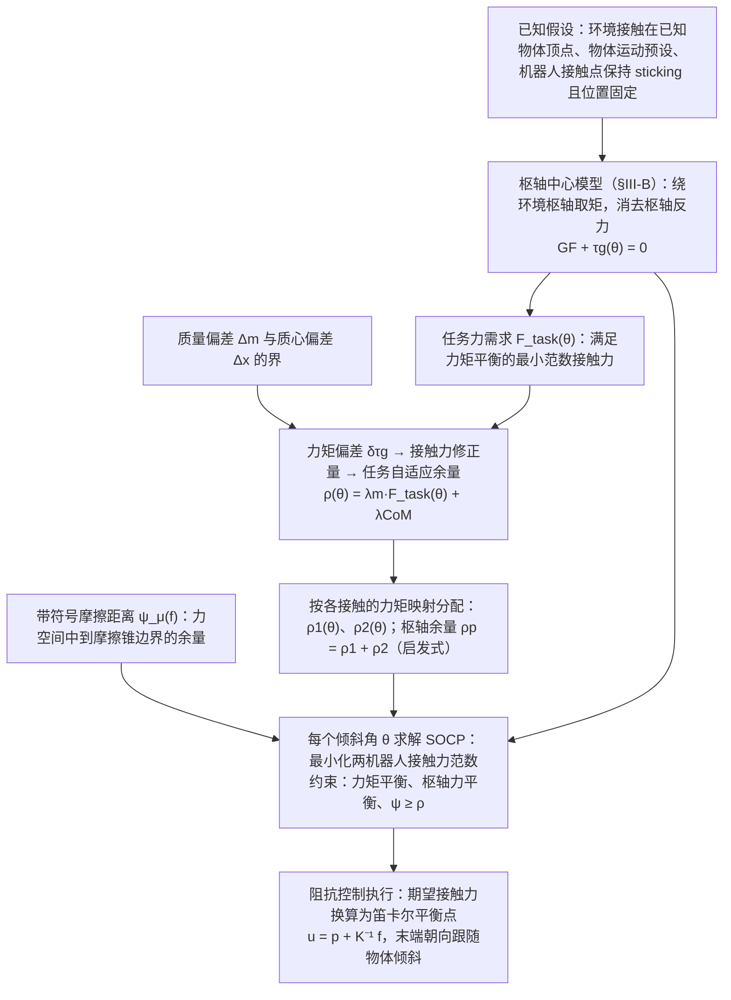

# Keeping Contact（arXiv:2610.36961）

**Keeping Contact**（*Keeping Contact: Task-Adaptive Friction Margins for Bimanual Non-Prehensile Manipulation*，[arXiv:2610.36961](https://arxiv.org/abs/2610.36961)，[项目页](https://keeping-contact.github.io/)）来自 [具身智能小站 2026-10-28 盘点](../../sources/blogs/wechat_embodied_station_59_papers_human_video_to_robot_experience_2026-10-28.md)，属「灵巧与接触操作」组。

## 一句话定义

**用有符号摩擦距离衡量接触力距滑移边界的余量，再依据任务力矩需求自适应调整。**

## 英文缩写速查

| 缩写 | 英文全称 | 简要说明 |
|------|----------|----------|
| Keeping Contact | Keeping Contact: Task-Adaptive Friction Margins for Bimanual Non-Prehensile Manipulation | 本文方法 / 基准的简称 |

## 为什么重要

- 双臂倾斜物体时留足摩擦余量。通过二阶锥规划分配接触力，并用真机物性变化与模型失配实验检验稳定接触。
- 开源结论：**项目页未列 GitHub**（步骤 2.5，2026-10-28）。项目页 HTTP 200，未见 GitHub 链接或 coming soon 字样。
- 同期同组工作见 [潜在动作、免渲染事件仿真与机器人评测：具身智能小站 10-28 期 59 篇阅读坐标](../overview/embodied-station-2026-10-28-59-papers-technology-map.md)。

## 流程总览

图依据：论文 §III-A–E（式 14、16、22–28）/ Fig.3

## 核心机制

| 项 | 内容 |
|----|------|
| **arXiv** | [2610.36961](https://arxiv.org/abs/2610.36961) |
| **开源** | **项目页未列 GitHub** |
| **要点** | 用有符号摩擦距离衡量接触力距滑移边界的余量，再依据任务力矩需求自适应调整。 |
| **文内指标** | 公众号转述：通过二阶锥规划分配接触力，并用真机物性变化与模型失配实验检验稳定接触。 |

## 源码运行时序图

**不适用（项目页未列 GitHub）** — 项目页 HTTP 200，未见 GitHub 链接或 coming soon 字样。 不编造运行脚本；代码公开后再补。

## 实验与评测

- 公众号转述：通过二阶锥规划分配接触力，并用真机物性变化与模型失配实验检验稳定接触。
- **读法：** 本页为索引级摘要，依据公众号转述的官方摘要与仓库信息整理；逐项数字与 baseline 以原文 PDF 为准。

## 与其他工作对比

- 横向索引见 [潜在动作、免渲染事件仿真与机器人评测：具身智能小站 10-28 期 59 篇阅读坐标](../overview/embodied-station-2026-10-28-59-papers-technology-map.md)；同 arXiv 不重复造页。

## 结论

**双臂倾斜物体时留足摩擦余量：通过二阶锥规划分配接触力，并用真机物性变化与模型失配实验检验稳定接触。**

1. 开源边界：**项目页未列 GitHub** — 项目页 HTTP 200，未见 GitHub 链接或 coming soon 字样。
2. 核心机制：用有符号摩擦距离衡量接触力距滑移边界的余量，再依据任务力矩需求自适应调整。
3. 复现与选型前核对任务协议、硬件与基准口径，勿直接横比公众号摘录数字。

## 关联页面

- [manipulation](../tasks/manipulation.md)
- [contact-rich-manipulation](../concepts/contact-rich-manipulation.md)
- [dexterous-kinematics](../concepts/dexterous-kinematics.md)
- [bimanual-manipulation](../tasks/bimanual-manipulation.md)
- [embodied-station-2026-10-28-59-papers-technology-map](../overview/embodied-station-2026-10-28-59-papers-technology-map.md)

## 参考来源

- [keeping_contact_arxiv_2610_36961.md](../../sources/papers/keeping_contact_arxiv_2610_36961.md)
- [wechat_embodied_station_59_papers_human_video_to_robot_experience_2026-10-28.md](../../sources/blogs/wechat_embodied_station_59_papers_human_video_to_robot_experience_2026-10-28.md)
- [arXiv:2610.36961](https://arxiv.org/abs/2610.36961)
- [arXiv PDF](https://arxiv.org/pdf/2610.36961)：已通读方法部分（实验与附录以略读为准）：§III 方法（A–E）、§IV-A 实验设置

## 推荐继续阅读

- [arXiv PDF](https://arxiv.org/pdf/2610.36961)
- [项目页](https://keeping-contact.github.io/)
