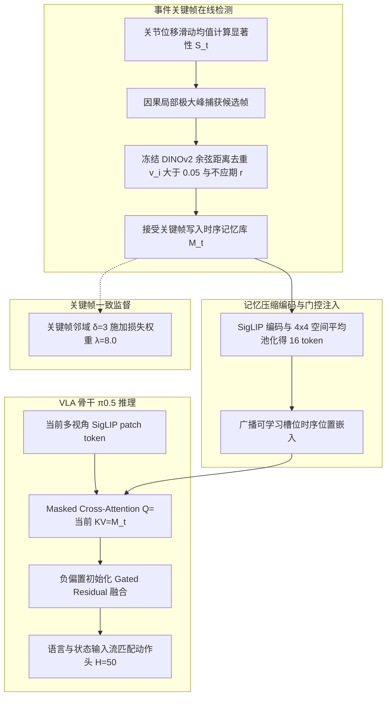

# KEMO（Event-Driven Keyframe Memory for Long-Horizon Robot Manipulation with VLA Policies）

**KEMO**（[arXiv:2606.23589v1](https://arxiv.org/abs/2606.23589)，[项目页](https://Hatty-z.github.io/KEMO)，Hong Kong Embodied AI Lab / CUHK / xdof.ai / UESTC / SJTU）提出面向 **记忆依赖长程双臂操作** 的 **可插拔关键帧记忆框架**：既不压缩稠密历史帧序列、也不引入高成本在线 VLM 任务分解，而是结合 **运动学减速显著性与冻结 DINOv2 视觉变化过滤** 在线选出过渡关键帧，编码入紧凑 **memory bank** 并通过 **masked cross-attention 与门控残差融合** 注入 $\pi_{0.5}$ 视觉表征，再以同一组关键帧定义邻域 **flow-matching loss 加权**。

## 一句话定义

**用「运动学减速峰 + DINOv2 视觉去重」自动挑出任务状态转移关键帧作稀疏历史证据，在视觉编码层以门控 cross-attention 插拔注入现有 VLA，并通过关键帧邻域 loss 加权让被记住的事件与被重点学习的时刻对齐。**

## 英文缩写速查

| 缩写 | 英文全称 | 简要说明 |
|------|----------|----------|
| KEMO | Event-Driven Keyframe Memory | 本文提出的事件驱动关键帧记忆插件框架 |
| VLA | Vision-Language-Action | 视觉-语言-动作多模态策略骨干（本文以 $\pi_{0.5}$ 验证） |
| TSR | Task Success Rate | 所有子阶段按序全部成功的试验比例 |
| SCR | Stage Completion Rate | 从首阶段起连续正确完成的阶段数比例 |
| SFT | Supervised Fine-Tuning | 基于双臂遥操作演示微调基础 VLA 策略 |
| KV | Key-Value | Cross-Attention 中来自关键帧记忆库的历史键值向量 |

## 为什么重要

- **直击长程 VLA 的阶段歧义（Stage Ambiguity）：** 在盖杯寻物、抽屉换物、盒内分拣等任务中，当前画面几乎完全一致，正确动作高度取决于数秒甚至数十秒前的操作历史。
- **免去子任务监督与在线 VLM 开销：** 检测管线仅需关节轨迹与冻结 DINOv2，不改写 LLM 前缀长度也不依赖额外 VLM 子目标规划幻觉传播。
- **验证「记忆内容」与「训练加权」必须同源协同：** Cover Blocks 上只做门控或只保留最近帧均大幅掉点，将关键帧邻域流匹配损失上调至 $\lambda=8$ 与记忆注入形成明显互补增益。

## 流程总览

## 核心原理

### 1. 事件驱动关键帧检测（无需任务标签）

首先在长度 $w$ 的滑动窗口上计算关节平均位移 $\bar{\delta}_t = \frac{1}{w}\sum_{i=0}^{w-1}\|q_{t-i}-q_{t-i-1}\|_2$，并定义事件显著性 $S_t = 1/(1+\bar{\delta}_t)$——机械臂在抓取、放置、加盖或释放前往往刻意减速，对应 $S_t$ 的局部峰值；经因果滑动峰检测获取候选帧后，使用冻结 DINOv2 全局表征计算与上一接收帧的余弦距离 $v_i = 1 - \cos(\phi(I_{c_i}), \phi(I_{k_{i-1}}))$，仅当超过视觉去重阈值 $\epsilon = 0.05$ 且距上一次接收超过不应期 $r$ 帧时才写入 $\mathcal{M}_t$，有效滤除纯机械停顿而不破坏场景的事件。

### 2. 紧凑记忆库与视觉门控注入

所有被接受关键帧使用策略同源的 SigLIP 视觉编码器提特征，并通过 $4\times 4$ 空间平均池化将每帧 `256` 个 patch token 压缩为 `16` 个 token。记忆库 $\mathcal{M}_t$ 保留最近 $K$ 个事件关键帧（不足 $K$ 时用最近关键帧填充并在注意力中以二进制 mask 屏蔽）；每个槽位广播可学习时序位置嵌入以区分阶段次序。融合发生在进入语言模型前的视觉编码层：当前帧图像特征作为 Query 与 $\mathcal{M}_t$ 做 Masked Cross-Attention，随后经 **负偏置初始化** 的可学习残差门 $\hat{X}_t = X_t + \sigma(g([X_t; X'_t])) \cdot X'_t$ 混合，保证微调早期平稳衔接预训练 $\pi_{0.5}$ 且不改变 LLM 前缀序列长度。

### 3. 关键帧一致的流匹配损失加权

阶段转换点既是记忆核心，也是策略一旦出错就会引发连锁失败的高危节点。KEMO 复用完全相同的关键帧索引集合，将距离任一关键帧半径 $\delta=3$ 步内的时间步 flow-matching 监督权重设为 $\lambda=8.0$（其余步为 `1.0`），确保模型在将来要写入记忆的临界过渡窗口拥有最高动作精度。

## 实验与评测

基于 **YAM 双臂** 真实桌面平台（每任务 100–200 条 leader–follower 遥操作演示，顶视+双腕三路 Decxin RGB，每任务评 **12 trials**）的结果（Paper Table 1–2）：

| 任务 | 计分子阶段 | 平均时长 / 步数 | KEMO TSR | $\pi_{0.5}$ TSR | MemoryVLA TSR | KEMO SCR |
|------|------------|-----------------|----------|-----------------|---------------|----------|
| **Swap Foods** | 2 | ~28 s / 830 | **8/12** | 6/12 | 1/12 | **1.580/2** |
| **Find Block** | 4 | ~40 s / 1186 | **2/12** | 0/12 | 0/12 | **3.167/4** |
| **Cover Blocks** | 6 | ~50 s / 1480 | **9/12** | 0/12 | 0/12 | **5.250/6** |
| **Box Refill** | 4 | ~50 s / 1480 | **7/12** | 4/12 | 0/12 | **3.330/4** |
| **Make Sandwich** | 4 | ~54 s / 1616 | **11/12** | 10/12 | 0/12 | **3.750/4** |
| **Drawer Items Replacement** | 4（4–5 动作段） | ~95 s / 2846 | 0/12 | 0/12 | 0/12 | **1.417/4** |
| **全任务聚合** | — | — | **51.4%** | 27.8% | 1.4% | **76.4%**（$\pi_{0.5}$ 42.3%） |

- **显著超越基线：** KEMO 聚合 TSR 相对无记忆 $\pi_{0.5}$ **+23.6 pt**、SCR **+34.1 pt**；相对稠密压缩基线 MemoryVLA 则在 TSR 领先 **+50.0 pt**、SCR 领先 **+60.9 pt**。
- **Cover Blocks 选择策略与消融（Table 1）：**
  - 仅比较关键帧选取（关闭 loss 加权）：事件关键帧 TSR **`3/12 (25.0%)`**（SCR `2.500/6`）> 近帧保留 **`1/12 (8.3%)`**（`0.700/6`）> 均匀采样 **`0/12 (0%)`**（`1.833/6`）。
  - 组件消融（采用事件关键帧）：去掉门控融合作直接残差相加后 TSR 跌至 **`0/12 (0%)`**（SCR `0.000/6`，记忆特征冲毁当前观察）；去掉 loss 加权 TSR 为 **`3/12 (25.0%)`**；完整 KEMO 升至 **`9/12 (75.0%)`**、SCR **`5.250/6`**。

## 结论

**KEMO 用实证说明长程记忆并不需要将海量稠密历史压成黑盒 token：基于运动减速和 DINOv2 去重的稀疏事件帧，配合负偏置门控残差与 $\lambda=8$ 关键帧加权微调，便可在不修改 VLA 语言骨干的前提下大幅解决视觉阶段歧义。**

- **事件选帧优于均匀采样与滑窗近帧**：均匀采样在试错拉长轨迹后会错位，近帧保留则会覆盖早期线索。
- **门控交叉注意力是防视觉覆盖的开关**：去除门控（直接残差）在 Cover Blocks 上会导致全任务瘫痪（`0/12`），因历史图像特征反客为主压过当前场景。
- **记忆与监督同源产生倍增效应**：同一关键帧既作 KV 记忆又加权 $\lambda=8$ 训练损失，使 Cover Blocks TSR 从 `25%` 跃升至 `75%`。
- **超长关系绑定仍存天花板**：95 秒的 Drawer Items Replacement 任务上三方全功亏一篑（0/12），说明跨多级抽屉打开–记忆物品类别–匹配回填仍超出手工阈值和固定 $K$ 的容量上限。
- **目前仅可作为算法参考，尚无公开源码**：官方项目页仍标注 `Code (coming soon)`。

## 源码运行时序图

**不适用**（截至 `2026-11-19` 核查：官方项目页 <https://Hatty-z.github.io/KEMO> 的源码按钮仍显示 `Code (coming soon)` 且 HTML 链接为禁用占位 `href="#" aria-disabled="true"`；`arXiv:2606.23589v1` 论文全文与附录亦未公布公共代码仓库或权重链接，故无法绘制经源码入口验证的运行时序图）。

## 工程实践

| 配置与参数域 | 论文附录验证参数（Appendix A–D） |
|--------------|----------------------------------|
| **机器人与相机** | **YAM 双臂** 6-DoF leader–follower（遥操作采数、推理仅 follower 自主）；3 路 Decxin RGB（固定顶视 + 左/右腕） |
| **SFT 训练配方** | 基于 $\pi_{0.5}$，`2×A100` 训练 `30,000` 步，global batch `32`，AdamW（`2.5e-5 → 2.5e-6`，warmup `1,000`），joint-space 动作块 `H=50` |
| **记忆与损失超参** | 关键帧损失权重 $\lambda=8.0$、半径 $\delta=3$；SigLIP $4\times 4$ 池化（`256 → 16` token）；DINOv2 去重统一 $\epsilon=0.05$ |
| **任务级检测器调参（Table 6）** | 窗口 `w` / 峰检测窗 / 不应期 `r` 需按任务调整：Cover Blocks `30/20/8`、Find Block `40/20/8`、Drawer `30/20/60`、Swap/Box/Make `10/60/8`；$K$ 亦按预期子阶段数手工设定 |
| **基线对照实验条件** | MemoryVLA 基线遵循其默认单顶视相机、Prismatic VLM、`8×A100`、batch `128`、40k 步配方训练；KEMO 与 $\pi_{0.5}$ 同享三相机 30k 步同配方 |

## 局限与风险

- **最长多关系绑定任务尚未突破：** 在 Drawer Items Replacement（95 s、2846 步，需跨抽屉记住物品与箱位映射）上 TSR 为 **0/12**，虽 SCR `1.417/4` 领先基线 `0.000/4`，但完整任务尚无法收官。
- **检测器超参与容量 $K$ 人工强绑定：** $w$、峰检测窗、不应期 $r$ 和记忆槽位上限 $K$ 依赖逐任务经验标定（如 Table 6 跨度从 `w=10..40`、`r=8..60`），尚未实现端到端可微学习式检测或动态扩容。
- **动作特征启发式的隐含假设：** 依赖关节明显减速才能触发事件峰；若操作员或高速连续轨迹在状态转移处未明显减速（或涉及无视觉变化的纯接触/按压次数记忆），纯运动学+视觉去重可能漏检。
- **与同名缩写的文献区分：** KEMO 论文中引用的 `BPP [11]` 指 Mark et al.（`arXiv:2602.15010`，基于 VLM 标记关键历史帧），与斯坦福 REALab 的 [Behavior Prompting Policy](./paper-behavior-prompting-policy.md)（`arXiv:2606.30457`）为不同工作；此外代码截至 `2026-11-19` 尚未公开，第三方暂不可直接跑通复现。

## 与其他工作对比

| 记忆方案 | 核心选帧 / 压缩机制 | 骨干与注入方式 | 相对 KEMO 特点 |
|----------|---------------------|----------------|----------------|
| **KEMO（本页）** | 运动减速显著峰 + DINOv2 余弦去重 | $\pi_{0.5}$ SigLIP 视觉层门控 cross-attn + $\lambda=8$ 损失加权 | 无在线 VLM 开销，不改 LLM 长度；需按任务调检测超参 |
| **MemoryVLA** | Per-step token merging 稠密压缩 | Prismatic VLM | 长轨迹下冗余帧易冲淡关键转移，6 任务 TSR 仅 1.4% |
| **[EventVLA](./paper-eventvla-visual-evidence-memory.md)** | 端到端学习前瞻 KEM + 原始帧拼接 | QwenOFT | 无需手工设置运动阈值，并配套 RoboTwin-MeM 诊断基准 |
| **[FM-VLA](./paper-fm-vla.md)** | Force-VAE 压缩腕部六维力历史 | $\pi_{0.5}$ action expert 注入 | 专解「视觉几乎看不出变化」的重复按压/力控记忆问题 |
| **[Chronos](./paper-chronos.md)** | SSM 压缩全历史观测状态 + 二阶动作桥 | 状态空间紧凑策略 | 不往大 VLA 挂外部视觉库，RMBench 73.6% |
| **[BridgeVLA++](./paper-bridgevla-plusplus.md)** | 时间关键帧 $\mathcal{T}$ + 初始几何 $\mathcal{S}$ | 3D 多视图热力图对齐策略 | 依赖 3D heatmap 表征，代码与权重已开源 |

## 关联页面

- 任务语境：[Manipulation](../tasks/manipulation.md)、[Bimanual Manipulation](../tasks/bimanual-manipulation.md)
- 方法与骨干：[VLA](../methods/vla.md)、[Imitation Learning](../methods/imitation-learning.md)、[π₀.₇ Policy](../methods/pi07-policy.md)、[π₀ Policy](../methods/pi0-policy.md)、[Action Chunking](../methods/action-chunking.md)
- 纵深路线：[具身上下文学习（ICL）纵深路线](../../roadmap/depth-icl.md)
- 关键帧与记忆族对比：[机器人关键帧与运动编辑工具](./robot-motion-keyframe-editors.md)、[EventVLA](./paper-eventvla-visual-evidence-memory.md)、[FM-VLA](./paper-fm-vla.md)、[Chronos](./paper-chronos.md)、[BridgeVLA++](./paper-bridgevla-plusplus.md)、[Gated Memory Policy](./paper-gated-memory-policy.md)、[MemER](./paper-memer.md)、[AMI-EV 微扫视事件相机](./paper-microsaccade-inspired-event-camera.md)

## 参考来源

- [arXiv 论文全文与附录精读笔记（2606.23589v1）](../../sources/papers/kemo_arxiv_2606_23589.md)
- [KEMO 官方项目页开源核查](../../sources/sites/kemo-github-io.md)

## 推荐继续阅读

- 论文：Zeng et al., *KEMO: Event-Driven Keyframe Memory for Long-Horizon Robot Manipulation with VLA Policies* — <https://arxiv.org/abs/2606.23589>
- 项目页：<https://Hatty-z.github.io/KEMO>
- 微调骨干：Physical Intelligence, *π₀.₅: a vision-language-action model with open-world generalization* — <https://arxiv.org/abs/2504.16054>
- 对照基线：Shi et al., *MemoryVLA: Perceptual-Cognitive Memory in Vision-Language-Action Models* — <https://arxiv.org/abs/2508.19236>
