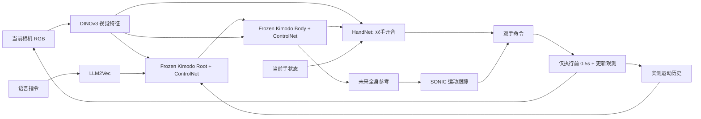
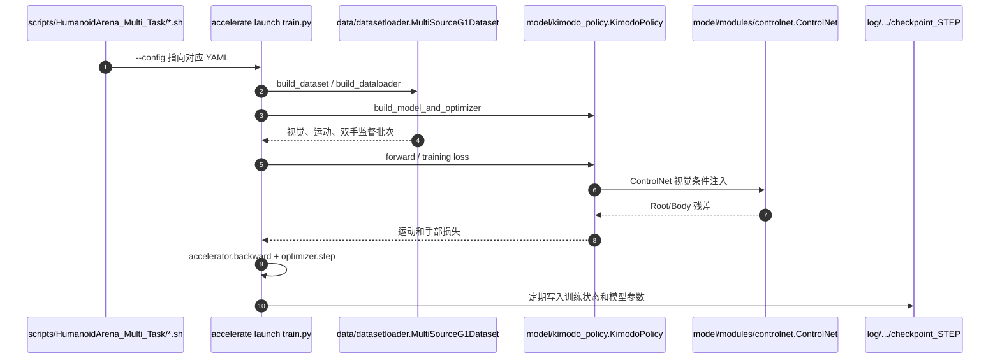
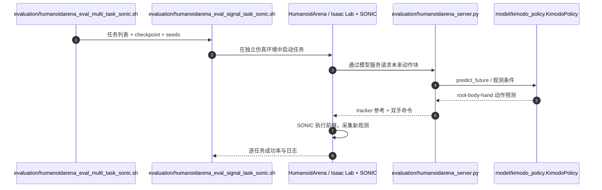

# Kimodo-Policy：运动动作模型的视觉闭环移动操作

## 一句话定义

冻结 Kimodo-G1 生成骨干，用视觉 ControlNet 与手部 HandNet 接入图像、手部状态及实测运动历史；分段预测、执行前缀再规划，实现 G1 视觉闭环移动操作。

## 英文缩写速查

| 缩写 | 英文全称 | 简要说明 |
|---|---|---|
| KAM | Kinematic Action Model | 运动预训练主干动作模型 |
| VLA | Vision-Language-Action | 视觉语言动作策略 |
| HOI | Human-Object Interaction | 人-物交互评测 |

## 为什么重要

- 将本研究放进从可控角色动画、实时生成到 G1 真机视觉闭环的对照坐标；输入和输出属于不同技术层级。
- 对工程部署而言，必须分别核查动作生成时间、动作跟踪控制频率和整机成功率。

## 核心信息

| 项 | 内容 |
|---|---|
| 论文/会议 | [arXiv 2026 preprint](https://arxiv.org/abs/2611.11554v1) |
| 机构 | 香港科技大学（广州）（HKUST Guangzhou）；京东探索研究院（JD Explore Academy）；北京工业大学（BJUT）；剑桥大学（Cambridge） |
| 作者 | Yunheng Wang、Jiaxi Zhang、Wei Lu、Yuetong Fang、Taowen Wang、Yixiao Feng、Shuning Zhang、Junzhe Xu、Yichi Wang、Zizhao Yuan、Kailun Huang、Lusong Li、Mingqian Zhou、Zecui Zeng、Renjing Xu（前三位共同一作；Zecui Zeng、Renjing Xu 为共同通讯作者） |
| 项目主页 | [作者官方入口](https://kimodo-policy.github.io/) |
| 开源 | [官方仓库](https://github.com/kimodo-policy/kimodo-policy)（依赖和模型文件另行准备） |
| 原文阅读状态 | **已完成主要论文全文、适用附录及原文结果复核**；源码仅核对主要运行路径 |

## 官方发布资源与复现接口（2026-11-13 核对）

| 层次 | 官方资源与操作 | 注意事项 |
|---|---|---|
| 仓库与许可 | [作者仓库](https://github.com/kimodo-policy/kimodo-policy)（代码标注 MIT）；[模型/检查点](https://huggingface.co/YunhengWang/kimodo-policy)；[数据与结果](https://huggingface.co/datasets/YunhengWang/kimodo-policy) | 仓库源码、底座模型权重、各任务 checkpoint、数据集与仿真资源需要分别准备；不能仅凭 clone 成功推断实验可运行 |
| 训练与 Arena | `bash setup.sh --only training`；多任务脚本 `scripts/HumanoidArena_Multi_Task/humanoidarena_sonicx7_gbs128_50w_controlnet4_detach_true_mse.sh` → Accelerate → `train.py` | 主模型环境 Python 3.10；Arena 独立 Python 3.11 / Isaac Sim 5.0.0 / Isaac Lab 2.2.0；需 SONIC ONNX 与场景资源 |
| SIMPLE | `evaluation/simple_eval_signal_task_sonic.sh` | SIMPLE 独立 Python 3.10 / MuJoCo 3.3.6 / Isaac Sim 4.5.0；Open Faucet、Push Office Chair、Move & Bend Pick 在发布评测中使用 50 帧执行前缀，其余五项为 15 帧 |
| 真机 | `real-world/`：PICO 采集 → 数据验证 → 419h 策略预训练权重上的任务微调 → GPU 服务器推理 → 工作站 bridge + SONIC 控制 | 官方发布 G1 + 双 Dex3 的八项任务共 **236 条演示**、对应数据和任务 checkpoint；另须准备带 SHA-256 清单的运行时资源、相机与网络配置，不能把发布流程等同于现场安全验收 |

> **开源范围**：官方 README 的 Roadmap 将预训练、HumanoidArena、SIMPLE 和真机采集/训练/部署列为已发布；BiGym 2.0 与 HumanoidToolBench 仍标为 Coming Soon。上述资源可下载与运行文档开放，不代表本库已运行或复现实验；真机需要在场操作者、安全支撑和急停。详见 [源码归档](../../sources/repos/kimodo-policy-official.md)。

## 流程总览

基于可核对的一手论文机制绘制主干模块关系：

## 核心原理

KAM 的预训练对象是运动学序列，而不是视觉语义；冻结的 Kimodo Root/Body 去噪骨干提供肢体协同先验。Trainable ControlNet 经双路径视觉融合注入根部与身体阶段，HandNet 根据未来身体、图像和当前双手状态生成开合命令。每次使用机器人实测动作历史而非仅重放预定动作。

## 实验与评测

论文报告 HumanoidArena 七任务多任务平均 72.14%，但单任务聚合预训练版本 67.14% 低于直接微调 69.76%；SIMPLE 八任务 75.83%（182/240）与 Ψ₀ 的 75.42% 接近。真机八任务 60%（48/80），不加 419h 交互预训练是 45%（36/80）。三项 HOI 消融 18.33/31.67/51.67% 与七任务汇总口径不同。**SIMPLE 的对照行汇集自不同原始报告，不是同一设置下统一重评**；75.83% 与 75.42% 仅相差 240 次中的一次成功，不能仅凭差值宣称跨任务显著领先。

## 原文复核摘录（正文证据）
- **图像到动作：** 保留冻结 Kimodo-G1 Root/Body 与 DINOv3，使用视觉 ControlNet 两路融合；训练 HandNet 的手部梯度不回传给 Motion Backbone；训练损失 root/body/hand/transition 权重 4/1/1/0.2。
- **时间与部署：** 30 Hz 历史 100 帧、预测 50 帧（1.67 秒）、执行 15 帧（0.5 秒）；SONIC 50 Hz。真机启用 RTC，仿真评测关 RTC；SIMPLE 可执行 15 或 50 帧（论文 §4.2）。
- **结果区别：** HumanoidArena 七任务多任务 72.14%，但单任务直接微调 69.76%，额外预训练后 67.14%；SIMPLE 8 任务 75.83%（182/240）对照 Ψ0 75.42%（181/240）。真机 36/80→48/80（45%→60%）。三项 HOI 消融 18.33/31.67/51.67% 与七任务总分不同。
- **局限：** §6 明确当前只适配 SONIC tracker，跨 tracker 未验证；独立 419h robot-interaction pretraining 的收益不可与 Kimodo-G1 运动骨干预训练混淆。
- **参考：** §3–§6 含全部主要结果表与 Figure 14 消融；[论文原文](https://arxiv.org/html/2611.11554v1)。

## 与其他工作对比

| 工作 | 关注点 | 与本文的区别 |
|------|--------|--------------|
| [Kimodo](./kimodo.md) | 文本 / 约束条件的运动学扩散生成骨干 | 只做开环运动生成；本文冻结其 G1 Root/Body，外加视觉 ControlNet 与 HandNet，用实测历史分段再规划形成视觉闭环 |
| [Ψ0](./paper-loco-manip-161-156-psi0.md) | 人形移动操作基础策略 | SIMPLE 八任务上为本文主对照：75.42%（181/240）对本文 75.83%（182/240），差距仅 1 次成功 |
| [NVIDIA SONIC](./nvidia-sonic.md) | 通用全身运动跟踪控制器 | 本文的下层执行器（50 Hz），论文只适配 SONIC，跨 tracker 未验证（§6） |

## 结论

**研究价值在于 冻结 Kimodo-G1 生成骨干，用视觉 ControlNet 与手部 HandNet 接入图像、手部状态及实测运动历史；对比时必须看清控制层级和数据口径。**

1. 生成模型输出的运动序列并不自动满足真实机器人动态平衡和接触约束。
2. 相关数值只对应论文实验配置，不能横向等同于另一系统的真机成功率。
3. 将该工作与相邻项目区分为 **生成、跟踪、视觉条件适配、闭环执行** 等不同接口。

## 源码运行时序图

下图由官方 `README.md`、多任务训练脚本、`train.py`、`model/kimodo_policy.py`、`model/modules/controlnet.py` 与评测脚本逐项对照得出。**训练和评测不是同一个进程的直接调用**，因此分开表达。

**训练入口（HumanoidArena 多任务示例）**

**HumanoidArena 评测入口（独立进程/环境）**

**真机执行**：官方 `real-world/deploy/deploy.sh` 调用 `deploy_cli.py`；GPU 服务器先执行 `server TASK`，工作站通过 `tunnel.sh` 建立 SSH 端口转发，启动 `sonic.sh` 后先 `check TASK`（仅检查、不发布动作），最后才 `run TASK` 发布参考命令。详见 [真机部署指南](https://github.com/kimodo-policy/kimodo-policy/blob/main/real-world/deploy/start.md)。

## 工程实践

最小排查顺序：`bash setup.sh --dry-run` → 安装并检查三套隔离环境 → 下载运动骨干/DINOv3/任务 checkpoint、文本缓存及仿真与 SONIC 资源 → 用评测 wrapper 的 `--dry-run` 校验路径 → 跑少量 episode 再完整评测。训练前可使用 `utils/check_datasets.py --fail-on-errors` 审计动作数据。真机依 [workstation 验证范围](https://github.com/kimodo-policy/kimodo-policy/blob/main/real-world/docs/verification.md) 在场确认，不在无人值守环境试运行。

## 局限与风险

文中 1.67 秒预测、0.5 秒执行前缀只属于本策略配置；部署依赖视觉、机器人状态与 SONIC，预训练消融与真实交互数据来源不可混算。

**核查边界：** 已复核论文正文、结果与可用附录；代码仓库仅核对 README 与关键运行入口，未运行真机部署或完整训练。论文内已发布结果不等同于独立复现。

## 关联页面

- [从动作生成到人形闭环：方法与证据对比](../comparisons/generative-motion-to-humanoid-closed-loop.md)
- [扩散式动作生成](../methods/diffusion-motion-generation.md)
- [ARDY：交互可控动作生成](./ardy.md)
- [Kimodo：运动生成主干](./kimodo.md)

## 参考来源

- [kimodo_policy_primary.md](../../sources/papers/kimodo_policy_primary.md)
- [kimodo-policy-primary.md](../../sources/sites/kimodo-policy-primary.md)
- [kimodo-policy-official.md](../../sources/repos/kimodo-policy-official.md)

## 推荐继续阅读

- [原始论文](https://arxiv.org/abs/2611.11554v1)
- [作者项目主页](https://kimodo-policy.github.io/)
- [官方源码](https://github.com/kimodo-policy/kimodo-policy)
