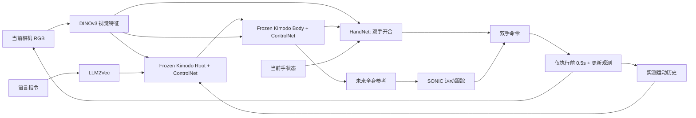
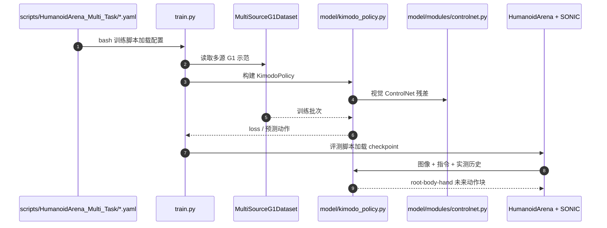

# Kimodo-Policy：运动动作模型的视觉闭环移动操作

## 一句话定义

冻结 Kimodo-G1 生成骨干，用视觉 ControlNet 与手部 HandNet 接入图像、手部状态及实测运动历史；分段预测、执行前缀再规划，实现 G1 视觉闭环移动操作。

## 英文缩写速查

| 缩写 | 英文全称 | 简要说明 |
|---|---|---|
| KAM | Kinematic Action Model | 运动预训练主干动作模型 |
| VLA | Vision-Language-Action | 视觉语言动作策略 |
| HOI | Human-Object Interaction | 人-物交互评测 |

## 为什么重要

- 将本研究放进从可控角色动画、实时生成到 G1 真机视觉闭环的对照坐标；输入和输出属于不同技术层级。
- 对工程部署而言，必须分别核查动作生成时间、动作跟踪控制频率和整机成功率。

## 核心信息

| 项 | 内容 |
|---|---|
| 论文/会议 | [arXiv 2026 preprint](https://arxiv.org/abs/2611.11554v1) |
| 机构 | 香港科技大学（广州）（HKUST Guangzhou）；京东探索研究院（JD Explore Academy）；北京工业大学（BJUT）；剑桥大学（Cambridge） |
| 作者 | Yunheng Wang et al. |
| 项目主页 | [作者官方入口](https://kimodo-policy.github.io/) |
| 开源 | [官方仓库](https://github.com/kimodo-policy/kimodo-policy)（依赖和模型文件另行准备） |
| 原文阅读状态 | **未完成全文与全部附录核对，暂为 draft** |

## 流程总览

基于可核对的一手论文机制绘制主干模块关系：

## 核心原理

KAM 的预训练对象是运动学序列，而不是视觉语义；冻结的 Kimodo Root/Body 去噪骨干提供肢体协同先验。Trainable ControlNet 经双路径视觉融合注入根部与身体阶段，HandNet 根据未来身体、图像和当前双手状态生成开合命令。每次使用机器人实测动作历史而非仅重放预定动作。

## 实验与评测

论文报告 HumanoidArena 七任务联合训练平均 72.14%；模型 678M 参数、92M 可训练；真机八任务 60%（48/80），对照移除 419 小时交互数据预训练为 36/80。仿真三项 HOI 消融 18.33/31.67/51.67% 不能和七任务总分混算。

## 结论

**研究价值在于 冻结 Kimodo-G1 生成骨干，用视觉 ControlNet 与手部 HandNet 接入图像、手部状态及实测运动历史；对比时必须看清控制层级和数据口径。**

1. 生成模型输出的运动序列并不自动满足真实机器人动态平衡和接触约束。
2. 相关数值只对应论文实验配置，不能横向等同于另一系统的真机成功率。
3. 将该工作与相邻项目区分为 **生成、跟踪、视觉条件适配、闭环执行** 等不同接口。

## 源码运行时序图

依据官方 README 及已核对的代码入口，仅描述可明确确认的运行链路：

## 工程实践

开源包括 `train.py`、`model/kimodo_policy.py`、`model/modules/controlnet.py`、Arena 和 SIMPLE 的训练/评测脚本、模型权重及数据入口。需要区分独立 Conda 环境、NVIDIA SONIC ONNX 权重和仿真资源。

## 局限与风险

文中 1.67 秒预测、0.5 秒执行前缀只属于本策略配置；部署依赖视觉、机器人状态与 SONIC，预训练消融与真实交互数据来源不可混算。

**阅读阻塞：** 仅核对论文的主要方法/结果段落、作者项目页及可用仓库入口；尚未完成全部原文与附录的通读及代码运行验证。按知识库规则保留 draft，未声称原文通读。

## 关联页面

- [从动作生成到人形闭环：方法与证据对比](../comparisons/generative-motion-to-humanoid-closed-loop.md)
- [扩散式动作生成](../methods/diffusion-motion-generation.md)
- [ARDY：交互可控动作生成](./ardy.md)
- [Kimodo：运动生成主干](./kimodo.md)

## 参考来源

- [kimodo_policy_primary.md](../../sources/papers/kimodo_policy_primary.md)
- [kimodo-policy-primary.md](../../sources/sites/kimodo-policy-primary.md)
- [kimodo-policy-official.md](../../sources/repos/kimodo-policy-official.md)

## 推荐继续阅读

- [原始论文](https://arxiv.org/abs/2611.11554v1)
- [作者项目主页](https://kimodo-policy.github.io/)
- [官方源码](https://github.com/kimodo-policy/kimodo-policy)
