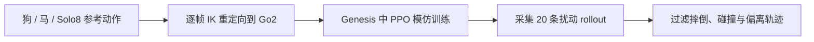
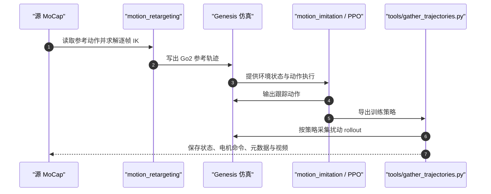

# Kine2Go：Unitree Go2 多步态运动学数据集

Kine2Go 是面向 Unitree Go2 的四足运动学数据集与生成管线：将狗、马和合成机器人动作重定向到 Go2，在 Genesis 中训练逐动作 PPO 模仿策略，再采集扰动 rollout。它提供动作先验及其策略生成的状态—电机命令轨迹，适合模仿学习与运动数据建模。

## 英文缩写速查

| 缩写 | 英文全称 | 简要说明 |
|------|----------|----------|
| Go2 | Unitree Go2 Quadruped Robot | 数据集目标四足机器人 |
| MoCap | Motion Capture | 上游参考动作来源之一 |
| IK | Inverse Kinematics | 将源动作映射到 Go2 关节与足端约束 |
| PPO | Proximal Policy Optimization | 逐参考动作训练的模仿策略 |
| RL | Reinforcement Learning | 在仿真中训练运动跟踪策略 |

## 数据与生成流程

论文与数据卡报告 40 段参考动作，来源包括 AI4Animation 狗动作、Vienna Horse Data Collection 马动作和 Solo8 四足动作；每段参考动作训练一个策略，采集 20 条扰动 rollout，总计 800 条。目标机器人为 12 驱动关节 Go2，仿真和采集使用 Genesis，数据采集频率为 60 Hz。

数据卡提供读取接口：参考动作数组为 (T, 61) 的 float32；片段元数据包含来源、许可、频率与帧数，另有配置和 rollout 逐步记录。请以数据集的实际文件与 schema 为准，使用前检查所需字段。

## 源码运行时序图

关键复现路径为 motion_retargeting → motion_imitation → tools/gather_trajectories.py；具体环境安装与命令以官方 README 为准。

## 适用范围与许可

- 适合研究 Go2 运动模仿、动物动作到四足机器人的运动重定向，以及策略生成轨迹作为 BFM 训练或正则化数据。
- 这是仿真生成的运动学与控制轨迹集合；不应将其当作 Go2 真机传感器采集数据。
- pipeline 代码为 BSD-3-Clause；数据集不是统一许可。数据卡列出 AI4Animation 子集为 CC BY-NC 4.0、VHDC 子集为 CC BY-SA 4.0、Solo8 子集为 BSD-3-Clause；片段许可以各目录 clip.json 的 license 字段为准。商用或再分发前需逐片段核对原始许可及衍生数据条件。

## 结论

Kine2Go 的主要价值是提供一条可复现的「跨形态动作重定向 → RL 物理跟踪 → 扰动轨迹采集」数据生产流程，而非大规模真机经验数据。

- 研究模仿学习时，可把 40 段参考动作作为技能覆盖，把 800 条 rollout 作为带策略行为的数据。
- 复现或扩展时，优先检查逐帧重定向质量、仿真跟踪误差与过滤规则；论文的总量不能替代这些质量指标。
- 商用或再分发时，逐片段按上游许可处理，不能仅依据 pipeline 的 BSD-3-Clause 许可证。

## 关联页面

- [Motion Retargeting](../concepts/motion-retargeting.md)
- [Go2 Motion Imitation](./go2-motion-imitation.md) — 另一套 Go2 Genesis 运动模仿实现，可对照其重定向格式与训练设置。
- [Genesis World 1.0](./genesis-world-10.md)
- [Locomotion](../tasks/locomotion.md)

## 参考来源

- [Kine2Go 论文摘录](../../sources/papers/kine2go_arxiv_2606_14433.md)
- [Kine2Go 项目页](../../sources/sites/kine2go-project.md)
- [Kine2Go pipeline 仓库](../../sources/repos/kine2go-pipeline.md)

## 推荐继续阅读

- [官方数据集卡](https://huggingface.co/datasets/MIMUW-Robotics/kine2go) — 查看完整数据文件、元数据及逐片段许可。
- [官方 pipeline](https://github.com/nomagiclab/kine2go-pipeline) — 查看环境、训练和采集脚本。
