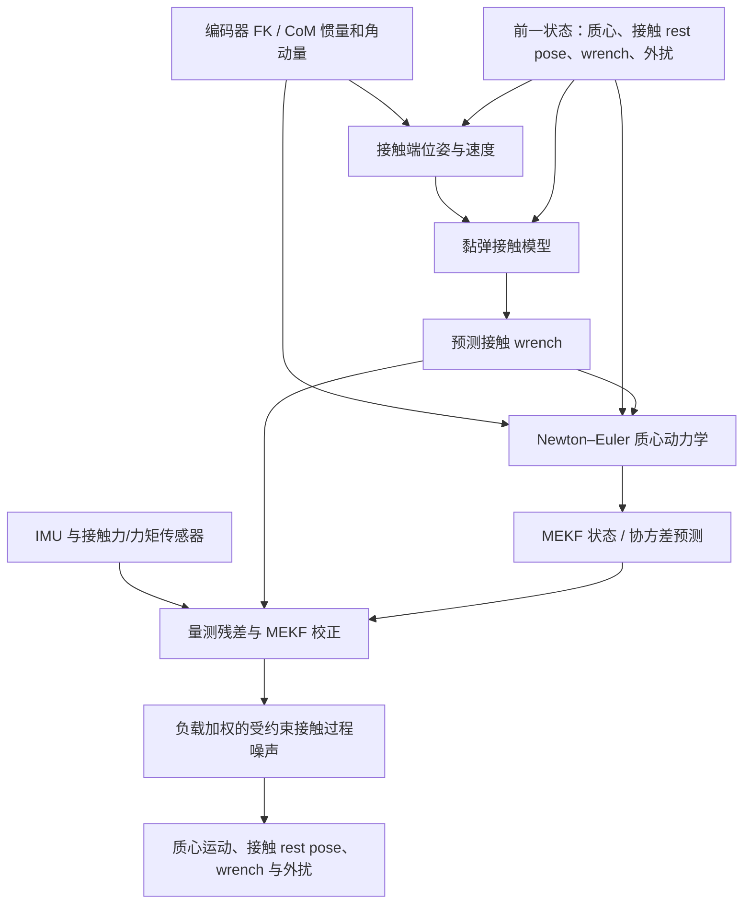
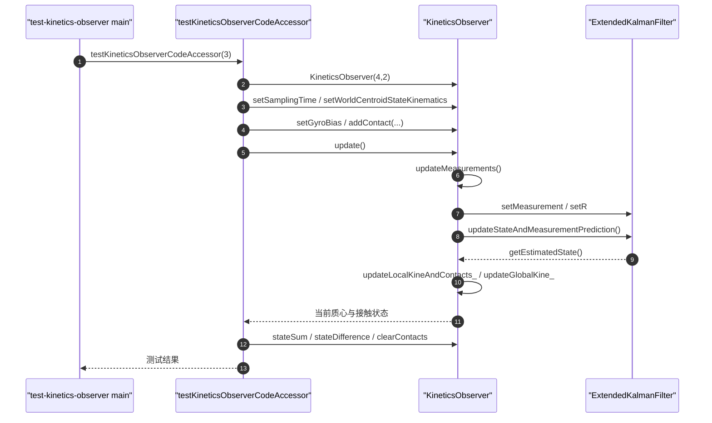

# Kinetics Observer：足式机器人运动学—动力学紧耦合估计 / The Kinetics Observer: A Tightly Coupled Estimator for Legged Robots

**作者：** Arnaud Demont、Mehdi Benallegue、Abdelaziz Benallegue、Pierre Gergondet、Antonin Dallard、Rafael Cisneros、Masaki Murooka、Fumio Kanehiro。**机构：** CNRS-AIST JRL（法国国家科学研究中心—日本产业技术综合研究所联合机器人实验室）、巴黎萨克雷大学/凡尔赛系统工程实验室（LISV）、法国 CNRS—蒙彼利埃大学 LIRMM。**原文：** [arXiv:2406.13267v2](https://arxiv.org/abs/2406.13267)，2026-10-08 修订。

## 一句话定义

**Kinetics Observer（KO）** 是腿式机器人乘法扩展卡尔曼滤波（MEKF）估计器：利用**质心动力学预测机体运动**和接触**弹簧—阻尼模型预测反力**，将 IMU 及接触力/力矩信号共同作为观测，联合修正质心状态、接触环境 rest pose 和未建模外扰。

## 英文缩写速查

| 缩写 | 英文全称 | 简要说明 |
|---|---|---|
| KO | Kinetics Observer | 本文的运动学—动力学紧耦合估计器 |
| MEKF | Multiplicative Extended Kalman Filter | 在旋转上用乘法误差表示的扩展卡尔曼滤波 |
| IMU | Inertial Measurement Unit | 机体角速度与比力传感器 |
| FK | Forward Kinematics | 编码器到接触端姿态的正向运动学 |
| CoM | Center of Mass | 质心与质心坐标系 |
| RI-EKF | Right-Invariant Extended Kalman Filter | 论文对照的腿式不变滤波方法 |
| GRF | Ground Reaction Force | 地面接触反作用力 |
| WBC | Whole-Body Control | 可消费高频估计状态的全身控制模块 |

## 为什么重要

传统腿-惯性里程计以 IMU 预测、接触脚位置不变的运动学假设校正；柔性结构、足端滑移和接触初始化误差可能将环境变化错判为机体运动。KO 把 6D 接触反力/力矩变成状态观测，使力测量和接触几何相互约束，适用于需要质心速度、支撑状态及外扰估计的人形真机。

## 核心原理

### 状态与动力学—量测耦合

| 部分 | 作用 |
|---|---|
| 联合状态 | 质心位置/姿态/线角速度、陀螺 bias、未建模 wrench、各接触 rest pose 及接触 wrench |
| 质心预测 | Newton–Euler 质心动力学、质量/惯量、角动量与接触合 wrench |
| 接触预测 | 编码器 FK → 当前接触端相对环境 rest frame 位姿/速度 → 黏弹性接触力 |
| 观测修正 | IMU 加速度/陀螺、接触力/力矩量测与预测量比较，MEKF 联合校正 |
| 接触管理 | 新建/删除接触状态、初始化 rest pose 和不确定性 |

**与 RI-EKF 的核心区别：** KO **不用 IMU 积分作为主要状态预测模型**，而采用动力学传播；IMU 与 wrench 一起进入观测校正。参见论文方法节和[原文核对](../../sources/papers/kinetics_observer_arxiv_2406_13267.md)。

### 流程总览

### 接触 rest pose、滑移和可观性

- 每一足/手接触用**随机器人运动的 contact frame** 与**接触不形变时的环境 rest frame** 描述；相对位移、旋转和速度经弹簧—阻尼生成 wrench 预测。测量反力有助于校正**相对质心系**的接触位置和局部滑移。
- 接触载荷构成权重，利用论文给出的 M=I-SWᵀ 约束接触过程噪声，减少所有支撑接触共同漂移，同时保留相对接触几何调整。该约束不等于新增绝对世界锚点。
- **纯本体传感全局位置和 yaw 仍不可观**；附录 B 的可观性分析依赖具体运动/接触条件，不能推广为任意接触配置的严格全局可观性。

## 源码运行时序图

官方仓库 [state-observation](https://github.com/jrl-umi3218/state-observation) 公开 C++ 实现。下图严格对齐实际**单元测试入口**，不将单测冒充论文机器人实验或真实部署流程；接口核对见[源码归档](../../sources/repos/jrl-state-observation-kinetics-observer.md)。

生产接入另需循环设置 setIMU、每个活跃接触的 updateContactWithWrenchSensor 或 updateContactWithNoSensor、以及 setCoMInertiaMatrix、setCoMAngularMomentum 等动力学信号；缺失接触更新会触发库断言。测试没有完成真实多传感器数据重放。

## 实验与评测

作者在 **RHP Friends、HRP-5P** 两款人形开展总计 13 段序列，涉及平地长走、滑移、足/手多接触与未建模外力。对比 RI-EKF 及 KO 无约束过程协方差等消融。

| 论文场景 | KO | 对照 | 结论边界 |
|---|---:|---:|---|
| HRP-5P 长走 yaw 相对方向误差 | **0.19°** | RI-EKF **0.37°** | 特定序列，不代表 yaw 全局可观 |
| RHP Friends 平地横向漂移 | **约 40% 改善** | RI-EKF | 论文报告的试验条件 |
| 多接触 0.3m 区间 yaw 误差 | **0.12°** | KO-ZPC **0.36°** | 接触过程协方差消融 |
| 30° 初始足端倾角误差示例 | 恢复至 **约 0.03°** | 仪器参考 | 指定倾斜障碍条件 |
| 0–8 接触单次估计耗时 | **小于 1 ms** | 作者评测设备 | 不可等同默认开源构建时延 |

论文还展示隐藏手部接触后的未建模 wrench 估计；观测与参考有约 10 N / 10 N·m 偏置，外扰状态同时吸收部分动力学误差。

## 结论

**KO 的关键价值是让反力测量参与修正接触几何与机体运动，而不只作为动力学前馈，因此对局部滑移、接触初始化误差和多接触场景更有诊断能力。**

1. **有 6D wrench 传感器时**，对比 KO 与仅依赖 FK/接触假设的 RI-EKF，并单独评估力信号噪声敏感性。
2. **动态接触要跟踪 rest pose**：观察接触几何随滑移更新是否合理，而非固定每次 touchdown 的世界足端坐标。
3. **多支撑消融过程协方差约束**：观察所有接触共同漂移与相对接触偏差。
4. **不要把局部滑移估计等同全局定位**：位置及 yaw 长程仍需外感知锚点。
5. **外扰估计须对照独立力传感器**：它包含模型误差，不是纯外力真值。
6. **延迟先按实际配置实测**：论文 <1ms 不能直接迁移到其它接触数/编译选项/机型。

## 工程实践

| 检查项 | 工程提示 |
|---|---|
| 实现 | 官方 C++ state-observation 库含 KineticsObserver 与 CTest 单测；本次未构建运行 |
| 输入 | IMU、关节 FK、接触 6D wrench、质心惯量与角动量，检查时间戳和坐标变换 |
| 标定 | 质量/惯量、接触弹簧和阻尼、传感器协方差、初始 rest pose |
| 接触管理 | 每个有效接触周期更新或显式删除，检查 touchdown/transient/slip |
| 对照 | RI-EKF、KO、KO-ZPC；记录相对轨迹误差、yaw、接触漂移、外扰和计算耗时 |
| 控制 | WBC/MPC 使用估计结果前先做断联、错误接触和超时回退验收 |

## 与其他工作对比

- **[State Estimation](../concepts/state-estimation.md)：** 常规腿—惯性滤波以 IMU 传播、足端运动学修正；KO 则以动力学传播，IMU 与 wrench 共同观测。
- **[SG-ODOM](./paper-sg-odom-2611-20710.md)：** SG-ODOM 关注何时认为支撑稳定、何时调度更新；KO 关注如何把弹性接触 wrench 与运动学/动力学联立估计，两者互补而非同一成果。
- **[Contact Estimation](../concepts/contact-estimation.md)：** 接触有效性的检测与已建立接触的 rest pose/wrench 估计目标不同。

## 局限与风险

- **不可观量：** 没有外感知时全局位置/yaw 漂移仍存在；无法承诺极端共同滑移条件下的可靠绝对修正。
- **模型误差：** 质量、惯量、角动量、FK、接触刚度/阻尼、时间同步误差会影响力观测残差；外扰可能吸收模型偏差。
- **复现不等于单测：** 仓库提供库实现与单测，未确认论文所有 ROS/真机日志与一键复现流程。
- **时延配置不同：** 库构造代码默认 finiteDifferencesJacobians_=true；论文的指定条件耗时需与实际目标构建和解析 Jacobian 配置核对。
- **场景边界：** 真实机器人实验仅覆盖论文两款人形的指定场景，不保证未知机器人或高速腾空步态表现。

## 关联页面

- [State Estimation](../concepts/state-estimation.md)
- [Contact Estimation](../concepts/contact-estimation.md)
- [人形行走任务](../tasks/humanoid-locomotion.md)
- [Locomotion（足式运动任务）](../tasks/locomotion.md)：估计质心及接触状态是行走反馈的前提。
- [Model Predictive Control（模型预测控制）](../methods/model-predictive-control.md)：高频状态、接触与外扰估计可作为预测控制的状态输入；论文未实测此闭环集成。
- [SG-ODOM](./paper-sg-odom-2611-20710.md)
- [Kalman Filter vs Optimization](../comparisons/kalman-filter-vs-optimization-based-estimation.md)
- [传统模型控制纵深 Stage 4](../../roadmap/depth-classical-control.md)

## 参考来源

- [arXiv v2 原文核读与实验口径](../../sources/papers/kinetics_observer_arxiv_2406_13267.md)
- [官方 C++ 代码与真实单测入口](../../sources/repos/jrl-state-observation-kinetics-observer.md)

## 推荐继续阅读

- [论文原文](https://arxiv.org/abs/2406.13267)
- [官方 KineticsObserver C++ 实现](https://github.com/jrl-umi3218/state-observation/blob/master/src/kinetics-observer.cpp)
- [Hartley et al. Contact-Aided Invariant EKF](https://arxiv.org/abs/1904.09251)
