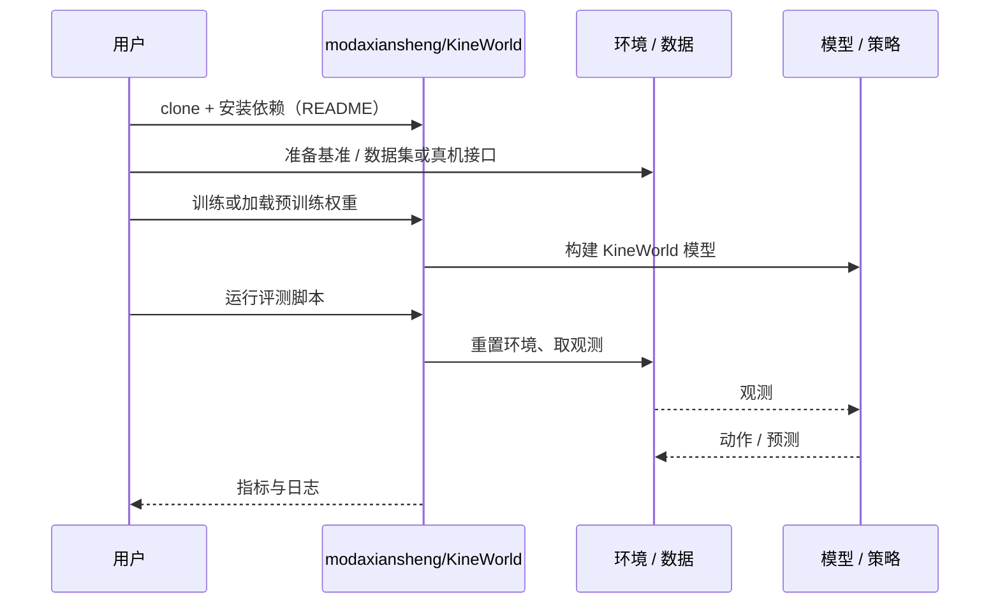

# KineWorld（arXiv:2610.06349）

**KineWorld**（*KineWorld: Action-Induced Transport Fields for Embodied World Modeling*，[arXiv:2610.06349](https://arxiv.org/abs/2610.06349)，[项目页](https://modaxiansheng.github.io/KineWorld/)，[代码](https://github.com/modaxiansheng/KineWorld)）来自 [具身智能小站 2026-10-13 盘点](../../sources/blogs/wechat_embodied_station_34_papers_mulligan_2026-10-13.md)，属「世界模型与仿真」组。

## 一句话定义

**把机器人运动学映射为相机对齐的输运场，对未来视频监督加权，让损失关注动作引起的局部变化。**

## 英文缩写速查

| 缩写 | 英文全称 | 简要说明 |
|------|----------|----------|
| WM | World Model | 世界模型 |
| Transport field | Action-induced Transport Field | 动作输运场 |
| FK | Forward Kinematics | 正运动学 |

## 为什么重要

- 均匀外观损失稀释了动作后果。
- 开源结论：**已开源**（步骤 2.5，2026-10-14）。项目页链接的 GitHub 仓库可达。
- 同期同组工作见 [失败导向采集与可组合世界动作模型：具身智能小站 10-13 期 34 篇阅读坐标](../overview/embodied-station-2026-10-13-34-papers-technology-map.md)。

## 核心机制

| 项 | 内容 |
|----|------|
| **arXiv** | [2610.06349](https://arxiv.org/abs/2610.06349) |
| **开源** | **已开源** |
| **要点** | 双臂仿真数据评测。 |
| **文内指标** | 以原文为准。 |

## 源码运行时序图

以下为按仓库入口（`modaxiansheng/KineWorld`）推断的通用运行链路；入库日仅核实仓库可达，未逐文件阅读，具体脚本名以 README 为准。

## 实验与评测

- 以原文为准。
- **读法：** 本页为索引级摘要，依据公众号转述的官方摘要与仓库信息整理；逐项数字与 baseline 以原文 PDF 为准。

## 与其他工作对比

- 横向索引见 [失败导向采集与可组合世界动作模型：具身智能小站 10-13 期 34 篇阅读坐标](../overview/embodied-station-2026-10-13-34-papers-technology-map.md)；同 arXiv 不重复造页。

## 结论

**世界模型监督应按「动作影响区域」加权。**

1. 开源边界：**已开源** — 项目页链接的 GitHub 仓库可达。
2. 核心机制：双臂仿真数据评测。
3. 复现与选型前核对任务协议、硬件与基准口径，勿直接横比公众号摘录数字。

## 关联页面

- [generative-world-models](../methods/generative-world-models.md)
- [world-action-models](../concepts/world-action-models.md)
- [bimanual-manipulation](../tasks/bimanual-manipulation.md)
- [embodied-station-2026-10-13-34-papers-technology-map](../overview/embodied-station-2026-10-13-34-papers-technology-map.md)

## 参考来源

- [kineworld_action_induced_transport_fields_arxiv_2610_06349.md](../../sources/papers/kineworld_action_induced_transport_fields_arxiv_2610_06349.md)
- [wechat_embodied_station_34_papers_mulligan_2026-10-13.md](../../sources/blogs/wechat_embodied_station_34_papers_mulligan_2026-10-13.md)
- [arXiv:2610.06349](https://arxiv.org/abs/2610.06349)

## 推荐继续阅读

- [arXiv PDF](https://arxiv.org/pdf/2610.06349)
- [项目页](https://modaxiansheng.github.io/KineWorld/)
- [https://github.com/modaxiansheng/KineWorld](https://github.com/modaxiansheng/KineWorld)
