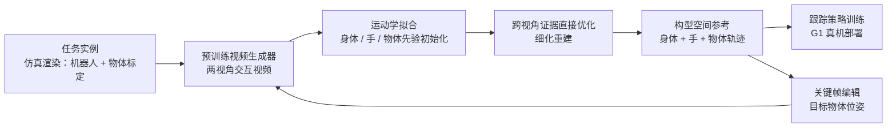

# KinoGen：基于运动学约束视频生成的人形移动操作参考

**KinoGen**（论文 *KinoGen: Customizable Humanoid Loco-Manipulation References via Kinematically Grounded Video Generation*，[arXiv:2610.20552](https://arxiv.org/abs/2610.20552)，[项目页](https://kinogen-humanoid.github.io/)）由 Cornell University 与 Multiply Labs 提出：用视频生成器合成人形移动操作的交互视频，但 **不是** 直接用生成视频做参考，而是把同一套机器人与物体模型拟合到生成视频上，使参考在机器人构型空间内成立。

## 一句话定义

**用机器人与物体的标定渲染约束视频生成，再通过两视角拟合恢复全身、手与物体轨迹，并允许编辑关键帧的目标物体位姿来定制参考。**

## 英文缩写速查

| 缩写 | 英文全称 | 简要说明 |
|------|----------|----------|
| KinoGen | Kinematically Grounded Video Generation（取自论文题名） | 本文框架：运动学约束的视频生成参考 |
| EPE | End-Point Error | 表面点轨迹在留出点上的误差，用于评估拟合质量 |
| GRAIL / GenMimic / GenHOI | 论文对比的视频参考生成方法名 | 视频类参考生成的基线，细节见原文参考文献 |
| RL | Reinforcement Learning | 下游用参考训练跟踪策略 |
| AUC | Area Under Curve | 学习曲线下面积，衡量下游训练效率 |

## 为什么重要

- **参考获取是移动操作的瓶颈：** 人类示教需要重建与重定向，遥操作成本高，纯生成视频又无法满足目标位姿等度量要求。
- **约束生成比后处理更可靠：** 直接用渲染条件约束视频，再做拟合，能减少脚滑、穿透和接触丢失，比只做插值的参考更接近真实交互。
- **可定制：** 关键帧编辑后重新生成周边动作，让同一任务可以指定新的物体目标位姿，对数据扩增有实用价值。

## 核心信息

| 项 | 内容 |
|----|------|
| **机构** | 康奈尔大学（Cornell University）；Multiply Labs |
| **平台** | Unitree G1 + 双 OYMotion ROHand（6-DoF 灵巧手）；仿真 Isaac Sim |
| **数据 / 任务** | 8 个移动操作任务（坐凳、跪地取物、拖地、搬箱上架、抬篮/椅/哑铃/篮球）；视频生成器生成的两视角交互视频 |
| **开源** | **待发布**（截至 2026-10-15）：项目页 Code 标注 "Code coming soon"，无代码链接 |

## 核心原理

### 流程总览

### 生成条件：校准渲染而非文本

- 视频生成器以目标机器人与物体在仿真任务实例中的 **校准渲染图** 为条件，而不是只用文本或参考图；这让生成视频的几何与机器人模型对齐。
- 拟合阶段不使用人体代理，也不做重定向：身体、手与物体的先验用于初始化，再对跨视角证据做直接优化。

### 关键帧定制

- 编辑后的关键帧就是另一个渲染状态，因此可以把目标物体位姿写进关键帧，再重新生成其周边动作。
- 重建在约束下满足目标位姿，而直接在末端执行器上插值会穿过桌面（论文 Table III 与 Fig. 6）。

## 工程实践

| 项 | 建议 |
|----|------|
| 搭建输入 | 需要机器人与物体的精确标定模型，以及同一任务实例的渲染；缺少标定则拟合会失效 |
| 质量指标 | 同时看穿透、脚滑、接触保持与平滑度；论文中 GRAIL 的根加速度更低，不能只看一项 |
| 下游训练 | 参考质量与下游 RL 成功率正相关（Table I：57% vs 最强基线 42%） |
| 关键帧编辑 | 目标位姿约束优先通过关键帧修改而不是后处理插值 |
| 源码运行时序图 | **不适用**（项目页标注代码待发布，截至 2026-10-15 无可运行官方代码） |
| 开源状态 | 待发布（2026-10-15 核查：项目页 "Code coming soon"，无仓库链接） |

## 实验与评测

- **参考质量（Table I）：** KinoGen 穿透 2.30 cm、脚滑 4.09 cm/s、接触保持 91.16%，均优于三类基线；平滑度 0.73 m/s² 次于 GRAIL（0.59）。
- **下游 RL（Table I）：** 成功率 57%，高于 GRAIL（42%）、GenMimic（31%）与 GenHOI（11%）；学习曲线 AUC 60.74 为最高。
- **消融（Table II）：** 单视角、去掉身体先验或手先验均使根加速度与穿透上升；去掉身体先验后穿透从 10.5 mm 增至 26.8 mm。
- **关键帧修正（Table III）：** 无修正时放置误差 1.07–14.55 cm；直接插值精确到达但穿透桌面；本文同时满足目标与降低穿透。
- **真机：** 四项任务（坐凳、抬椅、抬篮球、跪地取物）上部署跟踪策略，定性展示。

## 结论

**视频生成适合当行为插值器，但参考必须先被运动学与场景约束「接地」，再做定制。**

1. **约束先于生成** — 以标定渲染为条件，使生成视频与机器人模型一致；拟合阶段不需要人体代理或重定向。
2. **多视角证据决定位置** — 单视角会让参考的 EPE 变差，两视角拟合是解决深度歧义的关键。
3. **先验防止拟合发散** — 去掉身体先验后穿透与加速度显著增加，说明图像拟合本身不足以给出连贯的全身运动。
4. **关键帧编辑比后处理插值更好** — 直接插值能到达目标但穿透桌面，关键帧再生成加约束重建则两者兼顾。
5. **指标需分开读** — GRAIL 的平滑度更好，KinoGen 在穿透、脚滑、接触保持与下游成功率上更好，选型要看下游用途。
6. **复现依赖未发布的代码** — 当前只能依据论文复现，且需要自行准备标定资产与视频生成器。

## 与其他工作对比

| 对照 | 差异读法 |
|------|----------|
| [mimic-video](../methods/mimic-video.md) | 视频动作模型，视觉计划直接驱动动作；KinoGen 用视频生成恢复显式参考轨迹，再交给跟踪策略 |
| [视频即仿真](../concepts/video-as-simulation.md) | 视频作为仿真替代；KinoGen 把视频拟合回机器人构型空间，强调运动学一致性 |
| [运动重定向](../concepts/motion-retargeting.md) | 人体动作到机器人的主流路线；KinoGen 不经过人体代理，避免重定向误差 |
| [BeyondMimic](../methods/beyondmimic.md) / [SONIC](../methods/sonic-motion-tracking.md) | 下游跟踪方法；KinoGen 负责生成参考，不替代跟踪策略 |

## 局限与风险

- **依赖标定与渲染：** 物体与机器人模型需精确标定，否则两视角拟合会偏离真实接触。
- **视频生成器的先验：** 生成视频中的行为范围受生成器限制，定制只能在关键帧附近修正。
- **代码未发布：** 论文与项目页都未给出可运行代码，复现需要重新实现拟合与优化流程。
- **真机展示为定性：** 真机仅展示四项任务的部署，缺少成功率统计。

## 关联页面

- [mimic-video](../methods/mimic-video.md) — 视频生成作为动作先验的相关路线
- [视频即仿真](../concepts/video-as-simulation.md) — 视频数据替代仿真的上位讨论
- [运动重定向](../concepts/motion-retargeting.md) — KinoGen 试图绕开的传统路线
- [BeyondMimic](../methods/beyondmimic.md) — 下游跟踪策略的代表方法
- [移动操作任务](../tasks/loco-manipulation.md) — 本文的任务设定

## 参考来源

- [kinogen_arxiv_2610_20552.md](../../sources/papers/kinogen_arxiv_2610_20552.md) — 论文摘录与开源核查
- [arXiv:2610.20552](https://arxiv.org/abs/2610.20552) — 原文（Submitted 2026-10-14）
- [KinoGen 项目页](https://kinogen-humanoid.github.io/) — 项目页与代码待发布标注

## 推荐继续阅读

- [KinoGen 项目页](https://kinogen-humanoid.github.io/)
- [arXiv 全文 PDF](https://arxiv.org/pdf/2610.20552) — Table I–III 与附录
- [FoundationPose（论文引用的物体位姿估计）](https://arxiv.org/abs/2312.08344)
