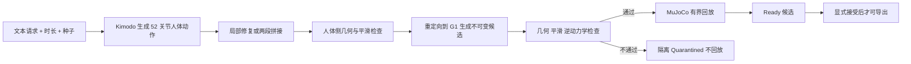

# Kinora：动作生成—重定向—验证的版本化工作流（arXiv:2611.11601）

*Kinora: A Versioned Workflow for Text-to-Motion Generation, Robot Retargeting, and Interactive Validation*（[arXiv:2611.11601](https://arxiv.org/abs/2611.11601)，Fangcheng Jin，中国科学院大学，技术报告，2026-11）。仓库：[PoirotJin/kinora](https://github.com/PoirotJin/kinora)。原文归档见 [sources/papers/kinora_arxiv_2611_11601.md](../../sources/papers/kinora_arxiv_2611_11601.md)。

## 一句话定义

**一套工程系统：用 Kimodo 生成人体动作，经动作库、本地 Agent 工具（Gadget）、重定向与精修，把每次修改保存为不可变候选，只有通过检查并被显式接受的版本才可导出；论文贡献在流程与验证契约，不在新算法（§1）。**

## 英文缩写速查

| 缩写 | 英文全称 | 简要说明 |
|------|----------|----------|
| MCP | Model Context Protocol | Gadget 通过它把服务端操作暴露给本地 Agent（§3.1） |
| FK | Forward Kinematics | 前向运动学，式 (2) 用于从旋转重建关节位置 |
| NPZ / BVH | NumPy archive / BioVision Hierarchy | 动作导出格式（§3.2） |
| G1 | Unitree G1（论文用 23 DoF 模型） | 唯一做过运行时验证的机器人（§5.1、§6.4） |
| MuJoCo | Multi-Joint dynamics with Contact | 回放用物理引擎（§2、§5.2） |
| SPD | Stable Proportional-Derivative | 回放控制器为力矩受限的逆 SPD（§5.2） |
| TMR | Text-to-Motion Retrieval | 语义检索路径，需另装资产，本次未评测（§2） |
| DoF | Degrees of Freedom | 自由度 |

## 为什么重要

- 生成动作常要反复搜索、变体生成、局部修复、拼接、重定向、微调再导出，论文指出重试会重复昂贵作业、编辑可能静默覆盖源、报告可能指向旧候选、好看的预览会被误当成动力学可行（§1）。
- 它把「哪个源、改了哪些帧、假设哪个机器人、哪些检查真跑了」变成可记录的产物关系，并强调每项检查只在声明范围内成立（§1、图 1）。
- 价值是工具链管理而非动作质量，下文「局限」「与文章说法的核对」逐项说明。

## 核心原理与流程总览

要点（均出自论文章节）：

- **作业层（§3.1）：** SQLite 持久作业、账号隔离、请求标识加 payload 哈希做幂等；Gadget 提供 CLI/MCP，本地 Agent 不向服务端转发自己的模型凭据。不声称任意故障下 exactly-once。
- **人体产物层（§3.2–3.3）：** 1–120 s、30 fps、52 关节 SMPL-H 兼容 NPZ；独立 Human52 骨架（22 身体 + 30 手指，米制，Y-up）；局部编辑满足式 (1)：区间外帧逐元素不变。旧文件由中位数估计 rest offset，分量误差超 5 mm 即拒收（式 3）。
- **修复与拼接（§4）：** 修复用含上下文的推理窗口；拼接分四阶段（收尾站定、走向目标、减速站定、进入目标动作），接缝限值 0.20 m / 120 m/s² / π/6 rad，序列级 0.25 m / 150 m/s² / π/4 rad，被称为工程拒收界限而非感知质量目标。
- **机器人层（§5）：** 编辑只产生新候选，撤销/重做走版本；平滑界为关节 4 rad/s、40 rad/s²、800 rad/s³ 与根平移 0.5 m/s、5 m/s²、100 m/s³；逆动力学根力/力矩残差比 ≤0.01（式 5）；之后 MuJoCo 连续回放，跟踪界根位置 0.02 m、根旋转 0.05 rad、关节 0.05 rad。缺必要物理参数则不能给出动力学成功结论。

## 主要结果（论文 §6）

| 检查 | 结果 | 范围（论文口径） |
|------|------|------------------|
| 核心回归（表 1） | 156 次通过 | 协议、编辑、时长、机器人编辑器/动力学、账号权限；是执行次数不是独立样本 |
| Gadget 回归（表 1） | 49 次通过 | 本地协议、HTTP 权限、恢复 |
| G1 外部资产（表 1） | 29 个哈希核验 | 仅 G1 机器人文件 |
| G1 重定向（§6.4） | 30 帧、输出 30×30 有限数组 | 说明新人体几何能进入真实求解器，不是动力学证书 |
| CUDA 案例（表 2） | 4 个通过数值门限 | 修复 seam 步长 0.01023 m；直走拼接漂移代理 3.1 cm；转弯拼接 14.3 cm，保留警告 |
| G1 夹具（表 3） | 正例 Ready：根力比 2.15×10⁻⁵，回放关节误差 0.00137 rad，61,183 步 | 合成 3,600 帧 30 Hz 轨迹，非文本生成的走路 |
| G1 负例（表 3） | 根力比 1.00001，被隔离，回放未运行 | 把根上抬 1 m 造出的悬空轨迹 |

## 与其他工作对比

论文明确不与竞品做比较（§7），下表是本页的定位对照，非论文实验：

| 工作 | 关注点 | 与本文的区别 |
|------|--------|--------------|
| [Kimodo](./kimodo.md) | 文本 / 约束条件的运动学扩散生成模型 | Kinora 的生成后端；Kinora 不改模型，只在其外围加作业、版本、编辑契约与验收（§1） |
| [Kimodo-Policy](./paper-kimodo-policy.md) | 冻结 Kimodo-G1 骨干、加视觉条件做 G1 闭环移动操作 | 同样以 Kimodo 为底座，但走向在线策略与真机执行；Kinora 是离线内容生产工作流，无硬件实验 |
| [SPIDER](../methods/spider-physics-informed-dexterous-retargeting.md) | 并行物理仿真中的采样式优化，把运动学参考变成动力学可行轨迹 | SPIDER 主动修正轨迹使其可行；Kinora 只做逆动力学残差与 MuJoCo 回放的「检查 + 隔离」，不优化轨迹本身（§5） |

## 结论

**Kinora 的贡献是把「生成 → 编辑 → 重定向 → 动力学验收」变成不可变候选加显式接受的可追溯工作流，而不是更好的动作或更安全的机器人执行。**

1. 产物契约清晰：局部编辑保证区间外帧逐元素不变，Human52 骨架误差超 5 mm 即拒收（§3.2–3.3）。
2. 验收分层：几何与平滑界、逆动力学残差比 ≤0.01、MuJoCo 有界回放，负例悬空轨迹能被正确隔离（§5、表 3）。
3. 评测是工程回归（156 + 49 次通过）与 4 个 CUDA 案例，转弯拼接仍有 14.3 cm 漂移警告（表 1、表 2）。
4. 局限：样本极窄、无统计与竞品比较、无硬件实验、只验证 G1，阈值无灵敏度分析（§7）。

## 工程实践

- **环境（§6.1）：** Linux x86_64、Python 3.10、48 GiB NVIDIA GPU、PyTorch 2.5.1 / CUDA 12.4、MuJoCo 3.4.0，上游 Kimodo 固定提交 e1c219c；服务端 0.5.1、Gadget 0.15.2。
- **获取方式（附录 A）：** 仓库是文档与下载入口，完整服务端为 Release 资产 kinora-server-0.5.1.zip（428 文件，含 SOURCE_MANIFEST.json，论文给出 SHA-256）；复现顺序是解压、校验清单、按安装指南、跑公开快速测试、装授权的运行时/模型资产、跑完整环境自检。GPU 与 G1 诊断脚本为 scripts/validate_kimodo_edit.py 与 scripts/validate_g1_editor.py，合成夹具在 scripts/fixtures/。本节为论文自述，我未下载或运行。
- **依赖：** Kimodo 权重、机器人资产、TMR 检索资产需另装；许可需另行遵守（§2、附录 A）。仓库 README 称 Kinora 自有代码为 Apache-2.0。
- **使用判据（附录 A）：** 报告代码与模型版本、种子与提示、各阶段通过/失败、警告，以及回放是否真的运行；保留被拒案例，不要用成功种子悄悄替换失败种子。
- **版本差异：** 仓库 README（读于 2026-11-11）已升至服务端 0.5.2，并称转弯拼接漂移由约 14.3 cm 降到 4.6 cm、超 8 cm 候选会被隔离，对应文档 docs/FOOT_CONTACT_0.5.2.md 我未读，未核实。

## 与文章说法的核对

对象：公众号文章对本文的概述（原文片段：「将文本生成、动作重定向和交互验证组织成可追溯版本流程，保存修改与验收结果。价值主要在工具链管理；回归测试通过不等于动作语义更准确或真机执行更安全。」）。

| 文章说法 | 核对结论 |
|----------|----------|
| 将文本生成、重定向、交互验证组织成可追溯版本流程 | 基本吻合：§3.1–3.2、图 1。「文本生成」本身是 Kimodo，非 Kinora 自研（§1）。 |
| 保存修改与验收结果 | 吻合：不可变候选、撤销/重做、显式接受、报告绑定候选（§3.2、§5.2、§6.5）。 |
| 价值主要在工具链管理 | 吻合，论文自述贡献是工作流与验证契约，不是新生成、重定向或动力学算法（§1、§2）。 |
| 回归测试通过不等于动作语义更准确 | 吻合：摘要与 §6.1、§7 明确不估计平均生成质量，不主张语义改进，转弯拼接仍有 14.3 cm 漂移警告（§6.3）。 |
| 回归测试通过不等于真机执行更安全 | 吻合：§6.5、§7 称无硬件实验，仿真接受不保证迁移。 |
| 文章措辞只提「回归测试」 | 不完整：论文除回归外还有 4 个 CUDA 案例和一个 G1 仿真回放加负例（§6.3–6.5），但都是仿真/诊断，且样本极小。读者若以为「通过回归即可交付」是误读。 |
| 文章未给任何数字、未说明仿真/真机 | 论文全部在软件与 MuJoCo 仿真中完成，机器人侧只有 G1（23 DoF）；文章若需要限定应补「仅 G1 仿真」。 |

作者自述与我的判断分开：「核对结论」列中引用论文章节的是作者自述；「文章措辞不完整」「若需要限定应补」是我的判断。

## 局限

**论文自己承认（§7）：**

- 样本窄：4 个 CUDA 案例、30 帧重定向、一条合成 G1 轨迹与一个悬空对照，不支持置信区间、语义改进或与竞品的比较；无延迟/吞吐/成本基准。
- 转弯拼接 14.3 cm 支撑脚漂移警告说明宽松连续性门限会放过接触不佳的动作；「直接桥接 vs 分阶段桥接」的消融尚未做。
- G1 夹具刻意温和且无硬件实验；接触模型、惯量、执行器、状态估计与控制器差异都可能使仿真结论失效。
- 外部 SMTP、付费模型 API、TMR 检索、全部 CASBOT 模型、空白 GPU 机器全量安装均未验证；未做多用户可用性研究。
- 156 与 49 是执行次数，部分测试可能重复；固定手指，不含灵巧手结果；回放控制器是评测机制，不是厂商部署控制器。

**我看到的未验证之处（判断）：**

- 唯一的「正例」是合成的平衡姿态加手臂运动，不是由文本生成再重定向得到的走路，所以「生成 -> 重定向 -> 回放通过」的整条链路没有端到端的长序列样例（§6.5 自述）。
- 阈值（如 0.01 残差比、0.20 m 接缝）是作者设定的工程界限，论文未做灵敏度分析，也未报告假接受/假拒绝率（§7 列为后续工作）。
- 论文只有一位作者，结果来自作者自己的环境收据，附录 A 称完整核心套件不是对最终归档逐文件的逐位执行。我没有运行代码，无法独立复现。
- 性质说明：这是软件/工具链类技术报告，不是方法论文，读结果时应当作「集成与契约检查」。

## 关联页面

- [Kimodo](./kimodo.md)：Kinora 的生成后端（arXiv:2603.15546）
- [MuJoCo](./mujoco.md)：回放使用的物理引擎
- [Unitree G1](./unitree-g1.md)：唯一做运行时检查的机器人
- [动作重定向](../concepts/motion-retargeting.md) 与 [重定向流水线](../concepts/motion-retargeting-pipeline.md)
- [逆动力学模型](../concepts/inverse-dynamics-model.md) 与 [逆动力学控制](../methods/inverse-dynamics-control.md)：残差检查的背景
- [扩散式动作生成](../methods/diffusion-motion-generation.md)：上游生成范式
- [Sim2Real](../concepts/sim2real.md)：论文反复强调仿真通过不等于真机迁移

## 参考来源

- 论文：[arXiv:2611.11601 v1](https://arxiv.org/abs/2611.11601)，全文已通读，见 [原文归档](../../sources/papers/kinora_arxiv_2611_11601.md)
- 代码与发布：[PoirotJin/kinora](https://github.com/PoirotJin/kinora)（README 静态读取，晚于论文版本）
- 公众号文章对该论文的概述（见上文核对表引用）

## 继续阅读

- [Kimodo](./kimodo.md) 了解生成后端本身的能力与指标，那些结果不是 Kinora 的测量（§2）。
- 论文 §7 列出的后续评测：固定提示集、多种子、分开报告语义/接触/保持性，以及假接受率评估。
- 仓库 docs/VERSIONS.md、docs/RELEASE_VALIDATION.md、docs/FOOT_CONTACT_0.5.2.md（均未读）。
