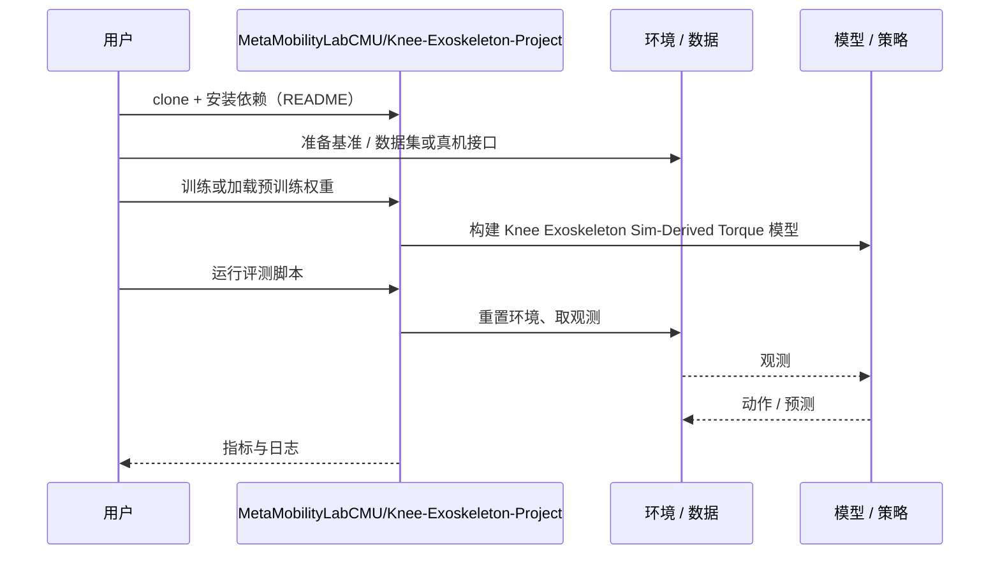

# Knee Exoskeleton Sim-Derived Torque（arXiv:2610.41981）

**Knee Exoskeleton Sim-Derived Torque**（*Design and Validation of a Robotic Knee Exoskeleton with Musculoskeletal Simulation-Derived Biological Torque Control*，[arXiv:2610.41981](https://arxiv.org/abs/2610.41981)，[代码](https://github.com/MetaMobilityLabCMU/Knee-Exoskeleton-Project)）来自 [具身智能小站 2026-11-03 盘点](../../sources/blogs/wechat_embodied_station_49_papers_sacq_action_aware_quantization_2026-11-03.md)，属「外骨骼与教程」组。

## 一句话定义

**从肌骨仿真提取膝关节力矩并蒸馏成传感器估计器，减少新硬件专门采集训练数据的需求。**

## 英文缩写速查

| 缩写 | 英文全称 | 简要说明 |
|------|----------|----------|
| Knee Exoskeleton Sim-Derived Torque | Design and Validation of a Robotic Knee Exoskeleton with Musculoskeletal Simulation-Derived Biological Torque Control | 本文方法 / 基准的简称 |

## 为什么重要

- 用仿真训练外骨骼辅助控制。人体实验针对健康参与者下蹲，不代表临床疗效。
- 开源结论：**已开源**（步骤 2.5，2026-11-03）。仓库可达（git ls-remote）。
- 同期同组工作见 [动作感知量化、失败定位与可验证自主：具身智能小站 11-03 期 49 篇阅读坐标](../overview/embodied-station-2026-11-03-49-papers-technology-map.md)。

## 核心机制

| 项 | 内容 |
|----|------|
| **arXiv** | [2610.41981](https://arxiv.org/abs/2610.41981) |
| **开源** | **已开源** |
| **要点** | 从肌骨仿真提取膝关节力矩并蒸馏成传感器估计器，减少新硬件专门采集训练数据的需求。 |
| **文内指标** | 公众号转述：减少硬件数据依赖：由肌骨仿真生成训练信号，再蒸馏为仅使用机载传感器的力矩估计器；七名健康参与者的下蹲结果不能外推至康复人群。 |

## 源码运行时序图

以下为按仓库入口（`MetaMobilityLabCMU/Knee-Exoskeleton-Project`）推断的通用运行链路；入库日仅核实仓库可达，未逐文件阅读，具体脚本名以 README 为准。

## 实验与评测

- 公众号转述：减少硬件数据依赖：由肌骨仿真生成训练信号，再蒸馏为仅使用机载传感器的力矩估计器；七名健康参与者的下蹲结果不能外推至康复人群。
- **读法：** 本页为索引级摘要，依据公众号转述的官方摘要与仓库信息整理；逐项数字与 baseline 以原文 PDF 为准。

## 与其他工作对比

- 横向索引见 [动作感知量化、失败定位与可验证自主：具身智能小站 11-03 期 49 篇阅读坐标](../overview/embodied-station-2026-11-03-49-papers-technology-map.md)；同 arXiv 不重复造页。

## 结论

**用仿真训练外骨骼辅助控制：减少硬件数据依赖：由肌骨仿真生成训练信号，再蒸馏为仅使用机载传感器的力矩估计器；七名健康参与者的下蹲结果不能外推至康复人群。**

1. 开源边界：**已开源** — 仓库可达（git ls-remote）。
2. 核心机制：从肌骨仿真提取膝关节力矩并蒸馏成传感器估计器，减少新硬件专门采集训练数据的需求。
3. 复现与选型前核对任务协议、硬件与基准口径，勿直接横比公众号摘录数字。

## 关联页面

- [manipulation](../tasks/manipulation.md)
- [locomotion](../tasks/locomotion.md)
- [embodied-station-2026-11-03-49-papers-technology-map](../overview/embodied-station-2026-11-03-49-papers-technology-map.md)

## 参考来源

- [knee_exoskeleton_sim_derived_torque_arxiv_2610_41981.md](../../sources/papers/knee_exoskeleton_sim_derived_torque_arxiv_2610_41981.md)
- [wechat_embodied_station_49_papers_sacq_action_aware_quantization_2026-11-03.md](../../sources/blogs/wechat_embodied_station_49_papers_sacq_action_aware_quantization_2026-11-03.md)
- [arXiv:2610.41981](https://arxiv.org/abs/2610.41981)

## 推荐继续阅读

- [arXiv PDF](https://arxiv.org/pdf/2610.41981)
- [https://github.com/MetaMobilityLabCMU/Knee-Exoskeleton-Project](https://github.com/MetaMobilityLabCMU/Knee-Exoskeleton-Project)
