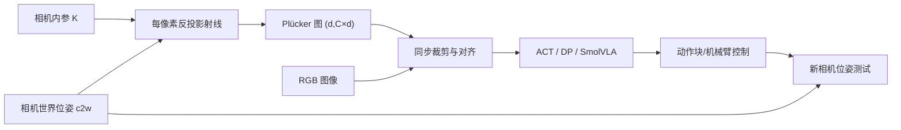
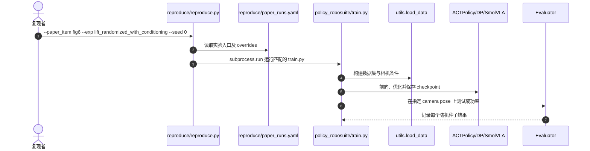

# Do You Know Where Your Camera Is?：用相机几何条件实现视角鲁棒策略学习

**英文：** Do You Know Where Your Camera Is? View-Invariant Policy Learning with Camera Conditioning · [原论文](https://arxiv.org/abs/2510.02268) · [官方项目](https://ripl.github.io/know_your_camera/) · [官方代码](https://github.com/ripl/CamPoseOpensource)

## 一句话定义

将相机内外参与每像素 Plücker 射线显式编码为机器人策略的附加输入，降低策略依赖训练摄像头视角与背景的捷径。

## 英文缩写速查

| 缩写 | 英文全称 | 简要说明 |
|---|---|---|
| ACT | Action Chunking with Transformers | 分段生成机器人动作的行为克隆策略 |
| DP | Diffusion Policy | 扩散动作策略，作为对照骨干之一 |
| VLA | Vision-Language-Action | 视觉语言动作策略，例如 SmolVLA |
| RGB | Red Green Blue | 不使用深度输入的彩色图像 |
| 6D | Six-Dimensional | Plücker 有向直线的方向和矩坐标 |

## 为什么重要

训练位置固定时模型可能根据背景推断相机姿态，而非学到像素与机器人动作空间的几何对应。移动相机但物体未动时，视觉外观大幅变化；显式相机条件让模型区分观测视角与物理状态。

## 核心信息

| 维度 | 内容 |
|---|---|
| 论文身份 | arXiv:2510.02268（v1（2025-10-02）） |
| 奖项 | ICRA 2026 Best Paper Award on Robot Learning（[2026 四大顶会策展索引](../../sources/blogs/wechat_shenlan_four_robotics_conferences_12_awards_2026_11_17.md)） |
| 源码/数据 | 已开源：训练代码、六项仿真任务、示范和论文逐图实验运行清单 |
| 研究定位 | Do You Know Where Your Camera Is?：用相机几何条件实现视角鲁棒策略学习 |

## 流程总览

## 核心原理与方法

由 K 内参和 camera-to-world 外参为每像素反投影得到世界方向 d；以相机中心 C 构造 Plücker 矩 m=C×d，拼接六维 (d,m) 射线图，与 RGB 一起输入 ACT、Diffusion Policy、SmolVLA；裁剪增强时必须同步裁剪 RGB 与 ray-map。

## 源码运行时序图

官方仓库 README 的 `bash setup.sh` 创建环境；`python reproduce/reproduce.py --paper_item fig6 --exp lift_randomized_with_conditioning --seed 0` 由 `reproduce/paper_runs.yaml` 查找实验，转发到 `policy_robosuite/train.py` 或 `policy_maniskill/train.py`。已阅读 `reproduce/reproduce.py`、`policy_robosuite/train.py` 核对调用顺序；没有实际 GPU 训练。

## 工程实践

官方仓库 README 的 `bash setup.sh` 创建环境；`python reproduce/reproduce.py --paper_item fig6 --exp lift_randomized_with_conditioning --seed 0` 由 `reproduce/paper_runs.yaml` 查找实验，转发到 `policy_robosuite/train.py` 或 `policy_maniskill/train.py`。已阅读 `reproduce/reproduce.py`、`policy_robosuite/train.py` 核对调用顺序；没有实际 GPU 训练。

## 实验与评测

六项 RoboSuite/ManiSkill 仿真任务与三项真实 UR5 操作；表 I 中 ACT 的 Lift 成功率 **33.6%→60.6%**，DP 的 Pick Place Can **23.1%→39.3%**，SmolVLA 的 Lift **19.6%→54.4%**（均为对应模拟设置）。仿真 ACT/DP 各设置三种种子×10 checkpoint×50 场景 = 1500 rollout。

## 结论

**总判：将相机内外参与每像素 Plücker 射线显式编码为机器人策略的附加输入，降低策略依赖训练摄像头视角与背景的捷径。**

1. 复现时首先检查相机外参参考坐标系是否与动作坐标系一致。
2. 将 ray-map 和图像进行完全相同的裁剪，否则引入像素几何错配。
3. 把固定背景/随机背景分别做消融，才能检验策略是否偷用视觉捷径。
4. 按 ACT、DP、SmolVLA 各骨干分别报告成功率，避免把个别最大增益概括为所有任务。

## 与其他工作对比

相对仅随机化相机位置做数据增强，显式提供像素对齐射线以避免背景捷径；与需要深度图的 3D 感知方案不同，本方法允许纯 RGB 控制，但仍依赖相机几何估计。

## 局限与风险

准确内外参是前提，遮挡、动态或无纹理环境的姿态估计误差会传递到控制；论文主要考察外参变化，跨不同内参相机仍待扩展；不能把模拟增益直接当作真实机器人的全任务成功率。

## 关联页面

- [SymSkill](./paper-symskill.md)
- [FlashSAC](./paper-flashsac.md)
- [视觉语言动作](../methods/vla.md)
- [模仿学习](../methods/imitation-learning.md)
- [具身数据纵深路线](../../roadmap/depth-embodied-data.md)

## 参考来源

- [原始论文阅读归档](../../sources/papers/know-your-camera_arxiv_2510_02268.md)（v1（2025-10-02）；已标注方法、评测和局限）
- [2026 四大顶会获奖综述（仅用于奖项线索）](../../sources/blogs/wechat_shenlan_four_robotics_conferences_12_awards_2026_11_17.md)
- [官方项目页](https://ripl.github.io/know_your_camera/)
- [官方实现](https://github.com/ripl/CamPoseOpensource)

## 推荐继续阅读

- [原论文全文（arXiv HTML）](https://arxiv.org/html/2510.02268)
- [官方项目页与实验资源](https://ripl.github.io/know_your_camera/)

