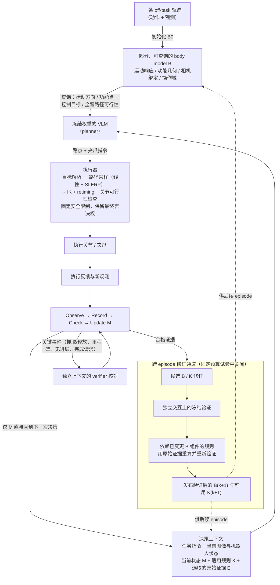

# KnowBody

**Know Your Body: A Harness for Direct and Self-Improving Robot Control with VLMs**（[arXiv:2609.28530](https://arxiv.org/abs/2609.28530)，[项目页](https://loule0-0.github.io/KnowBody/)）收录自 [具身智能小站 12 篇盘点（恢复/WAM 专题）](../../sources/blogs/wechat_embodied_station_12_papers_recover_wam_2026-09-27.md)。

## 一句话定义

**VLM 外挂可自改进的 body harness，跨回合验证后更新身体知识以改进直接控制。**

## 英文缩写速查

| 缩写 | 英文全称 | 简要说明 |
|------|----------|----------|
| SR | Success Rate | 任务成功率 |
| WAM | World Action Model | 联合预测未来观测与动作 |
| VLA | Vision-Language-Action | 视觉-语言-动作策略 |
| RL | Reinforcement Learning | 强化学习 |

## 为什么重要

- 纳入 [12 篇技术地图](../overview/embodied-research-12-papers-recover-wam-technology-map.md) 与同期失败恢复、异步 WAM、接触感知、持续学习、安全 RL 条目横向对照。
- 步骤 2.5 开源结论：**已开源**。

## 流程总览

图依据：论文 §3、§4.1–4.4 与 Fig. 2（Observe → Record → Check → Update M 与验证后修订通道）。

## 核心信息

| 项 | 内容 |
|----|------|
| **arXiv** | [2609.28530](https://arxiv.org/abs/2609.28530) |
| **项目页** | https://loule0-0.github.io/KnowBody/ |
| **代码** | https://github.com/Loule0-0/KnowBody |
| **开源** | **已开源** |

## 实验与评测（公众号口径）

- 指标与数字以 [公众号盘点](../../sources/blogs/wechat_embodied_station_12_papers_recover_wam_2026-09-27.md) 与 **原文 PDF** 为准；读复现前核对仿真/真机与 attempt 定义。

## 源码运行时序图

**不适用**（请按 GitHub README 入口自行补 sequenceDiagram；入库日未逐仓核对）。

## 与其他工作对比

| 对照 | 差异读法 |
|------|----------|
| [LLM 机器人控制接口](../concepts/llm-robotics-control-interfaces.md) | 该页结论：物理能力取决于接入抽象层级；KnowBody 不微调 VLM，而是加一层 **可查询/可修订的 body harness** 来连接指令与控制效果 |
| [VLA](../methods/vla.md) | VLA 把视觉-语言-动作训进同一策略；KnowBody 保持 VLM **冻结**，身体知识外置、跨回合更新 |
| [SayCan](../methods/saycan.md) | 用价值函数给语言子任务打可行性分；KnowBody 用 **交互证据** 修订身体关系模型，面向直接控制 |
| [Robot In-Context Learning](../concepts/robot-in-context-learning.md) | 同为部署期不改权重的适应；KnowBody 的更新落在 **外部身体知识**，而非上下文示范或快权重 |
| [KeyGen](./paper-keygen.md) | 同期「改条件化」条目；KeyGen 条件化于 **物体** 关键点几何，KnowBody 条件化于 **机器人自身** 身体关系 |

## 结论

**总判：KnowBody 适合作为「VLM 外挂可自改进的 body harness，跨回合验证后更新身体知识以改进直接控制。…」方向的入口页；机制细节以 arXiv 与项目页为准。**

1. 与 [12 篇技术地图](../overview/embodied-research-12-papers-recover-wam-technology-map.md) 对照，避免与其它 arXiv 混淆。
2. 开源为 **已开源** 时从项目页/GitHub 再核实一次再写复现计划。
3. 涉及异步 WAM 或恢复评测时，同时记录 **正常起点 SR** 与 **偏差后恢复率**（若适用）。

## 关联页面

- [具身研究 12 篇（恢复/WAM）技术地图](../overview/embodied-research-12-papers-recover-wam-technology-map.md)
- [Manipulation](../tasks/manipulation.md)

## 参考来源

- [论文归档](../../sources/papers/knowbody_arxiv_2609_28530.md)
- [KnowBody 仓库归档](../../sources/repos/knowbody.md)
- [公众号 12 篇清单](../../sources/blogs/wechat_embodied_station_12_papers_recover_wam_2026-09-27.md)
- [arXiv PDF](https://arxiv.org/pdf/2609.28530)：已通读方法部分（实验与附录以略读为准）：摘要、§1 引言、§3 问题与学习协议、§4 方法（4.1–4.4）、§5.1 任务与指标（略读 §2 相关工作与后续实验）

## 推荐继续阅读

- [arXiv:2609.28530](https://arxiv.org/abs/2609.28530)
- [项目页](https://loule0-0.github.io/KnowBody/)
- [GitHub 仓库](https://github.com/Loule0-0/KnowBody)

