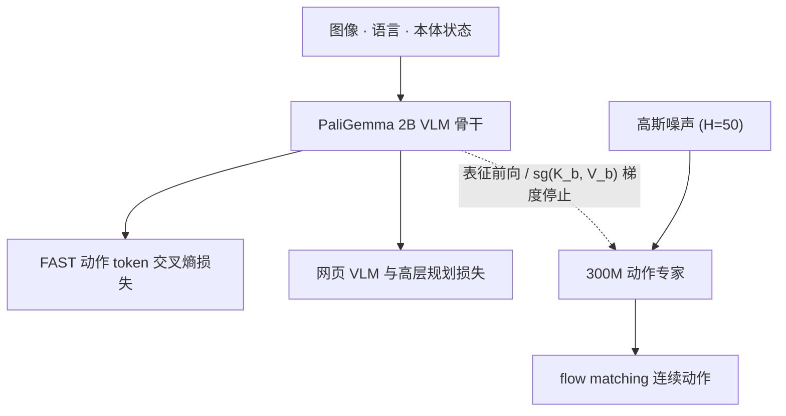

# Knowledge Insulation：隔离动作专家梯度

**Knowledge Insulation**（*Knowledge Insulating Vision-Language-Action Models: Train Fast, Run Fast, Generalize Better*，[arXiv:2505.23705](https://arxiv.org/abs/2505.23705)，[项目页](https://www.pi.website/research/knowledge_insulation)）由 **物理智能（Physical Intelligence）** 提出。它形式化 π₀.₅ 已经在用的训练方式，并给出单阶段配方：骨干学离散动作与网页知识，动作专家学连续控制，两边的梯度分开。

## 一句话定义

> **VLM 用离散动作 token 学会「和电机对话」，连续动作头的梯度不准改写这份预训练知识。**

## 英文缩写速查

| 缩写 | 英文全称 | 简要说明 |
|------|----------|----------|
| KI | Knowledge Insulation | 切断动作专家到 VLM 的梯度 |
| FAST | Frequency-space Action Sequence Tokenization | 骨干侧的离散动作目标 |
| FM | Flow Matching | 推理时动作专家的连续输出 |

## 为什么重要

第二代 VLA 用动作专家换来精细连续动作，但专家梯度会拖慢训练并削弱语言跟随。只冻结骨干又让视觉语言表征不适合控制。KI 试图同时留下三件事：FAST 那种训练速度、π₀ 那种推理速度、预训练 VLM 的语义泛化。后续 π₀.₆ / π₀.₇ 的模型卡也沿用「骨干预测 FAST、专家预测连续动作、梯度不回传」这一结构。

## 核心原理

- **模型结构（Appendix B）：** VLM 骨干初始化自 PaliGemma（2B，18 层，`width=2048`），动作专家为更窄的独立投影网络（300M，18 层，`width=1024`，动作块长度 $H=50$），两者仅通过自注意力交互。
- **双目标与掩码（Sec. 5.1–5.2）：** 联合目标 $\mathcal{L}_{\text{CO-VLA}}$ 同时训练 VLM 的文本 / FAST 离散动作自回归损失与动作专家的连续流匹配损失；通过注意力掩码 $A$ 禁止 FAST token 与连续动作 token 互看，并在注意力投影上施加 $\mathrm{sg}(K_b(X_b))$ 与 $\mathrm{sg}(V_b(X_b))$ 阻断专家梯度回传骨干（梯度隔离后流匹配权重可直接取 $\alpha=1$）。
- **为什么需要双信号：** 推理时只走动作专家（约 10 Hz，vs $\pi_0$-FAST 约 1.3 Hz / 750 ms），离散 token 丢弃。论文强调单独 stop-gradient 不够，因为骨干不再从机器人数据收到学习信号；FAST token 用来把控制表征写进骨干，又比连续损失更少破坏语言预训练，再叠加网页 VLM（CapsFusion / COCO / Cambrian-7M / PixMo / VQAv2 / 定位框）与高层规划数据，语义泛化才一起回来。

## 评测

论文在 12 种构型的真实机器人（单臂静态、双臂静态、移动双臂）及 DROID / LIBERO 上对比 $\pi_0$、$\pi_0$-FAST、HybridVLA、OpenVLA-OFT、Transfusion 与冻结骨干：

- **真机与速度：** `items in drawer`（未见厨房）上联合训练或 $\pi_0$ 均出现语言跟随退化，冻结骨干在衬衫折叠上不可用；通才 `table bussing` 上达到相近性能所需训练步数约为 $\pi_0$ 的 1/7.5，推理仍由动作专家实时执行（单本体 bussing 上自回归 $\pi_0$-FAST 完成时间约为 KI 的两倍）。移动操作的物体泛化实验（OOD Follow Rate）表明网页 VLM 数据对分布外抓取帮助最大，没有网页数据时 stop-gradient 仍然有效。
- **公开基准（Sec. 6 & Table 1）：** DROID 真实桌面平均得分达 **0.55 ± 0.09**（$\pi_0$ 为 0.49 ± 0.09，$\pi_0$-FAST 为 0.45 ± 0.09）；通才微调版在 LIBERO-Spatial / Object / Goal / 10（Long）/ 90 成功率分别达到 **98.0% / 97.8% / 95.6% / 85.8% / 96.0%**。

## 结论

**要连续动作又要保住语言跟随，就把控制表征的学习信号放在离散 token 上，不要让未初始化的动作专家反向改写 VLM。**

- 推理路径与 π₀ 相同，是 flow matching，不是自回归 FAST
- 冻结整个骨干不是 KI 的替代品
- openpi 里的 π₀.₅ 权重来自 KI 预训练，微调脚本并没有实现 KI
- 和 [FAST 论文](./paper-rcl-2501-09747-fast-efficient-action-tokenization-for-vision-la.md) 的差别是：FAST token 在这里是训练目标，不是部署时的动作接口

## 与其他工作对比

| 对照 | 差异读法 |
|------|----------|
| [π₀](./paper-pi0.md) / 联合训练 | 动作专家梯度回传 VLM：训练更慢、语言跟随变差；推理路径与 KI 相同（flow matching） |
| [FAST / π₀-FAST](./paper-rcl-2501-09747-fast-efficient-action-tokenization-for-vision-la.md) | 离散 token 既是训练目标也是部署接口，自回归推理慢（单本体 bussing 完成时间约为 KI 两倍）；KI 只把 FAST 当训练目标 |
| 冻结骨干 | 保住语义但控制表征不适配，衬衫折叠上不可用 |
| [π₀.₅](./paper-pi05-open-world-vla.md) | KI 是对 π₀.₅ 训练方式的形式化，并给出单阶段配方 |

## 源码运行时序图

**不适用**（KI 训练环）。[openpi](https://github.com/Physical-Intelligence/openpi) `README.md` 写明已发布基于 KI 预训练/微调的 `pi05_base`、`pi05_libero`、`pi05_droid` 检查点并支持 flow matching 推理与微调；但同一 README 与 [openpi#649](https://github.com/Physical-Intelligence/openpi/issues/649) 写明仓库目前仅支持 flow matching 头，微调 `train.py` 不会用 FAST 目标更新骨干，动作专家梯度会进入 VLM。要复现本文的 KI 训练配方，不能直接跑仓库里的 `train.py`。

## 工程实践

| 项 | 实践要点 |
|----|----------|
| **开源检查点使用** | 若仅需推理或常规流匹配适配，可直接在 `openpi` 中加载 `pi05_droid` / `pi05_libero` / `pi05_base`；若微调多任务且高度依赖语言跟随，需留意 `openpi` 缺失 FAST + stop-gradient 分支可能带来的骨干退化 |
| **状态表示选择** | 论文附录 C 对比文本状态、特殊 token 与连续线性投影：文本与连续状态均可配合 KI 正常工作，而离散特殊 token 效果最差 |
| **训练算力权衡** | 同时计算离散与连续头使单步训练算力增加约 **20%**，但收敛步数大幅下降（通才任务上总墙钟训练时间仍明显快于纯流匹配的 $\pi_0$） |
| **VLM 共训配比** | 面向分布外新物体与指令泛化时，应在机器人动作数据之外保留 VQA / captioning / bounding-box 等非动作 VLM 数据共训 |

## 局限与风险

- 「训练步数少 7.5 倍」是相对 $\pi_0$ 的通才 bussing 曲线，且单步额外引入约 20% 离散+连续双头计算开销，并非所有任务的墙钟时间都按同比例缩短。
- 微调阶段作者自己也说，只冻骨干、不给 FAST 目标，效果往往更差；openpi 又还没提供这条微调路径。
- LIBERO-10（Long）上论文录得 85.8%，低于 OpenVLA-OFT 的 94.5%（Table 1），说明长程子任务分解仍受上下文/混合配比约束。
- 语言跟随仍远非完美，训练数据中的相关偏差仍可能导致模型忽略文本指令（Sec. 7）。

## 关联页面

- [π₀ 策略](../methods/pi0-policy.md)
- [π₀.₅](./paper-pi05-open-world-vla.md)
- [FAST](./paper-rcl-2501-09747-fast-efficient-action-tokenization-for-vision-la.md)
- [VLA](../methods/vla.md)

## 参考来源

- [knowledge_insulation_arxiv_2505_23705](../../sources/papers/knowledge_insulation_arxiv_2505_23705.md)
- [PI 官网技术文章索引](../../sources/sites/pi-website-technical-articles.md)

## 推荐继续阅读

- [arXiv:2505.23705](https://arxiv.org/abs/2505.23705)
- [项目页](https://www.pi.website/research/knowledge_insulation)
