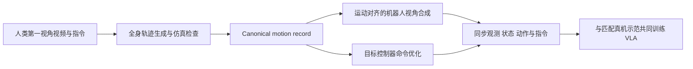

# KODA：从人类第一视角演示生成控制器对齐的人形 VLA 数据

## 一句话定义

**KODA 将人类第一视角视频转为可复用的 canonical trajectory，再按目标控制器生成对齐的机器人机载观测、全身状态和动作监督。**

## 英文缩写速查

| 缩写 | 英文全称 | 简要说明 |
|------|----------|----------|
| KODA | Kinematics–Observation Data Alignment | 论文方法名，运动学与观测对齐 |
| VLA | Vision-Language-Action | 视觉、语言与动作策略 |
| RGB | Red-Green-Blue | 人类第一视角视频的彩色图像输入 |
| SCO | Sampling-based Command Optimization | 用采样式命令优化生成控制器可执行动作 |
| DoF | Degrees of Freedom | 人形机器人全身自由度 |

## 为什么重要

人类演示规模大、获取成本低，但人类相机视角和机器人本体状态/控制接口并不匹配。KODA 的关键设计是先保留一个与控制器解耦的运动与任务记录，再在不同控制器下重新实例化动作监督，减少每换控制器就重做整套数据转换的成本。

## 核心机制

1. **运动生成：** 从手部等稀疏线索恢复全身参考，并用仿真检查与采样式命令优化提高可执行性。
2. **观测合成：** 根据生成运动确定相机姿态，将场景重投影到机器人视角，并渲染机器人、做深度合成与遮挡修复。
3. **控制器适配：** 将同一 canonical motion 投影到目标控制器的动作空间与控制时钟，生成匹配的状态—动作序列。
4. **共同训练：** 将机器人视角、全身状态、动作与任务指令打包，并与目标控制器对应的真机示范共同用于 VLA 训练。

## 流程总览

## 论文报告的评测

- Unitree G1 上四项全身 loco-manipulation 任务，评估 SONIC 与 HEFT 两种控制器。
- 在固定机器人演示量下，人类数据覆盖而机器人数据未覆盖的条件上，宏平均成功率分别提高 45.0 与 46.25 个百分点（论文摘要报告）。
- 两种控制器下，增加人类示范预算时该指标上升；结果支持人类数据补充机器人数据的价值，仍需结合论文完整任务设置解读。

## 源码运行时序图

**不适用（截至 2026-10-17）**：官方仓库公开的是分阶段项目说明，README 中核心转换模块仍在进行或计划开发，且无安装与运行步骤，尚无可辨识的完整运行入口。下面是论文方法的数据流，不能当作现有代码执行图。

## 工程实践与开放状态

截至 2026-10-17，KODA 代码部分公开：全身运动生成和机载观测工具仍在开发；命令生成、公开数据集与训练/模型配置尚列为计划。论文描述的方法完整度高于当前可复现代码，使用时应把“方法已报告”与“实现已发布”分开看。当前无公开数据下载和可直接照跑的 setup。

## 结论

**KODA 的主要贡献是把跨视角的人类演示变成可按控制器重生成监督的对齐记录，缓解人形 VLA 对昂贵机器人示范的依赖。**

1. 复用对象是 canonical motion 与任务上下文；控制器特定的动作标签仍需单独优化生成。
2. 机器人视角观测要与生成运动同步，单独做视频视角转换不能提供状态—动作监督。
3. 论文在固定机器人数据量的条件下报告显著增益；需按控制器、任务和“未覆盖条件”定义解读。
4. 完整复现目前受限于分阶段代码与数据发布，项目仓库不等于可运行实现。

## 关联页面

- [VLA](../methods/vla.md)
- [全身控制](../concepts/whole-body-control.md)
- [操作任务](../tasks/manipulation.md)

## 参考来源

- [KODA 论文摘录](../../sources/papers/koda_arxiv_2610_21152.md)
- [KODA 项目页归档](../../sources/sites/koda-humanoid.md)
- [KODA 官方仓库](../../sources/repos/gamma-robot-koda.md)

## 推荐继续阅读

- [KODA 官方项目页](https://koda-humanoid.github.io/koda/)
- [KODA 论文](https://arxiv.org/abs/2610.21152)
