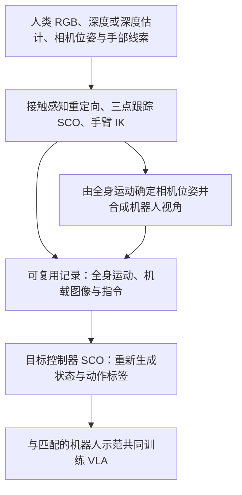
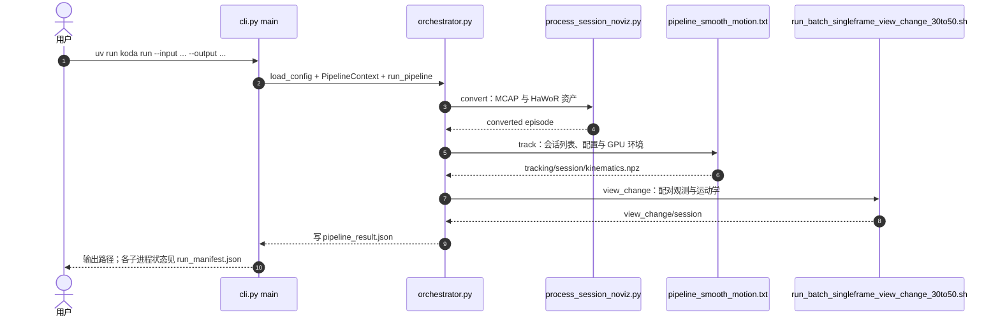

# KODA: Kinematics–Observation Data Alignment / 从人类第一视角演示生成控制器对齐的人形 VLA 数据

## 一句话定义

**KODA 将人类第一视角示范转为对齐的全身运动与机器人机载观测，再按目标控制器生成状态—动作监督，供全身 VLA 共同训练使用。**

## 英文缩写速查

| 缩写 | 英文全称 | 简要说明 |
|------|----------|----------|
| KODA | Kinematics–Observation Data Alignment | 论文方法名，运动学与观测对齐 |
| VLA | Vision-Language-Action | 视觉、语言与动作策略 |
| RGB | Red-Green-Blue | 人类第一视角视频的彩色图像输入 |
| SCO | Sampling-based Command Optimization | 用采样式命令优化生成控制器可执行动作 |
| DoF | Degrees of Freedom | 人形机器人全身自由度 |

## 核心信息

| 项目 | 内容 |
|---|---|
| 原文 | arXiv:2610.21152v1，2026-10-15；本次核对正文与附录 A–F |
| 机构 | 伽马智能（Gamma Robotics）、中国电信人工智能研究院（TeleAI）、上海交通大学、浙江大学 |
| 定位 | 人类示范到人形机器人训练数据的转换框架；论文不能单独证明它是公司主业或唯一核心项目 |
| 论文平台 | Unitree G1 + BrainCo 双手，SONIC / HEFT |
| 公开默认路径 | G1 + Dex3，运动学与机载视频生成，部分开源 |

## 为什么重要

人类演示规模大、获取成本低，但人类相机视角和机器人本体状态/控制接口并不匹配。KODA 的关键设计是先保留一个与控制器解耦的运动与任务记录，再在不同控制器下重新实例化动作监督，减少每换控制器就重做整套数据转换的成本。

## 核心机制

1. **运动生成：** 从手部等稀疏线索恢复全身参考，并用仿真检查与采样式命令优化提高可执行性。
2. **观测合成：** 根据生成运动确定相机姿态，将场景重投影到机器人视角，并渲染机器人、做深度合成与遮挡修复。
3. **控制器适配：** 将同一 canonical motion 投影到目标控制器的动作空间与控制时钟，生成匹配的状态—动作序列。
4. **共同训练：** 将机器人视角、全身状态、动作与任务指令打包，并与目标控制器对应的真机示范共同用于 VLA 训练。

## 流程总览

## 论文报告的评测

每个任务固定 50 条机器人示范，最多加入 100 条人类示范；四项任务为杯子入篮、包裹上架、篮子上架和杯子入抽屉。论文以 GR00T N1.7 联合训练四任务，20,000 iterations、batch size 160；每配置只训练一次，每任务每条件进行 20 次真机测试（§4、附录 D）。

| 控制器 | Robot-ID：仅机器人 → 加入 100 条人类示范 | Robot-OOD：仅机器人 → 加入 100 条人类示范 |
|---|---|---|
| SONIC | 62.50% → 72.50% | 3.75% → 48.75%（+45.0 个百分点） |
| HEFT | 68.75% → 76.25% | 5.00% → 51.25%（+46.25 个百分点） |

**Robot-OOD 只相对机器人示范分布定义**：换瓶子颜色、包裹颜色或倾斜篮子把手；这些条件已在人类训练池中出现。每任务完整人类池为 80 条 shifted + 20 条 robot-matched；不能称为对所有训练数据均未见条件的零样本泛化。较小预算独立随机抽样、并非嵌套子集，且未规定仍保持 80:20。

SONIC 消融中，原始人类图像、固定偏移、运动驱动重投影与完整视角对齐的 Robot-OOD 成功率分别为 18.75%、23.75%、37.50%、48.75%（表 2）。控制命令生成阶段移除 SCO 时为 7.50%，保留时为 48.75%（表 3）；该消融同时影响 rollout 身体状态和动作标签，不能解释为仅动作标签的独立效应。

## 局限与风险

- 论文四任务、两个控制器、每配置单次训练的结果，不足以证明跨任意机器人本体或大规模任务的效果。
- 400 条人类实验示范均含 iPhone 实测深度；RGB-only + 深度估计是框架支持的路径，未被单独评测为等价结果。
- canonical 图像复用与控制器实际 rollout 之间仍有跟踪误差；更换控制器要重新优化命令并记录本体状态，不能直接复用动作标签（附录 C.5）。
- 细粒度手物交互及物理可行性仍受限；几何接触线索不等于接触力测量，IK 后的运动也不能据此保证任意部署接口的动力学可行性。

## 源码运行时序图

官方仓库现提供可运行的运动学与机载视角生成流程。README 给出 `koda run` 入口，以及独立的 `convert`、`track`、`view-change` 子命令；该公开 CLI 在视角合成后结束，不含动作标签生成或策略训练。

数据准备之外，安装流程为 `uv sync --extra cuda`。M3 控制器动作标签与数据导出、M5 VLA 训练不在当前运行入口中。

## 与其他工作对比

| 维度 | KODA（本文） | [EgoMimic](./paper-ego-03-egomimic.md) | [λ₀ / HumanVerse-500](./paper-lambda0-egocentric-human-pretraining.md) |
|------|------|------|------|
| 人类数据形态 | 第一视角视频 → 与控制器解耦的 canonical motion record | Aria 第一视角视频 + 3D 手部轨迹 | 500 小时第一视角人类移动操作数据，恢复身体与手部运动 |
| 如何变成机器人监督 | 按目标控制器重生成机器人视角观测、全身状态与动作，再与匹配真机示范共训 | 与机器人遥操数据共训模仿学习 | 三阶段训练：互动预训练 → 全身协调 → 机器人与任务适配 |
| 视角差处理 | 显式合成运动对齐的机器人视角（重投影、渲染、遮挡修复） | 本库页未述显式视角合成 | 本库页未述显式视角合成 |
| 平台与开放 | Unitree G1，SONIC / HEFT 两种控制器；运动学与视频管线已发布，控制器对齐与训练仍待发布 | 本库页为策展摘要，细节以原文为准 | Unitree G1；OpenLambda 部分开源（代码 + Stage II checkpoint） |

- **相对 EgoMimic：** EgoMimic 把人类手部轨迹直接与机器人遥操数据共训；KODA 先把人类演示转成机器人机载视角与目标控制器下的全身状态—动作标签，再共训。
- **相对 λ₀：** λ₀ 用大规模人类全身数据做分阶段预训练再适配机器人；KODA 的复用单元是 canonical motion，换控制器时重新做命令优化生成动作标签。
- 各文任务、控制器与指标不同，KODA 报告的 +45.0 / +46.25 个百分点不可与另两文数字横比。

## 工程实践与开放状态

截至 2026-11-06，已从官方项目页的 Code 链接复核 README 与运行入口：**部分开源**。M1/M2 已发布，M4 提供两个示例 MCAP 和微调 ScaleBFM checkpoint；M3 动作标签、motion-token 编码、控制器对齐数据导出与 M5 训练配置/模型细节仍待发布。公开 CLI 在视角生成后结束，不能直接复现论文完整训练链路。

`uv sync --extra cuda` 后可按 README 下载/验证资产，再运行 `uv run koda run`；MANO 许可与 HaWoR/ProPainter 等手动资产步骤必须先完成。当前默认生成 G1 29-DoF 身体 + Dex3 14-DoF 手部运动学，与论文 BrainCo 12 手关节监督维度需区分。论文两控制器共享 44 维状态；SONIC 动作为 64 维 token + 12 手目标，HEFT 为 38 维身体参考 + 12 手目标。

本次阅读了 `pyproject.toml`、`src/koda/cli.py`、`src/koda/orchestrator.py` 与两级主要 shell 包装入口；时序图只描述已核实的公开编排关系。未下载大模型资产，也未运行 GPU 全管线，阅读源码不等于复现成功。

## 结论

**KODA 的主要贡献是把跨视角的人类演示变成可按控制器重生成监督的对齐记录，缓解人形 VLA 对昂贵机器人示范的依赖。**

1. 复用对象是 canonical motion 与任务上下文；控制器特定的动作标签仍需单独优化生成。
2. 机器人视角观测要与生成运动同步，单独做视频视角转换不能提供状态—动作监督。
3. 论文在固定机器人数据量的条件下报告显著增益；需按控制器、任务和“未覆盖条件”定义解读。
4. 当前已有可运行的运动学与视角合成实现；论文所述控制器对齐数据和 VLA 训练链路仍未完整开放。

## 关联页面

- [VLA](../methods/vla.md)
- [全身控制](../concepts/whole-body-control.md)
- [操作任务](../tasks/manipulation.md)

## 参考来源

- [KODA 论文摘录](../../sources/papers/koda_arxiv_2610_21152.md)
- [KODA 项目页归档](../../sources/sites/koda-humanoid.md)
- [KODA 官方仓库](../../sources/repos/gamma-robot-koda.md)

## 推荐继续阅读

- [KODA 官方项目页](https://koda-humanoid.github.io/koda/)
- [KODA 论文](https://arxiv.org/abs/2610.21152)
