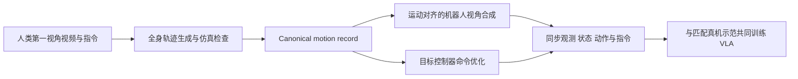
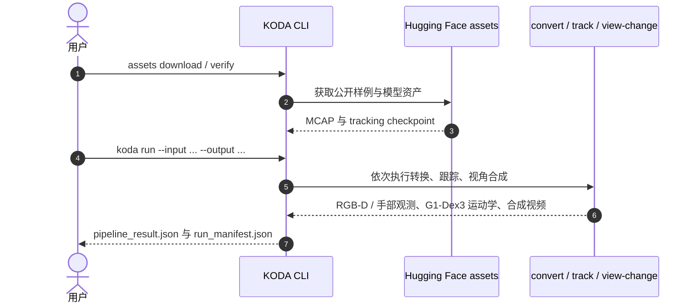

# KODA：从人类第一视角演示生成控制器对齐的人形 VLA 数据

## 一句话定义

**KODA 将人类第一视角视频转为可复用的 canonical trajectory，再按目标控制器生成对齐的机器人机载观测、全身状态和动作监督。**

## 英文缩写速查

| 缩写 | 英文全称 | 简要说明 |
|------|----------|----------|
| KODA | Kinematics–Observation Data Alignment | 论文方法名，运动学与观测对齐 |
| VLA | Vision-Language-Action | 视觉、语言与动作策略 |
| RGB | Red-Green-Blue | 人类第一视角视频的彩色图像输入 |
| SCO | Sampling-based Command Optimization | 用采样式命令优化生成控制器可执行动作 |
| DoF | Degrees of Freedom | 人形机器人全身自由度 |

## 为什么重要

人类演示规模大、获取成本低，但人类相机视角和机器人本体状态/控制接口并不匹配。KODA 的关键设计是先保留一个与控制器解耦的运动与任务记录，再在不同控制器下重新实例化动作监督，减少每换控制器就重做整套数据转换的成本。

## 核心机制

1. **运动生成：** 从手部等稀疏线索恢复全身参考，并用仿真检查与采样式命令优化提高可执行性。
2. **观测合成：** 根据生成运动确定相机姿态，将场景重投影到机器人视角，并渲染机器人、做深度合成与遮挡修复。
3. **控制器适配：** 将同一 canonical motion 投影到目标控制器的动作空间与控制时钟，生成匹配的状态—动作序列。
4. **共同训练：** 将机器人视角、全身状态、动作与任务指令打包，并与目标控制器对应的真机示范共同用于 VLA 训练。

## 流程总览

## 论文报告的评测

- Unitree G1 上四项全身 loco-manipulation 任务，评估 SONIC 与 HEFT 两种控制器。
- 在固定机器人演示量下，人类数据覆盖而机器人数据未覆盖的条件上，宏平均成功率分别提高 45.0 与 46.25 个百分点（论文摘要报告）。
- 两种控制器下，增加人类示范预算时该指标上升；结果支持人类数据补充机器人数据的价值，仍需结合论文完整任务设置解读。

## 源码运行时序图

官方仓库现提供可运行的运动学与机载视角生成流程。README 给出 `koda run` 入口，以及独立的 `convert`、`track`、`view-change` 子命令；该公开 CLI 在视角合成后结束，不含动作标签生成或策略训练。

数据准备之外，安装流程为 `uv sync --extra cuda`。M3 控制器动作标签与数据导出、M5 VLA 训练不在当前运行入口中。

## 与其他工作对比

| 维度 | KODA（本文） | [EgoMimic](./paper-ego-03-egomimic.md) | [λ₀ / HumanVerse-500](./paper-lambda0-egocentric-human-pretraining.md) |
|------|------|------|------|
| 人类数据形态 | 第一视角视频 → 与控制器解耦的 canonical motion record | Aria 第一视角视频 + 3D 手部轨迹 | 500 小时第一视角人类移动操作数据，恢复身体与手部运动 |
| 如何变成机器人监督 | 按目标控制器重生成机器人视角观测、全身状态与动作，再与匹配真机示范共训 | 与机器人遥操数据共训模仿学习 | 三阶段训练：互动预训练 → 全身协调 → 机器人与任务适配 |
| 视角差处理 | 显式合成运动对齐的机器人视角（重投影、渲染、遮挡修复） | 本库页未述显式视角合成 | 本库页未述显式视角合成 |
| 平台与开放 | Unitree G1，SONIC / HEFT 两种控制器；运动学与视频管线已发布，控制器对齐与训练仍待发布 | 本库页为策展摘要，细节以原文为准 | Unitree G1；OpenLambda 部分开源（代码 + Stage II checkpoint） |

- **相对 EgoMimic：** EgoMimic 把人类手部轨迹直接与机器人遥操数据共训；KODA 先把人类演示转成机器人机载视角与目标控制器下的全身状态—动作标签，再共训。
- **相对 λ₀：** λ₀ 用大规模人类全身数据做分阶段预训练再适配机器人；KODA 的复用单元是 canonical motion，换控制器时重新做命令优化生成动作标签。
- 各文任务、控制器与指标不同，KODA 报告的 +45.0 / +46.25 个百分点不可与另两文数字横比。

## 工程实践与开放状态

截至 2026-10-17，KODA 代码部分公开：全身运动生成和机载观测工具仍在开发；命令生成、公开数据集与训练/模型配置尚列为计划。论文描述的方法完整度高于当前可复现代码，使用时应把“方法已报告”与“实现已发布”分开看。当前无公开数据下载和可直接照跑的 setup。

## 结论

**KODA 的主要贡献是把跨视角的人类演示变成可按控制器重生成监督的对齐记录，缓解人形 VLA 对昂贵机器人示范的依赖。**

1. 复用对象是 canonical motion 与任务上下文；控制器特定的动作标签仍需单独优化生成。
2. 机器人视角观测要与生成运动同步，单独做视频视角转换不能提供状态—动作监督。
3. 论文在固定机器人数据量的条件下报告显著增益；需按控制器、任务和“未覆盖条件”定义解读。
4. 当前已有可运行的运动学与视角合成实现；论文所述控制器对齐数据和 VLA 训练链路仍未完整开放。

## 关联页面

- [VLA](../methods/vla.md)
- [全身控制](../concepts/whole-body-control.md)
- [操作任务](../tasks/manipulation.md)

## 参考来源

- [KODA 论文摘录](../../sources/papers/koda_arxiv_2610_21152.md)
- [KODA 项目页归档](../../sources/sites/koda-humanoid.md)
- [KODA 官方仓库](../../sources/repos/gamma-robot-koda.md)

## 推荐继续阅读

- [KODA 官方项目页](https://koda-humanoid.github.io/koda/)
- [KODA 论文](https://arxiv.org/abs/2610.21152)
