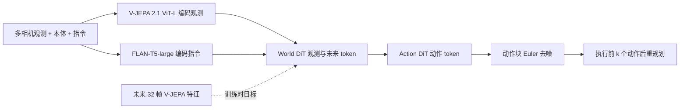

# La-JEPA（arXiv:2611.08156）

**La-JEPA**（*La-JEPA: Compact Robot Policies with Latent World Modeling*，[arXiv:2611.08156](https://arxiv.org/abs/2611.08156)，v1 2026-11-05）：Huawei Technologies 与多伦多大学、McGill、Mila 作者的论文。代码地址为 [mt-clemente/lajepa](https://github.com/mt-clemente/lajepa)（论文自述，本页编写时未能核实仓库内容）。通读记录见 [来源归档](../../sources/papers/la-jepa_arxiv_2611_08156.md)。

## 一句话定义

**Latent Action JEPA**：把预训练 V-JEPA 2.1 ViT-L 的密集视频特征当作唯一视觉输入与预测目标，在其上**从零训练**一个由 World DiT 与 Action DiT 组成的紧凑世界–动作模型（WAM）；训练时联合预测未来特征与动作，推理时只生成动作（§3）。

## 英文缩写速查

| 缩写 | 英文全称 | 简要说明 |
|------|----------|----------|
| JEPA | Joint-Embedding Predictive Architecture | 预测被遮挡输入的嵌入而非重建像素的自监督架构（§2） |
| V-JEPA 2.1 | Video JEPA 2.1 | 提升密集特征质量的视频 JEPA 编码器，本文用其 ViT-L（§3.1） |
| WAM | World-Action Model | 同时建模未来与动作的策略，常改造视频生成器 |
| VLA | Vision-Language-Action | 基于视觉语言模型的动作策略 |
| DiT | Diffusion Transformer | 扩散 / 流匹配用 Transformer，本文有 World DiT 与 Action DiT |
| VAE | Variational Autoencoder | 视频生成器的潜空间，本文对照实验用 Wan2.2 VAE |
| LoRA | Low-Rank Adaptation | 低秩适配，本文用于观测编码器（§4.2） |
| IID / OOD | In / Out of Distribution | 本文指 LIBERO 与 clean RoboTwin / LIBERO-Plus 与 randomized RoboTwin（§4） |
| EMA | Exponential Moving Average | 权重滑动平均，评测用 EMA 权重（附录 A） |

## 为什么重要

- **作者自述的问题（摘要、§1）：** WAM 沿用视频生成器、VLA 沿用语言生成骨干，策略架构与推理成本被「为生成而设计」的大 Transformer 绑定；该论文问不继承生成骨干能否同样有竞争力。
- **作者自述的结论：** 在无具身预训练的策略中，RoboTwin 2.0 clean 与 randomized 最高，修正指令后的 LIBERO-Plus 最高（表 1、2），部署参数约为次优策略的四分之一（§1）。作者认为「机器人基础模型可能更适合为控制而设计的架构」（摘要），这是论文的主张，不是已被独立验证的结论。
- **额外副产物：** 发现官方 LIBERO-Plus 评测器把扰动参数拼接到多数变体的指令后，导致基线分数被不均匀压低，并给出修正指令的重评结果（§5.2）。这对引用 LIBERO-Plus 数字的人有直接影响。
- **读法提醒（我的判断）：** 对比对象大多是作者重评或从各自论文取的数字，评测管线与步数上限不完全一致（附录 B），横向比较需看脚注。

## 核心机制

### 流程总览

### 方法栈（均出自 §3，数字出自附录 B 表 9）

| 模块 | 做法 |
|------|------|
| 视觉 | V-JEPA 2.1 ViT-L 逐相机编码，观测取最近帧，目标为未来 32 帧；特征归一化并空间缩减后投影；无单独 RGB 通路 |
| 条件 | 冻结 FLAN-T5-large 编码指令，学习投影把本体变成 token，合成 z_cond，两个 DiT 交叉注意力读取 |
| 双 DiT | World DiT 处理观测与未来特征 token，Action DiT 处理动作块，均从零初始化，每层交互；动作 token 只看观测与动作，不看未来 |
| 损失 | 未来特征与动作联合 flow matching，两项 MSE 权重各为 1（式 1、2） |
| 推理 | 丢弃未来 token，观测 KV 缓存，仅 Action DiT 做 Euler 去噪，世界 DiT 时间步固定为 0 |
| 规模 | S/B/L：宽度 384/768/1024，层数 12/12/24，可训练 0.10/0.34/1.14 B（LIBERO 配置）；含冻结编码器的部署参数 0.74/0.98/1.78 B（表 1、16） |

### 设计研究里的结论（§4，单次训练为主，表 6）

| 选择 | 对照 | 结果 |
|------|------|------|
| 联合未来预测 | 仅动作训练 | RoboTwin clean +7.0、randomized +3.7 个百分点；LIBERO-Plus 三 seed 平均 +2.1（74.35 到 76.47，表 7） |
| V-JEPA 特征 | Wan2.2 VAE 潜变量 | RoboTwin clean +15.9、randomized +16.0；LIBERO-Plus +6.0；randomized 下 Wan2.2 策略仅 1.0%。附录 A.1 的另两组 RoboTwin 对照中，clean 一组持平、一组 Wan2.2 更好（63.90 对 61.12），V-JEPA 优势在 randomized 一致、clean 不一致 |
| 时间编码 | 静态逐帧编码 | tube-motion：clean +3.4、randomized +3.7 |
| 相机 dropout | 无 | RoboTwin 仅腕部相机 dropout randomized +7.1；LIBERO 任一相机 dropout LIBERO-Plus +10.2 |
| 本体 dropout 0.1 | 无 | RoboTwin clean +3.8、randomized +4.2 |
| 图像增强 + 编码器 LoRA | 朴素策略 | LIBERO-Plus +7.2，RoboTwin clean +5.7、randomized +16.0；该块对照训练时长或数据不完全相同，作者称为「配方级」增益（附录 A.2） |

## 实验结果（作者报告）

- **LIBERO / LIBERO-Plus（表 1，三 seed 平均）：** S/B/L 在 LIBERO 为 97.9/98.0/98.1；LIBERO-Plus 官方指令 80.0/82.5/84.1，修正指令 86.3/87.3/88.0。NowWAM 官方与修正均 86.2，部署 7.1 B；官方指令下 NowWAM 高于 L，修正后 L 领先 1.8 个百分点（§5.1、§5.2）。
- **RoboTwin 2.0（表 2，clean 训练，5,000 集每条件）：** S/B/L clean 85.5/86.2/86.0，randomized 33.9/35.4/32.1；基线中最好的 Qwen-RobotManip-scratch 为 71.6 / 22.6，Fast-WAM 为 77.8 / 1.9。随规模变大并不单调，作者推测是动作专家过拟合（假设，未隔离，§5.1、§6）。
- **与潜空间 WAM 对比（表 3）：** JEPA-WAM 只在 RoboTwin 的 20 任务训练评测，La-JEPA 在 50 任务训练；作者做了线性外推以对齐（附录 B），外推本身是作者的估计，不入结果表。
- **含具身预训练的参考（图 4）：** B 的 clean 与 randomized 均值高于除 OLA-Sem、GigaBrain-0.7、Qwen-RobotManip、4D-WAM 外的全部具身预训练策略，这四者 randomized 更高、clean 更低（§5.1）。

## 结论

**La-JEPA 表明：在冻结 V-JEPA 2.1 特征上从零训练的紧凑 WAM，可在无具身预训练策略中达到最优任务成功率并显著降低推理延迟；但多数设计结论为单次训练、基线口径不一，应读作「控制专用架构可行」的证据而非定论。**

1. **真正该看的是 randomized / 修正指令下的成功率：** RoboTwin 2.0 randomized B 为 35.4（Fast-WAM 1.9，表 2），LIBERO-Plus 修正指令 L 为 88.0（NowWAM 86.2，表 1）；LIBERO 97.9 至 98.1 已接近饱和，区分度低。
2. **延迟是最实在的收益：** 10 步去噪 S/B/L 为 17.78/25.16/59.72 ms，对比 Fast-WAM 88.09 ms、π0.5 71.89 ms（表 15）；但测量条件不完全一致，选型时应在自有硬件上复测。
3. **引用 LIBERO-Plus 前先查指令口径：** 官方评测器把扰动参数拼进指令，修正后 Fast-WAM +19.3，并改变排名（§5.2）。
4. **最有把握的设计结论只有「联合未来预测」：** 三 seed 平均 +2.1 且有配对检验（表 7）；V-JEPA 对 VAE 的优势在 clean 条件下不一致（附录 A.1）。
5. **规模不单调：** RoboTwin 上 L 不优于 B（表 2），原因未隔离（§6），不要默认「更大更好」。
6. **实机按可行性读：** 四任务、每格 20 次，平均 17.50 对 π0.5 17.25（§5.5），差距远小于统计不确定性。

## 与其他工作对比

论文的对照主要是两类 WAM：**改造视频生成器的 WAM**（[Fast-WAM](./paper-fast-wam.md)、[Faster-WAM](./paper-rcl-2608-02365-faster-wam-do-world-action-models-need-deep-acti.md)、[NowWAM](./paper-nowwam.md)、[Cosmos Policy](./paper-shenlan-wm-11-cosmos-policy.md)）与**潜空间 WAM**（[JEPA-WAM](./paper-jepa-wam.md)，表 3）；另有 VLA 参考 π0.5（实机与延迟，表 5、15）。「训练联合预测、推理只出动作」沿用 Fast-WAM / Faster-WAM，不是本文首创。

| 对比对象 | 论文给出的差异 | 出处 |
|----------|----------------|------|
| Fast-WAM | RoboTwin randomized 1.9 对 La-JEPA 32.1 至 35.4；延迟 88.09 ms 对 17.78 至 59.72 ms | 表 2、15 |
| NowWAM | 官方指令下高于 La-JEPA L，修正指令后 L 领先 1.8 点；部署 7.1 B 对 1.78 B | 表 1、§5.2 |
| JEPA-WAM | 仅在 RoboTwin 20 任务训练评测，La-JEPA 在 50 任务；作者用线性外推对齐，不入结果表 | 表 3、附录 B |
| π0.5（具身预训练 VLA） | 实机平均 17.25 对 17.50；延迟 71.89 ms | 表 5、15 |
| 含具身预训练策略 | randomized RoboTwin 上仍低于最强者（如 OLA-Sem、GigaBrain-0.7 等） | 图 4、§6 |

## 工程实践

- **预计算特征（附录 B）：** 冻结编码器预先编码全部演示并存储；最终策略观测在线编码（因为 LoRA 与增强），未来目标仍读存储的冻结特征，原因是目标在线编码会使编码器成本占主导，且「自适应目标」不提升成功率（E.1：81.65% 对 82.26%，p = 0.096）。
- **Token 缩减：** LIBERO 用 2×2 均值池化；RoboTwin 用 patch grouping（head 相机 2×，腕部相机 4×），因为 LIBERO 上 patch grouping 反而更差（89.35% 对 94.05%，§4.1）。
- **优化（表 9）：** AdamW，策略学习率 5e-4，150k 更新，EMA 衰减 0.9999，全局 batch LIBERO 128 / RoboTwin 400，BF16；LoRA 秩 16，α = 32。
- **推理（§3.2、表 15）：** 10 步去噪，单张消费级 GPU，优化构建下 S/B/L 为 17.78/25.16/59.72 ms（对比 Fast-WAM 88.09，Faster-WAM 50.96，π0.5 71.89）；3 步去噪 S/B/L 为 11.04/13.40/26.30 ms，作者称成功率保持在约一个点内（E.2）。延迟指完整策略调用，不是控制环周期（附录 C.1）。
- **数据清洗（附录 B）：** LIBERO 回放过滤后保留 1,777 / 2,000 条；RoboTwin 剔除关节角越过 ±π 的 62 条，保留 2,438 条。LIBERO 需 MuJoCo 3.3.2，新版会导致某任务碗体在重置时错位。
- **实机（§5.5、附录 D）：** Franka Panda，腕部 D405 加外部 D435，SpaceMouse 遥操作 10 Hz，每任务 100 条共 400 条，每任务 20 次评测；La-JEPA B 带编码器 LoRA 无图像增强。结果见下表。

| 策略（具身预训练） | 水果 | 方块 | Push T | 餐具位置 | 平均（满分 20） | 延迟 ms |
|------|------|------|------|------|------|------|
| π0.5（是） | 20 | 20 | 11 | 18 | 17.25 | 71.89 |
| Fast-WAM（否） | 19 | 19 | 14 | 12 | 16.00 | 88.09 |
| Faster-WAM（否） | 18 | 20 | 13 | 14 | 16.25 | 50.96 |
| La-JEPA（否） | 19 | 20 | 15 | 16 | 17.50 | 25.16 |

## LIBERO-Plus 指令修正（§5.2，附录 B 表 13、14）

官方评测器对 10,030 个变体中的 8,493 个非语言变体，把扰动参数拼在训练指令后（例如「... light 1」）。作者令每个非语言变体使用其基础任务的训练指令原文。修正后各策略变化：Fast-WAM +19.3，LeapBot-WA +8.1，Cosmos Policy +4.1，La-JEPA +3.9 至 +6.3，π0.5 +1.4，NowWAM 0.0；此修正使 NowWAM 与 La-JEPA B/L、Cosmos Policy 与 La-JEPA S 的排名互换。作者称一次 10,030 集评测的二项标准误约 0.35 个点，L 的 1.8 个点领先超过 seed 间标准差 0.3 和该误差。

## 局限

**论文自己承认的（§6、附录）：**

- 未系统搜索学习率、权重衰减、dropout 率、LoRA 配置，也未改变 World DiT 与 Action DiT 的相对容量；此外目标数据有限，二者可能是 RoboTwin 规模非单调的原因，但实验未隔离。
- 不确定其改进能否与其他工作的策略升级叠加（许多强基线用了外部监督目标与机器人专用架构）。
- 只用目标演示训练，具身预训练下如何扩展未知；randomized RoboTwin 上仍低于最强具身预训练方法。
- 实机平均成功次数虽与 π0.5 相当，但仅四项任务、一套机器人，不能证明更广泛操作需求下对等。
- 作者对 LingBot-VA 实机成功率低的解释是其可能需要更多实机微调，是假设（附录 D）。

**我的判断（未必为作者所承认）：**

- 设计研究大多是单次训练运行，只有「联合预测」一项有三 seed 与配对检验；其余增益（如 +15.9 的 V-JEPA 对 VAE）没有方差估计。
- 设计研究块与最终策略使用不同的数据 / 评测管线版本（附录 B 表 11、12：修订版 RoboTwin clean 高 5 至 8 点而 randomized 低 5 至 9 点），表 6 的绝对数不能和表 1、2 直接比较。
- V-JEPA 对 VAE 的优势在附录 A.1 另两组对照中并不一致（clean 持平或反向），摘要里「最明显在分布外」的说法需带这个限定。
- 基线中多个分数来自作者自行重评或自行训练（如 Faster-WAM 的 clean 训练、StarVLA 的变体选择，附录 B），与原论文口径不同，且作者自己的 LIBERO 步数上限也与部分基线自带评测不同（表 1 脚注 §）。
- 效率对比含「参数部署量」口径（含冻结编码器），延迟在不同输入分辨率、精度与编译设置下测得，Fast-WAM 与 Faster-WAM 的 CUDA graph 因内存不足无法对照（表 15）。
- 实机每格仅 20 次试验，各策略之间 0.25 至 1.5 次的平均差距远小于统计不确定性（我的判断，论文未给置信区间）。
- 代码仓库内容本页未核实。

## 与「周报」说法的核对

周报（具身运控 lab）对本文的概括与论文的出入：

| 周报说法 | 核对结果 |
|------|------|
| 机构「待核实」 | 论文首页：Huawei Technologies Ltd.、University of Toronto、McGill University、Mila；Xue 与 Abyaneh 标注为 Huawei 实习生 |
| 现有 VLA 与 WAM 依赖大型预训练生成模型，参数与推理开销高 | 与摘要一致 |
| 使用冻结的 V-JEPA 2.1 视觉特征 | 基本一致，但最终配方对观测编码器加 LoRA（附录 B），未来目标来自冻结编码器；设计研究的一部分用冻结存储特征 |
| 训练时联合预测未来潜在特征与动作，推理只输出动作 | 一致，论文说明该训练 / 推理分离沿用 Fast-WAM 与 Faster-WAM，不是本文首创 |
| 较小模型也能取得具有竞争力的控制性能 | 偏保守：论文称在无具身预训练策略中取得最优（RoboTwin 2.0、修正指令的 LIBERO-Plus），官方指令下 L 仅次于 NowWAM |
| 比 Fast-WAM 运行更快 | 一致，论文称最高约 5 倍（S，优化构建 17.78 对 88.09 ms，表 15） |
| 周报未提 | LIBERO-Plus 指令泄漏的发现与重评、实机四任务对比、V-JEPA 对 VAE 的对照 |

## 关联页面

- [世界–动作模型（WAM）](../concepts/world-action-models.md)
- [Diffusion Transformer](../concepts/diffusion-transformer.md)
- [具身策略中的 Flow Matching](../concepts/flow-matching-embodied-policy.md)
- [VLA 方法页](../methods/vla.md)
- [模仿学习](../methods/imitation-learning.md)
- [Fast-WAM](./paper-fast-wam.md)
- [Faster-WAM](./paper-rcl-2608-02365-faster-wam-do-world-action-models-need-deep-acti.md)
- [JEPA-WAM](./paper-jepa-wam.md)
- [V-JEPA 2.1](./paper-sa-2603-14482-v-jepa-2-1-unlocking-dense-features-in-video-sel.md)
- [LIBERO 基准](./libero-benchmark.md)
- [RoboTwin](./robotwin.md)

## 参考来源

- [la-jepa_arxiv_2611_08156.md](../../sources/papers/la-jepa_arxiv_2611_08156.md)
- [arXiv:2611.08156](https://arxiv.org/abs/2611.08156)

## 推荐继续阅读

- [arXiv PDF](https://arxiv.org/pdf/2611.08156)
- [Fast-WAM 论文页](./paper-fast-wam.md)
- [世界–动作模型概念页](../concepts/world-action-models.md)
