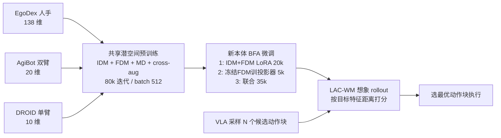

# LAC-WM：基于潜在动作的跨本体机器人基础世界模型

## 一句话定义

**LAC-WM** 是一个以「学习得到的共享潜在动作」为条件的机器人世界模型：逆动力学模型从相邻帧中抽出连续潜在动作，前向动力学模型据此预测下一帧特征，使人手、双臂人形与单臂 Franka 的数据落在同一个动作空间里，新本体只需训练一个小的动作投影器就能接入。

## 英文缩写速查

| 缩写 | 英文全称 | 简要说明 |
|------|----------|----------|
| LAC-WM | Latent Action-Conditioned World Model | 本文方法：以共享潜在动作为条件 |
| EAC-WM | Explicit Action-Conditioned World Model | 对照：每个本体各用一个显式动作编码器 |
| IDM | Inverse Dynamics Model | 从相邻帧嵌入推断潜在动作 z_t |
| FDM | Forward Dynamics Model | 给定帧与动作预测下一帧嵌入 |
| MD | Motion Decoder | 把潜在动作解码为末端/相机位姿的辅助监督 |
| VLA | Vision-Language-Action | 提供候选动作的策略（π0.5 骨干） |
| BFA | Bimanual Franka + Allegro hands | 下游灵巧手本体（仿真） |

## 为什么重要

- **动作空间不统一是跨本体世界模型的核心障碍：** 显式动作为条件时，增加预训练本体反而让下游性能下降；潜在动作则随本体数增加而提升。
- **可作为 VLA 的「评分器」：** 用世界模型对 VLA 采样的候选动作块打分，不重训策略即可提升成功率。
- **能吃无动作标签/异构数据：** 人手第一视角（EgoDex，138 维）与机器人（AgiBot 20 维、DROID 10 维）共用一个潜空间。

## 核心信息

| 项 | 内容 |
|----|------|
| **机构** | 斯坦福大学（Stanford）；部分工作在 Meta FAIR Robotics 完成 |
| **会议** | 项目页标注 ICML 2026 |
| **预训练数据** | EgoDex / AgiBot / DROID 各 5 万条轨迹，共 15 万；80k 迭代、batch 512；约 4 天 × 64 张 H200 |
| **下游** | 仿真中的双臂 Franka + Allegro 手（仅右臂，25 维动作）；LIBERO 未见物体 |
| **开源** | 截至 2026-10-12 未发现代码、权重链接（项目页与 arXiv 页均无） |

## 核心原理

### 方法栈

| 模块 | 设计 |
|------|------|
| 视觉编码 | 冻结 V-JEPA 2（1B），256×256 → 16×16 个 1408 维 token |
| IDM | 4 个因果注意力块、16 头、隐维 512（约 4694 万参数）；可学习 query cross-attend 帧嵌入，输出 64 维连续潜在动作 |
| FDM | 8 块（帧自注意力、动作自注意力、帧→动作 cross-attention，约 9384 万参数），预测下一帧嵌入 |
| 运动解码器 MD | 潜在动作 cross-attend 当前帧视觉 token，一半解码末端位姿、一半解码相机位姿；作辅助约束，防止潜在动作退化为捷径 |
| cross-augmentation | IDM 与 FDM 看同一时刻的两种独立增广视图 |
| 损失 | λ_recon·L2(下一嵌入) + λ_motion·MSE(运动标签)（λ 原文未给出） |
| 动作投影器 | 2 层 MLP（约 155 万参数）：未见机器人原始动作 → 共享潜空间 |

### 流程总览

## 方法

1. **为何要潜在动作。** EAC-WM 为每个本体配独立动作编码器，不同本体的动作表示各自成团；论文的 UMAP 显示 LAC-WM 的潜在动作在 DROID/AgiBot/EgoDex 之间重叠，而显式编码器按数据集分离。
2. **防止潜在动作塌缩。** 单靠重建下一帧嵌入，IDM 可能把信息走捷径；运动解码器用末端/相机运动标签做辅助监督，cross-augmentation 迫使 IDM 提取与视图无关的动态。两者合用，消融中 S.R. 由 0.13 升到 0.18。
3. **适配新本体。** 三阶段微调：先 LoRA(rank 2) 联合调 IDM+FDM；再冻结 FDM 单独学动作投影器（5k）；最后联合调投影器与 FDM。论文称 EAC-WM 在单阶段 60k 下更好，故对照采用单阶段。
4. **规划用法。** VLA 采样候选动作（主实验 N=500），世界模型想象 rollout，按与目标的距离打分选取；LIBERO 用 20 个候选动作块、π0.5 骨干。
5. 微调算力、λ 权重、IDM/FDM 的 cross-attention 层数、世界模型总参数原文未报告。

## 实验与评测

- **想象质量（Unseen Instances）：** LAC-WM PSNR 27.48、LPIPS 0.037、FID 8.44、FVD 23.21；EAC-WM 24.25/0.057/9.31/30.35；EAC-WM-S（从头训）22.21/0.077/10.65/42.26。
- **灵巧操作规划（仿真 BFA，3 seeds）：** 平均 S.R. LAC-WM **0.22±0.02**；EAC-WM 0.15±0.04；EAC-WM-S 0.18±0.03；VLA-mean 0.17±0.03；VLA-random 0.15±0.02。**+46.7% 是相对 EAC-WM 的相对提升**（绝对 +0.07）；相对最强 VLA 基线 +29.0%。Unseen Instances 0.25 对 0.16，Unseen Categories 0.18 对 0.14。
- **消融：** 去掉 MD 与 cross-augmentation：S.R. 0.13（完整 0.18，Unseen Categories 验证集）。
- **修改版 LIBERO（5 个含未见物体的任务，各 25 rollouts）：** LAC-WM 平均 **92.0%**；EAC-WM 82.4%；VLA-mean 81.6%；VLA-random 74.4%。**11.7% 为相对提升**（绝对 +9.6 点）；EAC-WM 与 VLA-mean 基本持平。
- **本体数扩展：** 预训练子集 EgoDex → +AgiBot → +DROID（各 5 万）：LAC-WM 持续提升，EAC-WM 下降；24k→150k 轨迹同样 LAC-WM 提升（具体数值仅在原文图中）。
- **训练集动作选择（附录 A.5）：** LAC-WM 0.11 对 EAC-WM 0.09。

## 源码运行时序图

**不适用**：截至 2026-10-12，项目页与 arXiv 页都没有官方代码仓库，无法对齐真实目录与脚本；推理成本仅有论文给出的数字（L40S 上批 10、预测 8 帧约 0.1 s）。

## 工程实践

| 项 | 建议 |
|----|------|
| 复现 | 无官方代码；预训练数据（EgoDex、AgiBot、DROID）为公开数据集，但管线需自建 |
| 新本体接入 | 先训动作投影器（约 155 万参数的 2 层 MLP），不必为新本体重做整套预训练 |
| 用法 | 作为 VLA 候选动作的打分器；论文 N=500（灵巧）/20（LIBERO） |
| 成本 | 预训练约 4 天 × 64 H200；微调成本原文未报告 |
| 开源核查（2026-10-12） | 项目页源码仅含锚点、视频与 OpenReview PDF，无 GitHub/HF 链接，如实记为「未发布」 |

## 结论

**把动作统一到学习得到的潜在空间，是让世界模型随预训练本体数增加而变好的关键；但绝对成功率仍低，且全部是规划/打分设置的仿真结果。**

1. **别给每个本体各配显式动作编码器** — 增加本体后 EAC-WM 反而变差，LAC-WM 变好。
2. **运动解码器 + cross-augmentation 缺一不可** — 去掉后 S.R. 0.18→0.13。
3. **读懂百分比** — 46.7% 与 11.7% 是相对提升；绝对为 +0.07 与 +9.6 点。
4. **灵巧手 S.R. 仅 0.22** — 作为评分器有收益，但远未解决灵巧操作。
5. **基线之间差距接近噪声** — 3 seeds 标准差 0.02–0.04，EAC-WM 与 VLA-random 同为 0.15，解读细小差异需谨慎。
6. **无真机、无代码** — 当前适合作为思路参考，而非可直接复用的模块。

## 与其他工作对比

| 对照 | 差异读法 |
|------|----------|
| [WAM 概念页](../concepts/world-action-models.md) | WAM 把世界预测放进策略；LAC-WM 是独立世界模型，作为外部打分器 |
| [生成式世界模型](../methods/generative-world-models.md) | 多数以像素视频生成为目标；LAC-WM 在冻结 V-JEPA 2 特征空间预测 |
| [V-JEPA 2](./paper-vjepa2.md) | 本文冻结使用其编码器 |
| [π0.5](./paper-pi05-open-world-vla.md) | LIBERO 实验中的候选动作来源与基线（VLA-mean/random） |

## 局限与风险

- **论文自述：** 灵巧操作绝对成功率仍低；预训练依赖运动标签，无标签视频预训练留待未来；无真机或硬件验证。
- **证据边界：** 灵巧结果来自 RoboCasa+MimicGen 生成的仿真数据（约 20% 成功轨迹），LIBERO 仅 5 个未见物体任务、各 25 rollouts。
- **开源状态：** 截至 2026-10-12 未发布代码或权重。

## 关联页面

- [Manipulation 周报汇总（2026-10-05~10-09）](../overview/frontier-manipulation-2026-10-05-10-09.md)
- [生成式世界模型](../methods/generative-world-models.md)
- [World Action Models 概念](../concepts/world-action-models.md)
- [双臂操作任务](../tasks/bimanual-manipulation.md)
- [V-JEPA 2](./paper-vjepa2.md)
- [LIBERO 基准](./libero-benchmark.md)

## 参考来源

- [lac_wm_arxiv_2610_10846.md](../../sources/papers/lac_wm_arxiv_2610_10846.md) — 论文摘录
- [lacwm-github-io.md](../../sources/sites/lacwm-github-io.md) — 项目页与开源核查
- [Manipulation 周报来源](../../sources/blogs/frontier_manipulation_2026_10_05_10_09.md) — 线索来源（技术事实以论文为准）
- [arXiv:2610.10846](https://arxiv.org/abs/2610.10846)

## 推荐继续阅读

- [LAC-WM 项目页](https://lacwm.github.io/)
- [OpenReview PDF](https://openreview.net/pdf?id=S30Y1sBz34)
- [V-JEPA 2 论文](https://arxiv.org/abs/2506.09985)
