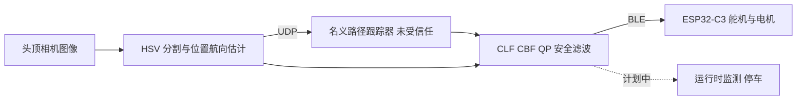

# LACART：前视点 CBF 避障与参考跟踪（arXiv:2611.09640）

**LACART**（*Lookahead-Augmented Collision Avoidance and Reference Tracking Strategies for Safety-Critical Robots*，[arXiv:2611.09640](https://arxiv.org/abs/2611.09640)，Lopes、Shivam、Paiva，INESC TEC 与波尔图大学 FEUP / ISR-Porto，cs.RO，2026-11-06）是一篇约 4 页的短文：作者自述它综合了一篇会议论文与一篇硕士论文（UP2Speed）。原文通读记录见 [来源归档](../../sources/papers/lacart_arxiv_2611_09640.md)。

## 一句话定义

**在名义路径跟踪器输出之后，加一层以「轴前方前视点」为参考的控制屏障函数（CBF）加松弛控制李雅普诺夫函数（CLF）的二次规划（QP），把圆形障碍、赛道边界和参考跟踪放进同一个小优化层，修正单轮车的速度与角速度指令。**（§II，式 1–3）

## 英文缩写速查

| 缩写 | 英文全称 | 简要说明 |
|------|----------|----------|
| LACART | Lookahead-Augmented Collision Avoidance and Reference Tracking | 本文方法名 |
| CBF | Control Barrier Function | 用 h(x)≥0 描述安全集，约束 ḣ+αh≥0 保持前向不变 |
| CLF | Control Lyapunov Function | 描述跟踪误差 V 的下降要求，本文放松为 V̇≤−εV+δ |
| QP | Quadratic Programming | 目标二次、约束线性的优化，每步在线求解 |
| UDP | User Datagram Protocol | 状态估计到外部控制器的传输方式（§IV） |
| BLE | Bluetooth Low Energy | 指令到小车的无线链路（§IV） |
| HSV | Hue-Saturation-Value | 相机图像的颜色空间，用于分割车上标记点（§IV） |
| ESP32-C3 | 乐鑫微控制器型号 | 小车端控制器（§IV） |

## 为什么重要

- 机器人实际落地时，学习或规划产生的名义指令往往要经过一层可在线求解的安全过滤；LACART 是这一类「CBF-QP 安全滤波」在轮式小车、赛道场景的一个具体实例，参见 [CBF](../concepts/control-barrier-function.md) 与 [安全滤波](../concepts/safety-filter.md)。
- 前视点让角速度 ω 能进入障碍约束（ṗ_l = v·t + l·ω·n，§II），使屏障对转向敏感；若只用轴心距离，ω 不出现在约束里。
- 论文难得地把硬件延迟、几何余量与执行器限制写成可检查的条件（§V），可以作为「CBF 保证成立的前提」的案例读物。
- 小站（具身智能小站 2026-11-10）把它概括为「在路径跟踪外加一层轻量避障过滤」，与论文自述的定位基本一致，核对见下文「与小站说法的核对」。

## 核心原理

### 方法栈

| 组件 | 内容（出处） |
|------|--------------|
| 状态与输入 | 轴位置 p=(x,y)、航向 θ、输入 u=(v,ω)；单轮车运动学（§II） |
| 前视点 | p_l = p + l·t，ṗ_l = v·t + l·ω·n（式 1） |
| 障碍屏障 | h_i = ‖p_l−o_i‖² − r_s,i²，r_s,i = r_obs,i + r_rob + d_min；约束 2 d_iᵀ(v t + l ω n) ≥ −α h_i，对 (v,ω) 仿射（式 2） |
| 赛道边界 | 附近折线段的最近点，障碍半径取 0；活动线段随运动更新（§II） |
| QP | min ½(u−u_nom)ᵀW(u−u_nom) + p_s δ²，约束为式 2、V̇≤−εV+δ、u∈U、δ≥0（式 3） |
| 调参旋钮 | 前视距离 l、屏障速率 α、跟踪速率 ε、松弛权重 p_s，用于平衡早干预与平滑恢复（§II） |

### 流程总览

图结构对应论文图 3；运行时监测在论文中标为 planned，尚未实现。

### 安全条件（§V，式 4）

圆盘模型下，由三角不等式，前视点净空 ‖p_l−o‖ ≥ r_obs+r_rob+d_min 蕴含车身净空 ‖p−o‖ ≥ r_obs+r_rob+d_min−l，所以 d_min ≥ l 是车身净空的**充分**几何条件；前视位置误差有界为 η 时需 d_min ≥ l+η。状态延迟 τ 至多使前视点多位移 τ·√(v_max²+l²ω_max²)。这是作者的条件推导，论文没有把它当作定理做形式化证明。

## 实验与结果（论文自述）

- **仿真对比（§III，图 1–2）：** 对象是 Huang 等 [9] 的「supplied implementation」（同样用偏置点使约束依赖 v 与 ω）。整圈路径「相近」；中位每步总耗时 0.31 ms 对 0.33 ms（−6.1%），QP 求解 0.023 ms 对 0.025 ms（−8.0%）；绝对节省约 20 µs 与 2 µs。
- **硬件（§IV，表 I）：** 1:43 比例车 + 头顶相机；控制周期 40 ms（25 Hz）；图像处理 27.39 ms、UDP 状态获取 28.29 ms、QP 7.49 ms、BLE 4.34 ms、图像采集 6.76 ms；平均状态估计延迟 62.44 ms；QP 均值约占周期 19%。各阶段均值之和超过周期，论文说明不是串行时间分配。硬件数据转引自硕士论文 [2]。
- **定性结果（图 4）：** 能跟随参考、避开静态障碍并回到路径；论文同时报告难放置障碍下的偶发赛道边界碰撞与多边界同时激活时的停车。

## 工程实践

- **前视距离与余量联动：** 选 d_min 时至少要覆盖 l（再加位置误差 η），否则前视点安全不保证车身安全（§V）。
- **延迟预算：** 1 m/s 下 62.44 ms 的平均延迟仅平移分量就是 6.24 cm（§V）；该均值不是最坏界，需要时应按最坏延迟留余量。
- **感知链路是主要耗时：** QP 约 7.49 ms，而图像处理加状态获取各约 27–28 ms（表 I），优化层本身不是瓶颈（据表 I 数字的推测性读法：压缩感知与通信延迟收益大于继续压缩 QP 时间）。
- **监测与停车：** 论文建议监测过期或与运动极限不符的状态更新并请求停车（§V–§VI，计划项），可对照 [机器人安全状态机](../concepts/robot-safety-state-machine.md) 与 [状态估计](../concepts/state-estimation.md)。
- **代码：** 仓库 README（静态读）自述 Python/NumPy/Shapely，目录含 Pack1–Pack7、Real1–Real3、XIAO_ESP32C3_BT 等；README 的克隆命令指向 `ControllerRC` 而非本仓库名，且列出「动态障碍、多智能体、强化学习集成」等论文未声称的特性，其与论文实验的对应关系未核实，也未运行。

## 局限

**论文自己承认的：**
- CBF 滤波可能产生不希望的平衡点 [7][8]，避障成功不等于无死锁；正对正的几何下 ω 的瞬时影响消失，前视点不能消除所有死锁（§I、§V）。
- 安全结论依赖可行的执行器能力、足够准确且及时的状态估计、屏障问题可行；实车不能原地转向，最大偏航率随速度下降；安全停车需要容纳实测停车距离的净空（§V）。
- 硬件上有难放置障碍下的偶发边界碰撞，归因于转向极限与延迟（§IV）。
- 运行时监测与受控延迟实验仅是计划（§V、§VI）。

**作者之外的观察（我的判断）：**
- 性能差异很小：20 µs 与 2 µs 的绝对节省来自图 2 取整后的中位数，论文没有给出重复次数、置信区间或显著性检验；比较对象是对方「提供的实现」，运行环境与编码语言论文未说明；因此「更快」更接近「同量级」，不宜当作方法优势。
- 轨迹「相近」没有跟踪误差、最小间距或安全违反率等定量指标；硬件部分也没有碰撞次数、成功率或最小净空数字。
- 只处理静态圆形障碍与折线边界；动态障碍、多车相对运动属于硕士论文中未归入本文比较的内容（§III）。
- 硬件与 CBF 前提的错位：模型是单轮车运动学，实车有转向角与延迟约束；论文用 d_min 与 η 余量处理，但未给出实验中的 d_min 取值与 η 实测。
- 本文本体是一篇简短的综合 / 演示说明，主要结果引用自 [1]、[2]，我没有读这两份原始材料。

## 与小站说法的核对

小站原条目（具身智能小站 2026-11-10）：「用前视点控制屏障函数与二次规划修正车辆指令，将障碍、赛道边界和路径跟踪放进同一层。仿真计算开销较小，但车身安全仍依赖几何、感知及执行条件。」

- 前两句与 §II、摘要一致（论文还含松弛 CLF 做跟踪）。
- 「计算开销较小」成立，但只相对 [9] 且差距很小（0.31 对 0.33 ms；QP 0.023 对 0.025 ms，图 2 取整中位数）。
- 「安全依赖几何、感知、执行条件」与 §V 一致，是论文自述。
- 机构以论文首页为准：INESC TEC 与波尔图大学 FEUP / ISR-Porto。

## 与其他工作对比

| 对照 | 差异读法 |
|------|----------|
| Huang 等 [9]（IECON 2023，时变 CBF + CLF-QP，后轴偏置点） | 论文仿真中的直接对比对象；作者称差异在于赛道跟随集成、边界处理与实验平台，并强调不意味着 [9] 缺少转向控制（§III） |
| [路线引导的 CBF-QP 修复](./paper-route-guided-cbf-qp-repair.md) | 同属 CBF-QP 滤波思路，场景与对象不同，具体差异以各自原文为准 |
| [Barrier-State 安全导航](./paper-barrier-state-safe-navigation.md) | 同为安全导航的屏障类方法，本页未逐项比对 |
| [MPC](../methods/model-predictive-control.md) | 论文用单步 QP 而非预测时域优化；代码 README 的「Future Work」提到 MPC-CBF 混合，论文本身未涉及 |

## 关联页面

- [控制屏障函数（CBF）](../concepts/control-barrier-function.md)
- [安全滤波](../concepts/safety-filter.md)
- [状态估计](../concepts/state-estimation.md)
- [机器人安全状态机](../concepts/robot-safety-state-machine.md)
- [Sim2Real](../concepts/sim2real.md)
- [安全强化学习](../methods/safe-rl.md)
- [模型预测控制](../methods/model-predictive-control.md)
- [路线引导的 CBF-QP 修复](./paper-route-guided-cbf-qp-repair.md)
- [Barrier-State 安全导航](./paper-barrier-state-safe-navigation.md)

## 参考来源

- [lacart_arxiv_2611_09640.md](../../sources/papers/lacart_arxiv_2611_09640.md)
- [arXiv:2611.09640](https://arxiv.org/abs/2611.09640)
- 代码：<https://github.com/Kanestrene/autonomous-racing-cbf>（仅静态读 README）

## 推荐继续阅读

- [控制屏障函数（CBF）](../concepts/control-barrier-function.md)
- [安全滤波](../concepts/safety-filter.md)
- [arXiv PDF](https://arxiv.org/pdf/2611.09640v1)
- 论文引用：Ames 等 2017（CBF-QP，IEEE TAC 62(8)）、Reis 等 2021 与 Tan & Dimarogonas 2024（CBF-QP 的不希望平衡点）
