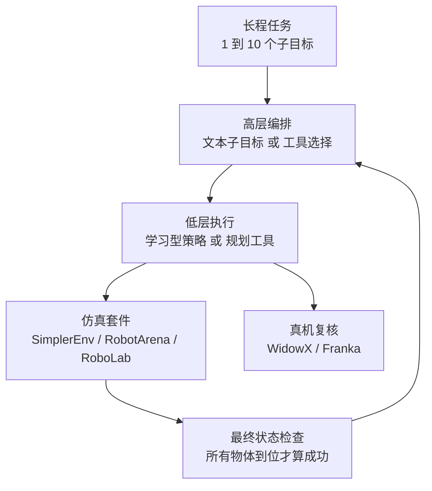

# LADDER：把「任务长度」单独拎出来的长程操作基准

**LADDER 在同一环境里让任务的子目标数从 1 逐级增到 10，把"horizon"作为唯一变量，用来比较学习型低层策略与高层编排（文本子目标、工具选择）到底是规划还是执行在拖后腿。**

论文 *LADDER*（[arXiv:2610.18053](https://arxiv.org/abs/2610.18053)，[项目页](https://ladder.insait.ai/)，[代码](https://github.com/insait-institute/ladder)）。

## 英文缩写速查

| 缩写 | 英文全称 | 简要说明 |
|------|----------|----------|
| VLM | Vision-Language Model | 充当高层编排器，分解指令并判断子目标是否完成 |
| PSP-Agent | （全称未核实） | 作者提出的工具选择编排 agent，论文对照系统之一 |
| LADDER-Lite | LADDER 精简子集 | 10 任务子集，用于比较更多闭源模型 |

## 为什么重要

- 现有基准没有把 horizon 隔离成变量；同一环境里逐步加物体后，能直接读出「成功率随长度掉多快」。
- 低层策略 1 个子目标 85.4%、5 个子目标 0.0%，说明长程失败是组合性的，不是单步能力不够。
- 把 VLM 规划与执行拆开评估，对做分层系统（见 [分层 RL](../methods/hierarchical-reinforcement-learning.md)）的人给出可操作的瓶颈定位。

## 核心信息

| 项 | 内容 |
|----|------|
| **机构** | INSAIT（Institute for Computer Science, Artificial Intelligence and Technology）；NVIDIA（Jonathan Tremblay），项目页署名 |
| **平台** | 三个仿真套件 SimplerEnv-Long、RobotArena-∞-Long、RoboLab-Long；WidowX 与 Franka；真机为 Franka 与 WidowX |
| **规模** | 145 任务、八类、1–10 子目标、每系统 2,024 个仿真 episode；LADDER-Lite 为 10 任务子集 |
| **开源** | **宣称已开放但仓库内容未核实**（2026-10-17）：项目页列出 GitHub、Hugging Face 集合与排行榜指南；WebFetch 访问 GitHub 仓库返回 404，HF 集合未打开核验 |

## 核心原理

### 流程总览

- **任务类别：** single destination、transfer、split destination、relay、revisit、exclusion、ordered、duplicates。
- **系统分两族：** 学习型（低层策略 + 周期 / 本体 / 特权触发或本体验证器）和工具选择型（CaP-X、TiPToP、PSP-Agent、GPT-Policy）。
- **步数预算：** WidowX 套件每子目标 100 步（5 Hz）；RoboLab-Long 900 至 4,950 步。

## 源码运行时序图

**不适用**：项目页列出的 GitHub 仓库在 2026-10-17 核查时返回 404，无法确认可运行入口，不对其目录结构做推断。

## 与其他工作对比

| 维度 | LADDER（本文） | [SimplerEnv](./paper-simplerenv-real2sim-eval.md) | [RoboLab](./robolab.md) | [BATON](./paper-baton-long-horizon-manipulation.md) |
|------|------|------|------|------|
| 定位 | 长程基准：同一环境内子目标数 1–10 作唯一变量 | real-to-sim 评测，验证仿真与真机分数相关 | Isaac Lab 高保真评测，RoboLab-120 任务库 | 长程方法：冻结 VLA + LLM 规划 + transition-aware 记忆 |
| 任务长度 | 1–10 子目标，145 任务 | 本库页未强调长程 | 平均 2.02 子任务 / 任务 | RoboMemArena 长程记忆任务 |
| 本体 | WidowX、Franka | Google Robot、Bridge WidowX | 默认 DROID 形态单臂 Franka | 本库页未列 |
| sim–real 证据 | 两种本体上仿真与真机系统排序一致（系统数少） | 约 1500 episode paired eval，Pearson 强相关 | 与 RoboArena 真机排名 Spearman ρ=0.94 | 不适用（方法论文） |

- **相对 SimplerEnv / RoboLab：** LADDER 的 SimplerEnv-Long、RoboLab-Long 套件从命名看对应这两个评测环境的长程版本；后两者主要回答「仿真能否代理真机排序」，LADDER 回答「horizon 增长时成功率掉多快、瓶颈在规划还是执行」。
- **相对 BATON：** BATON 是靠编排与记忆提升长程成功率的方法；LADDER 的结果（低层 85.4% → 0%，编排后最高约 62%）提示这类编排方法的上限受低层执行制约，可作其评测场。
- 各基准的任务集、本体与成功判定不同，数字不可横比。

## 工程实践

| 项 | 建议 |
|----|------|
| 先看什么 | 用低层策略单独跑一遍，看 1 / 2 / 5 子目标的掉点曲线，再加编排对比 |
| 验证器 | 无验证时 32.6%–43.4% 的子目标因编排器提前推进失败，加验证后降到 3.4% |
| 成本 | 项目页报告 GPT-6 Astra 每完成任务约 6.49 美元，PSP-Agent（Gemini 3.7 Flash）约 0.33 美元 |
| 提交 | 项目页列出排行榜提交指南（`leaderboard/README.md`），内容未核实 |
| 开源状态 | GitHub 实测 404；入库日期 2026-10-17，后续复查 |

## 实验与评测

- **按 horizon（低层策略）：** 1 子目标 85.4%，2 子目标 26.9%，5 子目标 0.0%，8–10 子目标 0.5%。
- **总体（arXiv HTML）：** 低层策略 11.0%；最佳学习型（特权验证器）29.6%；CaP-X 25.0%；TiPToP 9.4%；PSP-Agent 40.1%；GPT-Policy 62.0%。项目页给出最佳模型 63.3%、8–10 物体 34.8%，与 HTML 数字略有出入，口径差异未核实。
- **规划 vs 执行：** 离线 VLM 指令分解最高 93.1%，场景状态跟踪最高 70.8%；剩余瓶颈主要是低层未能操作到目标物体，TiPToP 在 50.9% 子目标上无规划。
- **真机：** 低层策略多子目标 WidowX 1.2%、Franka 5.6%；Franka 5 子目标 0.0 / 8.3 / 25.0%（低层 / 本体验证器 / PSP-Agent）；仿真与真机系统排序一致。

## 结论

**LADDER 表明长程失败主要由低层执行的逐步衰减造成，高层编排能挽回一部分但远不够。**

1. **看 horizon 曲线** — 低层策略 85.4% 到 0.0%，单子目标指标会严重高估长任务能力。
2. **验证比换更强规划器更便宜** — 提前推进导致的子目标失败从至多 43.4% 降到 3.4%。
3. **瓶颈在执行** — 即便编排后总体仍仅 29.6%（学习型最佳），失败集中在接近目标物体。
4. **工具选择型更强但更贵** — GPT-Policy 62.0% 对应约 6.49 美元 / 任务，成本与成功率需一起读。
5. **口径要对齐** — 项目页与 arXiv HTML 的总体数字略有差异，引用时注明来源。

## 局限与风险

- 评测用的闭源模型命名（GPT-6 Astra 等）取自项目页，版本不可独立核对。
- 基准为"移动物体到位置"类任务，不覆盖灵巧或接触密集长程任务（推测，论文页未直接声明）。
- 代码仓库实测 404，复现与排行榜提交路径未核实。
- 真机只有两种本体，系统排序一致性基于少量系统。

## 关联页面

- [仿真评测基础设施](../concepts/simulation-evaluation-infrastructure.md) — 基准构建背景
- [sim-vs-real 评测差距](../concepts/sim-vs-real-eval-gap.md) — 仿真与真机排序一致性
- [具身大模型评测基准选型闭环](../queries/embodied-eval-benchmark-selection-loop.md) — LADDER 属「策略任务成功率」层的长程基准，其 sim↔real 排序证据对应第四层校准
- [分层 RL](../methods/hierarchical-reinforcement-learning.md) — 编排与低层分工
- [VLA](../methods/vla.md) — 低层学习策略所属范式
- [BATON 长程操作](paper-baton-long-horizon-manipulation.md) — 另一条长程操作工作

## 参考来源

- [ladder_arxiv_2610_18053.md](../../sources/papers/ladder_arxiv_2610_18053.md) — 论文摘录与开源核查
- [ladder-project.md](../../sources/sites/ladder-project.md) — 项目页归档
- [ladder-insait.md](../../sources/repos/ladder-insait.md) — 仓库核查记录
- [arXiv:2610.18053](https://arxiv.org/abs/2610.18053) — 原文

## 推荐继续阅读

- [LADDER 项目页](https://ladder.insait.ai/)
- [arXiv HTML 全文](https://arxiv.org/html/2610.18053)
