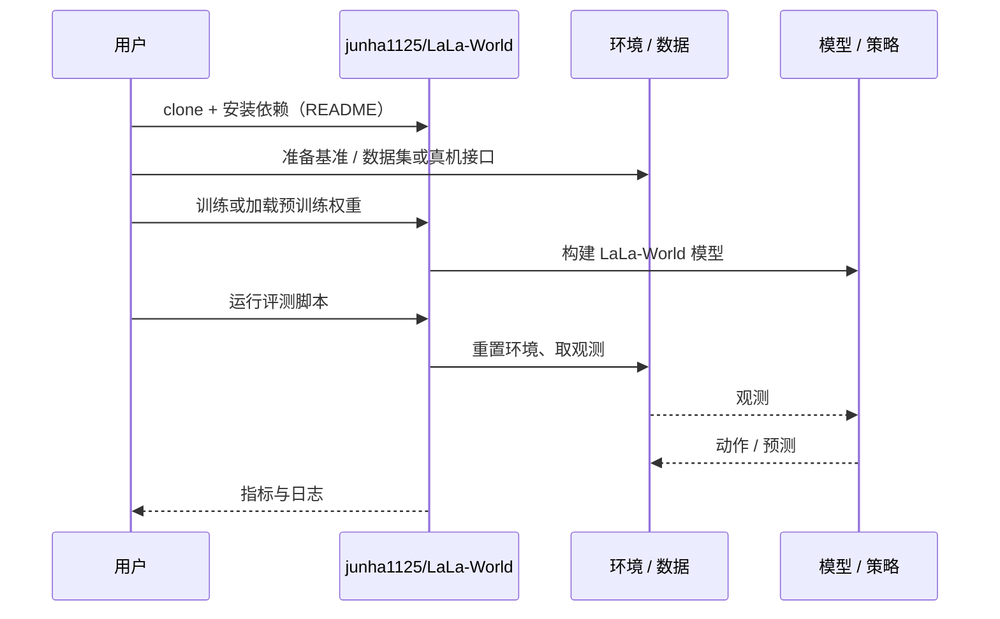

# LaLa-World（arXiv:2610.27851）

**LaLa-World**（*LaLa-World: Scaling Latent World Models with Natural Language Actions*，[arXiv:2610.27851](https://arxiv.org/abs/2610.27851)，[项目页](https://june-page.github.io/lala-world/)，[代码](https://github.com/junha1125/LaLa-World)）来自 [具身智能小站 2026-10-31 盘点](../../sources/blogs/wechat_embodied_station_50_papers_scenerig_photo_to_sim_2026-10-31.md)，属「世界模型与仿真重建」组。

## 一句话定义

**LaLa-World用语言统一数值动作与视觉变化，在潜空间预测未来并支持规划、策略微调；匹配实验显示效率优势，不能外推为所有控制场景的加速。**

## 英文缩写速查

| 缩写 | 英文全称 | 简要说明 |
|------|----------|----------|
| LaLa-World | LaLa-World: Scaling Latent World Models with Natural Language Actions | 本文方法 / 基准的简称 |

## 为什么重要

- 用语言连接不同世界模型的动作。
- 开源结论：**已开源**（步骤 2.5，2026-10-31）。仓库可达（git ls-remote）。项目页 HTTP 200。
- 同期同组工作见 [单图重建仿真、VLA 适配评测与跨形态世界模型：具身智能小站 10-31 期 50 篇阅读坐标](../overview/embodied-station-2026-10-31-50-papers-technology-map.md)。

## 核心机制

| 项 | 内容 |
|----|------|
| **arXiv** | [2610.27851](https://arxiv.org/abs/2610.27851) |
| **开源** | **已开源** |
| **要点** | LaLa-World用语言统一数值动作与视觉变化，在潜空间预测未来并支持规划、策略微调；匹配实验显示效率优势，不能外推为所有控制场景的加速。 |
| **文内指标** | 公众号未给具体数字，本页不引用。 |

## 源码运行时序图

以下为按仓库入口（`junha1125/LaLa-World`）推断的通用运行链路；入库日仅核实仓库可达，未逐文件阅读，具体脚本名以 README 为准。

## 实验与评测

- 公众号未给具体数字，本页不引用。
- **读法：** 本页为索引级摘要，依据公众号转述的官方摘要与仓库信息整理；逐项数字与 baseline 以原文 PDF 为准。

## 与其他工作对比

- 横向索引见 [单图重建仿真、VLA 适配评测与跨形态世界模型：具身智能小站 10-31 期 50 篇阅读坐标](../overview/embodied-station-2026-10-31-50-papers-technology-map.md)；同 arXiv 不重复造页。

## 结论

**用语言连接不同世界模型的动作：LaLa-World用语言统一数值动作与视觉变化，在潜空间预测未来并支持规划、策略微调；匹配实验显示效率优势，不能外推为所有控制场景的加速。**

1. 开源边界：**已开源** — 仓库可达（git ls-remote）。项目页 HTTP 200。
2. 核心机制：LaLa-World用语言统一数值动作与视觉变化，在潜空间预测未来并支持规划、策略微调；匹配实验显示效率优势，不能外推为所有控制场景的加速。
3. 复现与选型前核对任务协议、硬件与基准口径，勿直接横比公众号摘录数字。

## 关联页面

- [world-action-models](../concepts/world-action-models.md)
- [generative-world-models](../methods/generative-world-models.md)
- [simulation-evaluation-infrastructure](../concepts/simulation-evaluation-infrastructure.md)
- [embodied-station-2026-10-31-50-papers-technology-map](../overview/embodied-station-2026-10-31-50-papers-technology-map.md)

## 参考来源

- [lala_world_arxiv_2610_27851.md](../../sources/papers/lala_world_arxiv_2610_27851.md)
- [wechat_embodied_station_50_papers_scenerig_photo_to_sim_2026-10-31.md](../../sources/blogs/wechat_embodied_station_50_papers_scenerig_photo_to_sim_2026-10-31.md)
- [arXiv:2610.27851](https://arxiv.org/abs/2610.27851)

## 推荐继续阅读

- [arXiv PDF](https://arxiv.org/pdf/2610.27851)
- [项目页](https://june-page.github.io/lala-world/)
- [https://github.com/junha1125/LaLa-World](https://github.com/junha1125/LaLa-World)
