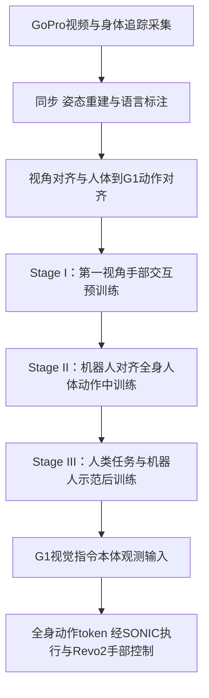
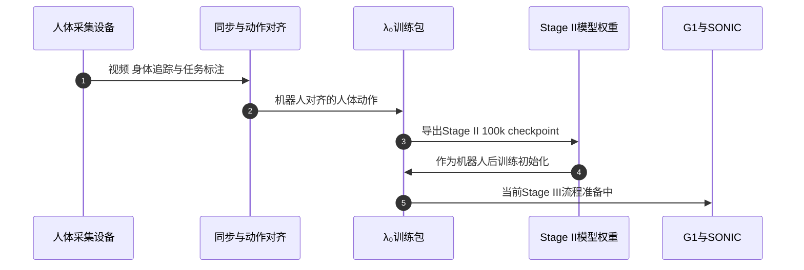

# λ₀：用开放世界人体经验训练人形移动操作策略

**λ₀**（*Scaling Open-World Egocentric Human Data for Humanoid Loco-Manipulation*，arXiv:2610.18950，2026-10-13）把大规模第一视角人体动作对齐到 Unitree G1 的全身控制接口，再与机器人数据共同训练人形移动操作模型。配套仓库名为 **OpenLambda**，覆盖人体数据采集、动作对齐、模型训练与部署工具。

## 英文缩写速查

| 缩写 | 英文全称 | 简要说明 |
|------|----------|----------|
| VLA | Vision-Language-Action | 以视觉和指令为条件生成机器人动作的模型 |
| WBC | Whole-Body Control | 协调人形腿、躯干、手臂与手部的控制 |
| G1 | Unitree G1 humanoid robot | 论文用于移动操作与真实评测的人形平台 |
| DoF | Degrees of Freedom | 机器人或手部动作接口的自由度单位 |
| EMA | Exponential Moving Average | Hugging Face 发布说明指出该中训练 checkpoint 不含 EMA 权重 |

## 为什么重要

人类可在日常场景中以较低成本产生多样的移动、弯腰、搬运和操作数据，而人形机器人遥操作示范的采集成本高。难点在于第一视角视频里的动作并不能直接变成机器人的全身控制命令：人和 G1 的摄像机视角、身体结构及控制器响应都不同。λ₀ 将大规模数据采集与机器人动作对齐、机器人后训练放入同一套流程，帮助判断“人体数据量增加”如何影响真实移动操作能力。

## 方法栈与流程总览

### 人体数据与动作对齐

HumanVerse-500 包含 500 小时、32,993 个 episode、约 8700 万姿态帧及 827 类任务，配对第一视角视频和同步的身体/手部动作。采集使用与机器人视角高度对齐的颈挂 GoPro、PICO 身体追踪和视频手部重建。此 500 小时指质量筛选和转成机器人动作之前的记录语料。

对齐过程处理视频与追踪器同步、语言任务标注、身体/手部运动重建、观测视角对齐及动作对齐。三阶段学习分别提供手物交互先验、机器人对齐的全身协调先验和机器人可执行动作的任务适配。λ₀ 使用 Qwen3.5-2B 视觉语言骨干与生成式动作专家；在 G1 上，身体动作通过 SONIC 执行，手部由 BrainCo Revo2 控制。

## 源码运行时序图

该图对应论文流程和仓库发布清单；当前可获取 Stage II checkpoint，不能据此认为 Stage III 训练及部署已完整发布。

## 实验与评测

| 指标 | 结果 | 阅读说明 |
|------|------|----------|
| HumanVerse-500 规模 | 500 小时、32,993 episodes、约 87M 姿态帧、827 类任务 | 指转换和有效性筛选前录制数据量 |
| SIMPLE 仿真 | 90.0% 成功率 | 论文采用按任务选择配置，需留意评测协议 |
| G1 真实任务 | 62.5% 完整成功、80.4% 平均任务进度 | 四项任务共 40 次试验；成功与部分进度是不同指标 |
| 移除 Stage II | 真实任务成功率从 62.5% 降至 22.5% | 全身人体中训练在此配方消融中影响较大 |

## 结论

**λ₀ 的重点不只是“更多人体视频”，而是把人体全身动作映射到机器人控制接口后，再用机器人示范完成具身适配。**

1. 将 500 小时数据量与约 87M 姿态帧、有效动作覆盖区分；原始采集时长不等于最终可训练的有效样本量。
2. Stage II 的消融影响最大，说明全身机器人对齐监督对移动操作尤其关键；单独堆叠手部交互数据不足以替代全身协调。
3. 62.5% 成功率和 80.4% 任务进度要结合 40 次、四项任务的规模阅读；SIMPLE 的 90% 使用任务级配置选择。
4. 当前可复现范围是公开代码和部分模型权重；数据集与完整真机后训练管线尚未完全开放。

## 与相关人体数据迁移路线对比

| 工作 | 人体数据角色 | 机器人适配重点 | 公开状态 |
|------|--------------|----------------|----------|
| **λ₀ / OpenLambda** | 规模化第一视角全身数据进入 Stage II；再以人类与机器人数据做 Stage III | 数据扩展、分阶段 VLA 训练和真实 G1 移动操作 | 代码与 Stage II checkpoint 可得；全量数据与 Stage III 流程未完全开放 |
| [EgoHumanoid-V2](./paper-egohumanoid-v2.md) | 逐任务人体示范作为策略监督 | 通过 H/K/D 离线对齐降低手足末端误差，再逐任务训练 π₀.₅ | 动作对齐代码有样例；视觉对齐、策略训练和部署部分待发布 |
| [WholeBodyVLA](./paper-hrl-stack-30-wholebodyvla.md) | 人体视频用于 latent action 学习及数据增强 | 统一 latent VLA 与分层控制器衔接全身移动操作 | 见对应论文实体的代码与评测范围 |

因此，λ₀ 的证据重点是**大规模、机器人对齐的人体全身数据如何影响后训练表现**；它与逐任务动作精炼路线互补，不应把不同任务集、策略架构和试验协议的成功率直接横向排序。

## 局限与风险

HumanVerse 全量训练数据未随仓库公开；项目页链接的样例数据在核查时返回 401 Unauthorized。公开 Hugging Face 权重是 100k 步 Stage II checkpoint，不含 EMA 权重和任务级 post-trained policy。官方 README 把完整 Stage III 流程标记为准备中，因此目前不能仅靠公开资产复现论文报告的完整 G1 训练及部署流程。

## 关联页面

- [Loco-Manipulation](../tasks/loco-manipulation.md)：协调移动与全身接触操作的任务定义
- [EgoHumanoid-V2](./paper-egohumanoid-v2.md)：人体到 G1 全身动作对齐的相关路线
- [NVIDIA SONIC](./nvidia-sonic.md)：λ₀ 使用的全身动作执行器
- [HWAM](./paper-hwam-humanoid-world-action-model.md)：人形世界-动作模型的相关方向

## 参考来源

- [λ₀ 论文摘录](../../sources/papers/lambda0_arxiv_2610_18950.md)
- [官方项目页核查](../../sources/sites/lambda-humanoid-project-page.md)
- [OpenLambda 源码核查](../../sources/repos/openlambda.md)

## 推荐继续阅读

- [λ₀ 论文全文](https://arxiv.org/html/2610.18950v1)
- [OpenLambda GitHub 仓库](https://github.com/LambdaHumanoid/openlambda)
- [λ₀ Stage II checkpoint 模型卡](https://huggingface.co/lambda-humanoid/lambda0-midtrain-100k)
