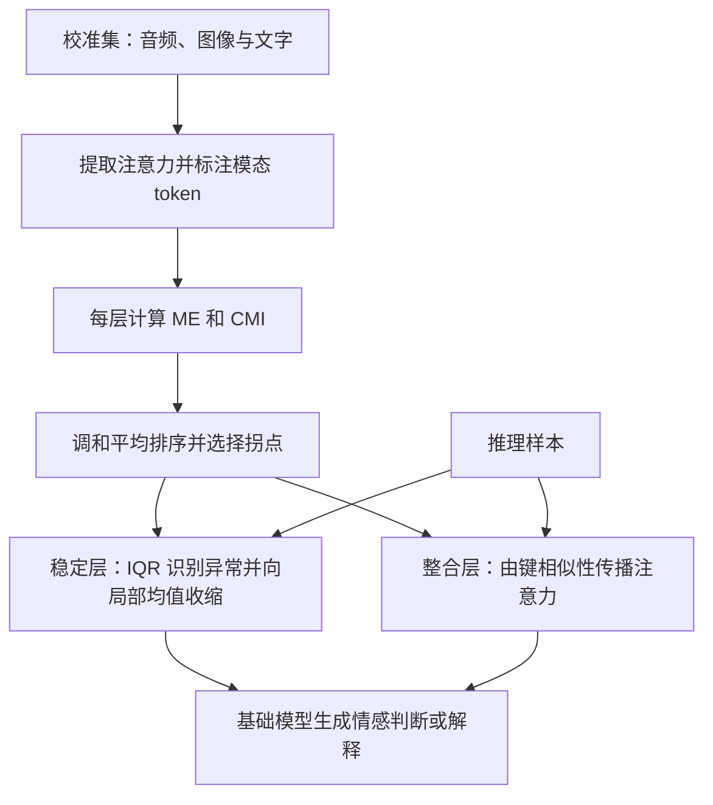
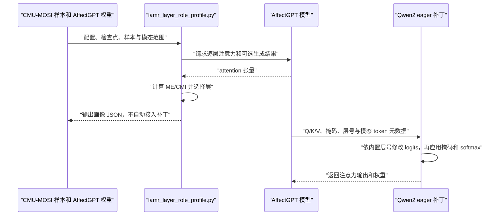

# LAMR：按层角色重新平衡多模态情感推理（Layer Roles Matter: Mitigating Modality Imbalance in Multimodal Emotion Reasoning via Adaptive Layer Profiling）

## 一句话定义

先用少量校准样本判断模型各层更擅长稳定单模态证据还是整合跨模态信息，再在推理时分别调节注意力，不重新训练模型。

## 英文缩写速查

| 缩写 | 英文全称 | 简要说明 |
|---|---|---|
| LAMR | Layer-Aware Modality Rebalancing | 按层角色进行模态再平衡 |
| MER | Multimodal Emotion Reasoning | 联合音频、视觉与语言线索推理情感 |
| ME | Modality Entropy | 目标模态间注意力分配的熵 |
| CMI | Cross-Modal Intensity | 跨模态 token 对的注意力强度 |
| IQR | Interquartile Range | 用四分位距识别注意力异常值 |
| CoT | Chain of Thought | MME-Emotion 的推理链评分维度 |

## 为什么重要

同样是模态不平衡，一种情况是模型只听语气而忽略文字，另一种情况是看见了多种线索却没有把冲突证据综合起来。共享 token 接口并不会自动解决这两类问题，对所有层使用相同注意力改动也可能让结果更差。

## 核心信息

| 字段 | 内容 |
|---|---|
| 机构 | 中国科学技术大学（University of Science and Technology of China） |
| 作者 | Pengyu Huang、Peipei Song、Beier Zhu、Zhiyuan Han、Jinpeng Hu、Xun Yang |
| 原文 | [arXiv:2611.11907v1](https://arxiv.org/abs/2611.11907v1)，2026-11-09；[ACM Multimedia 2026](https://doi.org/10.1145/3767308.3835292) |
| 输入与输出 | 视觉、音频和文本；输出分类或开放词表情感推理结果，依赖基础模型 |
| 公开实现 | AffectGPT 的 Qwen2 eager 注意力补丁和独立层画像脚本，不是所有论文骨干的完整评测套件 |

## 核心机制

1. **先校准，再分层。** 按视觉、音频、文字分组注意力。ME 测量注意力是否均衡分布，CMI 测量不同模态的 token 是否真的发生交互。两者取调和平均，用排序后曲线的拐点划分层组，因此整合层不必连续。论文校准使用 CMU-MOSI 和 CMU-MOSEI 样本。
2. **稳定层处理过强或过弱的值。** 用局部均值作锚点，以四分位距界定异常区间，把区间外的值向锚点软收缩，而不是把所有模态强制均分。
3. **整合层传播证据。** 从键向量相似性构造归一化矩阵，以部分保留原注意力、部分混合邻居注意力的方式传播证据。论文将其写为注意力矩阵的行混合；发布补丁运行在 softmax 前的 logits 上。

## 流程总览

## 实验结果

| 论文评测 | 基础模型 | 基线 → LAMR |
|---|---|---|
| MER-UniBench 九数据集均值（表 1） | PandaGPT | 53.97 → 55.68 |
| MER-UniBench 九数据集均值（表 1） | Emotion-LLaMA | 62.73 → 65.49 |
| MER-UniBench 九数据集均值（表 1） | AffectGPT | 71.33 → 73.01 |
| MME-Emotion 六任务平均 Rec / Rea / CoT（表 2） | AffectGPT | 15.0 / 58.5 / 36.8 → 16.9 / 62.5 / 39.7 |
| MELD、IEMOCAP、SIMS 三集均值（表 3–5） | AffectGPT | 64.69 → 66.13；交换两种干预则为 62.99 |

CA-MER 表 6 中，音频与视觉线索冲突或一致的三个分区均有提升；例如仅音频与标注一致分区的准确率和召回率平均值为 53.90 → 56.28。这只约束所测分区，不等于任意冲突或缺失模态下都可靠。

## 工程实践

以代码固定提交为准，画像脚本和推理补丁是两条分立路径。README 的 300 项 CMU-MOSI test 示例未传 `--use-kneedle`，按 CLI 默认取 top-13；补丁内置 11 层且不加载脚本输出。若要比较复现结果，应固定骨干、样本、模态 token 范围与层索引，并记录注意力后端，不能只写「采用 LAMR」。本次验证源文件语法以及原样层选择函数的 4 项 CPU 断言，未重跑音视频模型、注意力补丁或论文基准。

## 源码运行时序图

## 局限与风险

- 无额外训练不等于零校准成本，说明了方法可迁移的候选机制，不保证任意模型或场景得到同样改善。不同注意力后端也不一定执行 eager 补丁。
- MME-Emotion 的部分结论依赖多智能体 LLM 评分；数据集标签和多模态线索并非对个人内部情绪的直接测量。本研究没有验证真实机器人在环，也不宜用于高风险情绪判断。
- 未见完整多骨干推理入口或一键评测；公开 AffectGPT 补丁的干预位置、强度和层角色来源不应当成论文规范。

## 与相关工作对比

[统一多模态 Token](../methods/unified-multimodal-tokens.md)解决不同模态怎样共享序列接口，LAMR 研究 token 已经共享后信息是否得到平衡利用。与 [AIRIS](./paper-airis.md) 测量何时回应社交情境不同，LAMR 不输出具身动作，也未检验在线介入时机。

## 结论

对同一模型划分注意力层角色之后再做干预，比在论文消融中给所有层套用同一规则更有效；真正复现时要把论文算法和公开简化补丁分别验收。

1. 先固定骨干和模态 token 定位，再比较层选择与同规则干预的差别。
2. 分开记录层画像脚本和固定层号推理补丁的参数，不把两者的输出自动等同。
3. 在缺模态和线索冲突分组分别复测；基准得分不能作为真实场景识别个人情绪的凭据。

## 关联页面

- [统一多模态 Token](../methods/unified-multimodal-tokens.md)
- [AI 基准评测](../methods/ai-benchmark-evaluation.md)
- [跨模态注意力](../formalizations/cross-modal-attention.md)
- [AIRIS 社会具身智能评测](./paper-airis.md)

## 参考来源

- [论文全文核对](../../sources/papers/lamr_arxiv_2611_11907.md)
- [官方项目页](../../sources/sites/lamr.md)
- [作者仓库源码与复现范围](../../sources/repos/lamr.md)

## 推荐继续阅读

- [LAMR 论文 PDF](https://arxiv.org/pdf/2611.11907v1)
- [公开层画像及注意力补丁](https://github.com/PengyuHuang1/LAMR)
