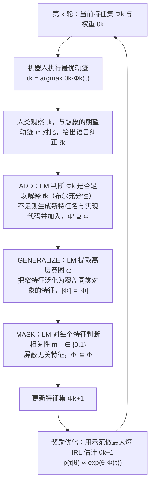

# Language-Guided Representation Editing（arXiv:2610.28893）

**Language-Guided Representation Editing**（*Flexible Language-Guided Representation Editing for Adaptive Robot Behavior*，[arXiv:2610.28893](https://arxiv.org/abs/2610.28893)，[项目页](https://mit-clear-lab.github.io/FLEX/)）来自 [具身智能小站 2026-10-29 盘点](../../sources/blogs/wechat_embodied_station_58_papers_diverse_demonstrations_2026-10-29.md)，属「VLA、智能体与策略后训练」组。

## 一句话定义

**FLEX用语言反馈添加缺失特征、泛化过窄特征并屏蔽无关项；二维导航、Franka操作及真实用户研究检验交互修正，目前主要面向准静态刚体任务。**

## 英文缩写速查

| 缩写 | 英文全称 | 简要说明 |
|------|----------|----------|
| Language-Guided Representation Editing | Flexible Language-Guided Representation Editing for Adaptive Robot Behavior | 本文方法 / 基准的简称 |

## 为什么重要

- 语言纠正不只加特征，也要泛化与屏蔽。
- 开源结论：**已开源**（步骤 2.5，2026-10-29）。公众号未给代码链接；项目页链接的 MIT-CLEAR-Lab/FLEX 经 git ls-remote 可达。
- 同期同组工作见 [多样成功示范、触觉工具链与预见式感知：具身智能小站 10-29 期 58 篇阅读坐标](../overview/embodied-station-2026-10-29-58-papers-technology-map.md)。

## 流程总览

图依据：论文 §3（式 1 至 6）、§4（ADD、GENERALIZE、MASK 与操作顺序）。回到“奖励优化”的闭环箭头依据 §3 对“特征规约与奖励优化两步迭代”的描述。

## 核心机制

| 项 | 内容 |
|----|------|
| **arXiv** | [2610.28893](https://arxiv.org/abs/2610.28893) |
| **开源** | **已开源** |
| **要点** | FLEX用语言反馈添加缺失特征、泛化过窄特征并屏蔽无关项；二维导航、Franka操作及真实用户研究检验交互修正，目前主要面向准静态刚体任务。 |
| **文内指标** | 公众号未给具体数字，本页不引用。 |

## 源码运行时序图

**不适用（已开源）** — 公众号未给代码链接；项目页链接的 MIT-CLEAR-Lab/FLEX 经 git ls-remote 可达。 不编造运行脚本；代码公开后再补。

## 实验与评测

- 公众号未给具体数字，本页不引用。
- **读法：** 本页为索引级摘要，依据公众号转述的官方摘要与仓库信息整理；逐项数字与 baseline 以原文 PDF 为准。

## 与其他工作对比

- 横向索引见 [多样成功示范、触觉工具链与预见式感知：具身智能小站 10-29 期 58 篇阅读坐标](../overview/embodied-station-2026-10-29-58-papers-technology-map.md)；同 arXiv 不重复造页。

## 结论

**语言纠正不只加特征，也要泛化与屏蔽：FLEX用语言反馈添加缺失特征、泛化过窄特征并屏蔽无关项；二维导航、Franka操作及真实用户研究检验交互修正，目前主要面向准静态刚体任务。**

1. 开源边界：**已开源** — 公众号未给代码链接；项目页链接的 MIT-CLEAR-Lab/FLEX 经 git ls-remote 可达。
2. 核心机制：FLEX用语言反馈添加缺失特征、泛化过窄特征并屏蔽无关项；二维导航、Franka操作及真实用户研究检验交互修正，目前主要面向准静态刚体任务。
3. 复现与选型前核对任务协议、硬件与基准口径，勿直接横比公众号摘录数字。

## 关联页面

- [vla](../methods/vla.md)
- [imitation-learning](../methods/imitation-learning.md)
- [reinforcement-learning](../methods/reinforcement-learning.md)
- [embodied-station-2026-10-29-58-papers-technology-map](../overview/embodied-station-2026-10-29-58-papers-technology-map.md)

## 参考来源

- [language_guided_representation_editing_arxiv_2610_28893.md](../../sources/papers/language_guided_representation_editing_arxiv_2610_28893.md)
- [wechat_embodied_station_58_papers_diverse_demonstrations_2026-10-29.md](../../sources/blogs/wechat_embodied_station_58_papers_diverse_demonstrations_2026-10-29.md)
- [arXiv:2610.28893](https://arxiv.org/abs/2610.28893)
- [arXiv PDF](https://arxiv.org/pdf/2610.28893)：已通读方法部分（实验与附录以略读为准）：§3 Problem Definition、§4 Flexible Feature Editing Pipeline、§5 Experiments 的设置部分（域、基线、指标；§5.1 至 §5.3 结果与附录略读）

## 推荐继续阅读

- [arXiv PDF](https://arxiv.org/pdf/2610.28893)
- [项目页](https://mit-clear-lab.github.io/FLEX/)
