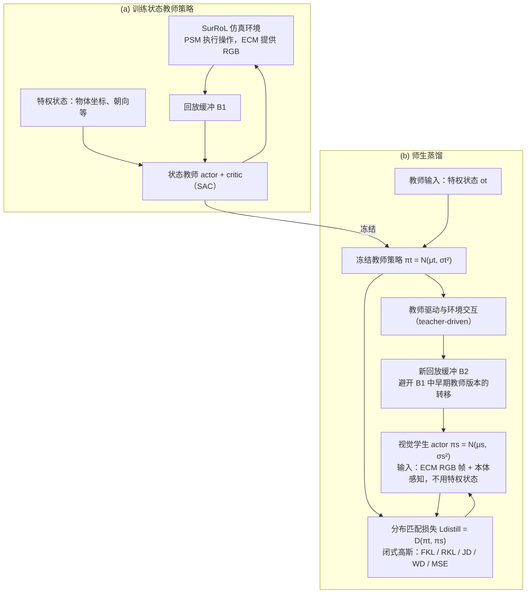

# Laparoscopic Distillation：重新研究腹腔镜机器人操作中从状态到视觉的策略蒸馏分布匹配

**Laparoscopic Distillation**（*Revisiting Distribution Matching for State-to-Vision Policy Distillation in Laparoscopic Robotic Manipulation*，[arXiv:2610.31010](https://arxiv.org/abs/2610.31010)）收录于 senlanke「具身运控lab」10-19–10-23 前沿论文动态（Manipulation）。本页依据**周报条目 + arXiv 摘要页**整理，流程图依据论文方法部分（见参考来源），未逐页核对实验数字；指标与结论以论文为准。

## 一句话定义

**Laparoscopic Distillation：重新研究腹腔镜机器人操作中从状态到视觉的策略蒸馏分布匹配——重新研究 State-to-Vision Policy Distillation 中的分布匹配问题，重点关注教师与学生之间的状态分布差异对蒸馏效果的影响。**

## 英文缩写速查

| 缩写 | 英文全称 | 简要说明 |
|------|----------|----------|
| VLA | Vision-Language-Action | 视觉–语言–动作模型 |
| IL | Imitation Learning | 模仿学习 |

## 为什么重要

- 周报所述待解决的问题：使用完整状态训练的教师策略能够获得更多环境信息，但视觉学生策略只能根据相机观测执行动作。两者的输入信息和闭环状态分布存在差异。

## 流程总览

图依据：论文 §III 开头 / Fig.1（a)(b) 与图注）、§III-B / §III-C。B2 的缘由来自 Fig.1 图注；a 图中 回放缓冲到 actor 的箭头为按 SAC 背景（§III-A）的推断。

## 核心机制

| 项 | 内容 |
|----|------|
| **arXiv** | [2610.31010](https://arxiv.org/abs/2610.31010) · [PDF](https://arxiv.org/pdf/2610.31010) |
| **作者（arXiv）** | Mingyu Sheng, Jianan Fan, Dongnan Liu, Guoyan Zheng, Ron Kikinis, Weidong Cai |
| **机构（周报所述，未逐条核实）** | 待核实（作者：Mingyu Sheng、Jianan Fan、Ron Kikinis、Weidong Cai 等）。 |
| **arXiv 评论栏** | 8 pages, 3 figures, 2 tables |
| **开源** | arXiv 摘要页与评论未见代码或项目页链接（仅核对 arXiv 摘要页，不代表未发布）（2026-10-26） |
| **周报所述创新点** | 重新研究 State-to-Vision Policy Distillation 中的分布匹配问题，重点关注教师与学生之间的状态分布差异对蒸馏效果的影响。 |

### arXiv 摘要节选（英文原文）

> End-to-end control policies trained via Reinforcement Learning (RL) have emerged as an alternative to conventional surgical robotic control approaches, with recent studies exploring state-based policies trained on privileged state observations. However, such approaches rely on precise physical states that are difficult to obtain reliably in surgical environments.

## 源码运行时序图

**不适用**：arXiv 摘要页与评论未见代码或项目页链接（仅核对 arXiv 摘要页，不代表未发布），无可对齐的官方代码流程。

## 实验与评测

- 周报与摘要给出的数字/场景已写入上表「创新点」与摘要节选；其余实验细节、基线与成功率定义请回到论文正文。
- 读法：先对齐任务设定、传感器与成功定义（仿真/真机），再解读 headline 数字，勿跨论文直接比较。

## 与其他工作对比

| 维度 | 读法 |
|------|------|
| **同周对照** | 见 [Manipulation周报技术地图](../overview/senlanke-weekly-2026-10-19-23-manipulation-technology-map.md)，按方向浏览同期论文 |
| **开源状态** | arXiv 摘要页与评论未见代码或项目页链接（仅核对 arXiv 摘要页，不代表未发布） |

## 结论

**Laparoscopic Distillation：重新研究腹腔镜机器人操作中从状态到视觉的策略蒸馏分布匹配。**

1. 本页是入库级摘要，复现前请核对论文正文、附录与代码仓库。
2. 指标须连同实验条件解读。
3. 关注 arXiv 版本更新与代码发布。

## 关联页面

- [senlanke-weekly-2026-10-19-23-manipulation-technology-map](../overview/senlanke-weekly-2026-10-19-23-manipulation-technology-map.md)
- [manipulation](../tasks/manipulation.md)
- [vla](../methods/vla.md)

## 参考来源

- [laparoscopic-state-to-vision-policy-distillation_arxiv_2610_31010.md](../../sources/papers/laparoscopic-state-to-vision-policy-distillation_arxiv_2610_31010.md)
- [wechat_senlanke_weekly_manipulation_2026-10-19_23.md](../../sources/blogs/wechat_senlanke_weekly_manipulation_2026-10-19_23.md)
- [arXiv:2610.31010](https://arxiv.org/abs/2610.31010)
- [arXiv PDF](https://arxiv.org/pdf/2610.31010)：已通读方法部分（实验与附录以略读为准）：§I 引言、§III Methods（§III-A 至 §III-F：SAC 背景、状态到视觉蒸馏、分布匹配目标、梯度与 Hessian 分析）、§IV 实验（仅略读表 II）

## 推荐继续阅读

- [arXiv PDF](https://arxiv.org/pdf/2610.31010)
