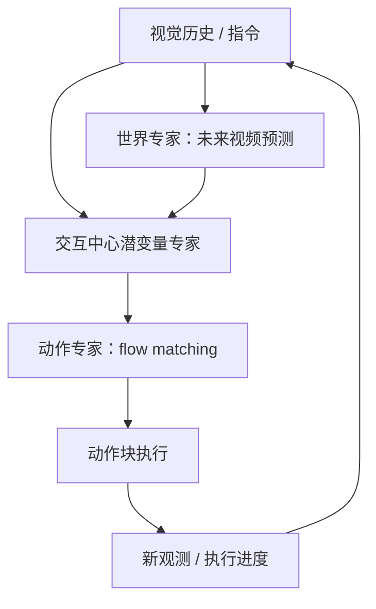

# LaST0.5： 以交互为中心的潜空间推理通才世界–动作模型

## 一句话定义

LaST0.5 是将视频未来生成、物体交互潜变量推理和连续机器人动作解码连接起来的 World Action Model。

## 英文缩写速查

| 缩写 | 英文全称 | 简要说明 |
|---|---|---|
| WAM | World Action Model | 联合建模未来动态与动作的模型 |
| VLA | Vision-Language-Action | 语言与视觉条件下的机器人动作策略 |
| MoT | Mixture of Transformers | 世界/潜变量/动作专家分块连接结构 |

## 为什么重要

把预测未来视频与可执行动作直接对齐，是减少仅像素预测难以产生控制指令这一鸿沟的尝试；实验兼顾 LIBERO、RLBench 和双臂真机。

## 核心原理

论文描述世界专家由 Cosmos-Predict2.5 视频模型初始化，对未来观测建模；交互中心潜变量专家把目标对象的可供性及末端交互运动编码为中间表征；动作专家通过 flow matching 解码动作块。三者以分块注意力连接而不是简单先生成完整视频再做逆动力学。作者还引入面向进度的未来动作触发/重规划机制。

## 流程总览

> **注意：** 此图仅抽象论文所述方法模块与数据/控制流，非未公开代码的实际调用路径。

## 实验与评测

作者自报超过 1.4 万小时机器人数据预训练；LIBERO 平均成功率 99.5%；RLBench 所列任务平均 88.0%；四项双臂真机任务平均 63.8%。这些指标跨不同任务集、评测协议，不宜横向直接比较。

## 结论

**这项工作最值得关注的是在世界模型与控制动作之间加入交互中心的可学习接口，而非仅扩大视频生成器规模。**

1. 区分世界专家的视频预测、交互潜变量和动作专家的监督来源。
2. 将 99.5% 明确标为 LIBERO 内部评测，不当作跨本体通用成功率。
3. 检查进度触发相对固定时间窗口的重规划收益。
4. 官方完整复现代码仍待确认。

## 与其他工作对比

[MetaWAM](paper-metawam.md) 以频域元帧建立视频–动作统一输入，而 LaST0.5 通过交互中心潜变量连接世界与动作专家。

## 源码运行时序图

未在论文公开入口确认可运行官方仓库，无法核实源码调用栈，因此不绘制未经证实的时序图。

## 工程实践

复现首先需分别校验视觉帧、语言指令与动作块的时间对齐，再检查潜变量是否真正携带机器人与物体交互信息；进度触发逻辑应和固定频率重规划做消融对照。官方公开全文未核实到可运行代码仓。

## 局限与风险

任务集、策略推理时延、真实接触误差和跨机器人迁移边界应单独评测；缺少完整可运行公开入口，尚不能独立验证训练数字。

## 关联页面

- [World Action Models](../concepts/world-action-models.md)
- [MetaWAM](paper-metawam.md)
- [Elastic-WAM](paper-elastic-wam.md)
- [VLA](../methods/vla.md)

## 参考来源

- [arXiv:2611.14048 归档](../../sources/papers/last05_arxiv_2611_14048.md)

## 推荐继续阅读

- [论文原文](https://arxiv.org/abs/2611.14048)

> **复核状态（2026-11-12）：** 论文关键方法与结果已核对，但全文与全部附录尚未逐项通读，故本节点保持 draft；不得将自报数值视为独立复现。
