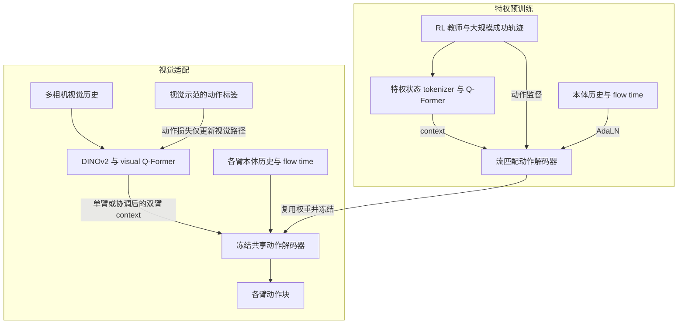

# Latent RL Priors：面向数据高效灵巧操作的潜在强化学习先验

## 一句话定义

Latent RL Prior 把大量特权 RL 控制经验蒸馏成动作解码器，再冻结它、学习图像到潜在条件的接口，以较少视觉示范适配灵巧操作。

## 英文缩写速查

| 缩写 | 英文全称 | 简要说明 |
|---|---|---|
| RL | Reinforcement Learning | 强化学习，提供仿真控制先验 |
| VLA | Vision-Language-Action | 本文对照的通用视觉语言动作模型 |
| FM | Flow Matching | 用于动作块生成的流匹配目标 |
| AdaLN | Adaptive Layer Normalization | 注入本体感觉与 flow time |
| RMSE | Root Mean Squared Error | 接触力线性探针误差 |

## 为什么重要

视觉模仿要同时学习感知与精细控制；本文拆分这两部分，让仿真 RL 负责控制能力、少量视觉示范负责访问控制先验。这为[教师学生训练](../methods/teacher-student-dagger-training.md)提供动作监督的潜在接口方案，而不是要求视觉学生回归特权状态或教师 latent。

## 核心信息

| 项目 | 内容 |
|---|---|
| 机构 | 加利福尼亚大学伯克利分校、亚马逊 |
| 原文版本 | arXiv:2611.08458v1，2026-11-05，全文 §1–6 已通读；该版无附录 |
| 平台 | MuJoCo Warp；KUKA iiwa + SHARPA 灵巧手 |
| 教师数据 | 程序化物体位姿对齐，100000 条成功轨迹 |
| 开放状态 | 截至 2026-11-07，项目页代码与数据均为 planned release，未列下载地址 |

## 核心原理

- **特权预训练：** 从 SimToolReal checkpoint 微调教师，对物体形状、尺寸、密度随机化；将轨迹蒸馏成 flow-matching transformer 动作解码器。状态 tokenizer + Q-Former 产生 task context，动作 token cross-attend context；本体历史和 flow time 通过 AdaLN 单独注入。
- **视觉适配：** DINOv2-Small + visual Q-Former 直接生成 context，替换状态 tokenizer / state Q-Former，保留冻结动作解码器。只用图像—本体—动作示范的动作损失，不需要特权标签、潜在目标或与教师轨迹配对。
- **接口对照：** explicit transfer 先从视觉预测“特权形状”的中间量，再送入冻结状态编码器。即便两者都只有动作监督，direct latent interface 表现与稳定性更好，不能把结果解释成精确物体状态估计的收益。
- **双臂扩展：** 左右查询组在同一 visual Q-Former 中通过自注意力协调；每臂 context 和本体历史分别调用同一个冻结单臂 decoder。协调来自视觉上下文，不是重新训练一个双臂动作模型。

## 项目流程图

## 实验与评测

| 项目 | 证据与条件 |
|---|---|
| 视觉示范 | 位姿对齐 4000、抬门 500、双臂装配 5000 episodes；均由各任务 SAPG 仿真策略采集 |
| 抬门 | 50 示范超过使用 500 示范全参数微调的 π0.5 与 GR00T N1.7，即下游示范少 10 倍 |
| 双臂装配 | 1000 示范超过使用 5000 示范的两种 VLA 基线，即少 5 倍 |
| 精度 | 位姿对齐四关键点最大误差 ≤1.5 cm（严格）或 5 cm（宽松）；10 个 policy steps 达标，不必连续 |
| 质量变化 | 5 kg 抬门成功率 32.6%，π0.5 为 12.9%；示范预算分别 50 与 500 |
| 接触力分析 | 各层 ridge 线性探针 RMSE 较低；200 示范可匹配或超过 scratch 的 4000 示范，属表征证据 |

本方法训练 100k steps，VLA 基线 30k；每 5k 存 checkpoint，最后五个各评测 256 rollout，每 run 报告其中最佳值，通常三训练种子均值±标准差。不能当作等计算预算或单个最终 checkpoint 对比。项目页视频明确是示范轨迹回放，不是适配策略的闭环评测视频。

## 结论

冻结 RL 动作先验、适配视觉潜在接口，在本文三个仿真任务中提高下游视觉示范效率。

- 先判断是否已有足够强、覆盖目标接触行为的特权教师，再评估视觉示范预算。
- 动作监督可训练 latent interface，无需假定视觉示范带特权状态或配对教师 latent。
- 小数据下优先测试冻结 decoder、保守更新图像编码器的方案。
- 双臂共享单臂先验有仿真证据，跨形态与真机迁移仍需单独验证。

## 与其他工作对比

| 项目 | 定位区别 |
|---|---|
| [教师学生训练](../methods/teacher-student-dagger-training.md) | 常见做法让视觉学生回归特权状态或教师 latent；本文只用动作监督训练视觉潜在接口，冻结教师蒸馏出的动作解码器 |
| [π0.5](./paper-pi05-open-world-vla.md) | 通用 VLA，本文作全参数微调基线；抬门任务中本文 50 示范超过 π0.5 的 500 示范（仿真、非等计算预算） |
| [VLA-Tug](./paper-vla-tug.md) | 同样利用潜在表征，但用于失败前监测告警；本文把潜在空间用作可复用的动作先验 |

## 源码运行时序图

不适用：截至 2026-11-07 官方项目页的训练/评测代码和数据均标 planned release，没有可核实的运行实现；上图只表达论文算法流程，不冒充源码调用关系。

## 工程实践

- 可复现设计需要预训练数据 `(特权历史, 本体历史, 动作块)` 和下游 `(图像历史, 本体历史, 动作块)`，两组无需配对；适配阶段冻结解码器但梯度经它传回视觉条件。
- 评估 direct latent 与 explicit interface 时保持动作先验一致，另设同架构 scratch，避免把 DINOv2 适配收益混入先验贡献。
- 双臂分别归一化和输入对应本体状态，在视觉查询组中学习协调；本文未证明其他臂手组合可直接复用。
- 代码、数据与权重未给出可下载实现，暂不能提供已验证的安装命令或训练入口；[项目页归档](../../sources/sites/latent-rl-priors.md)记录开放状态。

## 局限与风险

- 示范效率指下游视觉数据；教师训练和 100000 条成功仿真轨迹仍有成本。
- 全部实验在仿真中，视觉示范也由仿真策略生成；没有真机 Sim2Real 验证。
- 全部使用相同 arm–hand 系统；双臂复用不能推断跨机器人形态通用。
- 冻结先验可能继承教师失误，难以覆盖新控制行为。
- 质量鲁棒性与接触力可解码性符合保留控制知识的解释，但未隔离其对示范效率的因果机制；接触力是分析标签，不是部署输入。

## 关联页面

- [教师学生训练](../methods/teacher-student-dagger-training.md)：比较 latent / action / privileged supervision 的边界。
- [双臂操作](../tasks/bimanual-manipulation.md)：共享动作先验与跨臂协调的分工。
- [VLA-Tug](paper-vla-tug.md)：利用潜在表征作监测，与本文的动作先验用途不同。

## 参考来源

- [论文全文归档](../../sources/papers/latent-rl-priors.md)
- [官方项目页与开放状态](../../sources/sites/latent-rl-priors.md)

## 推荐继续阅读

- [论文 v1 全文](https://arxiv.org/html/2611.08458v1)
- [官方项目页](https://yixiaowang7.github.io/latent-rl-prior-page/)
